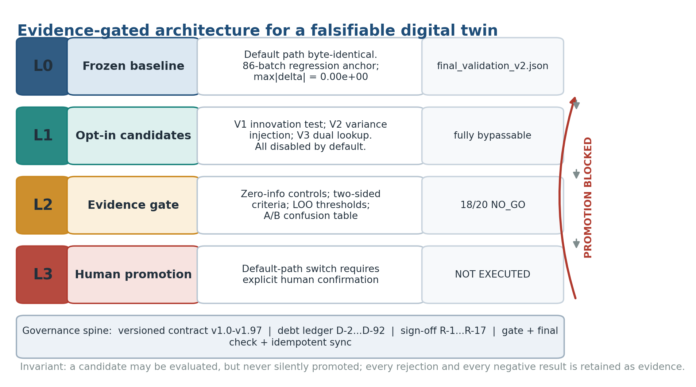
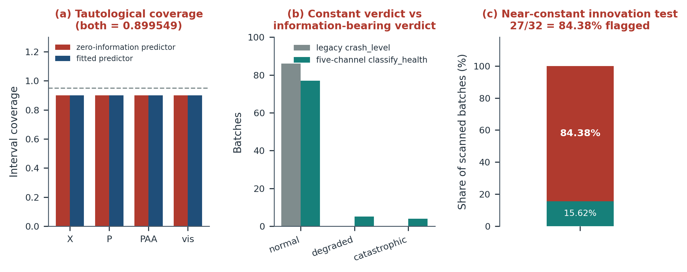
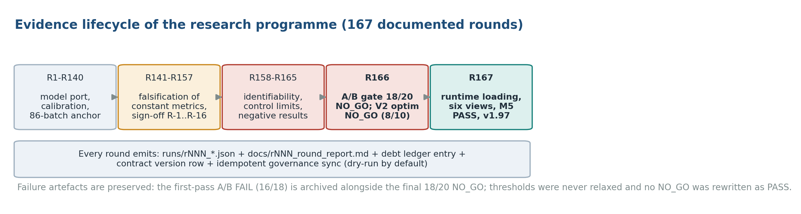
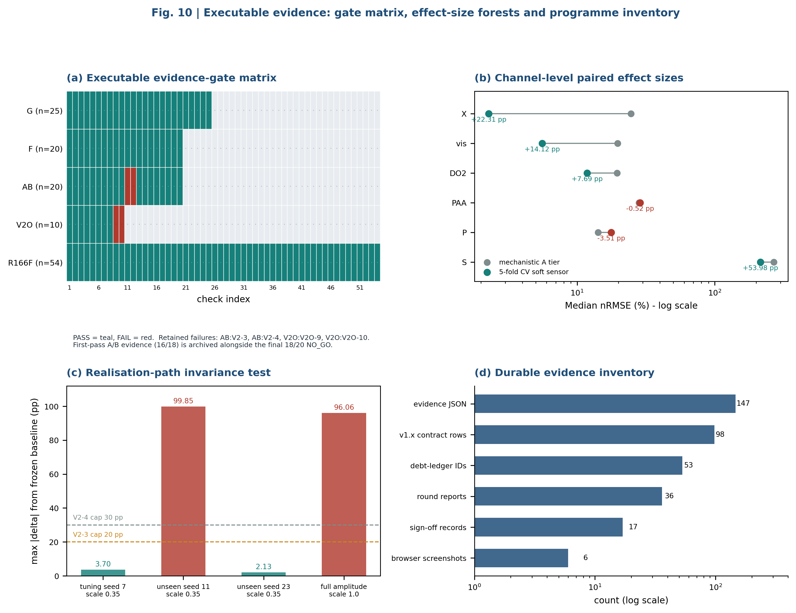
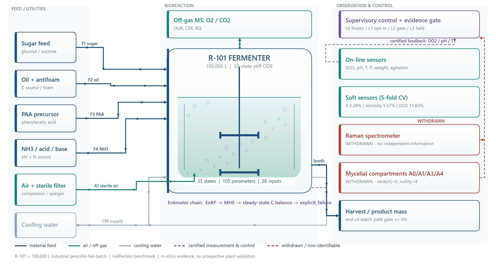
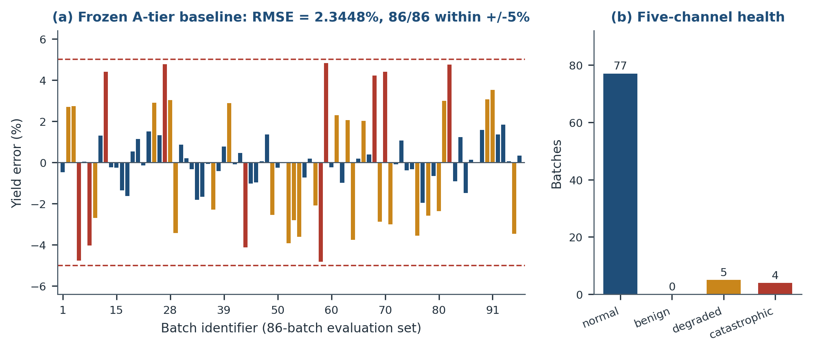
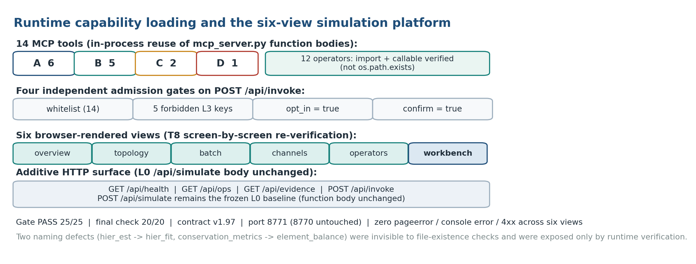

# 先冻结算子，再放 Agent 去发现

## 一次 AI Agent 原生研发仿真算子库与求解器的 167 轮实证

> 面向 AI4S / 工业软件研发同行。本文所有数字均可在仓库 `runs/*.json`、`docs/*_round_report.md` 与 `paper/manuscript_methods.md` 中复核；插图全部取自本系统已有的过程图、结果图与平台真实运行截图。

---

## 引子：三个不太协调的数字

先摆三个数字，它们彼此之间并不协调，而这篇文章要解释的正是这种不协调。

第一个：工业青霉素补料分批发酵罐（IndPenSim 基准，8.5 万升罐、批次约 230 h）的 Python 求解器，在 86 批验收集上产量 **RMSE 2.3448%**，**86/86 落在 ±5% 内**，且相对冻结基线的逐批逐位差异 `max|Δ| = 0.00e+00`。

第二个：为验收这套引擎而自建的 8 个判据仪器里，**4 个被判无效**——包括一个在 86/86 批上恒返回 `normal` 的崩溃分类器，和一个对零信息常数预测器也报 `0.899548532731377` 的置信区间覆盖率。

第三个：同一套模型换到留出批次上做前瞻迁移，中位 prior RMSE **97.47%**，20 批里只有 1 批进 ±5%，约为重建误差的 **41.6 倍**。

如果只想证明「AI 写了个能跑的求解器」，第一个数字就够了。但第二个数字说明：真正难的从来不是把代码写出来，而是**知道哪些「通过」是假的**。第三个数字则划死了边界：2.3448% 是**重建一致性**（每批使用各自的标定参数），**不是前瞻预测能力**，本文所有相关表述都保持这一口径。

这三个数字合起来指向一个更一般的问题：**在 AI Agent 时代，一个仿真计算系统应该按什么次序被研发出来？** 我们在 167 轮（R1–R168）研发里得到的答案，与当下多数「Agent 做科研」的直觉相反。

---

## 一、立论：AI Agent 时代的研发次序问题

### 1.1 判断不可外包，判定可以外包

谈到 Agent 做科研或做工业软件，默认画面通常是：Agent 读文献、提假设、设计实验、写代码、自动迭代，人只负责点头。这个画面把**不确定性**整包交给了 AI。

但在这套系统的实际研发里，Agent 最可靠、产出最大、也最不可替代的部分，恰恰不是「判断」，而是「判定」：

- 在给定判据下跑完 86 批，逐批逐位与冻结基线比对，输出结构化差异；
- 对某个参数做 12 批 × 6 档 × 3 档的网格扫描，把每个组合的产量、CO2d、崩溃标记落盘；
- 把 46 项治理文本做精确替换/插入，三次复跑零写入，且所有数字从 `runs/` 读取而不是由模型生成；
- 每轮独立重跑零回归、黄金集哈希、验收套件与全量回溯。

这些任务的共同点是：**输入确定、判据确定、输出格式确定、对错可判定**。仓库里 `tools/` 下 493 个 `.py`，绝大多数是这类一次性、只读、零引擎改动的探针，按 `rNNN_<主题>.py` 编号并在当轮报告里被引用一次。它们不是「AI 写的代码」，而是 **Agent 把确定性执行规模化**留下的痕迹。

由此得到本文的第一条命题：

> **人不要指望 Agent 替你判断「这个结论可信吗」；但可以放心让 Agent 执行「在给定判据下，这件事成立还是不成立」。判断与判定必须拆开。**

推论很直接：判据本身必须先于 Agent 存在，而且必须是冻结的、可复现的、可哈希的。否则 Agent 判定得再快，判的也是一个会移动的靶。

### 1.2 四层模型与一条确定性边界

我们把这套次序抽象成四层。需要特别说明：这里的分层是**研发范式分层**，与仓库 `docs/r166_verdict.md` 里定义的 **L0–L3 基线治理分层**（L0 冻结基线 / L1 opt-in 候选 / L2 证据闸门 / L3 切换决策）不是同一套编号，含义不同，正文将分别称呼。

| 层 | 归属 | 内容 | 硬要求 |
|---|---|---|---|
| 确定性底座 | **先研发、后冻结** | 数据、判据、算子、求解器（33 维 ODE、105 参数、58 个底层算子、四环回退链） | 逐位可复现、默认不改写、哈希可验 |
| 确定性执行 | Agent | 跑批、扫描、比对、闸门、证据落盘 | 先写判据再动手，输出结构化证据 |
| 编排与探索 | Agent | 协作、计算、调度、发现（14 个 MCP 工具、残差发现、并行作业、异步队列） | 只能作用于冻结底座，越界须授权 |
| 约束与授权 | 人类 | 目标、红线、验收口径、裁决、promote | 边界变更必须人裁决，L3 二次确认 |

底座与其余三层之间有一条**确定性边界**：边界以下必须逐位可复现，边界以上才允许探索。



*图 1 · 系统已有架构图：L0 冻结基线（86 批逐位零回归锚）、L1 默认关闭的 opt-in 候选、L2 对抗式证据闸门、L3 人类门控的模型更新采纳（本项目未执行）。底部治理脊为版本化契约、债务台账、签核单与幂等同步。*

用一句话概括这条思路：

> **在 Agent 时代，人的价值从「写算子」上移到「写约束」，Agent 的价值从「替你判断」下沉到「替你执行可判定的事」。所以第一性工程不是先搭智能体，而是先用 Agent 把算子、求解器这类确定性资产研发出来并冻结，再把协作、计算、调度、发现交给 Agent。**

我们把它叫作 **确定性底座优先（Determinism-first）**，副题是「先冻结算子，再放 Agent 去发现」。

### 1.3 为什么次序不能反：三个反面证据

次序问题不是哲学偏好，在本项目里有可量化的反面证据。

**其一，让 Agent 直接做闭环控制，底座会崩。** 葡萄糖闭环 `fs_ctl` 的 8 个配置全部给出 −98% ~ −100% 的产量，失败点统一落在 pH 掉到 3.000 守卫、残糖涨到 78 g/L；闭环数据同化把产量达标从 86/86 打到 **6/86**，49/86 批产素归零。这不是「算法没调好」，是调度对象本身没有冻结的有效域。

**其二，让 Agent 自由注入扰动，改进与漂移不可区分。** R166 的 V2 八路扰动方差注入：全幅 3/6 批崩塌、`max|Δ| = 96.058784 pp`；在 seed 7 上调出的 `scale=0.35`，换到未见过的 seed 11 仍崩到 99.85 pp。最终 **18/20 NO_GO**，阈值不放宽、默认不切换、L3 不执行。注意处置方式：原始 FAIL 记录保留，没有改写成 PASS，判定升格为 NO_GO 归档。

**其三，没有冻结判据时，Agent 连「自己错了」都测不出来。** D-38：`classify_crash()` 在 `CO2d.max() <= 7.57` 时直接 `return normal`，而 86/86 批的最大值只有 7.194——所谓「0 catastrophic」从未检验过任何东西。D-78：置信区间由残差自身的 5%/95% 分位数构造，对零信息常数预测器同样报 `0.899549`，四个通道逐位相同、差值为 `0.000000`。



*图 2 · 论文结果图：(a) 零信息预测器与拟合预测器的覆盖率完全相同；(b) 恒真判据 vs 五通道健康分级（77/5/4）；(c) 近似恒真的创新判据 27/32 = 84.38% 被标记。这三项直接支撑「判据自身必须先做证伪测试」。*

### 1.4 研发时间线本身就是一次自然实验

有意思的是，这套仓库的推进次序恰好是这条思路的一次实证：

| 阶段 | 时间/轮次 | 做了什么 | 性质 |
|---|---|---|---|
| S0 / M0 | 2026-10-26 | `GOAL.md` 目标确认、`PROBLEM.md` 受理冻结、验收标准 v1.0 | 人类写约束 |
| M1–M5 | 2026-10 | 33 维 ODE 移植、BDF 引擎、黄金集验收、看板 | **先做确定性底座** |
| R131–R160 | 11 月上半 | 判据、算子、可辨识性、恒真判据证伪、负结果归档 | **把底座打磨到可验** |
| R163 | 之后 | 四环回退链接入现役 MCP 路径（默认关闭、逐位不变） | 服务化 |
| R167 | 之后 | 六视图研发成果看板、第 6 视图「观察·控制工作台」、闸门 25/25 | 平台 |
| R168 | 之后 | `platform_v2` 仿真计算平台、`operator_kit` 18 高层能力 + 58 算子 + 21 MCP 工具 | **Agent 编排与调度** |

先有 86 批零回归的引擎，才有 Agent 的调度与发现；反过来，任何绕过底座的尝试都被同一套闸门检出并归档。这不是事后总结的叙事，是文件时间戳与契约版本行的顺序。


*图 3 · 系统已有的浅色研发过程卡：R129→R133 五轮迭代，黄金集从 10 批滚到 86 批、RMSE 收敛到 2.0–2.4%；卡底写明「黄金集 · 种子集 → 全量可移批」与「只增不减 · 双约束校验」。*



*图 4 · 证据生命周期：R1–R40 移植与标定 → R141–R157 恒真判据证伪 → R158–R165 可辨识性与负结果 → R166 A/B 闸门 18/20 NO_GO → R167 运行时加载、六视图与 M5 PASS。每轮都产出 `runs/rNNN_*.json`、轮次报告、债务台账条目与契约版本行。*

---

## 二、约束：人只做一件事，把不确定性写进文档

可行性论证的第一根支柱不是模型能力，是**约束的可执行性**。在这个项目里，人类没有写一行求解器代码，但写下了目标、红线、口径、判据与授权点；Agent 的自主范围，恰好等于这些文档留下的确定空间。

### 2.1 四类约束载体

| 类别 | 代表文件 | 约束了什么 |
|---|---|---|
| 目标约束 | `GOAL.md`（S0 目标确认单，2026-10-26 用户确认） | A 正问题 / B 逆问题 / C 反设计三档用途分级、±5% RMSE 验收基准、**§5 五条红线**（不接实产闭环、不放宽安全与操作窗、不做在线 RL、实产数据再训练需另行授权、HAZOP 联锁以文献规程为准）。R166 增补特别注明「§1/§3/§4/§5/§6/§7 一字未改」 |
| 受理冻结 | `PROBLEM.md`（M0 冻结）、`glossary.yaml` | 验收标准 v1.0 冻结、计量口径与时间戳纪律（化验时间戳用采样时刻，4 h 分析滞后单独登记）、数据可达性与 6 条 T7 假设 |
| 研发规范 | 外部 Workflow `flow-mvowqpw2`（§S0、§S1、§3.4 两阶段、§3.5 组合栈、§15 里程碑）、`docs/01_设计讨论…md`、`docs/deepening_plan.md`（PH1–PH5）、`docs/roadmap_next.md`（T0/T1/T2/T3 四波执行） | 流程先于代码；「每轮先写判据再动手，结果结构化落 `runs/ledger.jsonl`，ROUTE 四选一 PASS / REWORK / CAP / ESCALATE，数据窗口登记防跨轮混用」 |
| 过程契约 | `ENGINE_CONTRACT.md` v1.97（96 条版本行，不改写历史行）、`state.yaml`、`docs/m5_review_signoff.md`、`docs/r166_verdict.md`、`docs/rNNN_debt_ledger.md`、`docs/goal_backtrace_check_v3/v4/v5.md` | 结论必须落契约 + `state.yaml` + `runs/*.json` 三处；边界变更需裁决；每轮「未越界声明」；promote 人工发起 |

这里最容易被忽略、也最值得同行借鉴的是 `docs/m5_review_signoff.md` §4.3 的 **12 条禁止表述**：它明确列出「0 catastrophic」「置信区间覆盖率 0.95」「故障幅值可定量复现」「参数解锁路线完全封死」等**不允许出现在交付文档里**的说法，每条附原因与证据编号。换句话说，人类不只约束了 Agent 能做什么，还约束了 **Agent 能怎么写结论**。

### 2.2 约束如何变成机器可验

文档若不落到可执行检查，就只是措辞。本项目把约束翻译成四道常驻闸门：

1. **零回归**：`tools/r134_zero_regression.py --tol 0`，86 批逐批对比 `runs/final_validation_v2.json`，期望 `max|Δ| = 0.00e+00`、RMSE 2.3448%、86/86。被 `docs/r166_verdict.md` 定为「每轮独立重跑」的长期硬基线。
2. **黄金集完整性**：`data/processed/golden_set.sha256` 对 100 个 `batch_XX.csv` 加 `golden_set.json` 自身取哈希（101 条），`python tools/r157_golden_hash.py --check` 报修改/删除/新增/名单变化四类差异，前三类直接 exit 1。「黄金集只增不减」从此不是纪律口号，是机器可验事实。
3. **验收套件**：`tools/acceptance.py --reuse runs/r156_acceptance.json`，HARD 4 / SOFT 6 / DET 2，全量跑 907.9 s、`verdict=PASS(hard)`；复用模式 < 5 s。
4. **代码级回归**：`pytest` 33 passed in 509.47 s、引擎自测 13/13、R166 终检 54/54、R167 平台闸门 25/25（8771 端口，8770 前后均未监听）。

所有候选能力默认 opt-in 关闭，且不写回 `golden_params.py`；`platform/serve.py` 中 `POST /api/simulate` 是 L0 冻结基线，函数体逐字未改。R167 装载后，引擎 4 个文件的 sha256 与 R166 逐位一致。



*图 5 · (a) 闸门矩阵：G / F / AB / V2 / R166F 五族共 129 门检，红色为保留下来的失败项；(c) 实现路径不变性检验：调参 seed 7 只有 3.70 pp，未见 seed 11 崩到 99.85 pp；(d) 持久证据清单：147 份 evidence JSON、98 条契约行、53 个债务编号、36 份轮次报告、17 条签核、6 张浏览器截图。*

### 2.3 六个裁决点：人类介入稀疏但不可绕过

| # | 裁决点 | 内容 |
|---|---|---|
| 1 | S0 确认（2026-10-26） | A+B+C 全量分阶段、V3 黄金集 ±5%、先做机理引擎 M0–M4 |
| 2 | M0 冻结 | 验收标准 v1.0 与计量口径冻结 |
| 3 | R157 三项 | 保持默认基线、接受 B 档交付 X、标准 4 由 PARTIAL 改判（命题撤销，非新增证据） |
| 4 | R166 五项委托裁决 | V1/V2/V3 条件批准为 opt-in、V4 批准、V5 把菌丝区改标「软测量内部量，不作交付宣称」 |
| 5 | R167 三项授权 | 装载目标为现有 `platform/`、另起 8771 端口、L3 不处理 |
| 6 | L3 二次确认 | **未执行**，需独立基线冻结 + 契约升版 + 全量闸门重跑 |

对照一个细节：5 个 L3 禁键（`alpha_kla_override`、`dist_noise_seed`、`dist_noise_sigma`、`innovation_criteria`、`k_dual`）由 `POST /api/invoke` 逐个返回 **400 拒绝**。这是「约束变成了代码」最直接的证据，也是「评估权与授权权分离」的落点——Agent 可以评估候选，但永远不能静默把候选提为生产口径。论文方法学版把这一点抽象为四阶段 evidence-gating workflow，并明确写出 Stage 3（human-gated adoption）**在本研究中未执行**。

---

## 三、迭代：Agent 原生研发的运行循环

第二根支柱是：多轮迭代不等于「反复让 AI 改代码」，而是有收口件的闭环。

### 3.1 一轮的原子结构

```text
轮次计划 docs/r132_round_plan.md / r134_round_plan.md
  → 先写判据（判据不合规则本轮不成立）
  → 一次性探针 tools/rNNN_<主题>.py（只读 / opt-in / 零引擎改动）
  → 结构化证据 runs/rNNN_*.json
  → ROUTE 四选一：PASS / REWORK / CAP / ESCALATE
  → docs/rNNN_round_report.md + docs/rNNN_debt_ledger.md（D-NN 编号）
  → ENGINE_CONTRACT.md 版本行 + 幂等治理文本同步（dry-run 零泄漏）
  → 全量回溯 docs/goal_backtrace_check_v3/v4/v5.md（声明「只读回溯，不擅自推进」）
```

规模：36 份轮次报告、23 份债务台账、`tools/` 493 个脚本（其中 460+ 在 `tools/INDEX.md` 四分区索引里被标注为一次性探针）、`runs/` 根目录 149 份 JSON。三层账本分别是 `knowledge/ledger.jsonl`（111 行，含 `source: "agent"` 的 typed 记录，按 T1–T7 标注知识等级）、`runs/ledger.jsonl`（136 行）、`ENGINE_CONTRACT.md` v1.97。

关键在于**负结果是一等产出**：`paper/supplementary_methods.md` 把它写成制度——「被拒绝或撤回的主张是带自身证据的合法记录，因此负结果是一等输出」。D-2…D-92 的债务编号、B-1…B-19 的边界清单、R-1…R-17 的签核记录，共同构成一套可复核的纠错记忆。


*图 6 · 逐层校准的真实收敛过程：名义参数 RMSE 70.95%（9/12 批崩溃）→ 3D 校准 37.40% → m_s 校准 32.57% → 组合 16.18% → 常数 m_s 改进 7.28% → 时变 m_s 4.48%（±5% 内 8/12）。这条曲线不是一次生成的结果，是多轮「假设—反例—撤回—重来」的产物。*

### 3.2 六例自我证伪

| 编号 | 初判 | 如何被证伪 | 修正后结论 |
|---|---|---|---|
| D-38 | 「0 catastrophic」 | `classify_crash` 恒返回 normal，86/86 批 CO2d 最大值仅 7.194 | 五通道 `classify_health`：normal 77 / degraded 5 / catastrophic 4 |
| D-78 | 覆盖率可作 I3 达标证据 | 区间由残差自身分位数构造，零信息常数预测器也报 0.899548532731377，四通道 Δ=0.000000 | 论证层撤回，改用区间半宽 + nRMSE 改善；`observe.py::coverage_check` 换 μ±1.96σ 口径（垃圾 σ→0 覆盖 0.0000） |
| D-70 | PLS 三重验证 0.9995 / 0.9997 / 0.8463 | 相关系数对缩放不变，`pat × 1000` 后 r 逐位相同；OLS 实为 `lab = 721.263 × pred + 404.644`，量纲差 1000 倍 | Raman/PAT 判为「引擎 PAA 的重命名」，增量 R² 0.0199，不作交付组件 |
| D-74 | A2 两点校准「严格支配」PAT | 41 批中 29 批化验值是占位值（V6 批 61–90），A2 退化为常数预测，剔除后 20.47% 劣于 C0 10.29%，方向反转 | 当时唯一的「正面结论」整条撤回 |
| R148 | 守卫把 pH 写成 3 并维持 186 步 | 实测守卫只写 1 次，186 个样点是 ODE 自身伪平衡（速率低 3378 倍） | 两种叙述推出的结论相同，但处置相反：改守卫什么都不会发生，必须改速率结构 |
| R157 | 「崩塌态 = 吸引子」 | 判决性逃逸实验：把系统推进 `Y_sP=0.85` 后，`sd` 跨 `0.0015217285~0.0015219727` 即从 −100.00% 回到 +1.33% | 改为「阈值隔离的深盆地：可跨出但只能跨」；D-54 精确化为「运行期连续调控封死，开环设定点标定保留，精度 1e−4…1e−5」 |

这些案例里最值得同行注意的不是「发现错误」，而是**错误被检出、编号、撤回、留下证据、并沉淀成纪律**的完整链路。沉淀出的 32 条纪律里，传播价值最高的几条是：恒真的判据等于没有判据；相关系数不是量纲的证据；自建判据必须先做证伪测试（零信息对照 + 双向判据）；任何「改善」必须配更简单方法的控制组；排除一个旋钮比确认一个旋钮便宜；报测试结果必须带分母；预判式结论必须留证伪位。

### 3.3 迭代不劣化的保证

167 轮里最有工程价值的性质是「迭代不劣化」：每轮新增能力都以 opt-in 形式叠加，默认路径逐位不变，零回归与黄金集哈希每轮独立重跑。R166 的 V2 扰动注入 **18/20 NO_GO** 是一个预注册负结果的样板——多轮寻优仍无法解决时诚实降级，不得粉饰、不得偷放宽阈值，V2-3 / V2-4 的原始 FAIL 与 20/30 pp 阈值原样保留。

这恰恰回答了「Agent 会不会自己把候选偷偷提为生产口径」：不会，因为提升动作藏在人类闸门后面，而且 L3 从未执行。

---

## 四、成果一：Agent 研发出的算子库与求解器

下面两章展示成果。请留意这些成果的共同属性：每一项都有明确的判据来源、研发轮次与 `runs/*.json` 证据，都是 Agent 在上述约束下跑出来的确定性资产，而不是人工预先设计好再交给 Agent 抄写。

### 4.1 装置边界与求解器规格



*图 7 · R-101 发酵罐 100,000 L、33 态刚性 ODE、105 参数、26 输入；左侧 6 路补料/公用工程，右侧观测与控制链；橙色框为**已撤回**的 Raman 光谱仪与菌丝分室 A0/A1/A3/A4，虚线为已认证反馈。图底注明「in-silico evidence, no prospective plant validation」。*

| 项 | 规格 | 说明 |
|---|---|---|
| 状态维度 | 33 | S / DO2 / O2 / P / V / Wt / pH / T / Q / vis / A_t1 / A0 / A1 / A3 / A4 / n0–n9 / CO2 / CO2d 等 |
| 参数 | 105（`params.py`） | 逐项对照 MATLAB `Parameter_list.m` |
| 输入 | 26 维 `inp1` | 含 8 路时变扰动 |
| 积分 | BDF，`rtol=1e-3` / `atol=1e-6` / `max_step=0.01 h` | 对齐 ode15s，0.2 h 采样区间分段 |
| 回放 | 开环，V3 被控量序列驱动 | 前向 MV 时序修复对齐 `f_input` |
| 参数事实源 | `golden_params.py` 的 `COMBINED`（88 批）+ `build_params()` | 逐批给值本就是模型的标定范式，不是新增自由度 |

**验收**：产量 RMSE **2.3448%**、**86/86** 在 ±5% 内、零回归 `max|Δ| = 0.00e+00`、0 新发 catastrophic。必须同句写明：**每批使用各自的标定参数，这是重建一致性，不是前瞻预测**；论文 E2 的留批次迁移中位 prior RMSE 97.47%、bias −94.87%、20 批仅 1 批进 ±5%，约为重建误差的 41.6 倍。



*图 8 · (a) 冻结 A 档基线的 86 批产量误差，红色虚线为 ±5%；(b) 五通道健康分级 77 normal / 5 degraded / 4 catastrophic / 0 benign，替代了恒真的旧分类器。*

一个容易被「2.3448%」掩盖的事实：产量指标对 P 轨迹形状几乎失明（相关仅 +0.011）。因此后续补了形状指标——P 相对 RMSE 中位 15.6%（最差 84.8%）、峰比 1.060、末比 1.021、60–120 h 相位均值 −0.0625。达标不是终点，找出「这个达标数字看不见什么」才是。

### 4.2 算子库

| 算子族 | 代表 | 状态 |
|---|---|---|
| 底层算子 | `operator_kit` 58 个 + 18 个高层能力（14 A/B/C/D + 4 个 v2 扩展）+ 21 个 MCP 工具 | 29/29 PASS；不变量「不复制实现、不改旧目录一行、失败显式」 |
| 回退链算子 | `enkf_health` / `degradation_guard` / `mhe_step` / `steady_state_baseline` / `resolve_tier` | R161 落地、R163 接入现役 MCP 路径（默认关闭、逐位不变），3/3 PASS |
| 度量算子 | `trajectory_metrics.py`、`conservation_metrics.py`、`classify_health` / `shape_metrics` | 轨迹级、C/N 元素平衡、形状与健康五通道 |
| 故障注入 | 7 模式 `kla_step/ramp/fade`、`ph_drift`、`feed_hold`、`sensor_bias`、`probe_freeze` | 模式级复现；`sensor_bias`/`probe_freeze` 无判别力如实保留 |
| 寻优算子 | `optimize.py`：5 个 MV 倍率、Nelder-Mead、`max_yield` / `track_target` | 12 批口径下 12/12 落 ±5%（**不是 86 批**） |

### 4.3 B 档观测算子：可交付的与不可辨识的

观测器 v2 是双通道对数线性模型 `log(X_est/X_model) = a + b·log r_OUR(t) + c·log r_CER(t)`，批级 5 折 CV 拟合。机制证据很干净：CER 斜率 1.005（R² 0.699）对 OUR 1.420（R² 0.433），批内去均值回归 OUR +0.043 / CER +0.666——**OUR 定标度、CER 定时间形**。交付口径：X 中位 nRMSE **3.17%**、86/86 <15%、90% 区间半宽 8.14%。

覆盖面经过量化扩展：X 24.58%→2.28%（增益 22.31 pp）、粘度 19.69%→5.57%，两者 `DELIVERABLE`；而 P 14.19%→17.70%、PAA 28.20%→28.72% 均劣于 A 档，判 `NOT_IDENTIFIABLE`。菌丝区 A0/A1/A3/A4 更彻底：`H_assim` 50×4 **rank=0 / nullity=4**、`H_report` 60×4 **rank=1 / nullity=3**（11/11 PASS），加上 V3 的 37 列无任何分室实测、Raman 通道被否证，构成 D-88 双重结论——**结构不可辨识 + 数据资产级不可验证**。`GOAL.md` §2 第 7 行因此改标「软测量内部量，不作交付宣称」，§5 红线一字未改。

这些算子的共同属性只有两个字：**确定**。固定输入输出、逐位可复现、默认 opt-in 不改写基线、每个都有证据 JSON。这正是第一章所说「先研发的确定性底座」。

---

## 五、成果二：仿真计算系统全链条

### 5.1 从数据到治理的六层

| 层 | 成果 | 关键数字 / 证据 |
|---|---|---|
| 数据层 | 100 批 × 37 通道、12 批黄金集只增不减 → 86 批验收集 | 表头 `PAT_ref` 含逗号被拆 3 列 ⇒ 2239 列 vs 2237 值、错位 2 列；`Fremoved` 存负值出流；统计 CSV 标 (kg) 实为克级；离线化验 98.2% NaN；`data/processed/golden_set.sha256` 101 条哈希 |
| A 档 | 正问题引擎 | RMSE 2.3448% / 86/86 / `max|Δ|=0`；`runs/r166_zero_regression.json`（772 s） |
| B 档 | 逆问题软测量 + 四环回退链 | X 3.17%、86/86 <15%；`runs/r161_fallback_chain_probe.json`、`runs/r163_mcp_integration.json` 3/3 |
| C 档 | 反设计与有效域 | 12 批口径 12/12 落 ±5%；进料可行域 **<±1%**（u=0.99/1.01 各 5 批破线，最差 −30.1% / −100%，两批方向相反，没有「安全的那一侧」）；双稳态跳变 99.85 pp；修补 60–120 h 缺口需 ±30%~+80% 位移，与域宽差 **30 倍** |
| 服务化 | MCP 工具 **6 → 9 → 12 → 14**；L0 冻结 / L1 opt-in / L2 证据闸门 / L3 未执行 | `runs/r165_mcp_tools_probe.json` 12/12、`runs/r166_mcp_smoke.json` 9/9；改用官方 SDK `mcp.server.fastmcp.FastMCP`（锁 `mcp==1.12.0`）而非第三方 fastmcp，避免 dry-run 连带升级 11–30 个包 |
| 平台 | `platform/` 六视图 + `GET /api/ops` / `GET /api/evidence` / `POST /api/invoke`；`platform_v2/` | R167 闸门 **PASS 25/25**（8771，95.8 s，6 张截图）；`platform_v2` fast 闸门 18/18，全量闸门 24/24→27/27（设计文档，**非同一跑次**）；97 参数 / 40 通道 / 0.2 h 原生 / 异步作业队列，对比旧平台 14 参数 / 8 通道 / 2 h / 同步阻塞 18–84 s |
| 治理 | 契约 v1.97、五次全量回溯、论文方法学版 | `paper/methods_check.json` PASS 15/15（24 图 / 12 表 / 49 条文献）；M5 签核 2 PASS / 3 有界 PARTIAL / 0 FAIL |



*图 9 · 14 个 MCP 工具按 A6/B5/C2/D1 分组（进程内复用 `mcp_server.py` 函数体，12 个算子经 import + callable 验证）；`POST /api/invoke` 的四道独立准入闸（14 项白名单、5 个 L3 禁键、`opt_in=true`、`confirm=true`）；六视图与 additive HTTP 表面，L0 `/api/simulate` 函数体逐字未改。*

### 5.2 系统真实运行画面

平台控制台本身是深色主题。为保持本文整体浅色排版，系统已有的浅色成果卡与研发信息图页面承担了「承载真实截图」的角色，原始截图文件同时保留供核对。


*图 10 · 浅色成果卡「当场改参数 当场出轨迹」：卡片内嵌 `serve.py` 在 127.0.0.1:8770 的真实首屏截图，列出回归总览、批次工作台、仿真算子库、过程拓扑、通道诊断、实时重算六项能力。*


*图 11 · 研发信息图第 05 节「仿真平台 Live Simulation Platform」，浅色页面内嵌 R133 五视图平台的真实截图，并配「平台外壳 · 五视图导航」说明。*

以下三张是 R167 / R168 的原始真实运行截图：


*图 12 · 回归总览：产量 RMSE 2.34%、±5% 命中 86/86、catastrophic 4/86 已登记（`classify_health` 五通道）、X 软测量双轨 A 档 23.99% → B 档观测器 v2 3.17%（5 折 CV 测试位 3.30%、90% 区间 [−6.8, +9.4]%、覆盖 89.9%）、产量相对误差逐批散点与通道×批次健康矩阵。注意此处为 R167 后的新口径，旧截图中的「0/86」已被证伪并撤回。*


*图 13 · 第 6 视图：顶部 L0 冻结基线 / L1 opt-in 候选 / L2 证据闸门（18/20 NO_GO）/ L3 切换决策（未执行）四卡；中部 A/B/C/D 共 14 个能力按 light/medium/heavy 与「需确认」标注，可逐个调用；底部能力调用与证据边界面板（契约 v1.97、R166 终检 54/54 PASS、A/B 闸门 18/20 NO_GO、MCP 冒烟 9/9 PASS、86 批 `max|Δ|=0`）。*


*图 14 · `platform_v2` 参数扫描：`μx` × `μp` 二维网格，热力图给出产量相对误差响应（−8.91% ~ 5.48%），逐点明细列出真实% / CO2d峰值 / pH极 / 健康 / 状态，失败点显式标注 `yield_break` 且**不参与统计、不被静默填 0**。这是「失败可见」在 UI 层的落地。*

### 5.3 状态三色：哪些能写进成果，哪些不能

| 状态 | 内容 |
|---|---|
| **PASS / 已交付** | A 档 86 批、B 档 X + 粘度、四环回退链、MCP 14 工具、`platform/` 六视图、`platform_v2/`、`operator_kit` 29/29、论文一致性 15/15 |
| **提案 / 待裁决** | 候选基线 v2（`ph_fix=1` + 5 批 `mup` 重标，默认仍 `ph_fix=0`）、L3 四项切换、V1+ 立项（含菌丝形态测量数据、留出批次前瞻评估、第二个过程案例 E10） |
| **已否决 / 否定结论** | 闭环数据同化 6/86、葡萄糖闭环全崩、Raman/PAT 不作交付、A2「严格支配」结论撤回、I3 覆盖率恒真、P/PAA 与菌丝区不可辨识、V2 扰动注入 18/20 NO_GO、60–120 h 产素缺口四轮全局形状旋钮全失败、A 档参数域内 X 幅度不可修复（72 个反事实配置全部把产量推出 ±5%） |

把三色写清楚，比多报一个漂亮数字更重要。这也是本项目对「AI 生成内容」最实在的一条防线：**Agent 写的每一句结论都要能追到状态标签和证据编号**。

---

## 六、回证、可移植范式与未闭合项

### 6.1 用成果回证立论

回到第一章的命题。这套系统之所以能在 167 轮里让 Agent 做协作、计算、调度与发现而没有失控，原因不在模型更聪明，而在：

- **底座先冻结**：86 批 `max|Δ|=0` 的引擎 + 101 条哈希的黄金集 + 先写后跑的判据，使任何一轮探索都有同一个锚；
- **约束可执行**：`GOAL.md` 五条红线、12 条禁止表述、5 个 L3 禁键的 400 拒绝，把人类意图翻译成代码级闸门；
- **负结果可复核**：92 条债务编号、32 条纪律、36 份轮次报告、147 份证据 JSON，让 Agent 的错误不会随会话蒸发；
- **授权不外包**：L3 从未执行，5 个候选键一律拒绝，promote 由人类发起。

反过来，凡是绕过底座的尝试——闭环同化、V2 扰动注入、改 pH 守卫、两点校准——都被同一套机制检出并归档。这就是「确定性底座优先」的可证伪形式：**若去掉冻结底座，Agent 的多轮探索会系统性产生不可判定的改进**。本项目 167 轮的记录，是对这条命题的一次判决性实验。

### 6.2 七条可移植准则

给打算复现这条路径的同行，压缩成七条：

1. **目标与红线写成机器可验文档**：不是「尽量准确」，而是「±5% RMSE、86 批分母、哈希自检、exit 1 条件」。
2. **先研发并冻结确定性算子/求解器**，再上 Agent 编排；调度对象必须逐位可复现。
3. **每轮先写判据再动手**，判据不合规则本轮不成立；ROUTE 四选一并显式落盘。
4. **负结果与撤回编号归档、不删除**，撤回记录与通过记录同等重要。
5. **判据自身必须做证伪测试**：零信息对照、双向判据（禁恒真/恒假）、数据驱动阈值 + LOO。
6. **评估权与授权权分离**，候选默认 opt-in、禁键显式拒绝、提升由人类发起。
7. **一切结论三处一致**：契约版本行 + `state.yaml` + `runs/*.json`，缺一不算数。

### 6.3 诚实边界与未闭合项

- 前文所有 2.3448% 类数字是**重建一致性**，不是前瞻预测；留批次迁移 97.47% 是必须并列给出的另一半事实。
- **L3 切换从未执行**，V2 扰动注入 NO_GO，闭环控制是 `GOAL.md` §5 明令红线；本文不主张「Agent 可自主上线生产求解器」。
- 数据资产级限制：菌丝区结构不可辨识且 V3 无分室实测；碳平衡曾有 −60%~−67% 不闭合，R134 口径修正（CER × V × 12/44 折碳）后中位 −1.5%、11/12 进 ±20%，但气体通道与液相质量计量仍有约 **30 倍**单位失谐，待数据提供方原文核证。
- 留出批次前瞻评估尚未立项（D-89：28 批验证集从未留出），第二个过程案例 E10 亦未开展；因此本文论证的是**单案例、有界条件下的可行性**，不是跨领域泛化结论。
- 12 批与 86 批是两级口径；平台闸门 fast 18/18、设计文档 24/24→27/27、R167 25/25 属不同跑次，引用时须注明。

### 6.4 收尾

这套系统最有价值的产出，其实不是 2.3448%。

是 D-2 到 D-92 那 92 条债务编号、32 条纪律、被完整保留的 18/20 NO_GO，以及一条次序：**先把算子与求解器做成机器可验的确定性资产，再把协作、计算、调度、发现交给 Agent**。在 Agent 时代，值得人亲自写下的，是约束；值得 Agent 反复执行的，是判定。

---

## 附录 A · 插图清单（全部取自系统已有文件）

| 图 | 文件 | 类别 |
|---|---|---|
| 1 | `paper/figures/fig1_framework.png` | 过程/架构图（浅色） |
| 2 | `paper/figures/fig4_tautologies.png` | 结果图（浅色） |
| 3 | `docs/promo/card2_journey.png` | 研发过程卡（浅色） |
| 4 | `paper/figures/figS3_lifecycle.png` | 过程图（浅色） |
| 5 | `paper/figures/fig10_evidence_matrix.png` | 结果图（浅色） |
| 6 | `runs/report_assets/fig1_rmse_evolution.png` | 结果图（浅色） |
| 7 | `paper/figures/fig12_pfd.png` | 工艺流程图（浅色） |
| 8 | `paper/figures/fig3_validation.png` | 结果图（浅色） |
| 9 | `paper/figures/figS2_platform.png` | 架构图（浅色） |
| 10 | `docs/promo/card4_platform.png` | 浅色成果卡（内嵌真实截图） |
| 11 | `runs/info_platform.png` | 浅色研发信息图页面（内嵌真实截图） |
| 12 | `docs/screenshots/platform/r167_01_overview.png` | 平台真实截图（深色控制台） |
| 13 | `docs/screenshots/platform/r167_06_workbench.png` | 平台真实截图（深色控制台） |
| 14 | `docs/screenshots/platform_v2/r168_09_scan_2d.png` | 平台真实截图（深色控制台） |

> 说明：本系统平台控制台原始截图为深色主题；为满足浅色排版，正文以系统已有的浅色成果卡与研发信息图页面承载真实截图，并同时给出原始截图文件。未对任何截图做色调伪造或内容改写。

## 附录 B · 主要证据索引

`README.md` §4/§6 · `GOAL.md` · `PROBLEM.md` · `ENGINE_CONTRACT.md` v1.97 · `state.yaml` · `docs/m5_review_signoff.md` · `docs/r157_debt_ledger.md` · `docs/r166_verdict.md` · `docs/goal_backtrace_check_v5.md` · `docs/r167_round_report.md` · `docs/r168_platform_v2_design.md` · `runs/r166_zero_regression.json` · `runs/r156_acceptance.json` · `runs/r166_ab_gate.json` · `runs/r167_platform_gate.json` · `paper/manuscript_methods.md` · `paper/submission_strategy_methods_zh.md`。

> 口径提示：`paper/submission_strategy_zh.md` 自述已被取代，旧 journal 版稿件（`manuscript_journal.md`）的标题、术语与贡献陈述不得与当前方法学版混用。
