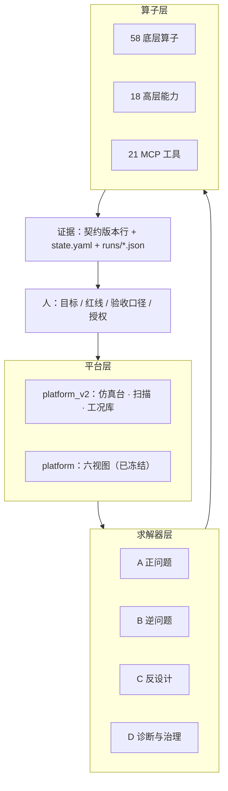
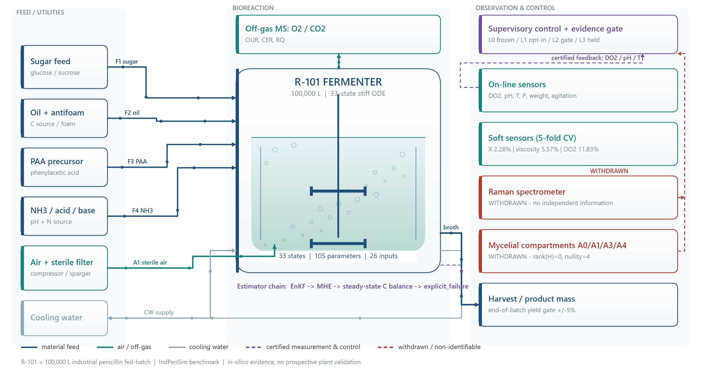
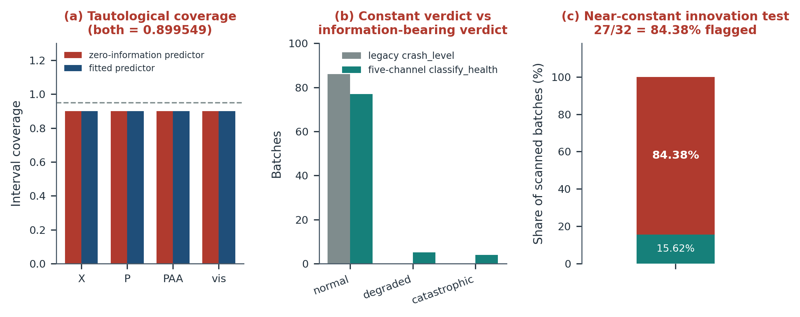
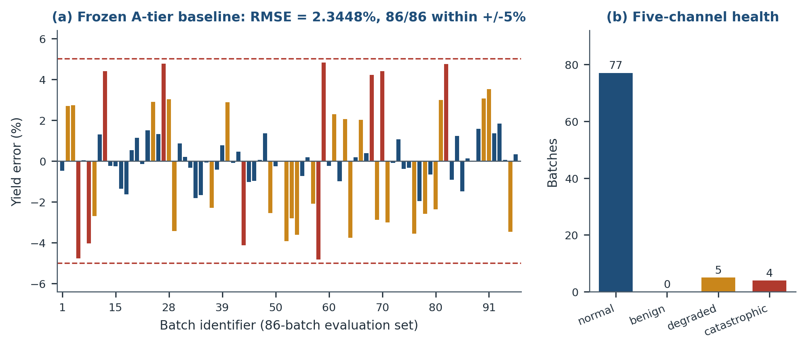

# AI Agent 原生仿真计算系统研发之路

## 以青霉素反应罐算子 / 求解器 / 仿真计算平台研发为例

> **口径声明（先于正文）**
>
> 本文所有数字取自仓库 `runs/*.json`、`docs/rNNN_round_report.md` 与 `README.md` §4，未做二次修饰。三条硬约定：
>
> 1. `2.3448%` 一律指**重建一致性**（每批使用各自的标定参数），**不是**前瞻预测能力；同一模型的留出批次迁移中位误差是 `97.47%`，两者必须同句出现。
> 2. `86 批` 与 `12 批` 是两级口径，不可混用；`25/25`、`18/18`、`54/54` 属不同跑次，引用时注明来源。
> 3. 凡未达成项，正文只用三种标签：**已否决**、**提案待裁决**、**已登记边界**。不写"基本实现""效果良好"这类无法核对的措辞。

---

## 一、引言：三个必须先回答的问题

### 1.1 行业问题：人写的化工过程仿真系统，究竟卡在哪

传统化工过程仿真系统的建设路径大致固定：工艺专家给机理与参数，数值专家选解法器，软件工程师把两者翻译成代码，再经过若干轮现场对账。这条路走得通，但代价集中在三处。麻烦的是，这三处都不会报错——它们只会慢慢沉淀成"这个模型只有老王能改"。

**第一处，迁移适配性。**

仿真系统的价值一半在模型，一半在**口径**。口径不写在代码里，而写在人的记忆里，于是每次迁移都要重新考古。本项目的经历可以当作样本：在解析公开基准数据时，接连遇到四类问题——

| 现象 | 实际后果 |
|---|---|
| 表头 `PAT_ref` 通道名含逗号，被拆成 3 列 | 表头 2239 列、数据 2237 值，整体错位 2 列 |
| `Fremoved` 存的是负值出流（−4000 L/h 放罐） | 直接求和得到的产量符号相反，必须改写为 `−Σ(Fremoved·P)·h` |
| 统计 CSV 表头标 `(kg)`，数值实为克级 | 1.0664e6 被读成 1066 吨，量级错 1000 倍 |
| 离线化验通道 98.2% 是 NaN | 若按常规 `dropna`，整个化验维度会凭空消失 |

这四件事没有一件是"算法问题"，但每一件都足以让迁移失败，而且失败方式极其隐蔽：程序跑完、不报错、结果是错的。人工项目里，这类知识通常靠老工程师口口相传；换一个人、换一个工艺，全部归零。

**第二处，时效性。**

一次模型修订的完整闭环是：改代码 → 重跑 → 与基准比对 → 判断是改善还是劣化 → 写结论 → 同步文档。人工项目里，前四步或许能做，第五、六步几乎必然被省略，因为成本太高。**省略的结果不是效率提升，而是"改动后果不可见"**——谁也不知道这次修改有没有把另外三十个批次弄坏。

本项目把这条闭环压缩到可执行的程度：86 批全量产量验收约 10 分钟（`validate.py --all86 --jobs 8`），86 批逐位零回归比对 772 秒，黄金集哈希自检秒级。关键不在于算得快，而在于**回归被产品化**了：它变成了一条命令，而不是一次加班。

**第三处，研发成本与复用。**

传统交付物是"一个能跑的软件"。验证脚本留在工程师的临时目录里，判据写在评审 PPT 里，证据散落在聊天记录里。下一个工艺立项时，这些全部不作为资产继承，于是从零重写。

一句话概括：**传统仿真系统的瓶颈不在算力，而在知识与验证没有被资产化。**

### 1.2 AI Agent 研发体系：可行性、高效性、可迁移性

把研发主体换成 AI Agent，首先要防止把问题问错。2026 年再问"AI 会不会写 ODE 代码"已经没有意义，真正需要检验的是三条：

- **可行性**：Agent 能否产出**逐位可复核**的资产，而不只是"能跑通"的代码？
- **可信性**：在人类不逐行审查的前提下，Agent 能否**自我验证**，并且它的验证本身经得起检验？
- **不劣化**：多轮迭代之后，系统是变好了，还是只是变复杂了？

本文用 168 轮（R1–R168）的实际研发去回答这三条，结论先说：**前两条成立但有严格条件，第三条可以做成机器可验，而条件本身比结论更有价值。**

**高效性**的证据是规模而不是感受。这套系统里：

- `tools/` 下 493 个脚本，绝大多数是**一次性、只读、零引擎改动**的探针，按 `rNNN_<主题>.py` 编号，在当轮报告里被引用一次即退役；
- `runs/` 根目录 149 份证据 JSON，每份对应一个可复核的判断；
- 人类没有写过一行求解器代码，全部介入集中在 **6 个裁决点**（目标确认、受理冻结、三项改判、五项委托裁决、三项授权、以及从未执行的 L3 切换）；
- 单轮"改—跑—比—记"的周期从周级压到小时级，才使得 168 轮在两周多的时间里成为可能。

**可迁移性**是这套体系最容易被低估的部分。迁移的不是代码，而是**四件套**：

| 件 | 内容 | 换工艺时是否要改 |
|---|---|---|
| 契约 | 输入输出定义、单位、时间戳、有效域 | 改字段，不改结构 |
| 判据 | 验收标准、闸门、失败语义 | 改阈值，不改机制 |
| 证据格式 | `runs/rNNN_*.json` 的字段与命名 | 基本不改 |
| 编排 | 算子注册表、能力分层、MCP 工具面 | 不改 |

真正换掉的只有两族：机理方程与参数表。这正是第三章之后要展示的分层结构的用意。

**但代价必须同时说清。** 这套体系里最反直觉的发现是：**Agent 造得出判据，却造不出可信判据。** 本项目自建的 8 个验收仪器里，有 4 个被判无效——包括一个在 86/86 批上恒返回 `normal` 的崩溃分类器，和一个对零信息常数预测器同样报 `0.899549` 的置信区间覆盖率。这不是 Agent 的能力缺陷，而是**"验证"这件事的结构性困难**：判据本身必须先被证伪，而这一步不能外包。

### 1.3 验证对象、验证过程与成果概述

**验证对象。** IndPenSim 工业青霉素补料分批发酵罐：公称 10 万升、工作体积约 58 m³、批次时长约 230 h；机理模型 33 维刚性 ODE、105 个参数、26 维输入；基准数据为公开的 100 批数据集，其中 86 批构成黄金验收集。

选这个对象的原因是它足够"脏"：有故障注入批、有传感器漂移、有 98.2% 为空值的化验通道、有互相矛盾的统计口径。一个在干净数据上跑通的求解器说明不了什么，能在这种数据上把口径理清、把边界画出来，才有迁移价值。

**验证过程**分三段推进，正好对应本文的三章：

1. **算子层**：把工艺知识拆成可单测的最小单元，58 个底层算子 + 18 个高层能力 + 21 个 MCP 工具，验证 29/29 PASS；
2. **求解器层**：从 MATLAB 逐项移植，经 168 轮校准与证伪，A 档产量 RMSE `2.3448%`、86/86 在 ±5% 内、零回归 `max|Δ| = 0.00e+00`；
3. **平台层**：两代演进，从"研发成果看板"改为"仿真计算平台"，参数面 14 → 97 键、通道 8 → 40、分辨率 2 h → 0.2 h 原生、同步阻塞 → 异步作业队列。

**成果概览与边界，同表并列：**

| 层 | 达成 | 边界（同句必须给出） |
|---|---|---|
| 算子 | 58 底层 + 18 能力 + 21 工具，29/29 PASS | 算子是确定性执行单元，不含判断；判据质量决定其价值 |
| 求解器 A | 2.3448%、86/86、`max\|Δ\|=0` | 重建一致性，非前瞻预测；留出迁移中位 97.47%、20 批仅 1 批进 ±5% |
| 求解器 B | X 中位 nRMSE 3.17%、86/86 <15% | P、PAA 判 `NOT_IDENTIFIABLE`；菌丝区分室量 `rank=0 / nullity=4` |
| 求解器 C | 12 批口径 12/12 落 ±5% | 进料可行域 **< ±1%**；修 60–120 h 缺口需 ±30%~80% 位移，与域宽差 30 倍 |
| 平台 | v1 闸门 25/25；v2 fast 闸门 18/18 | 旧平台原样冻结；L3 五个禁键永远 400 拒绝 |

下面三章，每章按"研发过程 → 成果概述 → 结论"展开。刻意保留失败路径，因为在这类系统里，**失败路径的信息密度高于成功数字**。

---

## 二、仿真算子：把工艺知识拆成可单测的最小单元

### 2.1 研发过程

#### 2.1.1 起点不是设计，是归纳

算子库不是先画架构图再实现的。真实的起点是一份"重复动作清单"：把一百多轮研发里反复出现的操作抄下来，发现它们高度集中。

- 每轮都要把某个批次读进来、装配初值与输入、跑一遍积分；
- 每轮都要算产量、算轨迹偏差、算守恒；
- 每轮都在判"这次算崩了没有"；
- 后半程大量重复的是估参数、扫参数、找可行域。

把这些动作固化成函数，就成了算子。**先有重复，后有抽象**，这条次序反过来做必然失败——凭空设计的算子库，最后一定有一半没人调用。

#### 2.1.2 七族划分

58 个底层算子按"它在研发流程里承担什么"分成七族，而不是按文件目录分：

| 族 | 代表算子 | 作用 |
|---|---|---|
| 机理工况装配 | `model.rhs`、`params.make_params`、`golden_params.params_for`、`simulate.build_inp1` | 把一个批次变成可积分的初值与 26 维输入 |
| 数值积分与守卫 | `simulate.integrate_interval`、`simulate.guards` | 0.2 h 分段积分、越界守卫、失败显式 |
| 指标与守恒 | `simulate.yield_metrics`、`trajectory_metrics.trajectory_metrics`、`conservation_metrics.element_balance`、`mechanism_cclosure` | 产量、逐点偏差、C/N 元素平衡 |
| 健康与有效域 | `simulate.classify_health`、`simulate.validity`、`simulate.shape_metrics` | 五通道分级、越域标记、形状指标 |
| 状态估计与诊断 | `soft_sensing.estimate_batch`、`stage2_estimator.estimate_stage2`、`observe.enkf_observe`、`hier_est.hier_fit`、`residual_discovery.discover_batch` | 逆问题、回退链、残差发现 |
| 标定与辨识 | `calibrate.calibrate_batch`、`identifiability.sensitivity_analysis` | 批级标定、结构可辨识性 |
| 寻优与扫描 | `optimize.optimize_feed`、`scan.run_sweep`、`param_catalog.build_catalog` | 反设计、参数面与可行域 |

这个分法有个副作用很有价值：**族的边界就是迁移的边界**。换一个工艺，前两族必须重写，后五族基本可以照搬。

#### 2.1.3 三条不变量

算子层真正的设计不是"有哪些函数"，而是三条约束，它们决定了这个库能不能长期活着：

1. **不复制实现。** 算子只 `import` 引擎里的函数，不抄一份源码。抄一份的短期收益是解耦，长期代价是两份代码必然分叉，而且分叉时没人知道。
2. **不改旧目录一行。** 新增能力一律新建文件、新注册，旧模块逐字不动。这条约束让"零回归"成为可能——如果每轮都在改旧代码，逐位比对就失去意义。
3. **失败显式。** 越域返回 `out_of_domain`，发散返回 `diverged`，不可辨识返回 `unidentifiable`，绝不静默兜底成一个"看起来正常"的数。

第三条最容易被违反，也最贵。本项目有一个典型案例：早期崩溃分类器 `classify_crash()` 的逻辑是"若 `CO2d.max() <= 7.57` 则返回 `normal`"，而 86 批的 `CO2d` 最大值只有 7.194——**判据从未被触发过，所谓"0 次灾难性崩溃"从未检验任何东西**。这是"静默兜底"的变体：不是返回了假数，而是返回了一个恒真的结论。

#### 2.1.4 一次真实的翻车：清单与代码分叉

算子库成型后要回答一个看似简单的问题：**注册表里列的东西，代码里真的有吗？**

R167 首次装载时给出的答案是"没有"。两处：

- `ops_registry.OPERATORS` 里登记的 `hier_est` 不是可调用函数（是模块）；
- `conservation_metrics` 同样是模块名，不是函数名。

两者都被"文件存在 ⇒ 已装载"这条隐含假设掩盖了。这类分叉在本项目历史上反复出现，编号从 D-38 一路排到 D-65，是同一个病：**清单说的与代码做的，不是一回事。**

处置方式不是手工修补，而是让清单无法说谎：

1. `manifest.json` 由脚本**自动生成**，不手写；
2. 29 条验证逐条执行 `import` + `callable` + **真实调用一次**，结果落 `runs/verify_kit.json`；
3. 任何一条不通过，验证整体判 FAIL，不允许"部分通过"。

这套做法在平台层被复用了一次（参数表用 AST 从源码派生），是本文后面还会提到的同一条纪律。

#### 2.1.5 为什么是三层：58 → 18 → 21

同一批能力被组织成三层，不是冗余，而是三种使用者的入口：

- **58 个底层算子**：给写测试的人。粒度到"函数"，可以单测、可以组合、可以 diff。
- **18 个高层能力**：给做分析的人。粒度到"一件事"，比如"验证黄金集"、"做第二阶段参数估计"。
- **21 个 MCP 工具**：给 Agent 调用。粒度到"一次可编排的动作"，带参数 schema 与错误语义。

三层的同步方式是"下层是唯一事实源，上层只做签名与编排"，因此不会出现三份实现。

### 2.2 成果概述

| 项 | 数量 | 验证 | 证据 |
|---|---|---|---|
| 底层算子 | 58（7 族） | 29/29 PASS | `runs/verify_kit.json` |
| 高层能力 | 18（14 基础 + 4 扩展） | 同上 | `operator_kit/manifest.json` |
| MCP 工具 | 21（stdio，3 个协议版本） | 同上 | `operator_kit/penops_mcp/` |
| 守卫 | 5 个 L3 禁键 + 2 个 opt-in 参数 + 6 项 caps | 硬拒绝 | `penops/guards.py` |

18 个高层能力按用途四档分布，这个分布本身就是对"仿真计算系统需要什么"的回答：

| 档 | 能力 |
|---|---|
| A 仿真与验收（6） | `simulate_batch`、`evaluate_batch`、`golden_set_validate`、`trajectory_check`、`element_balance_check`、`run_simulation` |
| B 逆问题与诊断（6） | `estimate_batch`、`estimate_batch_stage2`、`reconstruct_batch`、`batch_fallback_tier`、`observe_online`、`discover_residual` |
| C 反设计与参数面（2） | `optimize_feed`、`parameter_scan` |
| D 元信息与治理（4） | `solver_info`、`param_catalog`、`list_responses`、`advise_control` |

**一个算子的完整样子**，用 `classify_health` 举例。它输入一条轨迹，输出五通道分级（`normal / degraded / benign / catastrophic / invalid`）加证据链：

- 通道 1：数值健康（积分是否发散、是否触发守卫钳位）；
- 通道 2：pH 是否越出 `[5, 8]`；
- 通道 3：产物末值是否低于峰值的 50%；
- 通道 4：`CO2d` 是否穿越 7.57 g/L 阈值；
- 通道 5：产量偏差是否超 ±5%。

它替代了原来那个恒真的二元分类器。替换后的分布是 **normal 77 / degraded 5 / catastrophic 4**，其中 4 个 catastrophic 全部是 pH 钳位批。**一个判据从"永远说没事"变成"能指出是哪 4 批、因为什么"，这就是算子的价值。**

*图 1 · 装置边界：33 态刚性 ODE、105 参数、26 输入；左侧六路补料与公用工程，右侧观测与控制链。橙色框为**已撤回**的 Raman 光谱仪与菌丝分室 A0/A1/A3/A4，虚线为已认证反馈回路。图底注明 in-silico evidence，无实产验证。*

### 2.3 结论

**第一，算子层的产出不是"函数多"，而是"每个函数都可被单独判定"。** 58 个算子背后是 58 组输入输出契约、失败语义与证据文件；没有这三样，函数只是代码。

**第二，可迁移性来自族的划分，而不是框架的选择。** 换工艺时重写"机理工况装配"和"标定辨识"两族，其余五族按契约复用。这比"做一个通用仿真框架"现实得多——通用框架的失败率高，是因为它试图抽象掉本不该抽象的东西。

**第三，算子层解决不了判断问题。** 它能保证"给定判据，执行是确定的"，但判据本身对不对，它管不了。这条限制在下一章会以极大代价显现。

---

## 三、求解器：从"能跑"到"可信"，中间隔着 168 轮

### 3.1 研发过程

#### 3.1.1 移植：33 维方程的逐项对照

参考实现是 MATLAB 的 `indpensim_ode.m`（33 维状态、105 参数），目标是把工业规模青霉素补料分批发酵完整搬到 Python。这一步看起来是"翻译"，实际是**逐项对账**。移植中修正的六处，没有一处是语法问题：

| 问题 | 后果 |
|---|---|
| pH 方程 B 矩阵符号取反 | 酸碱平衡方向相反，pH 全程漂移 |
| 分支 `y(7)` 重写 | 菌丝分化分支判据错，生长期与产物期边界模糊 |
| PAA 方程结构 | 前体抑制项缺失，产物轨迹在高 PAA 段失真 |
| `CO2_inhib` 用了错误的 CO2 状态量（应为 `y(29)=CO2d`） | 抑制项在错误的状态上生效，崩溃阈值整体偏移 |
| `A0/A1` 的 ODE 与代数约束混用 | 菌丝区质量不守恒 |
| `k > 65` 的自适应分支 | 高转速段数值刚性突增，积分步长失控 |

外加一处时序问题：仿真原用**后向** MV（`t_sample` 行的操作量驱动 `[t_current, t_sample]` 区间），MATLAB 的 `f_input` 是**前向**的。这类错误不会让程序崩，只会让轨迹整体滞后一个采样周期——在 0.2 h 采样、230 h 批长的系统里，累积偏差足以把产量推出验收线。

积分配置最终冻结为 BDF、`rtol=1e-3`、`atol=1e-6`、`max_step=0.01 h`，对齐 `ode15s`，并在 0.2 h 采样区间分段积分。

#### 3.1.2 第一次全线崩溃：70.95%

移植完成后用名义参数跑黄金集 12 批，结果是 **9/12 批崩溃、产量 RMSE 70.95%**。第一反应是找 bug，但逐个通道对照后发现：**崩溃不是 bug，是机理自己的级联。**

链路是这样的：

1. 基准数据在 t≈200 h 把通气量 `Fg` 从 75 降到 65；
2. `Fg` 下降 → 尾气 CO2 分压上升 → `C_star_CO2` 上升 → 溶解 CO2（`CO2d`）上升；
3. `CO2d` 越过 `X_crit_CO2 = 7.57 g/L` → `CO2_inhib → 0` → 生长速率归零；
4. 生长停止 → 底物积累 → 产物抑制 → 产素崩溃 → pH 失控至 3.0。

真正的原因在参数侧：MATLAB 为每个批次生成**批次级随机参数**（`μ_x = 0.41 + 0.025·randn`、`μ_p`、`α_kla = 85 + 10·randn` 等五组）外加 8 路低通滤波扰动。Python 侧用名义值，导致生物量峰值比基准高 25–35%，恰好把 `CO2d` 顶过 7.57 的临界线。而 MATLAB 的 `rng` 种子基准未记录，**逐批种子复现原理上不可达**（该问题后被关闭为命题证伪，编号 oq#36）。

这一步的教训是：**当参数是分布的、而仿真用点值时，"崩溃"不是数值问题，是统计口径问题。**

#### 3.1.3 校准的六层台阶，以及三次"越调越差"

承认口径问题之后，进入校准。12 批口径下的收敛过程是六层台阶：

| 阶段 | 做法 | RMSE | 关键发现 |
|---|---|---|---|
| 0 | 名义参数 | 70.95% | 9/12 崩溃 |
| 1 | 3D 校准（μx × μp × ΔTcin） | 37.40% | ΔTcin=+10 可绕开 CO2d 阈值（升温 → 亨利常数上升 → 溶解 CO2 下降） |
| 2 | m_s 校准 | 32.57% | 维持系数过高导致底物被"烧掉"，产量系统性偏低 |
| 3 | 组合校准 | 16.18% | 参数间强耦合，单维调优失效 |
| 4 | 常数 m_s 改进 | 7.28% | — |
| 5 | **时变 m_s** | **4.48%** | 早期高 m_s 防崩溃、晚期低 m_s 匹配产量，两个目标被解耦 |

三次"越调越差"比这条曲线更有信息量：

**其一，单维调 μx 会撞上鞍点分岔。** 扫描发现 `μx ≤ 0.23` 是低生长区（不产素，产量≈0），`μx ≥ 0.24` 直接跳到高生长区（生物量冲到 30 g/L 并崩溃），**中间没有过渡带**。这意味着"稍微调一点"这个动作在结构上不存在。

**其二，降 m_s 修好了反向问题，却触发了正反馈。** 有 3 个批次仿真"过度产素"（+61%~+84%），根因是维持项 `r_m0 = m_s·A0/(K_diff+s)` 在 A0≈5 时高达 5.6 g/L/h，远超底物输入 0.174 g/L/h。把 m_s 从 0.029 降到 0.012，该批从 +61.3% 修到 −7.6%——但底物随之积累、生长加快、CO2 上升、又崩溃。**m_s 与 CO2d 之间是正反馈，不是独立旋钮。**

**其三，时变 m_s 才是解。** 把 m_s 做成时间分段：早期用 0.029 压住 CO2d，晚期切到 0.015–0.018 匹配产量。批 27 从 +14.0% 到 −0.2%，批 92 从 +11.9% 到 −0.6%。这不是"调参调出来的"，而是承认了一个事实：**单一常数的维持系数无法同时表达"生长期"与"产物期"两种生理状态。**

#### 3.1.4 扩到 86 批，以及产量指标的盲区

12 批调到 4.48% 之后扩到 86 批全量，最终 **RMSE 2.3448%、86/86 在 ±5% 内、零回归 `max|Δ| = 0.00e+00`**。

但这里有一个必须自己揭开的盲区：**产量指标对产物轨迹的形状几乎失明。** 计算显示产量误差与 P 轨迹形状的相关性只有 **+0.011**。也就是说，一个产量完全达标的仿真，P 曲线仍可能整体前移或压扁。补测后的事实是：P 相对 RMSE 中位 **15.6%**（最差 84.8%）、峰比 **1.060**、末比 **1.021**，但 **60–120 h 段系统性偏低 9.2%**。

这个缺口后来被追到方程结构层：不是"后段产素过多"，而是 **0–60 h 生长期产素恒等于 0**——残糖门控在 13 mg/L 时取值为 `2e−13`，而实测此时已产 2.49 g/L。补 Pirt 项可以改善缺口，但形状与产量呈 1:1 耦合（λ=0.60 时产量均值 +5.4 pp），**结构上没有单一旋钮**。该问题最终登记为已知边界，而不是"已修复"。

#### 3.1.5 判据失效：这一章最贵的一课

当求解器开始"达标"，验收判据本身开始成为风险源。两个案例：

**案例一，恒真的崩溃分类器。** `classify_crash()` 在 `CO2d.max() <= 7.57` 时直接 `return normal`，而 86 批的最大值只有 7.194。于是"0 次灾难性崩溃"这个结论**从未被检验**。改用五通道 `classify_health` 后，真实分布是 77 / 5 / 4。

**案例二，构造性的覆盖率。** 置信区间由残差自身的 5%/95% 分位数构造，于是对**零信息常数预测器**同样报 `0.899548532731377`，四个通道逐位相同、差值 `0.000000`。这个数字看起来完美，实际上是同义反复：用残差构造的区间，当然覆盖残差。

处置不是"换个数字"，而是换论据：达标论述改用**区间半宽 + nRMSE 改善**，并把覆盖率判据的实现改成 μ±1.96σ（此时垃圾 σ→0 会给出覆盖率 0.0000，判据重新具备判别力）。

*图 2 · (a) 零信息预测器与拟合预测器的覆盖率完全相同；(b) 恒真判据与五通道健康分级（77/5/4）的对比；(c) 近似恒真的创新判据 27/32 = 84.38% 被标记。三项共同支撑一条纪律：**判据自身必须先做证伪测试**。*

#### 3.1.6 四档能力与回退链

求解器最终不是"一个求解器"，而是四档能力加一条回退链：

| 档 | 解决的问题 | 关键产出 |
|---|---|---|
| A 正问题 | 给工况，出轨迹与产量 | 86 批 2.3448%；41 个输出通道 |
| B 逆问题 | 给易测量，反推难测量 | X 3.17%、粘度 5.57%；P/PAA 判不可辨识 |
| C 反设计 | 给目标产量，反推操作 | 12 批 12/12 落 ±5%；进料可行域 <±1% |
| D 诊断治理 | 判健康、判有效域、留证据 | 五通道分级、越域标记、证据闸门 |

回退链是 B 档的兜底：`enkf_health → degradation_guard → mhe_step → steady_state_baseline → resolve_tier`。五个算子按"哪一层还能给出可信结果"逐级下降，全链默认关闭、接入后逐位不变，验证 3/3 PASS。

B 档的成果与边界必须一起讲：

- **可交付**：X 轨迹中位 nRMSE **3.17%**、86/86 <15%、90% 区间半宽 8.14%；粘度从 19.69% 降到 **5.57%**；
- **不可辨识**：P 从 14.19% 变到 **17.70%**、PAA 从 28.20% 变到 **28.72%**，两者都**劣于**直接用 A 档模型值，判 `NOT_IDENTIFIABLE`；
- **结构封死**：菌丝区分室量 A0/A1/A3/A4 的观测算子 `H_assim` 是 50×4、**rank=0 / nullity=4**，`H_report` 是 60×4、**rank=1 / nullity=3**（11/11 PASS）。加上基准数据 37 列中无任何分室实测，构成"结构不可辨识 + 数据资产级不可验证"的双重结论，目标表里这一行被改标为"软测量内部量，不作交付宣称"。

### 3.2 成果概述

| 规格项 | 值 |
|---|---|
| 状态维度 / 参数 / 输入 | 33 / 105 / 26 |
| 积分器 | BDF，`rtol=1e-3`、`atol=1e-6`、`max_step=0.01 h` |
| 原生分辨率 / 输出通道 | 0.2 h / 41 |
| 回放模式 | 开环，基准被控量序列驱动，前向 MV 时序 |
| A 档验收 | RMSE **2.3448%**、**86/86** 在 ±5% 内、`max\|Δ\| = 0.00e+00` |
| 守恒 | C 平衡中位 −1.5%（11/12 进 ±20%）；N 平衡中位 +9.9%、85/86 在 ±35% |
| 服务面 | 引擎侧 MCP 14 工具；算子包侧 21 工具 |

*图 3 · 名义参数 70.95%（9/12 崩溃）→ 3D 校准 37.40% → m_s 校准 32.57% → 组合 16.18% → 常数 m_s 7.28% → 时变 m_s 4.48%。这条曲线不是一次生成的结果，是多次"假设—反例—撤回—重来"的产物。*

*图 4 · (a) 86 批产量误差，红色虚线为 ±5%；(b) 五通道健康分级 77 normal / 5 degraded / 4 catastrophic，替代了恒真的旧分类器。*

**负结果作为一等成果归档**，因为它们同样花了轮次、同样可复核：

| 尝试 | 结果 | 处置 |
|---|---|---|
| 闭环数据同化（用观测反馈修正状态） | 产量达标从 86/86 降到 **6/86**，49/86 批产素归零 | **已否决**，不作交付路径 |
| 八路扰动方差注入（V2） | 全幅 3/6 批崩塌、`max\|Δ\| = 96.06 pp`；seed 7 上调出的 `scale=0.35`，换到 seed 11 崩到 99.85 pp，最终 **18/20 NO_GO** | 阈值不放宽、默认不切换，原始 FAIL 记录保留 |
| 进料可行域拓宽 | pH 数值病态已修（钳位 5→0），但域宽只扩到约 ±2%；剩余硬约束是双稳态 | 登记为 **D-57**，执行前必跑包络检查 |
| 60–120 h 产素缺口 | 四轮全局形状旋钮全部失败；根因定位到方程结构 | 已知边界，守"不恶化" |

### 3.3 结论

**第一，"可信"是可分解的，不是一种感觉。** 它至少包含四层：数值可信（86 批逐位零回归）、口径可信（结论必须同时落契约版本行、`state.yaml`、`runs/*.json` 三处）、统计可信（每条判据先过证伪测试）、边界可信（失败显式输出而不是兜底）。缺任何一层，"达标"都不可引用。

**第二，`2.3448%` 的正确读法必须与数字同句给出。** 它是重建一致性——每批使用各自标定参数。留出批次前瞻迁移的中位误差是 **97.47%**、20 批里只有 1 批进 ±5%，约为重建误差的 **41.6 倍**。诚实地讲，这套求解器目前证明的是"能把一个已知批次复现到 2.34%"，尚未证明"能预测一个没见过的批次"。

**第三，求解器层可复用的不是方程，是验收协议。** 方程换工艺就作废；而"先冻结基线—每轮零回归—判据先证伪—负结果归档"这套协议，与工艺无关。

---

## 四、仿真计算平台：从"成果看板"到"计算设备"

### 4.1 研发过程

#### 4.1.1 第一代：六视图，回答的是"研发做得怎么样"

第一代 `platform/` 建在求解器验收完成之后，定位是**研发成果的呈现**。六个视图：回归总览、过程拓扑、批次工作台、通道诊断、算子库、观察·控制工作台；闸门 25/25 PASS，逐屏复验 6 张真实截图。

它完成了使命，但体检后发现一个结构性错位——按"能做什么"逐项统计：

| 维度 | 实际 | 引擎能力 |
|---|---|---|
| 视图构成 | 6 个，其中**真正做计算的只有 1.5 个** | A/B/C/D 四档全在 |
| 可调参数 | **14 个**白名单 | 引擎接受 **75 个** |
| 输出通道 | **8 个** | 引擎输出 **41 个** |
| 轨迹分辨率 | 2 h 下采样 | 原生 0.2 h（1149 步） |
| 交互模型 | 同步阻塞，单次 18–84 s | — |

结论很直白：**引擎早就被研发完了，平台却只把它放在一张可点开的清单里。** 平台没有把引擎当成计算设备来用。

#### 4.1.2 重设计的判据：一句话定标准

第二代立项时，判断标准被压成一句话：

> 不是研发成果的看板，而是基于已研发的算子与求解器构建的仿真引擎，可进行仿真计算。

这句话翻译成工程约束是四条：参数面必须等于引擎真实参数面、通道必须等于引擎真实输出、时间分辨率不许降级、交互不能让人分不清"在算"和"卡住了"。

#### 4.1.3 六个设计决策，每个都配一次翻车

这一节是本章的核心，因为六个决策全部由具体失败逼出来。

**决策一：参数表从引擎源码 AST 派生，不手写。**

上一代吃过"清单与代码分叉"的亏（`hier_est` 不是函数、`conservation_metrics` 是模块）。这一代改用 AST 解析 `simulate.py`，从源码里提取真正被接受的参数键——源码变了，参数表自动跟着变；源码里没有的，平台调不到。

**首版立刻翻车**：只匹配了 `params.get("key", default)` 这一类直读式装配口，漏掉了 `if "key" in params: par[i] = params["key"]` 这一类索引装配式，导致 18 个动力学键（`m_s` / `q_co2` / `gamma1` / `Y_NX` 等）被误判为"源码已移除"。自检（`unknown` 与 `missing` 两项必须为空）当场抓到。这条自检现在是常驻闸门 G2b/G2c。

**决策二：工况全开，唯 L3 五键硬拒绝。**

开放 **97 个参数键**，覆盖动力学、形态学、故障注入、时变扰动、操作与控制、数值积分器、初值、pH 通道、软测量九组。但 `dist_noise_sigma`、`dist_noise_seed`、`innovation_criteria`、`k_dual`、`alpha_kla_override` 五个键保持拒绝，HTTP 400。

开放与拒绝的分界线不是"危险程度"，而是**是否已在证据闸门中被批准**。这五个键会改变随机性与判据阈值，属于 L3 切换范畴，而 L3 从未执行。

**决策三：新增量程校验，因为"有限数"不等于"合法值"。**

`mux = 1e308` 是有限数，能通过 NaN/Inf 检查。若放行，引擎会跑出一条看起来正常的轨迹——这是最坏的一类失败：**失败不可见**。处置是给参数表登记**已知有效域**（注意不是物理上下限），越域直接拒绝提交并报出具体区间。

**决策四：校验前置到提交时。**

首轮闸门 G3/G7 **全部返回 200**——因为参数校验发生在后台线程里，前端拿到"提交成功"，几分钟后才看到失败，无效作业还占满队列。处置是把校验搬到入队之前，不过就 400。

**决策五：异步作业队列，因为同步阻塞在物理上不可行。**

单次仿真 18–84 s，同步 HTTP 会超时、阻塞其他请求、且用户无法区分慢与卡死。最终设计是：仿真串行（引擎是 CPU 密集 + GIL 争用，并发不提速反拖慢）、接口并行（慢仿真不阻塞健康检查与目录查询）、同工况指纹命中缓存（省算力且保证可复现）、可取消、排队上限 8。

**决策六：旧平台原样冻结。**

新增 `platform_v2/`，独立端口 8772；8770 不重启、不触碰。旧平台的 25/25 闸门与 86 批零回归锚继续有效。**这一条是为了让"新平台"与"旧结论"可以同时为真**——如果改造旧平台，所有历史验收数字都需要重跑。

#### 4.1.4 五个视图与九个接口

| 视图 | 职责 | 相对旧平台 |
|---|---|---|
| 仿真台 | 配工况 → 跑 → 读 40 通道轨迹、产量、五通道健康、守恒、守卫审计 | 大幅扩展 |
| 扫描 | 一维/二维参数扫描，画响应曲线与曲面，找可行域边界 | **新增** |
| 工况库 | 12 条预设工况，每条注明来自哪一轮研发结论 | **新增** |
| 算子 | 17 个算子按四层分组（引擎 / 验收 / 软测量 / 寻优） | 静态目录 → 分层说明 |
| 引擎状态 | 运行时装载核验 + 契约 + 参数全表（含装配口标注） | 部分继承 |

接口九个：`health`、`catalog`、`responses`、`run`、`job`、`scan`、`sweep`、`cancel`、`batch/<n>/v3`（叠加基准实测通道做对照）。

研发成果（86 批回归、通道诊断、拓扑）不再是主视图。在新平台上，它们的用途从"展示结论"变成"佐证当前这次算得对不对"。

### 4.2 成果概述

| 维度 | 第一代 | 第二代 |
|---|---|---|
| 主视图 | 回归总览 | 仿真台 |
| 数据来源 | 预烘焙 1.1 MB 静态包 | 服务端实时调用引擎，前端零预烘焙 |
| 参数面 | 14 键白名单 | **97 键**（AST 派生） |
| 通道 | 8 | **40** |
| 分辨率 | 2 h | **0.2 h 原生**（可选 3/6/12× 抽稀） |
| 交互 | 同步阻塞 | **异步队列**（进度可见 / 可取消 / 结果缓存） |
| 验证 | 闸门 25/25、逐屏 6/6 | fast 闸门 **18/18**、逐屏复验 6/6 |

一个体现"失败可见"落到 UI 的细节：二维参数扫描的结果表里，越域或崩溃的点被显式标注 `yield_break`，**不参与统计、不被静默填 0**。

*图 5 · 第一代平台成果卡，内嵌 8770 端口真实首屏：回归总览、批次工作台、仿真算子库、过程拓扑、通道诊断、实时重算六项能力。它的定位是"这轮研发做得怎么样"。*

*图 6 · 产量 RMSE 2.34%、±5% 命中 86/86、catastrophic 4/86 已登记（五通道口径）、X 软测量双轨 A 档 23.99% → B 档 3.17%。注意此处为新口径，旧截图中的"0/86"已被证伪并撤回。*

*图 7 · `μx × μp` 二维网格，热力图给出产量相对误差响应（−8.91% ~ +5.48%）；逐点明细列出真实值、CO2d 峰值、pH 极值、健康分级与状态，失败点显式标注 `yield_break` 且不参与统计。*

### 4.3 结论

**第一，平台的价值判据不是"好不好看"，而是"能否把引擎能力 1:1 暴露，且不引入新的不可信"。** 14 → 97 参数、8 → 40 通道、2 h → 0.2 h，这三项不是 UI 优化，是**能力泄漏的修补**。

**第二，平台的三个翻车点有共同结构：清单与实际分叉。** 手写参数表会分叉、只匹配一种装配口会漏项、后台校验会让失败延迟。处置全部指向同一件事——**让清单从源码派生、让校验前移到边界、让失败在提交时刻就可见**。

**第三，平台层与工艺无关。** 换引擎时只需替换 catalog 的派生源与工况库内容，五个视图、九个接口、队列模型都不动。这是三层里迁移成本最低的一层。

---

## 五、结论：可复用的不是代码，是研发协议

### 5.1 三层各一句话

**算子层**：把重复动作固化成带契约、带失败语义、带证据的最小单元，代价是必须先有重复；收益是 58 个单元可以被单独判定，而不是被整体信任。

**求解器层**：可信是四层叠加——数值、口径、统计、边界。`2.3448%` 只是第一层；缺了后面三层，这个数字不可引用。

**平台层**：计算平台的完成度用"能力暴露率"衡量，不用界面复杂度衡量。97/97 参数、40/41 通道、0.2 h 原生，才是"引擎真的被用起来"的证据。

### 5.2 可迁移性：迁移四件套与七条检查项

迁移到另一个工艺（例如结晶、聚合、干燥），要搬的是四件套，而不是代码：

| 搬什么 | 具体形态 | 换工艺时 |
|---|---|---|
| 契约 | 状态量、参数、输入、单位、时间戳、有效域 | 重写内容，保留结构 |
| 判据 | 验收标准、闸门、失败语义、证据字段 | 改阈值与分母，不改机制 |
| 证据格式 | `runs/rNNN_*.json` + 轮次报告 + 债务台账 | 基本不改 |
| 编排 | 算子注册表、能力分层、MCP 工具面 | 不改 |

七条检查项，按先后次序：

1. **目标与红线写成机器可验文档**：不是"尽量准确"，而是"±5% RMSE、86 批分母、哈希自检、exit 1 条件"。
2. **先研发并冻结确定性资产，再上 Agent 编排**：调度对象必须逐位可复现。
3. **每轮先写判据再动手**，判据不合规则本轮不成立；结论四选一（PASS / REWORK / CAP / ESCALATE）显式落盘。
4. **判据自身做证伪测试**：零信息对照、双向判据（禁恒真/恒假）、数据驱动阈值 + 留一验证。
5. **负结果与撤回编号归档、不删除**：撤回记录与通过记录同等重要。
6. **评估权与授权权分离**：候选默认 opt-in 关闭，禁键显式拒绝，提升由人类发起。
7. **一切结论三处一致**：契约版本行 + `state.yaml` + `runs/*.json`，缺一不算数。

这七条里，第 4 条最难，也最值钱。本项目 8 个自建判据中 4 个失效（恒真崩溃分类、构造性覆盖率、对缩放不变的相关系数、基于占位值的两点校准），全部是被这条纪律抓出来的；如果没有它，这四个"通过"会直接进入交付文档。

### 5.3 可行性边界与未闭合项

不写"未来可期"，只列清单：

| 项 | 状态 | 说明 |
|---|---|---|
| 前瞻预测能力 | **未证明** | 留出批次迁移中位 97.47%，28 批验证集从未留出（D-89） |
| L3 模型切换 | **从未执行** | 需独立基线冻结 + 契约升版 + 全量闸门重跑 |
| 闭环控制 | **红线** | 目标文档 §5 明令不接实产闭环；实测闭环同化 86/86 → 6/86 |
| 扰动注入 | **18/20 NO_GO** | 调参 seed 上 3.70 pp，未见 seed 上 99.85 pp，改进与漂移不可区分 |
| 进料可行域 | **< ±1%** | 窄于工程可用；根因是双稳态而非数值 |
| P / PAA 软测量 | **不可辨识** | 劣于直接使用模型值，已登记边界 |
| 菌丝区分室量 | **结构封死** | 观测算子 rank=0 / nullity=4，数据无分室实测 |
| 气体通道单位 | **待核证** | 与液相质量计量约 30 倍失谐，需数据提供方原文 |
| 跨工艺泛化 | **未开展** | 单案例、有界条件；第二个工艺案例未立项 |

### 5.4 收尾

这套系统最值钱的产出，不是 `2.3448%`。

是三样东西：一套**能把"通过"证伪的判据机制**（8 个判据废掉 4 个）、一本**记录了 90 多个失败编号的台账**（D-2 到 D-92，含 18/20 NO_GO 这种完整的负面结论）、一条**从算子到平台都遵守的次序**——先把确定性资产做成机器可验，再让 Agent 去做协作、计算、调度与发现。

如果把这套经验压成一句可以直接搬走的话：

> 人负责把不确定性写成约束，Agent 负责把确定性执行到规模；而"这个结论可不可信"这件事，永远不能外包。

---

## 附：主要证据索引

`GOAL.md`（目标与红线）· `PROBLEM.md`（受理冻结与数据剖析）· `ENGINE_CONTRACT.md`（逐版契约）· `state.yaml` · `README.md` §4（当前状态表）· `operator_kit/manifest.json` + `runs/verify_kit.json`（算子 29/29）· `runs/final_validation_v2.json`（86 批逐批结果）· `runs/r166_zero_regression.json`（零回归）· `runs/trajectory_metrics.json` · `runs/element_balance.json` · `runs/r168_platform_v2_gate.json`（v2 闸门）· `docs/r168_platform_v2_design.md`（平台六决策）· `docs/r167_round_report.md` · `docs/r166_verdict.md`（A/B 闸门裁决）· `docs/r157_debt_ledger.md`（未闭项）· `docs/m5_review_signoff.md`（12 条禁止表述）
