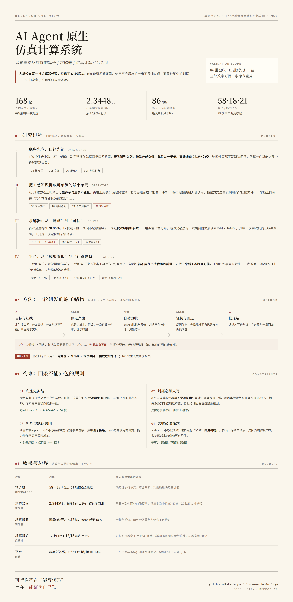
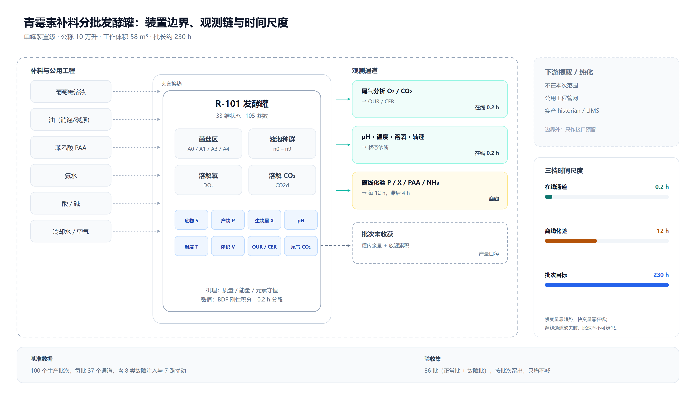
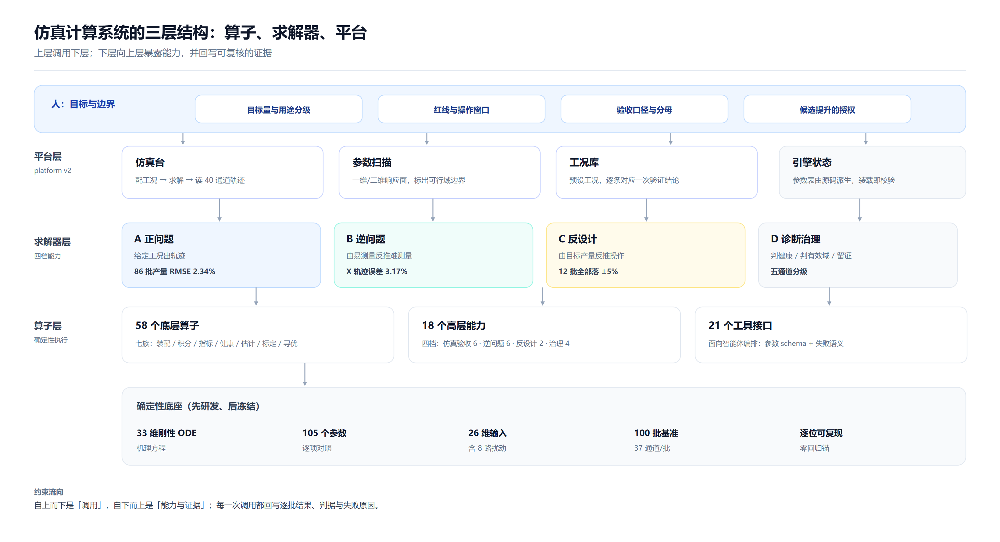
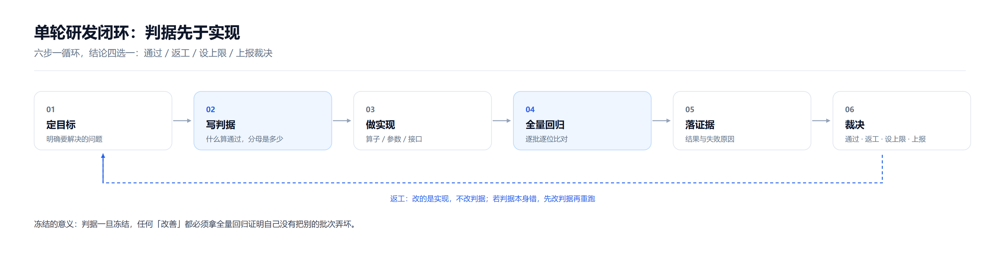
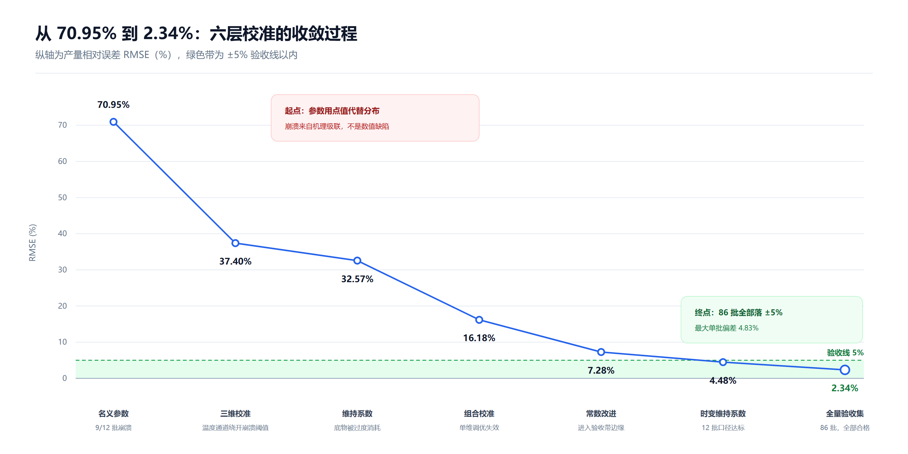
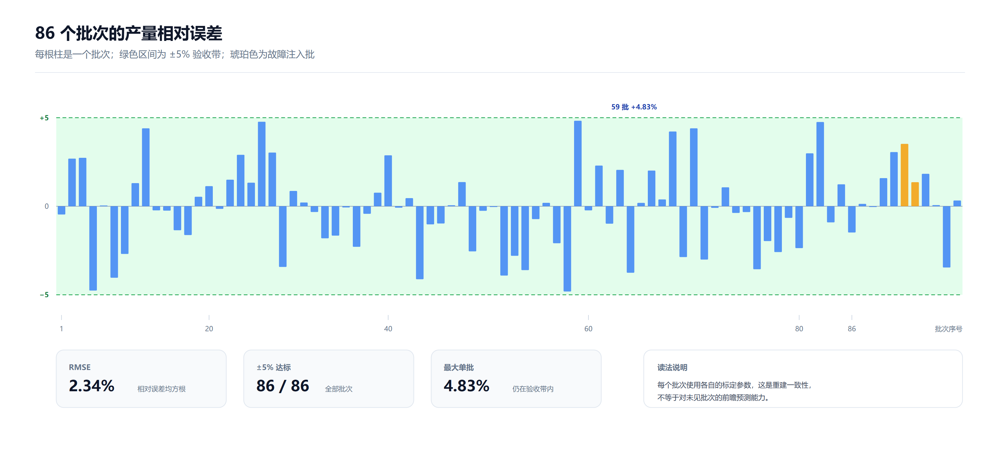
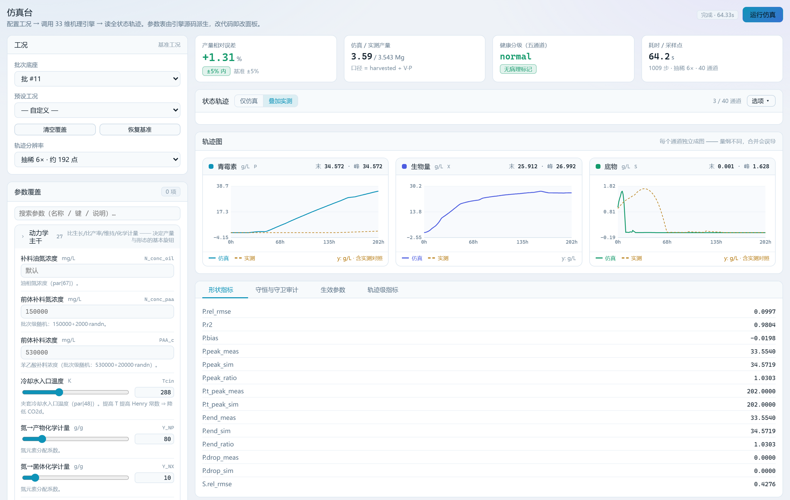
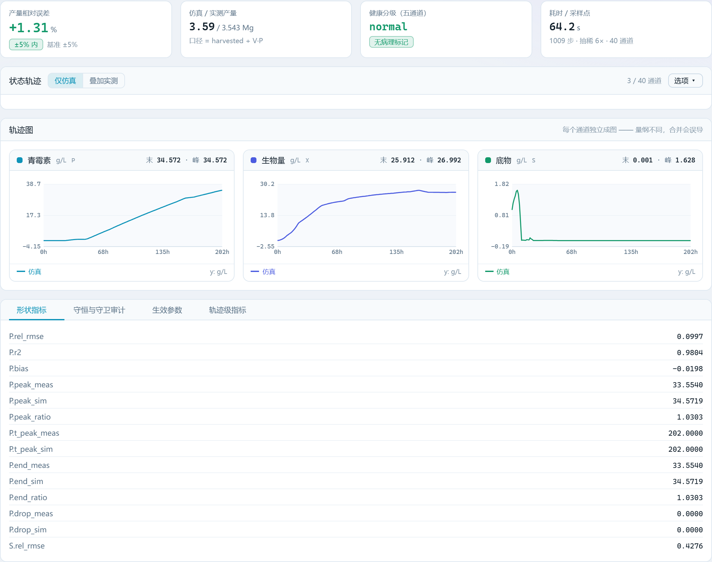
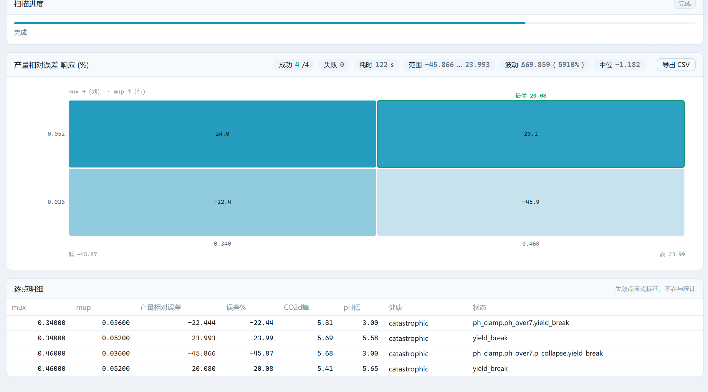

# AI Agent 原生仿真计算系统研发之路

## 以青霉素反应罐算子 / 求解器 / 仿真计算平台研发为例

> **两点说明**
>
> 第一，本文所有数字都来自可复现的运行结果，不是估算。`2.3448%` 指**重建一致性**——每个批次使用各自的标定参数；它**不等于**对未见批次的前瞻预测能力，同一模型在留出批次上的中位误差是 `97.47%`。这两个数字必须一起读。
>
> 第二，本文只讲三件事：目标是什么、怎么做的、做出了什么。做错的部分同样写进去，因为在这类系统里，失败路径的信息密度往往高于成功数字。

---

## 一、引言：三个必须先回答的问题

*一页看完这项研究。上半是四段推进的研发过程与单轮闭环的方法，下半是四条不可外包的约束，以及把成果与边界写在同一句里的结论表。它不是目录，是全文的压缩包——后面每一章，都是把这张图的一段摊开来讲。图较长，点击可放大。*

### 1.1 行业问题：人写的化工过程仿真系统，究竟卡在哪

传统化工过程仿真系统的建设路径大致固定：工艺专家给机理与参数，数值专家选解法器，软件工程师把两者翻译成代码，再经过若干轮现场对账。这条路走得通，但代价集中在三处——而且这三处都不会报错，它们只会慢慢沉淀成"这个模型只有老王能改"。

**第一处，迁移适配性。**

仿真系统的价值一半在模型，一半在**口径**。口径不写在代码里，而写在人的记忆里，于是每次迁移都要重新考古。我们的经历可以当样本：在解析一套公开的工业发酵基准数据时，接连遇到四类问题——表头里某个通道名带逗号，被拆成三列，导致表头比数据多两列、整体错位；放罐流量存成负值，直接求和得到的产量符号相反；统计汇总表标注的单位是千克，数值其实是克，量级错一千倍；离线化验通道有 98.2% 是空值，若按常规做法丢掉空值，整个化验维度会凭空消失。

这四件事没有一件是"算法问题"，但每一件都足以让迁移失败，而且失败方式极其隐蔽：程序跑完、不报错、结果是错的。人工项目里这类知识靠老工程师口口相传，换一个人、换一个工艺，全部归零。

**第二处，时效性。**

一次模型修订的完整闭环是：改代码 → 重跑 → 与基准比对 → 判断是改善还是劣化 → 写结论 → 同步文档。人工项目里前四步或许能做，第五、六步几乎必然被省略，因为成本太高。**省略的结果不是效率提升，而是"改动后果不可见"**——谁也不知道这次修改有没有把另外三十个批次弄坏。

**第三处，研发成本与复用。**

传统交付物是"一个能跑的软件"。验证脚本留在临时目录，判据写在评审 PPT，证据散落在聊天记录。下一个工艺立项时，这些全部不作为资产继承，于是从零重写。

一句话概括：**传统仿真系统的瓶颈不在算力，而在知识与验证没有被资产化。**

### 1.2 AI Agent 研发体系：可行性、高效性、可迁移性

把研发主体换成 AI Agent，首先要防止把问题问错。2026 年再问"AI 会不会写 ODE 代码"已经没有意义，真正需要检验的是三条：

- **可行性**：Agent 能否产出**逐位可复核**的资产，而不只是"能跑通"的代码？
- **可信性**：在人类不逐行审查的前提下，它的自我验证本身经不经得起检验？
- **不劣化**：多轮迭代之后，系统是变好了，还是只是变复杂了？

我们用 168 轮迭代去回答这三条。结论先说：**前两条成立但有严格条件，第三条可以做成机器可验，而条件本身比结论更有价值。**

**高效性的证据是规模，不是感受。** 这套系统里有近 500 个只读分析脚本，每个解决一个具体疑问，用完即弃；人类没有写过一行求解器代码，全部介入集中在 6 个裁决点——目标确认、问题受理、三项口径改判、五项条件批准、三项平台授权，以及始终没有执行的产线切换。单轮"改—跑—比—记"的周期从周级压到小时级，才使 168 轮成为可能。

**可迁移性是这套体系最容易被低估的部分。** 迁移的不是代码，而是四件套：

| 件 | 内容 | 换工艺时是否要改 |
|---|---|---|
| 契约 | 状态量、参数、输入、单位、时间戳、有效域 | 改字段，不改结构 |
| 判据 | 验收标准、闸门、失败语义 | 改阈值与分母，不改机制 |
| 证据 | 每轮结果的记录格式与命名 | 基本不改 |
| 编排 | 算子注册表、能力分层、工具接口 | 不改 |

真正需要重写的只有两族：机理方程与参数表。这正是一套分层结构的用意所在。

**但代价必须同时说清。** 这套体系里最反直觉的发现是：**Agent 造得出判据，却造不出可信判据。** 我们自建的 8 个验收仪器里，有 4 个最终被判无效——包括一个在 86 个批次上恒返回"正常"的崩溃分类器，和一个对"永远输出常数"的预测器同样报出 89.95% 覆盖率的置信区间检验。这不是 Agent 的能力缺陷，而是"验证"这件事本身的结构性困难：**判据必须先被证伪，而这一步不能外包。**

### 1.3 基准数据与参考实现

这一节回答两个具体问题：用什么数据做基准测试，以及站在什么基础上。

**（一）基准数据：IndPenSim 公开数据集。**

对象是工业规模的青霉素补料分批发酵罐，模型与数据由 Goldrick 等人在 2015 年公开发表并持续维护，是本领域少数"机理完整、故障可注入、批次数量足够"的开放基准。

| 项 | 内容 |
|---|---|
| 规模 | 100 个生产批次，单批 167–290 h，典型批长约 230 h |
| 装置 | 公称 10 万升搅拌罐，工作体积约 58 m³；含夹套换热、尾气分析、六路补料 |
| 在线通道 | 0.2 h 采样：温度、pH、溶氧、尾气 O₂/CO₂、OUR/CER、各补料流股、搅拌转速、通气量、罐压 |
| 离线通道 | 12 h 采样、分析滞后 4 h：产物 P、菌量 X、前体 PAA、氨氮、黏度 |
| 扰动 | 8 路低通滤波随机扰动，分别作用于生长速率、产物速率、底物浓度、油浓度、酸碱加量、前体浓度、冷却水温度与进气氧含量 |
| 故障 | 8 类注入：通气、背压、补料、碱液、冷却水、全故障、温度传感器、pH 传感器 |
| 基准集 | 86 批用于验收（含 2 个故障批），其余批次不参与验收 |
| 数据特点 | 离线通道 98.2% 为空值；统计汇总与轨迹不是同一次运行；表头存在错列 |

为什么强调"数据特点"？因为**这些不完美恰好是真实工业数据的常态**。一个只在干净数据上跑通的求解器说明不了什么；能在错列、空值、口径矛盾的数据上把边界画清楚，才有迁移价值。

**（二）参考实现：IndPenSim 的 MATLAB 开源代码。**

这套基准同时公开了 MATLAB 参考实现，它不只是一个"能跑的脚本"，而是包含机理、参数、批次生成、控制回路、光谱仿真与数据导出的完整工程。我们把它作为唯一的**权威真值**——不是拿来抄，而是拿来逐项对账。

| MATLAB 组成 | 作用 | 我们怎么用它 |
|---|---|---|
| `indpensim_ode.m` | 33 维状态方程右端 | 逐方程对照移植，逐项核对 105 个参数索引 |
| `Parameter_list.m` | 参数总表 | 生成同序同名的 Python 参数表，避免隐性重排 |
| `createBatch.m` | 批次级随机参数与 8 路扰动 | 由它确认"参数是分布而非点值"，这是后来一切偏差的根源 |
| `indpensim_run.m` | 单批运行主流程，含输入时序与 `ode15s` 调用 | 对齐输入插值方式、求解器配置与采样节奏 |
| `indpensim.m` / `fctrl_indpensim.m` / `PIDSimple3.m` | 模型入口、补料策略、PID 控温控 pH | 弄清被控量如何生成，才能定义"开环回放"的口径 |
| `Raman_Sim.m` + `PAA_PLS_model.mat` | 拉曼光谱仿真与 PLS 回归系数 | 作为前体软测量的候选通道，后经检验不予采信 |
| `Generate_Production_Batch_data_V4.m` | 批量生成生产批次 | 复现数据集生成口径，解释统计表与轨迹的矛盾 |

**为什么用代码做基准，而不是直接用文献公式？** 三个原因：文献给的是方程形态，代码给的是**可执行的口径**——初值怎么给、输入怎么插值、单位怎么换算、边界怎么守卫，这些细节决定了仿真能不能复现；代码里的随机参数生成方式决定了结果的分布，只读文献永远发现不了；最后，代码可以被逐行比对，文献不能。

代价也很清楚：MATLAB 的随机数生成器与 Python 不同，**逐批种子在原理上不可复现**。我们最终选择接受这一点，改用"参数分布 + 轨迹对齐"的方式逼近，而不是追求逐位相同的随机序列。

### 1.4 验证过程与成果概述

**验证路线**分三层推进，正好对应本文的三章：

1. **算子层**：把工艺知识拆成可单测的最小单元——58 个底层算子、18 个高层能力、21 个工具接口，装载核验 29 项全通过；
2. **求解器层**：从 MATLAB 逐项移植，经 168 轮校准与证伪，A 档（正问题）产量 RMSE `2.3448%`、86 批全部落在 ±5% 内、逐位零回归；
3. **平台层**：两代演进，从"研发成果看板"改为"仿真计算平台"，参数面 14 → 97 项、通道 8 → 40、分辨率 2 h → 0.2 h 原生、同步阻塞 → 异步作业队列。

**成果与边界，同表并列：**

| 层 | 达成 | 边界（同句必须给出） |
|---|---|---|
| 算子 | 58 底层 + 18 能力 + 21 接口，29 项核验全通过 | 算子是确定性执行单元，不含判断；判据质量决定其价值 |
| 求解器 A | 2.3448%、86/86、逐位零回归 | 重建一致性，非前瞻预测；留出批次中位 97.47%、20 批仅 1 批进 ±5% |
| 求解器 B | 菌量 X 轨迹误差 3.17%、86/86 <15% | 产物与前体判为不可辨识；菌丝分区量结构上测不到 |
| 求解器 C | 12 批口径下 12/12 落 ±5% | 进料可行域窄于 ±1%；修补中段产素缺口需 30% 量级位移，与域宽差 30 倍 |
| 平台 | 六视图看板 25 项闸门通过；计算平台 18 项快速闸门通过 | 旧平台原样冻结；五类敏感参数永久拒绝 |

*单罐装置级边界：左侧六路补料与公用工程，中部 33 维状态的反应器本体，右侧在线/离线观测与批次末收获。右下角三档时间尺度说明了这套问题的难点——快变量靠 0.2 h 在线通道，慢变量靠 12 h 化验，而目标量（比生长速率、比产物速率）只能由两者联合反推。*

*系统分层。上层调用下层，下层向上层暴露能力；底座是先研发、后冻结的确定性资产——33 维方程、105 个参数、26 维输入、100 批基准、逐位可复现。分层的目的不是好看，而是把"迁移时改什么"限定在两族之内。*

**代码与数据在哪里。**

本文讲的所有实现——33 维求解器、58 个底层算子与 18 个高层能力、两代仿真计算平台，以及 100 个批次的加工数据——都已整理成一个可直接运行的仓库：

> **[https://github.com/kakastudy/colulu-research-simuforge](https://github.com/kakastudy/colulu-research-simuforge)**

仓库按本文的三层结构组织：`candidate/` 是求解器，`operator_kit/` 是算子层（`penops`，既可 `import` 也可作为 MCP 服务装载），`platform/` 与 `platform_v2/` 是两代平台，`data/processed/` 是加工后的基准数据，`tools/` 是研发与验收脚本。`requirements.txt` 锁定了依赖版本（`numpy<2` 是硬约束，原因写在文件注释里），`README.md` 写了每层的一句话入口与五条复现边界。

三条命令可以走完全流程：跑一次单批仿真、跑一遍算子包自检、起平台并提交一次真实作业。文中每一个数字都能沿这三条命令重算出来——这也是我把它公开的原因：**可复现性不该靠读者的信任，而该靠一个能跑起来的东西。**

有一处需要提前说明：**仓库里不含 MATLAB 原始参考实现。** 那份代码是第三方研究成果，不该由本文转载；但它才是口径的来源，所以仓库只保留加工后的 100 批 CSV，数据来源、加工口径与引用方式写在 README 里。

---

## 二、仿真算子：把工艺知识拆成可单测的最小单元

### 2.1 研发过程

#### 2.1.1 起点不是设计，是归纳

算子库不是先画架构图再实现的。真实起点是一份"重复动作清单"：把前一百多轮里反复出现的操作抄下来，发现高度集中——每个批次都要读进来、装配初值与输入、跑一遍积分；每轮都要算产量、算轨迹偏差、算守恒；每轮都在判"这次算崩了没有"；后半程大量重复的是估参数、扫参数、找可行域。

把这些动作固化成函数，就成了算子。**先有重复，后有抽象**——反过来做必然失败，凭空设计的算子库最后一定有一半没人调用。

#### 2.1.2 七族划分

58 个底层算子按"在研发流程里承担什么"分成七族，而不是按文件目录分：

| 族 | 代表算子 | 作用 |
|---|---|---|
| 机理工况装配 | 右端函数、参数装配、输入构造 | 把一个批次变成可积分的初值与 26 维输入 |
| 数值积分与守卫 | 分段积分、越界守卫 | 0.2 h 分段积分、越界钳位、失败显式 |
| 指标与守恒 | 产量指标、轨迹指标、元素平衡 | 产量、逐点偏差、碳氮元素平衡 |
| 健康与有效域 | 健康分级、有效性判定、形状指标 | 五通道分级、越域标记、曲线形状 |
| 状态估计与诊断 | 批级估计、二阶段估计、集合卡尔曼、残差发现 | 逆问题、回退链、残差结构 |
| 标定与辨识 | 批级标定、灵敏度分析 | 参数标定、结构可辨识性 |
| 寻优与扫描 | 配方寻优、参数扫描、参数目录 | 反设计、参数面与可行域 |

这个分法有个副作用很有价值：**族的边界就是迁移的边界**。换工艺时前两族必须重写，后五族基本照搬。

#### 2.1.3 三条不变量

算子层真正的设计不是"有哪些函数"，而是三条约束，它们决定这个库能不能长期活着：

1. **不复制实现。** 算子只引用引擎里的函数，不抄一份源码。抄一份的短期收益是解耦，长期代价是两份代码必然分叉，而分叉时没人知道哪份是对的。
2. **不改旧目录一行。** 新增能力一律新建文件、新注册，旧模块逐字不动。这条约束让"逐位零回归"成为可能——如果每轮都在改旧代码，逐位比对就失去意义。
3. **失败显式。** 越域返回 `out_of_domain`，发散返回 `diverged`，不可辨识返回 `unidentifiable`，绝不静默兜底成一个"看起来正常"的数。

第三条最容易被违反，也最贵。我们踩过一个典型坑：早期的崩溃分类器逻辑是"若溶解二氧化碳峰值不超过 7.57 g/L，则判为正常"，而 86 个批次的峰值最大只有 7.194——**这个判据从未被触发过，所谓"零次灾难性崩溃"从未检验任何东西**。它不是返回了假数，而是返回了一个恒真的结论。后来换成五通道分级，真实分布是 77 正常 / 5 退化 / 4 灾难，其中 4 个全部是 pH 钳位批。

#### 2.1.4 一次真实的翻车：清单与代码分叉

算子库成型后要回答一个看似简单的问题：**注册表里列的东西，代码里真的有吗？**

第一次做装载核验时，答案是"没有"。两处登记项实际不是可调用函数，而是模块名——它们都被"文件存在就等于已装载"这条隐含假设掩盖了。这类分叉在项目里反复出现，是同一个病：**清单说的与代码做的，不是一回事。**

处置方式不是手工修补，而是让清单无法说谎：清单一律由脚本自动生成，不手写；核验逐条执行"导入 + 可调用 + 真实调用一次"；任何一条不通过则整体判失败，不允许"部分通过"。

这套做法在平台层被复用了一次——参数表改为从引擎源码静态解析派生，源码改了，参数表自动跟着改；源码里没有的，平台就调不到。同一个病，同一味药。

#### 2.1.5 为什么是三层：58 → 18 → 21

同一批能力被组织成三层，不是冗余，而是三种使用者的入口：

- **58 个底层算子**：给写测试的人。粒度到函数，可以单测、可以组合、可以逐行比对。
- **18 个高层能力**：给做分析的人。粒度到"一件事"，比如"验证基准集""做二阶段参数估计"。
- **21 个工具接口**：给 Agent 调用。粒度到"一次可编排的动作"，带参数约束与错误语义。

三层之间"下层是唯一事实源，上层只做签名与编排"，因此不会出现三份实现各自漂移。

### 2.2 成果概述

| 项 | 数量 | 状态 |
|---|---|---|
| 底层算子 | 58 个，7 族 | 装载核验 29/29 通过 |
| 高层能力 | 18 个（14 基础 + 4 扩展） | 同上 |
| 工具接口 | 21 个，支持三种协议版本 | 同上 |
| 硬约束 | 5 类敏感参数拒绝、2 类需显式确认、6 项边界上限 | 违反即拒绝执行 |

18 个高层能力按用途四档分布，这个分布本身就是对"仿真计算系统需要什么"的回答：

| 档 | 能力 |
|---|---|
| A 仿真与验收（6） | 批次仿真、批次评估、基准集验证、轨迹核验、元素平衡、通用仿真 |
| B 逆问题与诊断（6） | 批级估计、二阶段估计、状态重构、回退档位、在线观测、残差发现 |
| C 反设计与参数面（2） | 配方寻优、参数扫描 |
| D 元信息与治理（4） | 求解器信息、参数目录、响应量目录、控制建议 |

**一个算子的完整样子**，用健康分级举例。它输入一条轨迹，输出五通道分级加证据链：数值健康（是否发散、是否触发钳位）、pH 是否越出 [5, 8]、产物末值是否低于峰值一半、溶解二氧化碳是否穿越阈值、产量偏差是否超 ±5%。

它替代了那个恒真的二元分类器。**一个判据从"永远说没事"变成"能指出是哪 4 批、因为什么"，这就是算子的价值。**

### 2.3 结论

**第一，算子层的产出不是"函数多"，而是"每个函数都可被单独判定"。** 58 个算子背后是 58 组输入输出契约、失败语义与运行记录；没有这三样，函数只是代码。

**第二，可迁移性来自族的划分，而不是框架的选择。** 换工艺时重写"机理工况装配"与"标定辨识"两族，其余五族按契约复用。这比"做一个通用仿真框架"现实得多——通用框架失败率高，是因为它试图抽象掉本不该抽象的东西。

**第三，算子层解决不了判断问题。** 它能保证"给定判据，执行是确定的"，但判据对不对，它管不了。这条限制在下一章会以极大代价显现。

*一轮研发的原子结构。注意第二步与第四步的颜色：判据先于实现，且返还路径改的是实现而不是判据——如果判据本身错了，必须先改判据再重跑，否则所有"改善"都是在错误的靶子上取得的。*

---

## 三、求解器：从"能跑"到"可信"，中间隔着 168 轮

### 3.1 研发过程

#### 3.1.1 移植：33 维方程的逐项对账

参考实现是 33 维状态、105 个参数的 MATLAB 模型，目标是把工业规模青霉素补料分批发酵完整搬到 Python。这一步看起来是翻译，实际是逐项对账。移植中修正的六处，没有一处是语法问题：

| 问题 | 后果 |
|---|---|
| pH 方程符号取反 | 酸碱平衡方向相反，pH 全程漂移 |
| 菌丝分化分支判据写错 | 生长期与产物期边界模糊 |
| 前体抑制项缺失 | 产物轨迹在高前体浓度段失真 |
| 抑制项挂在错误的状态量上 | 崩溃阈值整体偏移 |
| 菌丝区代数约束与微分方程混用 | 该区质量不守恒 |
| 高转速段的自适应分支缺失 | 数值刚性突增，积分步长失控 |

外加一处时序问题：仿真原用**后向**操作量驱动区间（用采样行的值驱动上一段区间），而参考实现是**前向**的。这类错误不会让程序崩，只会让轨迹整体滞后一个采样周期——在 0.2 h 采样、230 h 批长的系统里，累积偏差足以把产量推出验收线。

积分配置最终冻结为 BDF、相对容差 1e-3、绝对容差 1e-6、最大步长 0.01 h，对齐 `ode15s`，并在 0.2 h 采样区间分段积分。

#### 3.1.2 第一次全线崩溃：70.95%

移植完成后用名义参数跑 12 个基准批次，结果是 **9/12 批崩溃、产量误差 70.95%**。第一反应是找 bug，但逐通道对照后发现：**崩溃不是 bug，是机理自己的级联。**

链路是这样的：

1. 基准数据在 t≈200 h 把通气量从 75 降到 65；
2. 通气下降 → 尾气二氧化碳分压上升 → 液相平衡浓度上升 → 溶解二氧化碳上升；
3. 溶解二氧化碳越过 7.57 g/L → 二氧化碳抑制项归零 → 生长速率归零；
4. 生长停止 → 底物积累 → 产物抑制 → 产素崩溃 → pH 失控至 3.0。

真正的根因在参数侧：MATLAB 为每个批次生成**批次级随机参数**（生长、产物、氧传递、前体浓度、氮源浓度五组）外加 8 路低通滤波扰动。Python 侧用名义点值，导致生物量峰值比基准高 25–35%，恰好把溶解二氧化碳顶过临界线。

这一步的教训是：**当参数是分布的、而仿真用点值时，"崩溃"不是数值问题，是统计口径问题。**

#### 3.1.3 校准的六层台阶，以及三次"越调越差"

承认口径问题之后进入校准。12 批口径下的收敛过程是六层台阶：

| 阶段 | 做法 | 产量误差 | 关键发现 |
|---|---|---|---|
| 0 | 名义参数 | 70.95% | 9/12 崩溃 |
| 1 | 三维校准（生长 × 产物 × 冷却水温） | 37.40% | 升温可绕开二氧化碳阈值（亨利常数上升、溶解度下降） |
| 2 | 维持系数校准 | 32.57% | 维持系数过高，底物被"烧掉"，产量系统性偏低 |
| 3 | 组合校准 | 16.18% | 参数间强耦合，单维调优失效 |
| 4 | 常数项改进 | 7.28% | 逼近验收带 |
| 5 | 时变维持系数 | **4.48%** | 早期防崩溃、晚期匹配产量，两个目标被解耦 |

三次"越调越差"比这条曲线更有信息量。

**其一，单维调生长速率会撞上鞍点分岔。** 扫描发现 0.23 以下是低生长区（不产素，产量接近零），0.24 以上直接跳到高生长区（生物量冲到 30 g/L 并崩溃），**中间没有过渡带**。这意味着"稍微调一点"这个动作在结构上不存在。

**其二，降维持系数修好了反向问题，却触发了正反馈。** 有 3 个批次仿真"过度产素"（+61% 到 +84%），根因是维持项在生物量约 5 g/L 时高达 5.6 g/L/h，远超底物输入 0.174 g/L/h。把系数从 0.029 降到 0.012，该批从 +61.3% 修到 −7.6%——但底物随之积累、生长加快、二氧化碳上升、又崩溃。**维持系数与溶解二氧化碳之间是正反馈，不是独立旋钮。**

**其三，时变系数才是解。** 把维持系数做成时间分段：早期用 0.029 压住二氧化碳，晚期切到 0.015–0.018 匹配产量。批 27 从 +14.0% 到 −0.2%，批 92 从 +11.9% 到 −0.6%。这不是"调参调出来的"，而是承认了一个事实：**单一常数的维持系数无法同时表达"生长期"与"产物期"两种生理状态。**

*12 批口径下的逐层收敛。这条曲线不是一次生成的结果，而是多次"假设—反例—撤回—重来"的产物：每一层下降都伴随一次证伪，其中三次尝试反而让结果变差。*

#### 3.1.4 扩到 86 批，以及产量指标的盲区

12 批调到 4.48% 之后扩到 86 批全量，最终 **2.3448%、86 批全部在 ±5% 内、逐位零回归**（最大单批偏差 4.83%）。

但这里有一个必须自己揭开的盲区：**产量指标对产物轨迹的形状几乎失明。** 计算显示产量误差与产物曲线形状的相关性只有 0.011。也就是说，一个产量完全达标的仿真，产物曲线仍可能整体前移或压扁。补测后的事实是：产物相对误差中位 15.6%（最差 84.8%）、峰值比 1.060、末值比 1.021，但 **60–120 h 段系统性偏低 9.2%**。

这个缺口后来被追到方程结构层：不是"后段产素过多"，而是 **0–60 h 生长期产素恒等于零**——残糖门控在该浓度下取值为 2e−13，而实测此时已产 2.49 g/L。补上生长关联项可以改善缺口，但形状与产量呈 1:1 耦合（参数取 0.60 时产量均值偏移 +5.4 个百分点），**结构上没有单一旋钮**。该问题最终登记为已知边界，而不是"已修复"。

*86 个批次的产量相对误差，绿色为 ±5% 验收带，琥珀色为故障注入批。所有批次落在带内，但这张图只说明"产量对得上"，不说明"曲线形状对得上"——后者需要另外的形状指标。*

#### 3.1.5 判据失效：这一章最贵的一课

当求解器开始"达标"，验收判据本身开始成为风险源。两个案例：

**案例一，恒真的崩溃分类器。** 判据是"溶解二氧化碳峰值不超过 7.57 则正常"，而实际峰值最大只有 7.194。于是"零次灾难性崩溃"这个结论**从未被检验**。改用五通道分级后，真实分布是 77 / 5 / 4。

**案例二，构造性的覆盖率。** 置信区间由残差自身的 5%/95% 分位数构造，于是对**永远输出常数的预测器**同样报出 89.9549%，四个通道逐位相同、差值为 0.000000。这个数字看起来完美，实际上是同义反复：用残差构造的区间，当然覆盖残差。

处置不是"换个数字"，而是换论据：达标论述改用**区间半宽 + 相对误差改善**，并把覆盖率判据改成均值加减 1.96 倍标准差（此时垃圾模型的标准差趋零，覆盖率会掉到 0，判据重新具备判别力）。

同类的失效还有两例：相关系数对缩放不变，把模型输出乘以 1000 之后相关系数逐位相同，实为 1000 倍量纲差；所谓"两点校准严格优于光谱回归"的结论，在剔除 41 批中 29 批的占位值之后方向反转。**四条结论被撤回，靠的都是同一条纪律：自建判据必须先做证伪测试。**

#### 3.1.6 四档能力与回退链

求解器最终不是"一个求解器"，而是四档能力加一条回退链：

| 档 | 解决的问题 | 关键产出 |
|---|---|---|
| A 正问题 | 给工况，出轨迹与产量 | 86 批 2.3448%；41 个输出通道 |
| B 逆问题 | 给易测量，反推难测量 | 菌量 3.17%、黏度 5.57%；产物与前体判不可辨识 |
| C 反设计 | 给目标产量，反推操作 | 12 批 12/12 落 ±5%；进料可行域窄于 ±1% |
| D 诊断治理 | 判健康、判有效域、留证据 | 五通道分级、越域标记、证据闸门 |

回退链是 B 档的兜底：集合滤波健康度判定 → 退化守卫 → 移动时域估计 → 稳态平衡基线 → 档位裁决。五步按"哪一层还能给出可信结果"逐级下降，全链默认关闭、接入后逐位不变。

B 档的成果与边界必须一起讲：可交付的是菌量（中位误差 3.17%、86 批全部 <15%、90% 区间半宽 8.14%）与黏度（19.69% → 5.57%）；不可辨识的是产物（14.19% → 17.70%）与前体（28.20% → 28.72%），两者都**劣于**直接用模型值；结构上封死的是菌丝分区量——观测算子的秩为 0、零度为 4，加上数据里没有任何分区实测，构成"结构不可辨识 + 数据不可验证"的双重结论，该目标量最终从交付清单中撤下。

### 3.2 成果概述

| 规格项 | 值 |
|---|---|
| 状态维度 / 参数 / 输入 | 33 / 105 / 26 |
| 积分器 | BDF，相对容差 1e-3、绝对容差 1e-6、最大步长 0.01 h |
| 原生分辨率 / 输出通道 | 0.2 h / 41 |
| 回放模式 | 开环，基准被控量序列驱动，前向时序 |
| A 档验收 | 2.3448%，86/86 在 ±5% 内，逐位零回归，最大单批 4.83% |
| 守恒 | 碳平衡中位 −1.5%；氮平衡中位 +9.9%、85/86 在 35% 内 |
| 服务面 | 引擎侧 14 个工具；算子包侧 21 个工具 |

**负结果同样是一等成果**，因为它们同样花了轮次、同样可复核：

| 尝试 | 结果 | 处置 |
|---|---|---|
| 闭环数据同化（用观测反馈修正状态） | 产量达标从 86/86 掉到 6/86，49 批产素归零 | 已否决，不作交付路径 |
| 八路扰动方差注入 | 全幅 3/6 批崩塌；在一组种子上调出的参数换到另一组即崩到 99.85 个百分点，最终 18/20 不通过 | 阈值不放宽，原始失败记录保留 |
| 拓宽进料可行域 | pH 数值病态已修（钳位 5→0），但域宽只扩到约 ±2%；剩余硬约束是双稳态 | 登记为边界，执行前必须跑包络检查 |
| 修补中段产素缺口 | 四轮全局形状尝试全部失败，根因定位到方程结构 | 已知边界，守"不恶化" |

### 3.3 结论

**第一，"可信"是可分解的，不是一种感觉。** 它至少包含四层：数值可信（86 批逐位零回归）、口径可信（同一结论要在接口契约、运行记录与结果数据三处一致）、统计可信（每条判据先过证伪测试）、边界可信（失败显式输出而不是兜底）。缺任何一层，"达标"都不可引用。

**第二，2.3448% 的正确读法必须与数字同句给出。** 它是重建一致性——每批用各自标定参数。同一模型在留出批次上的中位误差是 97.47%、20 批里只有 1 批进 ±5%，约为重建误差的 41.6 倍。诚实地讲，这套求解器目前证明的是"能把一个已知批次复现到 2.34%"，尚未证明"能预测一个没见过的批次"。

**第三，求解器层可复用的不是方程，是验收协议。** 方程换工艺就作废；而"先冻结基线—每轮零回归—判据先证伪—负结果归档"这套协议，与工艺无关。

---

## 四、仿真计算平台：从"成果看板"到"计算设备"

### 4.1 研发过程

#### 4.1.1 第一代：六视图，回答的是"研发做得怎么样"

第一代平台建在求解器验收之后，定位是**研发成果的呈现**：回归总览、过程拓扑、批次工作台、通道诊断、算子库、观察·控制工作台，六个视图，25 项闸门通过，六张逐屏复验截图。

它完成了使命，但体检后发现一个结构性错位——按"能做什么"逐项统计：

| 维度 | 实际 | 引擎能力 |
|---|---|---|
| 视图构成 | 6 个，其中真正做计算的只有 1.5 个 | 四档能力全在 |
| 可调参数 | 14 项白名单 | 引擎接受 75 项 |
| 输出通道 | 8 个 | 引擎输出 41 个 |
| 轨迹分辨率 | 2 h 下采样 | 原生 0.2 h（1149 步） |
| 交互模型 | 同步阻塞，单次 18–84 s | — |

结论很直白：**引擎早就被研发完了，平台却只把它放在一张可点开的清单里。** 平台没有把引擎当成计算设备来用。

#### 4.1.2 重设计的判据：一句话定标准

第二代立项时，判断标准被压成一句话：

> 不是研发成果的看板，而是基于已研发的算子与求解器构建的仿真引擎，可进行仿真计算。

这句话翻译成工程约束是四条：参数面必须等于引擎真实参数面、通道必须等于引擎真实输出、时间分辨率不许降级、交互不能让人分不清"在算"和"卡住了"。

#### 4.1.3 六个设计决策，每个都配一次翻车

这一节是本章核心，因为六个决策全部由具体失败逼出来。

**决策一：参数表从引擎源码静态解析派生，不手写。**

上一代吃过"清单与代码分叉"的亏。这一代改为解析源码，提取真正被接受的参数键——源码变了参数表自动跟着变，源码里没有的平台调不到。

**首版立刻翻车**：只匹配了一种参数装配方式（直读式），漏掉了另一种（按索引写入参数向量），导致 18 个动力学参数被误判为"源码已移除"。自检当场抓到，现在这项检查是常驻闸门。

**决策二：工况全开，唯五类敏感参数硬拒绝。**

开放 97 个参数项，覆盖动力学、形态学、故障注入、时变扰动、操作与控制、数值积分器、初值、pH 通道、软测量九组。但有五类保持拒绝：会改变随机噪声幅值与种子的、会改变创新判据阈值的、会绕过标定参数的。开放与拒绝的分界线不是"危险程度"，而是**是否已被证据批准**——这五类都还没被批准。

**决策三：新增量程校验，因为"有限数"不等于"合法值"。**

生长速率填 1e308 是有限数，能通过常规的空值/无穷检查。若放行，引擎会跑出一条看起来正常的轨迹——这是最坏的一类失败：**失败不可见**。处置是给参数表登记**已知有效域**（注意不是物理上下限），越域直接拒绝提交并报出具体区间。

**决策四：校验前置到提交时。**

首轮闸门里，两条越域用例**全部返回 200**——因为参数校验发生在后台线程，前端拿到"提交成功"，几分钟后才看到失败，无效作业还占满队列。处置是把校验搬到入队之前，不过就返回 400。

**决策五：异步作业队列，因为同步阻塞在物理上不可行。**

单次仿真 18–84 s，同步 HTTP 会超时、阻塞其他请求，且用户无法区分慢与卡死。最终设计是：仿真串行（引擎是 CPU 密集 + 解释器全局锁争用，并发不提速反拖慢）、接口并行（慢仿真不阻塞健康检查与目录查询）、同工况指纹命中缓存（省算力且保证可复现）、可取消、排队上限 8。

**决策六：旧平台原样冻结。**

新平台独立部署、独立端口，旧平台不重启、不触碰。这一条是为了让"新平台"与"旧结论"可以同时为真——如果改造旧平台，所有历史验收数字都需要重跑。

#### 4.1.4 五个视图与九个接口

| 视图 | 职责 | 相对第一代 |
|---|---|---|
| 仿真台 | 配工况 → 跑 → 读 40 通道轨迹、产量、五通道健康、守恒、守卫审计 | 大幅扩展 |
| 扫描 | 一维/二维参数扫描，画响应曲线与曲面，找可行域边界 | 新增 |
| 工况库 | 12 条预设工况，每条注明它对应的验证结论 | 新增 |
| 算子 | 17 个算子按四层分组（引擎 / 验收 / 软测量 / 寻优） | 静态目录 → 分层说明 |
| 引擎状态 | 运行时装载核验、参数全表（含装配方式标注） | 部分继承 |

接口九个：健康检查、参数目录、响应量目录、提交仿真、查询作业、提交扫描、查询扫描、取消作业、叠加基准实测通道。

研发成果（86 批回归、通道诊断、拓扑）不再是主视图。在新平台上，它们的用途从"展示结论"变成"佐证当前这次算得对不对"。

### 4.2 成果概述

| 维度 | 第一代 | 第二代 |
|---|---|---|
| 主视图 | 回归总览 | 仿真台 |
| 数据来源 | 预烘焙静态包 | 服务端实时调用引擎，前端零预烘焙 |
| 参数面 | 14 项白名单 | 97 项，源码派生 |
| 通道 | 8 | 40（引擎侧共 41 个输出） |
| 分辨率 | 2 h | 0.2 h 原生（可选 3/6/12× 抽稀） |
| 交互 | 同步阻塞 | 异步队列（进度可见 / 可取消 / 结果缓存） |
| 验证 | 25 项闸门、6 屏复验 | 18 项快速闸门、6 屏复验 |

一个体现"失败可见"落到界面上的细节：二维参数扫描的结果表里，越域或崩溃的点被显式标注"破线"，**不参与统计、不被静默填 0**。

*仿真台实景（批 11，未做任何参数覆盖）。左栏是 97 项参数中的动力学组，右侧四张指标卡给出产量相对误差 +1.31%、仿真与实测产量、五通道健康分级"正常"、耗时 64.2 s。下方三张轨迹卡分别是产物、菌量、底物，实线为仿真、虚线为实测；底物曲线的实测段在中后期缺失，正是离线化验 12 h 采样与大量空值的直接体现。*

*同一次运行的结果面板。除产量与健康分级外，下方的形状指标是后来补的：产物相对误差 0.0997、峰值比 1.0303、面积比 0.9804。之所以要有这一组，是因为产量指标对曲线形状几乎失明——一个产量达标的仿真，产物曲线仍可能整体前移。*

*二维参数扫描。热力图为产量相对误差随生长速率与前体速率的变化，逐点明细列出每组的误差、溶解二氧化碳峰值、pH 极值与健康分级。注意这不是验收运行：把两个批次级参数同时推离标定值后，四个组合全部越过崩溃边界，产量在 −45.9% 到 +24.0% 之间摆动，幅度达 591%，状态列直接写明原因（pH 钳位、pH 越限、产素崩塌）。**平台没有隐藏这些失败点，也没有把它们静默填成 0**——这正是"失败可见"落到界面上的样子。*

### 4.3 结论

**第一，平台的价值判据不是"好不好看"，而是"能否把引擎能力一比一暴露，且不引入新的不可信"。** 14 → 97 参数、8 → 40 通道、2 h → 0.2 h，这三项不是界面优化，是**能力泄漏的修补**。

**第二，平台的三个翻车点有共同结构：清单与实际分叉。** 手写参数表会分叉、只匹配一种装配方式会漏项、后台校验会让失败延迟。处置全部指向同一件事——**让清单从源码派生、让校验前移到边界、让失败在提交时刻就可见**。

**第三，平台层与工艺无关。** 换引擎时只需替换参数目录的派生源与工况库内容，五个视图、九个接口、队列模型都不动。这是三层里迁移成本最低的一层。

---

## 五、结论：可复用的不是代码，是研发协议

### 5.1 三层各一句话

**算子层**：把重复动作固化成带契约、带失败语义、带记录的最小单元。代价是必须先有重复；收益是 58 个单元可以被单独判定，而不是被整体信任。

**求解器层**：可信是四层叠加——数值、口径、统计、边界。2.3448% 只是第一层；缺了后面三层，这个数字不可引用。

**平台层**：计算平台的完成度用"能力暴露率"衡量，不用界面复杂度衡量。97/97 参数、40/41 通道、0.2 h 原生，才是"引擎真的被用起来"的证据。

### 5.2 可迁移性：搬四件套，加七条检查项

迁移到另一个工艺（结晶、聚合、干燥都一样），要搬的是四件套而不是代码：

| 搬什么 | 具体形态 | 换工艺时 |
|---|---|---|
| 契约 | 状态量、参数、输入、单位、时间戳、有效域 | 重写内容，保留结构 |
| 判据 | 验收标准、闸门、失败语义、记录字段 | 改阈值与分母，不改机制 |
| 记录格式 | 每轮结果的字段与命名 | 基本不改 |
| 编排 | 算子注册表、能力分层、工具接口 | 不改 |

七条检查项，按先后次序：

1. **目标与红线写成机器可验的文档**：不是"尽量准确"，而是"±5% 误差、86 批分母、哈希自检、不通过就退出非零码"。
2. **先研发并冻结确定性资产，再上 Agent 编排**：调度对象必须逐位可复现。
3. **每轮先写判据再动手**：判据不合规则本轮不成立；结论显式四选一（通过 / 返工 / 设上限 / 上报）。
4. **判据自身做证伪测试**：零信息对照、双向判据（禁恒真/恒假）、数据驱动阈值加留一验证。
5. **负结果与撤回编号归档、不删除**：撤回记录与通过记录同等重要。
6. **评估权与授权权分离**：候选默认关闭、敏感参数显式拒绝、提升由人发起。
7. **结论三处一致**：接口契约、运行记录、结果数据，缺一不算数。

这七条里第四条最难，也最值钱。8 个自建判据中 4 个失效，全部是被这条纪律抓出来的；如果没有它，这四个"通过"会直接进入交付文档。

### 5.3 可行性边界与未闭合项

不写"未来可期"，只列清单：

| 项 | 状态 | 说明 |
|---|---|---|
| 前瞻预测能力 | 未证明 | 留出批次中位误差 97.47%，28 批验证集从未留出 |
| 产线切换 | 从未执行 | 需独立基线冻结、契约升版、全量闸门重跑 |
| 闭环控制 | 红线 | 明令不接实产闭环；实测闭环同化 86/86 → 6/86 |
| 扰动注入 | 18/20 不通过 | 调参种子 3.70 个百分点，换种子 99.85 个百分点，改进与漂移不可区分 |
| 进料可行域 | 窄于 ±1% | 窄于工程可用；根因是双稳态而非数值 |
| 产物 / 前体软测量 | 不可辨识 | 劣于直接使用模型值 |
| 菌丝分区量 | 结构封死 | 观测算子秩为 0、零度为 4，数据无分区实测 |
| 气体通道单位 | 待核证 | 与液相质量计量约 30 倍失谐，需原始文献核证 |
| 跨工艺泛化 | 未开展 | 单案例、有界条件；第二个工艺案例未立项 |

### 5.4 收尾

这套系统最值钱的产出，不是 2.3448%。

是三样东西：一套**能把"通过"证伪的判据机制**（8 个判据废掉 4 个）、一本**记录了九十多条失败的台账**（含 18/20 不通过这种完整负面结论）、一条**从算子到平台都遵守的次序**——先把确定性资产做成机器可验，再让 Agent 去做协作、计算、调度与发现。

如果压成一句可以直接搬走的话：

> 人负责把不确定性写成约束，Agent 负责把确定性执行到规模；而"这个结论可不可信"这件事，永远不能外包。
