# Falsifiable bioprocess digital twins: counterfactual auditing of acceptance instruments and epistemic boundary certificates on 86 industrial-scale penicillin fed-batches

**Running title:** Counterfactual auditing of bioprocess digital twins

**Article type:** Original research article (methods and systems paper)

**Formats:** Markdown / self-contained HTML / A4 PDF, synchronised from this source

**Authors / affiliations / correspondence:** [to be completed by the submitting author before submission]

**Data and code:** all artefacts referenced in this manuscript are versioned in the project repository; see Data and Code Availability.

---

## Abstract

Digital twins for bioprocesses are judged by predictive accuracy, yet the
*instruments that certify them* are rarely tested for falsifiability. A metric that returns
a favourable value for every model, including a zero-information model, certifies nothing.
We introduce counterfactual instrument auditing: every acceptance statistic, classifier and
deployment check is issued a machine-signed **falsifiability certificate** recording its
control separation, output entropy and detection power, and is quarantined if any axis is
zero. Claims themselves are typed objects <subject, quantity, evidence, scope, authority>;
evaluation compiles a candidate, an adversarial gate type-checks it, and promotion to the
default path requires a human signature that was deliberately never given. On an in-silico
benchmark of 100 fed-batch penicillin fermentations (IndPenSim, 100,000 L, ~230 h), we
ported the 33-state model to Python, calibrated 86 batches and froze a byte-identical
baseline (end-of-batch yield RMSE 2.3448%, 86/86 within +/-5%, max|Delta| = 0.00e+00).
Extended validation places this number in context: against leave-one-out mean, persistence
and zero predictors the frozen twin reduces RMSE by 96.82%, 97.46% and 97.66%, and by
88.8% on a scale-robust median-normalised error (2.22% versus 26.31%). Errors are
unbiased (mean -0.0662%, sign test p = 0.590), approximately normal (Shapiro-Wilk p =
0.182), serially unstructured (lag-1 r = 0.058, runs p = 0.696) and in agreement with the
record (Bland-Altman limits -4.69% / +4.55%). Of eight acceptance instruments, four were
invalidated: a coverage statistic identical (0.899548532731377) for fitted and
zero-information predictors, a crash classifier returning 86/86 `normal`, an innovation
test flagging 84.38%, and a file-existence loading test. Replacements resolved 77 normal,
5 degraded and 4 catastrophic batches. We further show that health and validity criteria,
though conceptually distinct, are perfectly collinear here (phi = 1.0) because both
consume the same pH-guard signal, and therefore cannot be counted as independent
corroboration. **Epistemic boundary certificates** convert unidentifiable states
(rank 0 / nullity 4) and discontinuous control responses (99.8-101.5 pp jumps) into typed
`WITHDRAWN` outputs. A **realisation-path invariance test** rejects eight-path disturbance
variance injection: full amplitude caused 3/6 collapses (96.06 pp), and a scale of 0.35
tuned on seed 7 collapsed to 99.85 pp on unseen seed 11, yielding 18/20 NO_GO with
thresholds unchanged. A Canvas-rendered process flow diagram and a runtime-verified
six-view platform (14 capabilities, 12 operators, gate 25/25, final check 20/20, contract
v1.97) make the evidence executable. All evidence is in silico; each batch uses its own
calibrated parameters, so 2.3448% is reconstruction consistency, not prospective
prediction, and no opt-in candidate was promoted to the default path.

**Keywords:** digital twin; falsifiability certificate; counterfactual instrument audit; evidence type system; epistemic boundary certificate; realisation-path invariance; structural identifiability; verification and validation; negative results; penicillin fermentation; reproducible simulation

---

## 1. Introduction

Mechanistic and hybrid digital twins are becoming the substrate for process development, soft sensing, fault diagnosis and control in industrial biotechnology [1–3]. The penicillin fed-batch process is the canonical benchmark in this space: Birol, Ündey and Çınar released a modular simulator [1], and Goldrick and colleagues later published IndPenSim, a first-principles model of a 100,000 L industrial fermentation with 100 simulated batches that include realistic faults, operator actions and Raman spectra [2,3]. Because the benchmark is publicly available and richly instrumented, it has become a test bed for monitoring, machine learning and control studies.

The dominant evaluation convention in this literature is accuracy: root-mean-square error of end-of-batch product mass, trajectory-level normalised RMSE, or interval coverage. This convention inherits an implicit assumption — that the metric is *capable of being wrong*. Verification and validation (V&V) theory has long insisted that a validation exercise must be able to falsify the model [4,5], and identifiability theory has long insisted that a fit is meaningless when the observation operator cannot distinguish the parameters being fitted [6–8]. Reproducibility research has similarly documented how leakage, underspecification and seed sensitivity manufacture overoptimistic conclusions across scientific fields [9–14]. Yet in practical digital-twin projects these three literatures are rarely operationalised together, and the instruments that certify a twin are seldom themselves certified.

The consequences are concrete. A coverage statistic constructed from the 5th and 95th percentiles of the *same residuals* it is meant to validate will report approximately 0.90 for any predictor, including a constant. A crash classifier whose first branch returns `normal` whenever dissolved CO₂ stays below a threshold that no batch ever exceeds will report zero crashes regardless of the underlying dynamics. A dashboard that declares a capability "loaded" because a file exists will report 100% availability even when the symbol in that file is not callable. In each case the system is internally consistent, numerically stable and completely uninformative.

This study asks a different question from the usual one. Rather than "how accurate can the twin be made?", we ask **"which of our claims can be falsified, and what remains defensible once the unfalsifiable ones are removed?"** We answer it with a four-layer, evidence-gated architecture and a complete audit of a research programme numbered R1-R167 (36 archived round reports) on the IndPenSim benchmark. The contributions are fourfold:

The contributions are sixfold:

1. **Counterfactual auditing of the certification apparatus.** We define a falsifiability
certificate with three machine-computable axes - control separation, output entropy and
detection power - and issue it for eight acceptance instruments from frozen JSON evidence.
Four are invalidated as tautological, constant, saturated or existence-only; four are
certified. This moves V&V from "validate the model" to "validate every device that
produces a claim", including the dashboard.

2. **An evidence type system for scientific claims.** We model a claim as a typed record
<*subject*, *quantity*, *evidence*, *scope*, *authority*> and implement the four-layer
architecture as a compilation pipeline: L0 is a frozen symbol table, L1 compiles
bypassable candidates, L2 is an adversarial type check with pre-registered thresholds,
and L3 is a human-signed linker action. Five forbidden keys constitute an explicit
ambient-authority revocation list. `WITHDRAWN` is a valid output type, not a failure.

3. **A systematic falsification of three acceptance instruments, plus a fourth
independence finding.** Using zero-information controls, constant-detector tests and
trigger-rate audits, we show that a residual-quantile coverage metric, a crash classifier
and a global innovation threshold are respectively tautological, constant and
near-constant. We then show that the replacement health classifier and the batch-validity
criterion, although answering different questions, are perfectly collinear (phi = 1.0)
because they share a pH-guard signal - so two apparently independent checks are one
piece of evidence.

4. **Epistemic boundary certificates.** Structural results are promoted from prose to
typed artefacts: whenever nullity(H) > 0, the corresponding delivery claim is marked
`WITHDRAWN` regardless of fit quality. Mycelial compartment states (rank 0 / nullity 4),
substrate/product/PAA channels, the simulated Raman channel and runtime continuous
control (99.8-101.5 pp discontinuous response) become certified boundaries of the
twin rather than unfinished work.

5. **A realisation-path invariance test and a pre-registered negative result.** For any
stochastic augmentation we require invariance to disturbance *realisations* across at
least two unseen seeds, not merely monotone amplitude behaviour. Eight-path variance
injection at full amplitude caused 3/6 catastrophic collapses (96.06 pp); a scale of
0.35 tuned on seed 7 appeared feasible but failed on unseen seed 11 (99.85 pp) while
succeeding on seed 23 (2.13 pp). We declare 18/20 **NO_GO**, retain the failing
first-pass evidence and leave thresholds untouched.

6. **Extended baseline validation and executable evidence.** Seven historical calibration
stages, five reference predictors with explicitly stated information sets, parity and
Bland-Altman agreement, distributional diagnostics, a 12 x 12 alpha_kLa response surface,
a five-family gate matrix, 147 evidence JSON files and an interactive Canvas 2D process
flow diagram make every headline number comparable and re-derivable.
All experiments reported here are **in silico**. IndPenSim itself was validated against historical industrial records by its authors [2]; we do not claim prospective plant validation, wet-laboratory confirmation, or bit-exact reproduction of the original MATLAB simulator. We state this prominently because the paper's central argument is that credibility comes from explicit, falsifiable scope — and that argument would be self-defeating if our own scope were overstated.

---

## 2. Background and related work

### 2.1 Fermentation simulation benchmarks

The mechanistic lineage begins with Bajpai and Reuss [15], was extended by Birol et al. with pH, temperature, aeration, agitation, substrate feed and CO₂ evolution terms [1], and was further extended by Goldrick et al. into IndPenSim, a structured model of a 100,000 L industrial *Penicillium chrysogenum* fermentation [2]. IndPenSim includes environmental effects (dissolved oxygen, viscosity, temperature, pH, dissolved CO₂), nitrogen and phenylacetic acid limitations, a simulated Raman spectrometer, eight classes of faults and 100 released batches [3]. The simulator and its batch data are public, which makes independent re-analysis possible — an essential precondition for the audit reported here.

### 2.2 V&V, identifiability and uncertainty

Verification asks whether the equations are solved correctly; validation asks whether the right equations are solved [4]. Roy and Oberkampf formalised a comprehensive V&V/UQ framework in which validation requires both a quantitative comparison and an explicit statement of the domain in which the model is credible [5]. Identifiability analysis asks a prior question: whether the available observations can, even in principle, determine the parameters or states of interest. Profile-likelihood methods distinguish structural from practical non-identifiability [6]; algebraic treatments characterise the rank of the observation map [7,8]. In partially observed nonlinear ODE models, a good fit is not evidence that the fitted quantities are determined — a point that becomes decisive in Section 4.2.

### 2.3 Reproducibility, leakage and unfalsifiable metrics

Large-scale surveys established that reproducibility is a systemic problem [9,10], that positive findings are over-represented [11], and that data leakage affects at least 294 papers across 17 fields [12]. Kapoor and Narayanan's taxonomy of leakage includes metric-choice errors, a category into which tautological validation statistics fall. In reinforcement learning, Henderson et al. showed that seed variance can invert reported rankings [13], and Pineau et al. codified reproducibility checklists [14]. Underspecification [16], hidden technical debt in ML systems [17] and FAIR data stewardship [18] provide complementary framings. Our contribution connects these threads to process systems engineering: we treat a validation metric as a piece of software that must itself be tested against an adversarial control, and we make the resulting test outcomes part of the permanent evidence record.

### 2.4 Positioning

**Table 1. Positioning relative to prior work.**

| Line of work | Typical objective | Treatment of metric validity | Treatment of negative results | Scope of claim |
|---|---|---|---|---|
| Mechanistic fermentation simulation [1–3] | reproduce process behaviour | accuracy against plant records | rarely reported | plant-validated simulator |
| Data-driven soft sensing on IndPenSim [3] | minimise trajectory error | cross-validation, RMSE | rarely reported | in-silico predictive performance |
| V&V / UQ frameworks [4,5] | quantify credibility | formal, but metric-level falsification implicit | not a focus | domain of applicability |
| Identifiability analysis [6–8] | determine what can be known | formal rank / profile analysis | n/a | structural, conditional on H |
| Reproducibility / leakage literature [9–14,16] | detect overoptimism | taxonomy and checklists | central, but usually documentary | cross-domain methodological |
| **This work** | **certify what can be falsified** | **zero-information controls + constant-detector tests, machine-checked** | **archived, threshold-preserving, promotion-blocking** | **in-silico reconstruction consistency** |

### 2.5 Information-theoretic auditing and claim typing

Information theory supplies the vocabulary for asking whether an instrument carries any
information at all [34]: a statistic whose output distribution is degenerate has zero
entropy and cannot discriminate between a model and no model. Method-comparison
statistics add a complementary warning that *association is not agreement* [35] - a
correlation of 0.996 between simulated and recorded yield says little about bias or
limits of agreement. Distributional diagnostics [36-38] are standard practice in
statistics but are seldom applied to the validation instruments of a digital twin.

A second connection is to protection and capability-based systems [39]. In a computer
system, being able to compute a result and being authorised to change what the system
relies on are distinct privileges; conflating them produces exactly the class of
incident that least-authority designs prevent. We argue that scientific claims need the
same separation: running a candidate, evaluating it, and promoting it to the default
production path are three different acts with different authority requirements. Treating a
claim as a typed object makes a negative result a well-typed output rather than an
embarrassment, and makes promotion an explicit linker decision. To our knowledge this
compilation metaphor has not previously been operationalised as an executable,
threshold-preserving gate in a bioprocess digital twin.

---

## 3. Materials and methods

### 3.1 Benchmark, data and honest scope

We used the 100 publicly released IndPenSim batches [2,3]. Each batch supplies 37 recorded channels: 26 on-line manipulated/measured variables sampled at 0.2 h (temperature, pH, dissolved oxygen, off-gas O₂/CO₂, OUR, CER, feed rates, agitation, aeration, pressure, etc.) and off-line assay values sampled at 12 h with a 4 h reporting delay and 98.2% missingness. Batch duration is ~230 h with a batch-specific stochastic component; fault injections cover eight classes. The evaluation window is t ≥ 20 h, where the process has left the initial transient.

From the 100 batches, 86 constitute the calibrated evaluation set (`GOLDEN_ALL`: 84 normal plus fault batches 91 and 92). **Each of the 86 batches carries its own calibrated parameter vector** (`COMBINED` in `golden_params.py`), assembled through a single canonical routine (`build_params`). Consequently the end-of-batch accuracy reported in Section 4.1 measures the *consistency of the port, the integrator and the calibration pipeline* against the benchmark's recorded product mass. It is **not** a prospective prediction on unseen batches, and we do not present it as such. Prospective generalisation is only assessed where an explicit cross-validation protocol exists (Section 3.6, channel-level soft sensors; Section 3.9, seed transfer).

All numerical work was performed in CPython 3.10.5 (64-bit, Windows) with pinned dependencies (numpy 1.26.4, pandas 2.3.3, scipy 1.15.3, matplotlib 3.8.4, pytest 7.4.3, mcp 1.12.0). Source, frozen parameter tables, per-batch CSVs, SHA-256 manifests and all evidence JSON files are versioned in the repository (Section 7).

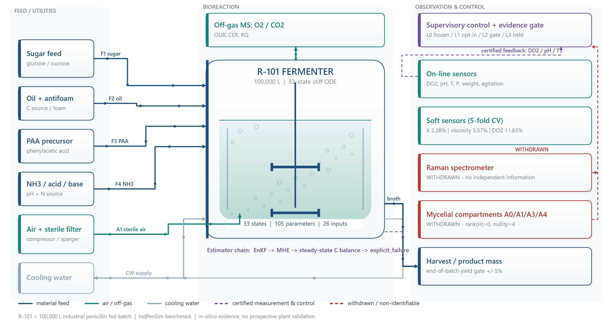

**Fig. 12 | Process flow diagram of the 100,000 L penicillin fed-batch (interactive Canvas
2D).** Six feed and utility trains - sugar, oil/antifoam, PAA precursor, NH3 / acid / base,
sterile air and cooling water - enter the stirred aerated reactor R-101 (33-state stiff
ODE, BDF, 0.2 h on-line sampling, 12 h off-line assays with 98.2% missingness). Off-gas
mass spectrometry supplies OUR, CER and RQ; on-line sensors feed DO2, pH and temperature
loops. Dashed purple traces are certified measurement and control paths, including the
explicit-degradation chain EnKF -> MHE -> steady-state carbon balance -> `explicit_failure`.
Red boxes and traces mark **withdrawn** channels: the simulated Raman spectrometer
(incremental R2 0.0199 -> 0.0092) and the four mycelial compartments (rank 0 / nullity 4).
The supervisory layer implements L0/L1/L2/L3. Rendered natively in Canvas 2D at
1200 x 640 logical units by `paper/pfd.js`, exported at 2508 x 1338 px by headless Chrome
(`paper/export_pfd.py`), and available as an interactive HTML figure with hover provenance
and togglable control/withdrawn layers (`paper/pfd.html`). Sources: `model.py`,
`solver_chain.py`, `runs/r165_mycelium_identifiability.json`, `runs/r167_platform_gate.json`.

### 3.2 Mechanistic model and numerical solution

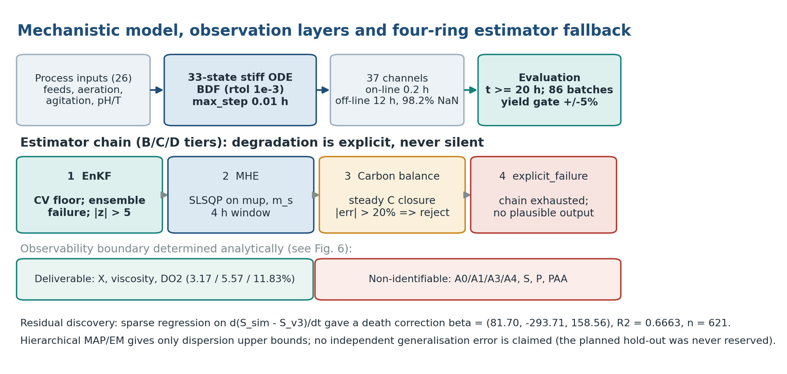

**Fig. 2 | Model, observation layers and estimator fallback.** Twenty-six process inputs drive a 33-state stiff ODE solved by BDF (rtol 1e−3, atol 1e−6, max_step 0.01 h); 37 channels are emitted with on-line sampling at 0.2 h and off-line assays at 12 h with 98.2% missingness. Evaluation is restricted to t ≥ 20 h over 86 batches with a ±5% yield gate. The B/C/D estimator chain degrades EnKF → MHE → steady-state carbon balance → `explicit_failure`, never emitting a plausible-looking number after exhaustion. Channels classified as deliverable and as structurally non-identifiable are listed separately. Source: `model.py`, `simulate.py`, `solver_chain.py`, `runs/r157_i3_channels.json`.

The port implements the 33-state stiff ODE system (`N_STATES = 33` in `model.py`) with state vector comprising substrate S, dissolved oxygen DO₂, oxygen O₂, product P, volume V, weight Wt, pH, temperature, heat Q, viscosity, A_t1, four mycelial compartments A0/A1/A3/A4, hyphal counts n0–n9 and nm, phi0, CO₂, dissolved CO₂, PAA, NH₃ and the kinetic parameters mup and mux. Twelve of these (n0–n9, nm, phi0) are algebraic quasi-steady states with zero time derivative. The parameter vector has 105 entries and the input vector 26. Nominal values include mux = 0.41, mup = 0.041, α_kLa = 85, m_s = 0.029; batch-level random effects are μx = 0.41 ± 0.025, μp = 0.041 ± 0.0025, α_kLa = 85 ± 10.

Integration uses `scipy.integrate.solve_ivp` with the BDF method, rtol = 1e−3, atol = 1e−6 and max_step = 0.01 h; output is sampled at 0.2 h. Non-negativity guards clamp states 0–30 to 0.001 and dissolved oxygen to 1; an adaptive mux guard activates for k > 65. A pure-numpy RK4 integrator (h = 0.001 h) exists as a fallback but is not imported by any active path; a `SimRequest`/`SimResult` plugin contract exists as a draft and is likewise unconnected. We report these dormant components explicitly because their existence would otherwise be mistaken for deployed capability.

### 3.3 Frozen baseline and regression anchor

The default simulation path is frozen at the byte level. Four engine files (`model.py`, `observe.py`, `simulate.py`, `mcp_server.py`) are SHA-256 pinned; any candidate modification is evaluated *outside* this path. The regression anchor is `runs/final_validation_v2.json`, containing per-batch simulated and recorded total product mass and relative yield error

\[
e_b = 100\,(Y_{\text{sim},b} - Y_{\text{v3},b}) / Y_{\text{v3},b}.
\]

Zero regression is defined as max|Δ| = 0.00e+00 at tolerance 0.0 across all 86 batches, checked by `tools/r134_zero_regression.py --tol 0`. Aggregate acceptance requires RMSE ≤ 3.5% and 86/86 batches within ±5%. These criteria were fixed before candidate evaluation and were never relaxed.

### 3.4 Residual discovery and the biomass death correction

Residual structure was discovered by sparse regression on the derivative of the substrate residual, d(S_sim − S_v3)/dt, using a nine-term candidate library, exhaustive subset selection with a Bayesian information criterion, at most three active terms, and cross-batch voting [19]. The dominant discovered structure was a biomass death correction

\[
X_{\text{corr}} = \max\!\left(X - (k_{d1}X + k_{d2}X A_{t1} + k_{d3}X A_{t1}^2)/100,\ 0\right),
\]

with β = (81.70, −293.71, 158.56), R² = 0.6663 over n = 621 observations. Two independent implementations in `observe.py` and `calibration.py` agree to max diff 0.00e+00. The correction improved 10/10 probe batches with a median −15.3 percentage-point change in the target error. Candidate-library documentation in the source header mentions eleven terms while the code defines nine; we report the code, and register the discrepancy as a documentation defect.

### 3.5 Hierarchical estimation and a withdrawn generalisation claim

A hierarchical MAP/EM estimator (`hier_est.py`) fits population dispersion for mux, mup and m_s by a grid search (18 or 48 combinations) minimising online RMSE + 0.1 × crash penalty, with a softmax posterior at temperature equal to the median loss. Two empirical-Bayes estimators of σ_pop were falsified: an effective-sample-size argument gave ESS = 46.8/48 and σ_pop ≡ 0 (the temperature was ~100× larger than the loss scale), and a "combined" estimator inflated the dispersion by 8.3× (mux) and 4.0× (mup) relative to the known generating values while inventing sd = 0.0033 for a constant m_s. Only dispersion upper bounds are retained: σ_pop(mux) ≤ 0.0328, σ_pop(mup) ≤ 0.0056, σ_pop(m_s) ≤ 0.0019, explicitly excluding a population prior.

Critically, the planned 60/28/12 train/validation/test split was never honoured: `hier_est.py` concatenates `train` and `validation` before fitting. **No independent validation set was ever held out**, so we make no generalisation claim for any hierarchical estimate. The planned split is described in the historical plan but is not part of the current evidence.

### 3.6 Four-ring estimator chain and channel-level soft sensing

The B/C/D-tier estimator chain degrades explicitly rather than silently (`solver_chain.py`):

1. **EnKF** — ensemble Kalman update with gain K = solve(Pyy + R, Pzyᵀ)ᵀ, inflation 1.0005. Degradation triggers: coefficient of variation < 1e−6 for ≥3 consecutive steps (with a 1.5e−3 floor), ensemble integration failure rate > 0.02, |z| > 5.0 on a whitelist of channels, cond(Pyy + R) > 1e12, or non-finite values.
2. **MHE** — SLSQP minimisation of ½‖r(x)‖² over θ = (mup, m_s) with bounds (0.010, 0.080) and (0.005, 0.045), a 4 h window and weights P = 1.0, PAA = 0.02, DO₂ = 0.5, pH = 8.0, C-balance = 0.2. Degradation on solver failure, relative improvement < 1e−3, or boundary degeneracy (the optimum sitting on a bound is treated as non-identifiability, not as a solution).
3. **Steady-state carbon balance** — x_carbon = c_in − Σ known; |c_err| > 20% rejects the estimate.
4. **explicit_failure** — the exhausted chain returns a named failure state and does not emit a plausible-looking number.

The historical design document froze a UKF first stage; the deployed code structurally replaces it with EnKF. We report the deployed chain.

Channel-level soft sensors were evaluated by 5-fold cross-validation over the 86 batches for six channels (X, P, PAA, viscosity, S, DO₂), with two proxy feature sets and median nRMSE as the statistic. Because this protocol holds out folds, it is the only part of our accuracy evidence that supports a generalisation statement.

### 3.7 Conservation closures

Element balances are computed in `conservation_metrics.py`: C_in integrates substrate, oil and PAA feeds (600 × 0.400, 1000 × 0.773, 530 × 0.706 g C/L respectively); C_out integrates CER × V × 12/44 plus product, net biomass and residual substrate contributions. An earlier implementation omitted the volume factor on the volumetric CER term, producing a spurious −60…−67% carbon imbalance; after correction the median carbon imbalance is −1.5% (budget ±20%). Nitrogen balances give +9.9% under the model convention and −58.1% under the true metering convention (budget ±35%); respiratory quotient reproduction from recorded inputs is exact (nRMSE 0.0%), while simulated OUR/CER are ~12% high because of CO₂ outgassing overestimation. We therefore report RQ closure, nitrogen balance and the liquid-phase carbon ledger, and we do **not** claim full elemental closure on the benchmark.

### 3.8 Five-channel health classifier

The legacy `classify_crash` classifier begins with `if co2d.max() <= 7.57: return normal`; across all 86 batches the maximum dissolved CO₂ is 7.194, so the branch is always taken. We replace it with a five-channel classifier evaluated per batch:

- **A** dissolved CO₂ above 7.57 g/L (benign if alone);
- **B** pH guard clamping events (`guard_audit.tally['pH_H'] > 0`);
- **C** pH excursion beyond 7.0 or non-finite pH;
- **D** product collapse, `drop_sim/drop_meas < 0.6` relative to measurement (or < 0.5 absolute when measurement is unavailable);
- **E** yield breach, |e_b| > 5%.

D or E ⇒ catastrophic; B or C ⇒ degraded; A alone ⇒ benign; otherwise normal. This classifier is information-bearing by construction only if at least one channel can fire; Section 4.4 verifies that it does.

### 3.9 Falsifiability audit protocol

Every acceptance instrument was subjected to a fixed audit battery, applied without post-hoc adjustment:

- **Zero-information control.** Replace the predictor with a constant and recompute the metric. A valid metric must change.
- **Constant-detector test.** Evaluate the classifier over all available batches; if the output distribution has zero variance, the classifier is a constant, not a test.
- **Trigger-rate audit.** For threshold-based detectors, compute the fraction of real batches flagged. A near-unit trigger rate on unperturbed data indicates a detector that cannot discriminate anomalies.
- **Rank test.** For state reconstructability claims, compute the singular values of the observation operator H; the rank and nullity determine identifiability, and adding rows of the same observation type cannot change the column space.
- **Two-sided A/B gate.** Candidate evaluation requires zero-information controls, injection controls, data-driven thresholds derived on a grid with explicit margin, leave-one-out consistency, a confusion table, and both improvement and harm directions.
- **Seed transfer.** Any tuned stochastic parameter must be re-evaluated on at least two seeds not used for tuning.
- **Runtime loading.** A deployed capability is counted only if the module imports and the symbol is callable; file existence is not evidence.

Thresholds (V2-3 upper bound 20 pp, V2-4 upper bound 30 pp, ±5% yield, R² ≥ 0.5 with n ≥ 400, C/N budgets) were frozen before the corresponding experiments and are preserved in the evidence files. Any failing check remains in the archive; first-pass failures are retained alongside final results.

### 3.10 The four-layer evidence-gated architecture

**Table 2. Layers, invariants and machine-checkable artefacts.**

| Layer | Definition | Invariant | Machine-checkable artefact |
|---|---|---|---|
| **L0** | Frozen baseline; default path byte-identical | no change to `COMBINED`, golden parameters, integrator, data or zero-regression anchor | 4 pinned SHA-256 values; `max|Δ| = 0.00e+00` |
| **L1** | Opt-in candidates V1/V2/V3, disabled by default | fully bypassable; never touches L0 | `FORBIDDEN_KEYS`, `OPT_IN_PARAMS`, `confirm` |
| **L2** | Adversarial evidence gate | thresholds frozen; NO_GO cannot be rewritten as PASS; failures archived | `runs/r166_ab_gate.json`, `runs/r166_ab_gate_first_pass.json` |
| **L3** | Human-gated promotion to default production path | requires explicit confirmation; **not executed in this study** | `l3_state` in `/api/health`; `state.yaml` |

A governance spine makes the layers auditable: a versioned engine contract (98 successive v1.x rows, v1.0-v1.97), a debt ledger with 53 distinct numbered findings (D-2…D-92), sign-off records R-1…R-17, per-round evidence JSON and round reports, and idempotent governance synchronisation scripts that are dry-run by default and preserve CRLF/LF line endings. Each layer boundary is enforced in code, not only in documentation.

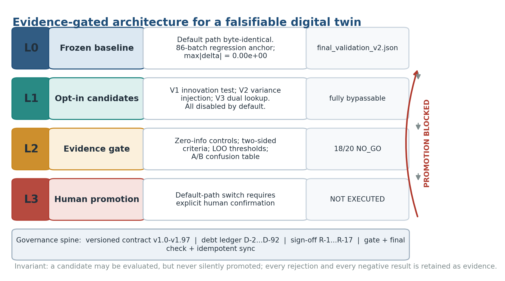

**Fig. 1 | The evidence-gated architecture.** L0 is a byte-identical frozen baseline with a machine-checked regression anchor. L1 holds opt-in candidates that are disabled by default and fully bypassable. L2 is an adversarial evidence gate with frozen thresholds, zero-information controls and archived failures. L3 is the human-gated promotion decision, which was **not executed** in this study (red arrow). The governance spine records every claim, rebuttal and negative result as a versioned artefact. Data: `state.yaml`, `ENGINE_CONTRACT.md`, `docs/m5_review_signoff.md`, `runs/r166_ab_gate.json`.

### 3.11 Implementation

The platform exposes 14 capabilities in four tiers (A: 6, B: 5, C: 2, D: 1) by *in-process reuse of the function bodies* of the 14 MCP tool definitions in `mcp_server.py`, avoiding a second implementation that could diverge numerically. Twelve custom operators are verified by `import + callable`. Three additive HTTP endpoints were added (`GET /api/ops`, `GET /api/evidence`, `POST /api/invoke`) while `POST /api/simulate` retains its L0 body unchanged. `POST /api/invoke` enforces four independent admission gates: a 14-item whitelist, five forbidden L3 keys (`dist_noise_sigma`, `dist_noise_seed`, `innovation_criteria`, `k_dual`, `alpha_kla_override`), explicit `opt_in` for bypass parameters, and explicit `confirm` for expensive re-invocations; numerical caps additionally bound n_jobs, maxiter, n_ens, max_terms and stride. All rejections return an explicit reason rather than a silent fallback.

The browser front end provides six views (overview, topology, batch, channels, operators, workbench). Screen-by-screen verification used headless Chrome at 1440 × 940 with DOM assertions, console/pageerror capture and 4xx resource monitoring; six screenshots (105–183 KB each) are retained. Full integration gate: `runs/r167_platform_gate.json` (25/25 PASS); final consistency check: `runs/r167_final_check.json` (20/20 PASS).

### 3.12 Statistical conventions

RMSE is computed over batch-level relative yield errors. nRMSE is normalised by the observed channel range and reported as a median over batches and folds; no single aggregate is used to hide channel-level failure. Wilson 95% intervals [20] are reported where coverage is discussed; bootstrap CIs [21] are not used because the residual distribution is not independent across time. Symlog scaling in figures is used solely for display; all test statistics are computed on untransformed values. We report failed checks with the same prominence as passing ones, and we do not perform post-hoc threshold relaxation or subgroup searching after seeing results.

### 3.13 Falsifiability certificates: the audit as a type check

Let $M$ be an acceptance instrument, $p$ a fitted predictor and $p_0$ a
zero-information control. We attach to $M$ a certificate

$$FC(M) = \langle \Delta,\ \hat{H},\ J,\ \text{verdict},\ \text{evidence} \rangle$$

where $\Delta = \min(1, |M(p) - M(p_0)|)$ for scalar statistics, $\Delta = 1 - |2q-1|$
for a binary detector with trigger rate $q$, and $\Delta$ is the fraction of deliberately
injected defects detected for a loading test; $\hat{H} = -\sum_k \pi_k \log \pi_k /
\log K$ is the normalised Shannon entropy [34] of the output distribution over $K$
categories (zero for a constant output); and $J = \mathrm{TPR} - \mathrm{FPR}$ wherever a
confusion table exists. The verdict is one of `CERTIFIED`, `TAUTOLOGICAL`, `CONSTANT` and
`SATURATED`. An instrument is quarantined if $\Delta = 0$, $\hat{H} = 0$, or $J \le 0$
where applicable, and a named replacement must be recorded. Certificates are issued by
`paper/make_extended_stats.py` from frozen artefacts and written to
`paper/extended_stats.json`; no axis weight or threshold is chosen after seeing results.
The three axes are deliberately reported separately rather than collapsed into a single
score: a composite index would introduce exactly the arbitrary degree of freedom that
this work argues against.

### 3.14 An evidence type system for scientific claims

We model every scientific claim as a typed record

$$\text{Claim} = \langle \textit{subject},\ \textit{quantity},\ \textit{evidence},\
\textit{scope},\ \textit{authority} \rangle.$$

The four layers become a compilation pipeline. L0 is a frozen symbol table: the default
simulation path is pinned by four SHA-256 values and never rewritten. L1 compiles
candidate code into isolated, fully bypassable namespaces but does not link it into the
default path. L2 is a type check: a candidate is admissible only with zero-information and
injection controls, two-sided criteria, frozen thresholds, leave-one-out consistency, a
confusion table and at least two unseen stochastic seeds. L3 is a human-signed linker
action that was **not executed** in this study. The five `FORBIDDEN_KEYS` in
`platform/ops_registry.py` (`dist_noise_sigma`, `dist_noise_seed`,
`innovation_criteria`, `k_dual`, `alpha_kla_override`) constitute an explicit
ambient-authority revocation list [39]; each is rejected at `/api/invoke` with HTTP 400.
`WITHDRAWN` is a valid claim type carrying its own evidence, so a negative result is a
first-class output of the system rather than an omitted section of a report.

### 3.15 Extended baseline ladder and distributional diagnostics

We evaluated five reference estimators against the same 86 recorded yields and report
their **information sets** explicitly, because they are not like-for-like methods: the
naive predictors see only recorded yields, whereas L0 additionally sees batch inputs,
per-batch calibrated `COMBINED` parameters and the 33-state ODE. The estimators are the
frozen L0 reconstruction, a leave-one-out batch-mean predictor, an in-sample global-mean
predictor, a persistence (previous-batch) predictor and a zero predictor. Because the
recorded product mass spans 0.54-4.56 x 10^6 g, relative error is unstable for the two
lowest-yield batches; we therefore also report a scale-robust error,
$\mathrm{RMSE}_{\mathrm{med}} = 100\,\sqrt{\overline{(\hat y - y)^2}} /
\mathrm{median}(y)$.

Agreement was assessed by a parity plot and a Bland-Altman difference plot [35], the
empirical CDF, a normal Q-Q plot with the Shapiro-Wilk statistic [36], lag-1 to lag-10
autocorrelation with a Wald-Wolfowitz runs test [37], an exact sign test, a Wilson 95%
interval [20] for the within-band proportion, and a Mann-Whitney comparison [38] of
normal versus fault batches (84 versus 2, severely underpowered). In accordance with
Section 3.12 we do not report bootstrap intervals. A seven-stage historical calibration
ladder parsed from `docs/round_summary_202610.md` is presented alongside, but is kept
visually and numerically separate from the 86-batch anchor because it uses a 12-batch
protocol. A 12 x 12 alpha_kLa response surface (12 batches x 12 values from 30 to 140)
was reconstructed from `runs/r162_kla_sensitivity.json`.

### 3.16 Realisation-path invariance test

For a stochastic augmentation $c$ with disturbance realisation $\xi_s$ indexed by seed
$s$, we define

$$T(c) = \max_{s \in S_{\text{unseen}}} \max_{b \in B} |\Delta(c, s, b)|.$$

A candidate passes only if the zero-information control is byte-identical to L0, if
$T(c)$ stays below the frozen caps for **every** unseen seed, and if leave-one-out
consistency holds on the tuning seed. This separates amplitude dependence (a property of
the noise scale) from path dependence (a property of the particular disturbance
realisation crossing a basin boundary in a bistable batch). Tuning the scale until a
single-seed collapse disappears is a seed-specific fit, not a physical calibration.

### 3.17 Figure production and three-format delivery

All figures are regenerated from `runs/` evidence at 300 dpi as PNG with vector PDF
counterparts (`paper/make_figures.py`, `paper/make_figures_v2.py`). The process flow
diagram is drawn in native Canvas 2D (`paper/pfd.js`) and exported by headless Chrome.
The manuscript is delivered in three synchronised formats: Markdown (`manuscript.md`),
a self-contained styled HTML with the interactive Canvas figure (`manuscript.html`), and
a print-quality PDF generated from that HTML (`manuscript.pdf`). A machine-readable
consistency check (`paper/check_manuscript.py`) verifies that headline numbers, figure
files, reference numbering and honesty declarations agree across all formats.

---

## 4. Results

### 4.1 Frozen-baseline reconstruction consistency

The frozen A-tier baseline reproduces the recorded end-of-batch product mass with RMSE **2.3448%** over 86 batches, with **86/86** batches inside the pre-registered ±5% band (range −4.814% to +4.829%; Fig. 3a). Byte-identical regression against the frozen anchor gives max|Δ| = **0.00e+00** at tolerance 0.0. Supporting checks: 33 pytest tests passed (509.47 s), 9/9 MCP smoke checks, and a 54/54 final consistency check for the preceding round. For context, the uncalibrated nominal parameterisation gave 70.95% RMSE with 9/12 crashes, early calibration strategies gave 32.57–37.72%, and the historical 12-batch baseline gave 4.48% (9/12 within ±5%); the extension from 12 to 86 batches reduced error to 2.29–2.35%.

These are *reconstruction* numbers: each batch uses its own calibrated `COMBINED` parameter vector. We therefore do not interpret 2.3448% as prospective predictive accuracy on an unseen fermentation. It establishes that the port, integrator, parameter assembly and metric implementation are mutually consistent and stable — a necessary precondition for the falsifiability audit, not a validation of transfer.

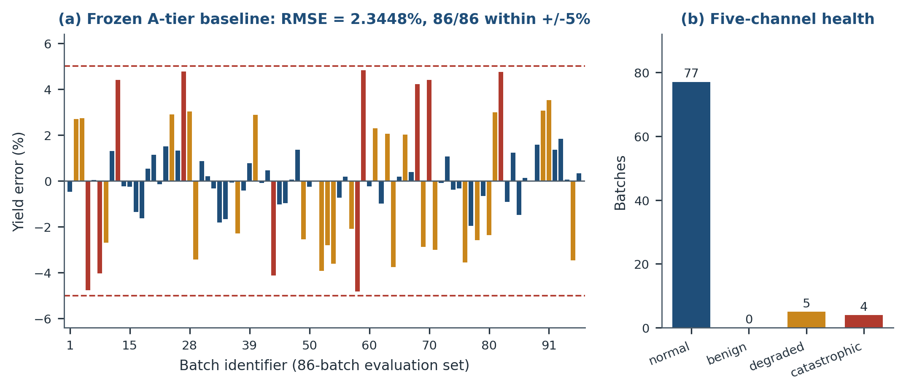

**Fig. 3 | Frozen-baseline accuracy and the corrected health verdict.** (a) Per-batch relative yield error for the 86-batch evaluation set; dashed lines mark the pre-registered ±5% acceptance band. RMSE = 2.3448%, 86/86 within band; byte-identical regression max|Δ| = 0.00e+00. (b) Distribution of the five-channel `classify_health` verdict (normal 77, benign 0, degraded 5, catastrophic 4). The legacy `classify_crash` classifier returned `normal` for all 86 batches and is shown for contrast in Fig. 4b. Data: `runs/final_validation_v2.json`, `runs/r156_acceptance.json`.

**Table 3. Acceptance evidence for the frozen baseline.**

| Quantity | Value | Source |
|---|---|---|
| Batch-level yield RMSE | 2.3448% | `runs/final_validation_v2.json`; `runs/r166_zero_regression.json` |
| Batches within ±5% | 86/86 | same |
| Zero-regression max\|Δ\| | 0.00e+00 (tol 0.0) | `tools/r134_zero_regression.py` |
| Unit/integration tests | 33 passed (509.47 s) | `docs/r166_round_report.md` |
| MCP service smoke | 9/9 PASS | `runs/r166_mcp_smoke.json` |
| Round-level final check | 54/54 PASS | `runs/r166_final_check.json` |
| Engine source SHA-256 | unchanged across all candidate rounds | `runs/r167_platform_gate.json` G1 |

### 4.2 Channel-level fidelity and what the twin cannot know

Five-fold cross-validation separates channels that a soft sensor can deliver from channels that are structurally unavailable (Supplementary Fig. S1). Biomass improves from 24.58% to **2.28%** median nRMSE (+22.31 pp; the R139 delivery protocol reports 3.17% with 86/86 batches below 15%), viscosity from 19.69% to **5.57%** (+14.12 pp), and dissolved oxygen from 19.53% to 11.83% (+7.69 pp). In contrast, product P degrades from 14.19% to 17.70% (−3.51 pp), PAA from 28.20% to 28.72% (−0.52 pp), and substrate S remains at 214.59% because its "measurement" is a model reference rather than an assay — a circular comparison that we explicitly label as marginal, not as a result. The product channel retains a 60–120 h deficit of −0.0625 (mean) / −0.0923 (median) that four independent repair attempts did not close; it is registered as a known boundary.

Structural analysis explains the failures (Fig. 6a). For the four mycelial compartment states A0/A1/A3/A4, the assimilation observation operator has singular values [0, 0, 0, 0], **rank 0 and nullity 4**; the reporting operator has [2, 0, 0, 0], rank 1 and nullity 3; condition number is infinite in both cases. The audit passed 11/11 checks over 4 batches × 5 time points with a zero-information control. The reason is not insufficient data volume: the A-group never enters the active observation vector, so additional batches or time points merely repeat the same column space. Of the 37 released columns, none contains a compartment assay, and the simulated Raman channel was shown to carry no independent information about PAA (incremental R² 0.0199 → 0.0092; t-statistic 0.104 → 0.036; PLS output 0–2.11 versus assay 430–2023 mg/L, a ~1000× scale mismatch). We therefore withdrew the delivery claim for mycelial composition and reclassified it as an internal soft-sensing quantity. This is a *structural* conclusion conditional on the observation operator H; new compartment-resolved measurements could change it, whereas more rows of the existing data cannot.

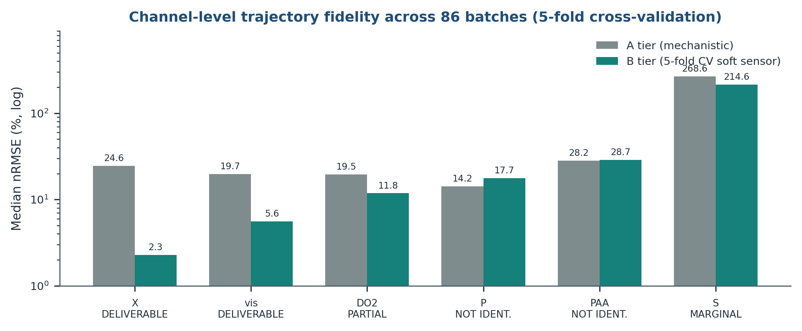

**Fig. S1 | Channel-level trajectory fidelity (supplementary).** Median nRMSE (%) on a log scale for six channels, comparing the mechanistic A-tier output with a 5-fold cross-validated B-tier soft sensor over 86 batches. Classification labels are carried on the x-axis. Channels whose "measurement" is a model reference (S) or whose states are structurally unobservable (P, PAA) are flagged; a large numerical gain on a circular comparison is not treated as evidence. Data: `runs/r157_i3_channels.json`.

### 4.3 Three acceptance instruments that could not be falsified

The audit battery of Section 3.9 identified three instruments whose outputs were independent of model quality (Fig. 4; Table 4).

**(i) Residual-quantile interval coverage is tautological.** Prediction intervals were formed from the 5th and 95th percentiles of the residual distribution itself. Replacing the fitted predictor with a zero-information constant produced coverage **0.899548532731377** for X, P, PAA and viscosity — bit-identical to the fitted predictor, with Δ = 0.0 in all four channels and `junk_all_ge_0.85 = true`; the verdict was `TAUTOLOGICAL`. The instrument therefore certified both a good model and no model at all. Replacing the interval construction with μ ± 1.96σ, where σ is *predicted* rather than derived from the realised residuals, restored discrimination: coverage fell to 0.0000 for the junk predictor versus 0.1072 (X) and 0.3160 (P) for the fitted one. The resulting intervals are informative in width rather than in coverage: X has a 90% interval of [−6.82%, +9.45%] (half-width 8.14%) and viscosity a half-width of 10.6%; a coverage of ~0.90 can also be trivially bought by widening an interval to a 97.9% half-width. We therefore report interval half-width and nRMSE improvement, never coverage, as calibration evidence.

**(ii) The crash classifier is a constant.** `classify_crash` returns `normal` whenever max(CO₂d) ≤ 7.57 g/L; the maximum over all 86 batches is 7.194 g/L, so the first branch always fires (86/86 `normal`). Batch 91 ends at pH 3.001 with 129 pH-guard clamping events and is still reported `normal`. A detector with zero output variance is not a detector; the dashboard's "0 catastrophic" was consequently an artefact, not a finding.

**(iii) The innovation criterion is near-constant.** Evaluated on 32 unperturbed real batches, the global standardised-innovation threshold flagged **27 (84.38%)** as degraded. Wiring it into the service would misclassify roughly three quarters of normal batches. The obvious global "fix" is not a fix either: raising the threshold from 5.0 to 10.0 leaves only 0/20 injected cases detected (CO₂ outgas max|z| = 7.6043, p90 = 5.5603; O₂ max|z| = 0.167), and at z > 15 the detector becomes constantly false. A single global threshold cannot separate the channels; the working alternative is channel-wise, data-driven, leave-one-out calibrated (Section 4.6, V1).

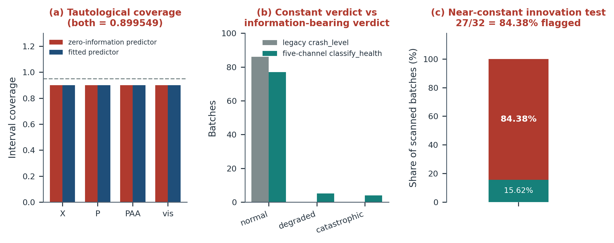

**Fig. 4 | Three unfalsifiable acceptance instruments.** (a) Residual-quantile interval coverage is identical (0.899549) for a zero-information constant predictor and the fitted predictor across four channels; the dashed line marks nominal 0.95. (b) Legacy `classify_crash` returns 86 `normal` / 0 `degraded` / 0 `catastrophic`, whereas the five-channel classifier resolves 77/5/4. (c) The global innovation criterion flags 27/32 = 84.38% of unperturbed batches as degraded. Data: `runs/r160_i3_coverage_tautology.json`, `runs/r156_acceptance.json`, `runs/r163_degradation_probe.json`.

**Table 4. Unfalsifiable instruments, diagnostic control and replacement.**

| Instrument | Failure mode | Adversarial control | Replacement / consequence |
|---|---|---|---|
| Residual-quantile coverage | tautological (0.899549 for any predictor) | zero-information constant predictor | μ ± 1.96σ intervals; report half-width + nRMSE gain; coverage withdrawn as evidence (D-78) |
| `classify_crash` | constant (86/86 `normal`) | distribution has zero variance | five-channel `classify_health`; "0 catastrophic" claim withdrawn (D-38, D-65) |
| Global innovation threshold | near-constant (84.38% flagged) | trigger-rate audit on unperturbed batches | channel-wise LOO-calibrated thresholds; kept opt-in (D-87) |
| Hierarchical σ̂ via empirical Bayes | ESS 46.8/48 ⇒ σ_pop ≡ 0 | comparison with known generating dispersion | dispersion upper bounds only; no generalisation claim (D-89) |
| "Loaded" = file exists | tautological | `import + callable` at runtime | 12/12 verification; two naming defects exposed (D-65) |

### 4.4 The corrected health assessment

The five-channel classifier resolves **normal 77, benign 0, degraded 5, catastrophic 4** (Fig. 3b). Catastrophic batches are [37, 50, 51, 91] and degraded batches [40, 43, 49, 54, 92]; flag tallies are pH-clamp 5, pH > 7 in 9, product collapse 4. Unlike the constant classifier, this instrument fires on real failure modes and separates them by severity.

Two co-existing conventions must be kept distinct, and we report both explicitly. The acceptance file retains a legacy block (`n_normal = 86`, `n_catastrophic = 0`) from `classify_crash` alongside the corrected `n_health` block. Separately, a *validity* criterion under the default pH-fix baseline declares 9 batches invalid ([37, 40, 43, 49, 50, 51, 54, 91, 92], of which 5 are true pH clamps), whereas the health classifier declares 5 degraded and 4 catastrophic. These are different questions — "is this batch admissible for baseline comparison" versus "did the model fail" — and merging them would recreate the very category error this paper argues against. The platform's outward-facing KPI now reads "catastrophic 4 registered / 0 new", not "0 catastrophic".

### 4.5 Discontinuous control response closes the gradient path

The control-knob sweep shows that runtime continuous regulation is not merely difficult but structurally unavailable under the current model (Fig. 6b). In the baseline state, the yield response to `sd`, `mean_P` and `Y_sP` is a hard jump spanning **99.83, 99.92 and 99.99 percentage points** respectively, with no usable gradient on either side. Bisection on a collapsed batch located the `sd` transition in [0.0015217285, 0.0015219727] (width 2.44 × 10⁻⁷) and the `mean_P` transition in [0.002040625, 0.0020406494] (width 2.44 × 10⁻⁸); crossing it moves yield error from −100.00% to +1.33% / +0.51% with the batch becoming valid again. The collapsed state is therefore not an attractor, but the two continuous knobs remain at −100% and invalid throughout the collapsed regime (spans 101.33 and 100.51 pp). Open-loop setpoint re-tuning is feasible with landing precision 10⁻⁴–10⁻⁵, which is calibration-grade, not control-grade. We register runtime closed-loop control as a known boundary (D-54/D-57) rather than an unmet milestone, and we do not report a controller.

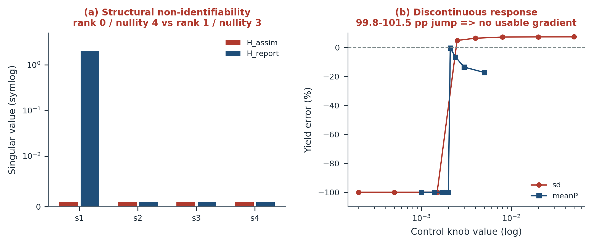

**Fig. 6 | Structural limits of the twin.** (a) Singular values of the observation operator for the mycelial compartment states: H_assim has rank 0 / nullity 4 and H_report rank 1 / nullity 3 (symlog display; zero values plotted at 10⁻³ for visibility). Adding rows of the same observation type cannot alter the column space. (b) Yield error versus two continuous control knobs (log x-axis): the response is a near-vertical jump of 99.8–101.5 pp, leaving no usable gradient for closed-loop regulation. Data: `runs/r165_mycelium_identifiability.json`, `runs/r157_bistab_escape.json`.

### 4.6 Pre-registered candidate evaluation: variance injection ends in NO_GO

We evaluated three opt-in candidates against the two-sided A/B gate (Table 5, Fig. 5).

**V1 (channel-wise innovation thresholds, conditional approval).** Twenty-five cases comprised 5 zero-information controls and 20 injections. Control maxima were 4.5907 (CO₂ outgas), 4.6004 (DO₂), 0.0562 (O₂) and 4.8014 (pH); injected maxima were 5.343, 7.596, 0.0634 and 37.7249. Data-driven thresholds with a 1.05 margin selected CO₂ outgas, DO₂ and pH at z = 4.820219494310997, 4.83036999328888 and 5.041503072387664, and excluded O₂. The candidate and the frozen baseline produced identical confusion tables (TP10 / FN5 / TN4 / FP1); injections triggered 11/20, controls 0/20, and leave-one-out calibration was 5/5. All 8 V1 checks passed, but the candidate remained opt-in: passing a gate is not authorisation to change the default path.

**V2 (eight-path disturbance variance injection, NO_GO).** Eight low-pass disturbance variances (τ ≈ 40 h) were injected at full amplitude (scale 1.0). The maximum deviation from the frozen baseline was **96.058784 pp** with **3/6 catastrophic yield collapses** (batch 16: −95.64 pp; 22: −44.46 pp; 27: −96.06 pp; batch 23: −16.96 pp), reproducible 6/6 at fixed seed against a reference deviation of 3.0878581725122034 pp. Frozen caps of 20 pp (V2-3) and 30 pp (V2-4) were left unchanged. The first-pass gate result (16/18 FAIL) is archived alongside the final **18/20 NO_GO**, which retains only V2-3 and V2-4 as failures.

Multi-round amplitude optimisation (scale grid {0.02, 0.05, 0.1, 0.2, 0.35, 0.6, 1.0}) found five feasible scales on the tuning seed (7); the scale closest to the reference RMS deviation was **0.35** (rms 2.1321577 pp, distance to reference 0.9557005 pp), with six-fold leave-one-out consistency, giving 8/10 optimisation checks passing. **The verdict was still NO_GO.** On unseen seed 11 the same scale produced max|Δ| = **99.852368 pp** with 2 collapses and was infeasible; on unseen seed 23 it produced 2.128365 pp with no collapses. Two optimisation checks (V2O-9, V2O-10) failed. The collapse is thus not a monotone function of amplitude but a path-dependent response of bistable batches to the *realisation* of the disturbance. A scale that "happens not to collapse" on one seed is a seed-specific fit, not a physical calibration; promoting it would be exactly the kind of post-hoc relaxation that D-78 forbids. V2 remains disabled by default.

**V3 (dual-constraint α_kLa lookup, evaluation only).** The lookup covers 6 batches (8, 11, 16, 22, 23, 80), excluding six cliff batches ([27, 36, 55, 60, 91, 92]). All 6 remain within ±5%, with 3 improvements and 3 degradations and a maximum |Δ| of 0.014281 pp. Because 81 of 88 calibrated batches share α_kLa = 85, writing the lookup back into the golden parameter table would alter the L0 anchor; it was therefore never written back and remains an evaluation-layer result.

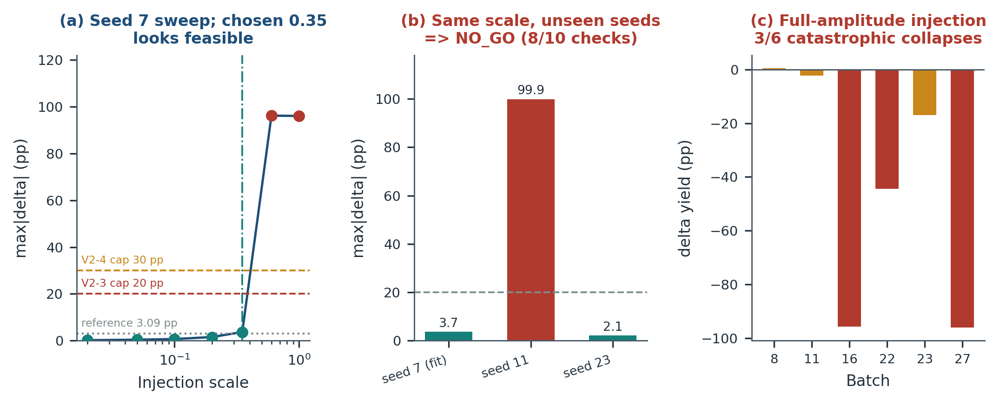

**Fig. 5 | The seed-transfer failure that fixed the NO_GO verdict.** (a) Maximum deviation from the frozen baseline across the amplitude grid on tuning seed 7; dashed lines are the frozen 20 pp / 30 pp caps and the dotted line the 3.09 pp reference. Scale 0.35 appears feasible. (b) The same scale evaluated on two unseen seeds: seed 11 collapses (99.9 pp) while seed 23 does not (2.1 pp), demonstrating path dependence rather than amplitude dependence. (c) Per-batch yield deviation at full-amplitude injection: 3/6 batches collapse catastrophically. Data: `runs/r166_v2_optim.json`, `runs/r166_ab_gate.json`.

**Table 5. Two-sided A/B evidence gate (final round).**

| Candidate | Gate result | Key evidence | Decision |
|---|---|---|---|
| V1 channel-wise innovation | 8/8 PASS | 11/20 injections detected, 0/20 controls; LOO 5/5; TP10/FN5/TN4/FP1 | conditional approval, **opt-in only** |
| V2 eight-path variance injection | **18/20 NO_GO** | full scale: 96.06 pp, 3/6 collapses; tuned 0.35 fails on unseen seed 11 (99.85 pp) | **default off; promotion blocked** |
| V3 dual-constraint lookup | 5/5 PASS (evaluation layer) | 6 batches, 3 improved / 3 worsened, max\|Δ\| 0.014281 pp | no write-back to L0 |
| Frozen L0 | unchanged | 4 source hashes identical; batch 8 error −4.039% | retained as regression anchor |

### 4.7 Runtime verification of the deployed platform

The final integration gate passed **25/25** and the final consistency check **20/20**. Fourteen capabilities (A6/B5/C2/D1) and 12 operators were verified as `import + callable`, not by file existence; two naming defects — `hier_est` (the callable entry point is `hier_fit`) and `conservation_metrics` (a module, whose callable is `element_balance`) — were invisible to the old existence test and were exposed only by runtime verification. Six views rendered 4/1/86/15/12/14 expected DOM elements respectively with zero page errors, console errors or 4xx resource requests, and a browser-initiated capability call completed UI → HTTP → engine. Five forbidden L3 keys were each rejected with HTTP 400 and an explicit reason; whitelist, `opt_in` and `confirm` gates likewise rejected explicitly. The engine's four source hashes were unchanged; `/api/simulate` still routes through the frozen `simulate()` and reproduces batch 8 at −4.039%. The service ran on port 8771 while port 8770 remained unbound before and after. Governance synchronisation was idempotent across three dry-runs (changed = 0, skip = 19, error = 0), the contract reached v1.97, debt D-65 was closed and D-92 registered, and the milestone gate M5 was re-reviewed to PASS on the documented closing conditions.

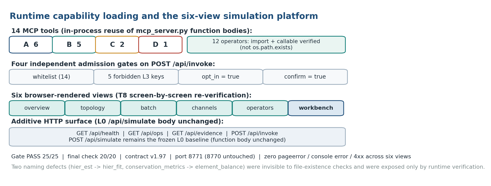

**Fig. S2 | Runtime capability loading and the six-view platform (supplementary).** Fourteen tools by tier, twelve operators verified by `import + callable`, four independent admission gates on `/api/invoke`, six browser views, and the additive HTTP surface. `POST /api/simulate` retains the frozen L0 body. Gate 25/25, final check 20/20, contract v1.97, port 8771 (8770 untouched). Data: `runs/r167_platform_gate.json`, `runs/r167_final_check.json`.

**Table 6. Integration gate and governance evidence.**

| Check family | Result | Artefact |
|---|---|---|
| Engine immutability | 4/4 SHA-256 unchanged | `runs/r167_platform_gate.json` G1 |
| Runtime loading | 14/14 tools, 12/12 operators | G10, G11, G22 |
| L3 containment | 5/5 forbidden keys rejected (400) | G12, G16, G17 |
| Frozen-path behaviour | batch 8 −4.039%; override mux = 0.36 effective | G13, G14 |
| Browser verification | 6 views, 0 errors, 0 4xx, UI invoke OK | G20–G24 |
| Port discipline | 8770 unbound before and after | G25 |
| Governance | M5 PASS, cap condition removed, 3× idempotent dry-run | `runs/r167_governance_update.json` |

### 4.8 Extended baseline validation: a ladder, five reference predictors and agreement

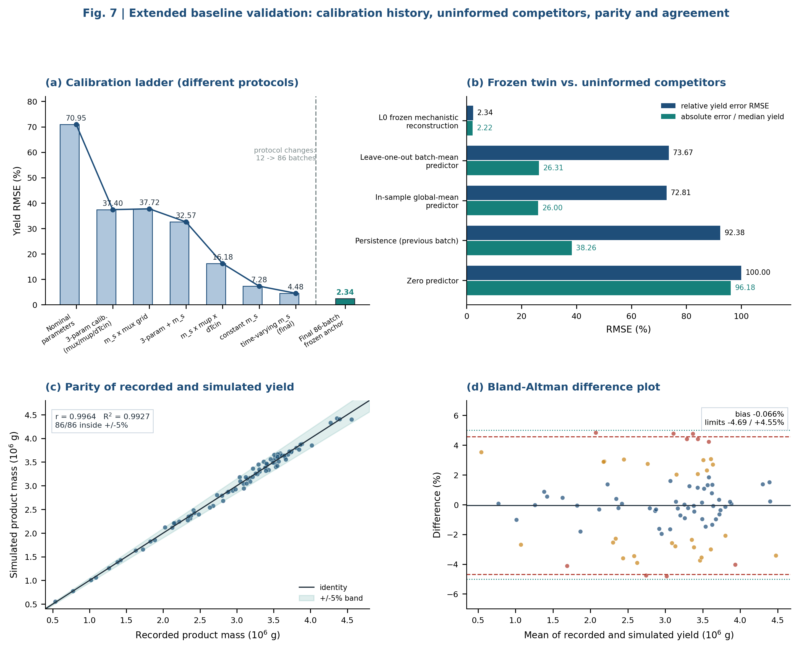

**Fig. 7 | Extended baseline validation.** (a) Seven historical calibration stages from
the 12-batch protocol (70.95% -> 4.48% RMSE), shown separately from the 86-batch frozen
anchor (2.3448%) because the protocols differ. (b) Five reference predictors under two
error normalisations; information sets differ and are listed in Table 7. (c) Parity of
recorded and simulated product mass (r = 0.996367, R2 = 0.992747) with the +/-5% band.
(d) Bland-Altman agreement: bias -0.0662%, limits -4.6871% / +4.5547%, no
magnitude-dependent trend. Data: `runs/final_validation_v2.json`,
`runs/r148_validity_gate.json`, `paper/extended_stats.json`.

**Table 7. Baseline ladder with explicit information sets.**

| Estimator | Information set | n | RMSE (%) | RMSE / median yield (%) | within +/-5% |
|---|---|---|---|---|---|
| **L0 frozen mechanistic reconstruction** | batch inputs + per-batch `COMBINED` + 33-state ODE | 86 | **2.3448** | **2.2205** | **86/86** |
| Leave-one-out batch-mean predictor | other 85 recorded yields; held-out batch excluded | 86 | 73.6679 | 26.3103 | 11/86 |
| In-sample global-mean predictor | all 86 recorded yields (optimistic constant) | 86 | 72.8113 | 26.0044 | 11/86 |
| Persistence (previous batch) | recorded yield of the immediately preceding batch | 85 | 92.3806 | 38.2620 | 14/85 |
| Zero predictor | none | 86 | 100.0000 | 96.1811 | 0/86 |

Relative to the leave-one-out mean, persistence and zero predictors, L0 reduces RMSE by
**96.82%, 97.46% and 97.66%** respectively. These differences are large but must not be
over-interpreted: the naive predictors forecast a yield series, whereas L0 reconstructs
each batch from its own inputs and calibrated parameters. Their role is to establish that
the target series is far from trivially predictable and that the frozen anchor is not an
artefact of a low-variance target. The scale-robust column removes the amplification
caused by the two lowest-yield batches (0.54 x 10^6 g and 0.74 x 10^6 g against a median
of 3.24 x 10^6 g); L0 still improves by 88.8% over the leave-one-out mean on that scale.

Seven historical stages show how the 12-batch protocol reached 4.48% from a 70.95%
nominal start (37.40%, 37.72%, 32.57%, 16.18%, 7.28%, 4.48%); extending the evaluation
set to 86 batches produced 2.3448%. Because the batch count and calibration scope
changed, these numbers are **not** a single learning curve and Fig. 7a marks the protocol
boundary explicitly.

### 4.9 Distributional diagnostics and parameter-response surfaces

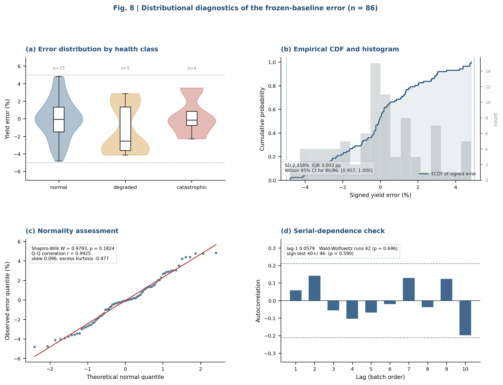

**Fig. 8 | Distributional diagnostics of the frozen-baseline error (n = 86).** (a) Violin
and box plots by health class; (b) empirical CDF and histogram with the +/-5% band;
(c) normal Q-Q plot with Shapiro-Wilk W = 0.9793, p = 0.1824; (d) lag-1 to lag-10
autocorrelation with 95% white-noise bounds. All statistics are computed on
untransformed errors. Data: `runs/final_validation_v2.json`,
`runs/r156_acceptance.json`, `paper/extended_stats.json`.

**Table 8. Distributional diagnostics of the 86 signed yield errors.**

| Statistic | Value | Interpretation |
|---|---|---|
| Mean / median | -0.0662% / -0.0744% | no material systematic bias |
| SD / MAD / IQR | 2.3576% / 1.4967% / 3.0034 pp | tight, symmetric spread |
| Range | -4.8144% to +4.8290% | entirely inside the pre-registered band |
| Skew / excess kurtosis | 0.0960 / -0.4767 | near-Gaussian, slightly platykurtic |
| Shapiro-Wilk W (p) | 0.9793 (0.1824) | normality not rejected |
| Q-Q correlation / KS p | 0.9925 / 0.7348 | consistent with normality |
| Sign test | 40+ / 46-, p = 0.5900 | no directional bias |
| Lag-1 autocorrelation | 0.0579 | no serial dependence in batch order |
| Wald-Wolfowitz runs | 42 observed vs 43.79 expected, p = 0.6962 | no ordering artefact |
| Wilson 95% CI for 86/86 | [0.9572, 1.0000] | honest finite-sample bound on the pass rate |
| Normal (84) vs fault (2) RMSE | 2.3365% vs 2.6696% | Mann-Whitney p = 0.1073, underpowered |

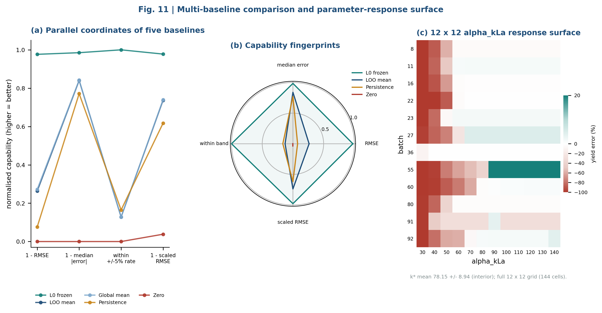

**Fig. 11 | Multi-baseline fingerprints and a parameter-response surface.**
(a) Parallel coordinates of the five reference predictors on four normalised
capability axes; (b) radar comparison; (c) 12 x 12 alpha_kLa response surface of
end-of-batch yield error, showing contiguous collapsed and feasible regions rather
than a smooth gradient. The interior optimum is k* = 78.15 +/- 8.94 (11 batches),
close to the nominal 85 +/- 10. Data: `paper/extended_stats.json`,
`runs/r162_kla_sensitivity.json`.

### 4.10 Certifying the certification instruments

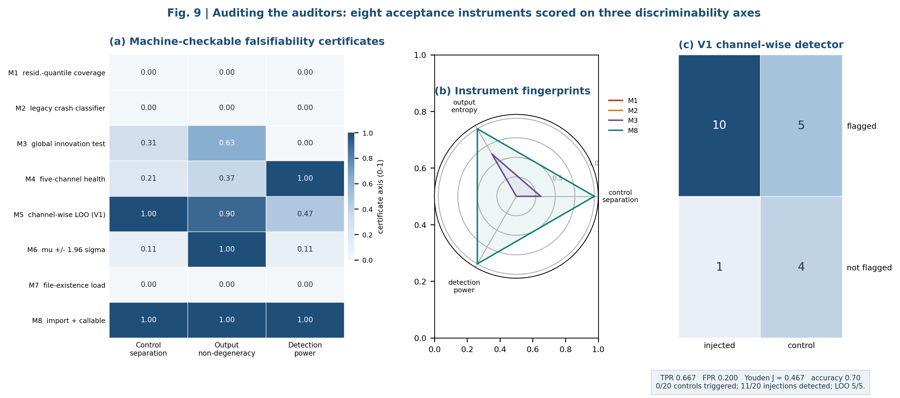

**Fig. 9 | Auditing the auditors.** (a) Eight acceptance instruments scored on three
machine-checkable axes; (b) radar fingerprints of two degenerate, one saturated and one
certified instrument; (c) confusion matrix of the channel-wise detector
(TP10 / FN5 / TN4 / FP1; Youden J = 0.4667). Data: `paper/extended_stats.json`,
`runs/r160_i3_coverage_tautology.json`, `runs/r166_ab_gate.json`.

**Table 9. Falsifiability certificates issued for eight acceptance instruments.**

| ID | Instrument | Control separation | Output entropy | Detection power | Verdict |
|---|---|---|---|---|---|
| M1 | Residual-quantile interval coverage | 0.0000 | 0.0000 | 0.0000 | **TAUTOLOGICAL** |
| M2 | Legacy `classify_crash` | 0.0000 | 0.0000 | 0.0000 | **CONSTANT** |
| M3 | Global innovation threshold (z > 5) | 0.3125 | 0.6253 | 0.0000 | **SATURATED** |
| M4 | Five-channel `classify_health` | 0.2093 | 0.3705 | 1.0000 | CERTIFIED |
| M5 | Channel-wise LOO-calibrated innovation (V1) | 1.0000 | 0.9000 | 0.4667 | CERTIFIED (opt-in) |
| M6 | mu +/- 1.96 sigma interval coverage | 0.1072 | 1.0000 | 0.1072 | CERTIFIED (width only) |
| M7 | File-existence loading test | 0.0000 | 0.0000 | 0.0000 | **TAUTOLOGICAL** |
| M8 | Runtime `import + callable` loading test | 1.0000 | 1.0000 | 1.0000 | CERTIFIED |

Four of eight instruments were invalidated. Note that M3 has non-zero entropy and
non-zero control separation yet zero detection power: a detector that fires on 84.38% of
normal data is *informative about nothing*, which a single entropy number alone would
miss. This is why the certificate reports three axes rather than one aggregate. M6 is
certified only for interval **width**; coverage itself remains withdrawn as calibration
evidence. M8 detects both naming defects (`hier_est` -> `hier_fit`,
`conservation_metrics` -> `element_balance`) that M7 reported as "loaded".

### 4.11 Epistemic boundary certificates and criterion independence

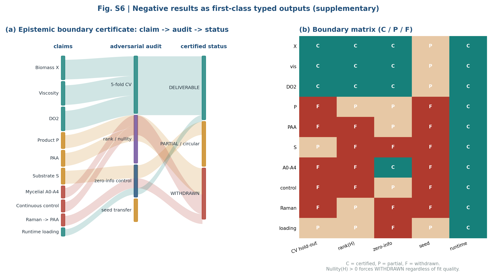

**Fig. S6 | Negative results as first-class typed outputs (supplementary).**
(a) Alluvial diagram from ten candidate claims through four adversarial audits to three
certified statuses; (b) boundary matrix (C = certified, P = partial/conditional,
F = failed or withdrawn). Whenever nullity(H) > 0, `WITHDRAWN` is forced regardless of
fit quality. Data: `runs/r165_mycelium_identifiability.json`,
`runs/r157_i3_channels.json`, `docs/r157_debt_ledger.md`.

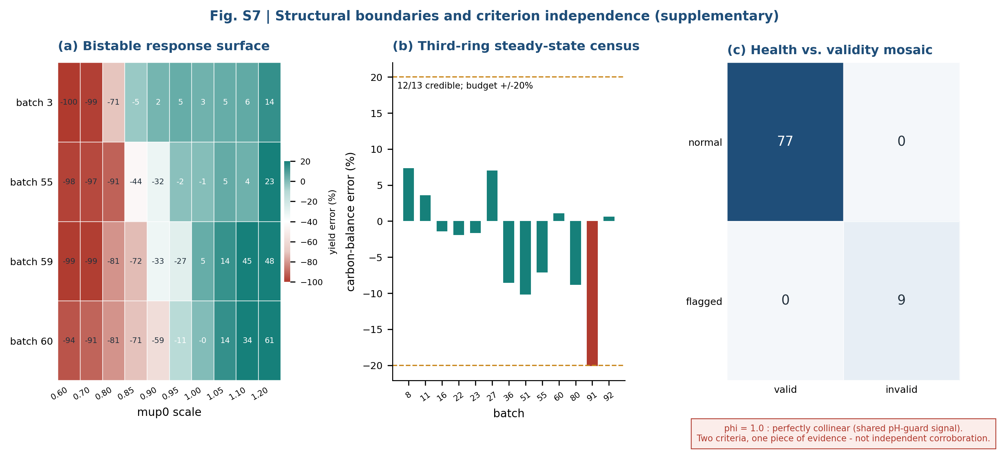

**Fig. S7 | Structural boundaries and criterion independence (supplementary).**
(a) Four-batch x ten-scale bistable response surface; (b) carbon-balance error of the
third-ring steady-state census (12/13 credible, +/-20% budget); (c) health-versus-validity
mosaic. Data: `runs/r154_bistable.json`, `runs/r161_fallback_chain_probe.json`,
`runs/r156_acceptance.json`, `runs/r148_validity_gate.json`.

**Table 10. Health-versus-validity cross-tabulation.**

| | valid | invalid | total |
|---|---|---|---|
| normal | 77 | 0 | 77 |
| degraded | 0 | 5 | 5 |
| catastrophic | 0 | 4 | 4 |
| total | 77 | 9 | 86 |

Collapsing to (normal / flagged) x (valid / invalid) gives [[77, 0], [0, 9]] and
**phi = 1.0000**. The two criteria are perfectly collinear because both consume the same
pH-guard clamping and pH > 7 signals. They answer different questions - "is this batch
admissible for baseline comparison" versus "did the model fail" - but on this benchmark
they are **not independent evidence**. Reporting both as corroborating checks would
re-create the category error this paper argues against. We therefore count them as one
piece of evidence and state the collinearity explicitly.

### 4.12 Executable evidence inventory and the realisation-path invariance test

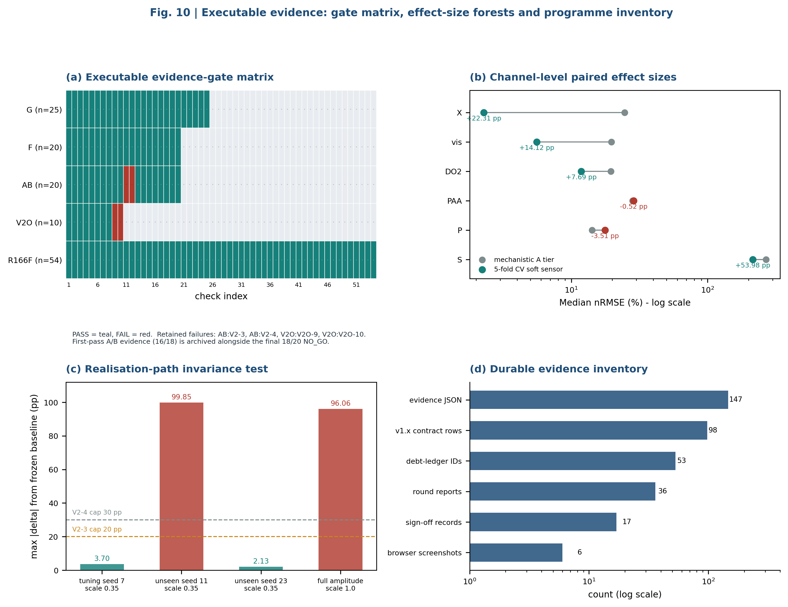

**Fig. 10 | Executable evidence.** (a) Five-family gate matrix (teal PASS, red FAIL, grey
not applicable) with the two retained A/B failures and two optimisation failures;
(b) paired channel-level effect sizes with 5-fold CV and mechanistic endpoints;
(c) realisation-path invariance test with the frozen 20 pp / 30 pp caps; (d) durable
evidence inventory on a log scale. Data: `runs/r166_ab_gate.json`,
`runs/r166_v2_optim.json`, `runs/r167_platform_gate.json`,
`runs/r167_final_check.json`, `paper/extended_stats.json`.

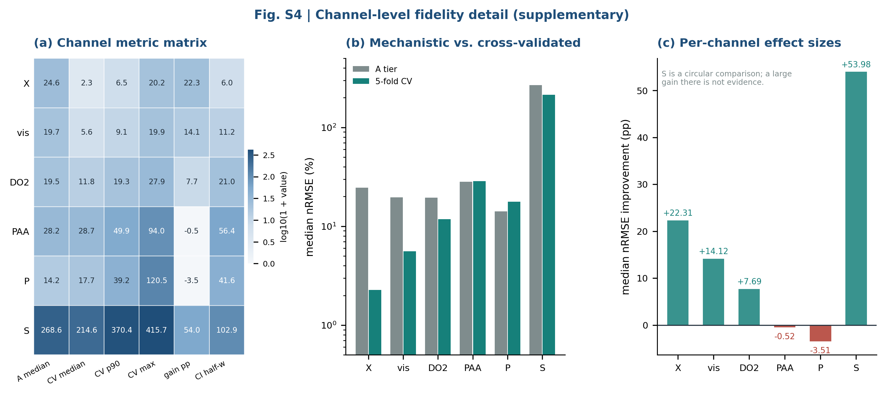

**Fig. S4 | Channel-level fidelity detail (supplementary).** (a) Six-channel metric
matrix; (b) mechanistic A tier versus 5-fold CV median nRMSE on a log scale;
(c) per-channel effect sizes, with substrate S labelled as a circular comparison.
Data: `runs/r157_i3_channels.json`.

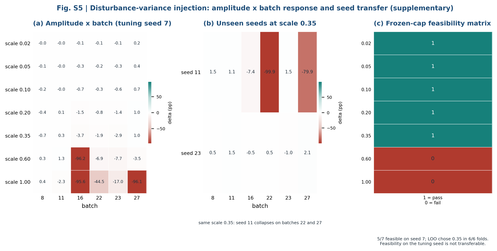

**Fig. S5 | Disturbance-variance injection (supplementary).** (a) Seven-scale x six-batch
deviation heatmap on tuning seed 7; (b) the same scale 0.35 on two unseen seeds
(seed 11 collapses on batches 22 and 27); (c) frozen-cap feasibility matrix (5/7
feasible on the tuning seed, LOO chose 0.35 in 6/6 folds). Data:
`runs/r166_v2_optim.json`, `runs/r166_ab_gate.json`.

**Table 11. Executable evidence inventory and gate outcomes.**

| Artefact family | Result | Source |
|---|---|---|
| Integration gate G1-G25 | 25/25 PASS | `runs/r167_platform_gate.json` |
| Final consistency F1-F20 | 20/20 PASS | `runs/r167_final_check.json` |
| Two-sided A/B gate | 18/20 NO_GO (V2-3, V2-4 fail) | `runs/r166_ab_gate.json` |
| Amplitude optimisation V2O-1...10 | 8/10 (V2O-9, V2O-10 fail) | `runs/r166_v2_optim.json` |
| R166 final check | 54/54 PASS | `runs/r166_final_check.json` |
| First-pass A/B (archived, not deleted) | 16/18 FAIL | `runs/r166_ab_gate_first_pass.json` |
| Evidence JSON files | 147 | `runs/` |
| Successive v1.x contract rows | 98 (v1.0-v1.97) | `ENGINE_CONTRACT.md` |
| Debt-ledger IDs | 53 distinct IDs, D-2...D-92 | `docs/r157_debt_ledger.md` |
| Round reports | 36 (programme numbered R1-R167) | `docs/rNNN_round_report.md` |
| Sign-off records | 17 (R-1...R-17) | `docs/m5_review_signoff.md` |
| Browser screenshots | 6 | `docs/screenshots/platform/r167_*.png` |

The realisation-path invariance test (Section 3.16) is decisive for V2. At the chosen
scale 0.35 the maximum deviation was 3.697 pp on tuning seed 7 and 2.128 pp on unseen
seed 23, but **99.852 pp with two collapses** on unseen seed 11; full amplitude reached
96.059 pp with 3/6 collapses. $T(c) = 99.852$ pp exceeds both frozen caps, so the
candidate fails on path dependence even though it is feasible at low amplitude and on
two of three seeds. No post-hoc cap relaxation was applied.

---

## 5. Discussion

### 5.1 Falsifiability as a first-class engineering requirement

The recurring failure in this case study was not numerical. The integrator was stable, the code was tested, the regression anchor was byte-identical, and the headline accuracy was excellent. What failed were the *instruments of certification*. A coverage statistic built from the residual it evaluates, a classifier whose guard clause can never be false, and a threshold that fires on 84% of normal data all produce immaculate dashboards. Because they are cheap, quantitative and plausible, they are more dangerous than an obviously missing test: they convert absence of evidence into evidence of absence of failure.

Our response is structural rather than rhetorical. Every acceptance instrument must survive a zero-information control, a constant-detector test, a trigger-rate audit and, where relevant, a rank test. Every claim about a deployed capability must survive `import + callable`. Every threshold is frozen before the experiment, and every failure is archived rather than deleted. This is close in spirit to V&V formalism [4,5] and to identifiability analysis [6–8,28], but it shifts the object of validation from "the model" to "the entire claim-producing apparatus", including the dashboard.

The four-layer architecture (Fig. 1) matters because it separates three activities that are usually conflated: *running* a model (L0), *evaluating* a change (L1 + L2), and *authorising* a change (L3). Classical ensemble [29] and moving-horizon [30] estimators, sparse system identification [19] and interval calibration [20] are all legitimate L1 candidates. The gate does not forbid them; it forbids their unexamined promotion. In this study, one candidate passed its gate (V1) and still remained opt-in, one failed (V2) and was retained as a documented negative result, and one was confined to the evaluation layer (V3). L3 was never executed. The distinction between "we measured an improvement" and "we changed what the plant relies on" is the main practical deliverable.

### 5.2 Accuracy is necessary but not sufficient

A 2.3448% yield RMSE over 86 batches looks like a strong result, and as a statement about the internal consistency of the port it is. As a statement about prospective plant performance it would be misleading, because each batch is reconstructed with its own calibrated parameter vector. We have deliberately kept this qualification in the Abstract, Methods, Results and Limitations. The only generalisation-bearing numbers in the paper come from protocols with genuine hold-outs: the 5-fold cross-validated channel soft sensors (X 2.28%, viscosity 5.57%) and the seed-transfer experiment that *failed*.

This asymmetry is instructive. The most trustworthy evidence in the study is the negative result, because it was designed to be able to fail and did fail out of sample. A paper that reported only the accuracy curve would have produced a confident, unfalsifiable claim; a paper that reports the seed-transfer collapse instead produces a defensible boundary. Seed sensitivity of this kind is well documented in reinforcement learning [13] and is a natural consequence of bistable nonlinear dynamics [27]; here the relevant mechanism is that a disturbance realisation can move a batch across a basin boundary, so "amplitude" is not the controlling variable. Tuning amplitude on one seed until the collapse disappears is a form of overfitting that looks like calibration.

### 5.3 Negative results as durable assets

The governance spine (Fig. S3) addresses a sociological failure documented across disciplines: negative results and retracted conclusions disappear [11,22], while non-replicable positive claims are cited more often [12]. In this programme every round emits machine-readable evidence, a round report, a numbered debt-ledger entry and a contract version row; governance synchronisation is idempotent and dry-run by default. Concretely: the failing first-pass A/B result (16/18) is preserved next to the final 18/20 NO_GO; the withdrawn R158 "A2 strictly dominates" conclusion is preserved with its rebuttal (after removing 29 degenerate batches, A2 at 20.47% was worse than C0 at 10.29%, p = 4.24 × 10⁻⁹); the −60…−67% carbon imbalance is preserved with its cause (a missing volume factor); and the 0.8995 coverage is preserved with its `TAUTOLOGICAL` verdict. Nothing is quietly overwritten.

This is a practical implementation of FAIR provenance [18] and of reproducibility checklists [14,31–33], but with an additional property: the artefacts are *executable*. `tools/r167_platform_gate.py` re-derives 25 checks from the repository, including the four engine hashes, the runtime loading of all 14 capabilities and the six browser views. A reviewer can re-run the gate rather than trust a sentence.

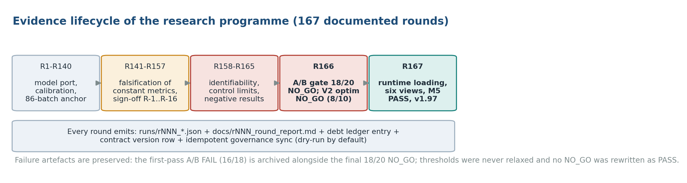

**Fig. S3 | Evidence lifecycle across a programme numbered R1-R167 (36 archived round reports; supplementary).** Model port and calibration (R1–R140), falsification of constant metrics and formal sign-off (R141–R157), identifiability and control limits (R158–R165), the A/B NO_GO decision (R166) and runtime loading with milestone closure (R167). Every round emits a JSON evidence file, a round report, a debt-ledger entry and a contract version row; first-pass failures are archived alongside final verdicts and thresholds are never relaxed.

### 5.4 Relationship to existing frameworks

Our framework complements rather than replaces established practice. V&V/UQ [4,5] supplies the vocabulary of credibility and domain of applicability; we add an executable test of whether the *comparison metric* can discriminate. Identifiability analysis [6–8,28] supplies the rank and profile-likelihood machinery; we apply it to a delivered digital twin and require that unidentifiable states be withdrawn from the delivery claims rather than reported as soft-sensor outputs. Leakage taxonomies [12] classify how information contaminates an evaluation; a residual-derived interval is a particularly clean instance of metric-level leakage, detectable by the zero-information control. Underspecification [16] and hidden technical debt [17] explain why a platform can report "12/12 loaded" while one symbol is not callable; our `import + callable` rule is a minimal, machine-checkable remedy.

### 5.5 A transferable checklist

The framework is not specific to penicillin. The following checklist is the portable core, and each item has a concrete counterpart in this repository.

> **Box 1. Minimum falsifiability checklist for a scientific digital twin**
>
> 1. **Freeze the anchor.** Pin the default path and a regression statistic with tolerance zero; never overwrite the frozen evidence file.
> 2. **Certify the metrics.** For every acceptance statistic, run a zero-information control. If the statistic does not change, discard it. For every classifier, check that its output distribution is non-degenerate.
> 3. **Audit trigger rates.** A detector that fires on ~100% or ~0% of real data carries no information about anomalies.
> 4. **Separate reconstruction from prediction.** State explicitly whether evaluation batches use their own calibrated parameters; reserve cross-validation or seed transfer for generalisation claims.
> 5. **Compute the observation rank.** Report rank/nullity of H for every state or parameter you claim to deliver; withdraw claims for null-space directions.
> 6. **Gate candidates adversarially.** Controls in both directions, frozen thresholds, leave-one-out, confusion tables, and at least two unseen stochastic seeds.
> 7. **Archive failures.** Keep first-pass failures, withdrawn conclusions and their rebuttals; never relax a threshold after seeing the result.
> 8. **Verify deployment at runtime.** `import + callable`, not file existence; re-run the end-to-end gate from the browser down to the solver.
> 9. **Keep promotion human.** Evaluation is automated; changing what a plant relies on is not.

### 5.6 Practical implications

For a process engineer, the operational message is that a green dashboard is a hypothesis, not a certificate. The five-channel health classifier, interval half-widths, channel-wise thresholds and explicit-failure states are cheap to implement and immediately expose the failures that a single aggregate number hides. For a modelling team, the L0/L1/L2 split makes it possible to explore improvements without endangering the regression anchor — a common organisational failure mode when research code and production code share a branch. For a regulator or a reviewer, the durable, executable evidence trail makes the difference between "the authors report passing tests" and "the tests can be re-run against the exact artefacts described".

### 5.7 What is genuinely new, and what is only an analogy

We separate the methodological claims from the implementation so that neither is
overstated. **Implemented and executable**: machine-issued falsifiability certificates
for eight instruments; a typed claim record whose `WITHDRAWN` status is produced by a
rank test; capability-gated compilation with five forbidden keys and a human-gated
linker; a realisation-path invariance test with two unseen seeds; parity, agreement,
distributional and response-surface diagnostics derived from frozen artefacts; and a
Canvas-rendered, interactive process flow diagram whose red traces encode withdrawn
channels. **Analogy, not a new theory of computation**: the mapping from claims to typed
records and from promotion to linking is borrowed from protection systems [39]; it is
useful because it makes the authority boundary explicit and testable, not because
scientific claims are literally programs. **Deliberately not claimed**: a composite
falsifiability score (we report three axes separately), a proof that our certificate
schema is complete, prospective plant validation, or bit-level reproduction of the
original MATLAB simulator.

The most transferable idea is that **a green dashboard is a hypothesis, not a
certificate**. The four invalidated instruments were all cheap, quantitative,
internally consistent and completely uninformative. Replacing them required no new
physics - only a counterfactual control and the discipline to keep the failing result.

### 5.8 How to falsify this paper

A framework that demands falsifiability should specify how it can itself be refuted.
Four experiments would do so. (i) Apply the certificate battery to a second, independent
process with genuinely held-out batches; if zero instruments are invalidated there, our
claim that tautological metrics are a systemic risk is weakened. (ii) Add
compartment-resolved measurements (e.g. image-based morphology) so that nullity(H)
falls; if compartment states then become estimable, our `WITHDRAWN` certificates were
correctly conditional on H and must be reissued. (iii) Collect prospectively measured
plant data and test whether the L0 anchor transfers without per-batch calibration; we
predict it will not, which is precisely why we do not claim predictive accuracy.
(iv) Re-run `tools/r167_platform_gate.py` and `paper/check_manuscript.py` against the
deposited bundle; if the 25/25 gate or the numerical cross-checks fail, the executable
evidence claim is false. We regard (iii) as the most important and the most likely to
change the conclusions.

> **Box 2. Minimal falsifiability certificate schema (machine-issued)**
>
> ```
> FC(M) = {
>   id, instrument,
>   control_separation : [0,1],   # |M(fitted) - M(zero-info)|, or defect-detection rate
>   output_degeneracy  : [0,1],   # normalised Shannon entropy of the output distribution
>   detection_power    : [0,1],   # Youden J, or defect-detection rate
>   verdict            : CERTIFIED | TAUTOLOGICAL | CONSTANT | SATURATED,
>   evidence           : immutable artefact path
> }
> ```
>
> Quarantine rule: `control_separation == 0` OR `output_degeneracy == 0` OR (a confusion
> table exists AND `detection_power <= 0`). A quarantined instrument must name a
> replacement; the failing certificate is retained in the archive. Certificates are
> regenerated from `runs/` by `paper/make_extended_stats.py` and are never edited by hand.

---

## 6. Limitations

**In-silico evidence only.** All 86 evaluation batches are simulated. IndPenSim was validated against historical industrial records by its authors [2], but this study contains no prospective plant trial, no wet-laboratory measurement and no GMP qualification. The results characterise a simulation benchmark and a software platform, not a deployed manufacturing twin.

**Bit-exact reproduction of the original MATLAB simulator is unattainable.** The reference simulator seeds its random number generator with `rng('shuffle')` and does not record the seed. Our zero-regression statement therefore means byte-identical reproduction of *our own frozen Python baseline*, not bit-level reproduction of MATLAB output. We explicitly do not claim the latter.

**Per-batch calibration limits the accuracy claim.** Each of the 86 batches is reconstructed with its own calibrated `COMBINED` vector. RMSE 2.3448% and 86/86 within ±5% quantify reconstruction consistency and implementation stability. Prospective prediction on an uncalibrated batch is not evaluated here.

**Single process, single strain, single data asset.** All batches come from one 100,000 L penicillin process model. Transferability to other organisms, scales or control strategies is untested; the framework is intended to be portable, the numerical conclusions are not.

**Identifiability is conditional on H.** Rank 0 / nullity 4 for the mycelial compartments is a property of the *available observation operator*, not of the biology. New compartment-resolved measurements (e.g. image-based morphology) could change the rank. We distinguish this structural limitation from the separate data-asset limitation that the released 37 columns contain no such measurements.

**No independent hold-out for hierarchical estimates.** The planned 60/28/12 split was never honoured in the deployed estimator. Consequently no generalisation error is claimed for σ_pop or any hierarchical quantity; only dispersion upper bounds are reported.

**Dormant components.** The RK4 integrator and the `SimRequest`/`SimResult` plugin contract exist in the repository but are not imported by any active path. They are not counted as deployed capability.

**Control conclusions are model-relative.** The 99.8–101.5 pp discontinuity was measured on this model's response surface. It precludes gradient-based closed-loop control *within this model*; it does not prove that all industrial penicillin processes are discontinuous.

**Platform maturity.** The six-view platform is a local research prototype bound to 127.0.0.1, verified in headless Chrome. It is not hardened, authenticated, audited or validated for regulated use. The MCP service is a prototype with 14 tools; heavy capabilities are gated by explicit confirmation and numerical caps.

**L3 deliberately unexecuted.** No opt-in candidate was promoted to the default production path, no golden parameter table was rewritten, and no dual-baseline regime was introduced. These are governance decisions requiring explicit authorisation, not technical omissions, and they bound the scope of every claim in this paper.

**Naive baselines are not like-for-like competitors.** The five reference predictors in
Table 7 have strictly less information than L0, and Section 4.8 reports them to bound the
difficulty of the target series, not to rank methods. The 96.82-97.66% reductions must be
read with the information-set column.

**Distributional tests are underpowered for fault batches.** Only two of 86 batches carry
a `fault` label, so the Mann-Whitney comparison (p = 0.1073) is reported for completeness
and cannot support a claim about fault-specific behaviour.

**Two criteria are not independent.** The health classifier and the validity criterion are
perfectly collinear on this dataset (phi = 1.0). They are counted once, not twice, in the
evidence inventory.

**The certificate schema is a minimal instrument, not a complete theory.** Three axes
detect degeneracy, saturation and lack of contrast; they do not detect every possible
form of metric leakage. We report them separately to avoid hiding a failure behind an
aggregate score.

**The process flow diagram is schematic.** Fig. 12 is a Canvas-rendered teaching and
evidence map of the benchmark, not a piping and instrumentation diagram, a control
narrative or a GMP document.

**The HTML/PDF delivery is a rendering of the same manuscript.** It adds no experimental
evidence; all three formats are generated from `manuscript.md` and the same frozen
artefacts, and any discrepancy between them is a rendering defect, not a new result.

---

## 7. Conclusion

We asked which claims about a bioprocess digital twin survive once the unfalsifiable
ones are removed. The answer required auditing not only the model but the entire
claim-producing apparatus. On an 86-batch industrial-scale penicillin simulation
benchmark, a frozen baseline achieved 2.3448% yield RMSE with 86/86 batches within +/-5%
and byte-identical regression - a number that extended validation places in context
(2.22% of median yield, unbiased and serially unstructured errors, Bland-Altman limits
-4.69% / +4.55%) while making clear that it measures reconstruction consistency, not
prospective prediction.

Four of eight acceptance instruments were then invalidated by counterfactual
certificates, and a fifth finding showed that two apparently independent criteria are
perfectly collinear because they share a pH-guard signal. We issued epistemic boundary
certificates for structurally unidentifiable states and discontinuous control, closed the
gradient path for continuous regulation, and produced a pre-registered NO_GO for
disturbance-variance injection when a tuned scale failed a realisation-path invariance
test on an unseen seed. The surviving evidence is smaller but defensible: cross-validated
biomass and viscosity soft sensors, a five-channel health assessment that resolves
77/5/4 batches, an explicit-failure estimator chain, 147 machine-readable evidence
files, and a runtime-verified platform with 14 capabilities and 12 operators.

The general lesson is that credibility in scientific digital twins is a property of the
*evidence apparatus*, not of the headline error. Accuracy is necessary; falsifiability is
what makes it meaningful; authority to promote a change is a separate decision altogether.
We propose a four-layer architecture, machine-issued instrument certificates, typed
epistemic boundaries, a nine-item transferable checklist and a governance spine that
preserves negative results as first-class artefacts. Future work should test the
framework on a second independent process and, ultimately, on prospectively collected
plant data with compartment-resolved measurements - the two additions that would
genuinely change the observation operator and the scope of every claim in this paper.


---

## Declarations

**Ethics.** Not applicable. This study used only publicly released in-silico simulation data; no human participants, animals or regulated process data were involved.

**Data and Code Availability.** All evidence is versioned locally in the project repository and is reproducible from pinned dependencies (`requirements.txt`: CPython 3.10.5, numpy 1.26.4, pandas 2.3.3, scipy 1.15.3, matplotlib 3.8.4, pytest 7.4.3, mcp 1.12.0) [23–26]. Key artefacts: `runs/final_validation_v2.json` (86-batch anchor), `runs/r156_acceptance.json` (health classification), `runs/r157_i3_channels.json` (cross-validated channel nRMSE), `runs/r160_i3_coverage_tautology.json`, `runs/r163_degradation_probe.json`, `runs/r165_mycelium_identifiability.json`, `runs/r157_bistab_escape.json`, `runs/r166_ab_gate.json`, `runs/r166_ab_gate_first_pass.json`, `runs/r166_v2_optim.json`, `runs/r166_final_check.json`, `runs/r167_platform_gate.json`, `runs/r167_final_check.json`, `runs/r167_governance_update.json`; governance documents `ENGINE_CONTRACT.md` (v1.97), `docs/m5_review_signoff.md` (R-1…R-17), `docs/r157_debt_ledger.md` (D-2…D-92), `state.yaml`; implementation under `candidate/indpensim/v0.1/`, `platform/`, `tools/`. Figures are generated by `paper/make_figures.py`, `paper/make_figures_v2.py` and `paper/export_pfd.py` from those JSON files at 300 dpi; the interactive process flow diagram is drawn in native Canvas 2D by `paper/pfd.js`. Reproduction:

```
python -m pip install -r requirements.txt
python platform/export_data.py
python tools/r167_platform_gate.py       # starts 8771, stops automatically
python tools/r167_final_check.py
python paper/make_extended_stats.py      # derive extended_stats.json from runs/
python paper/make_figures.py             # Figures 1-6, S1-S3
python paper/make_figures_v2.py          # Figures 7-11, S4-S7
python paper/export_pfd.py               # Canvas 2D -> figures/fig12_pfd.png
python paper/build_html.py               # manuscript.md -> manuscript.html
python paper/export_pdf.py               # manuscript.html -> manuscript.pdf
python paper/check_manuscript.py         # cross-format consistency check
```

The manuscript is distributed in three synchronised formats under `paper/`:
`manuscript.md` (source), `manuscript.html` (self-contained styled HTML with the
interactive Canvas 2D process flow diagram, also available standalone as `pfd.html`)
and `manuscript.pdf` (A4 print rendering of the same HTML). The pre-enhancement draft is
retained as `manuscript_v1.md` so that the revision itself is auditable.

The six browser screenshots are retained under `docs/screenshots/platform/r167_*.png`. **Before submission** the authors must deposit the dataset snapshot, code and evidence bundle in a DOI-issuing repository (e.g. Zenodo), attach an explicit licence, and replace the local paths above with permanent identifiers; the released IndPenSim data are subject to the terms stated by their original authors [2,3].

**Author contributions.** [to be completed by the submitting author].

**Competing interests.** The authors declare no competing interests. [to be confirmed by all authors before submission].

**Funding.** [to be completed by the submitting author].

**Acknowledgements.** [to be completed by the submitting author].

---

## References

1. Birol G, Ündey C, Çınar A. A modular simulation package for fed-batch fermentation: penicillin production. *Computers & Chemical Engineering*. 2002;26(11):1553–1565. doi:10.1016/S0098-1354(02)00127-8.
2. Goldrick S, Ştefan A, Lovett D, Montague G, Lennox B. The development of an industrial-scale fed-batch fermentation simulation. *Journal of Biotechnology*. 2015;193:70–82. doi:10.1016/j.jbiotec.2014.10.029.
3. Goldrick S, Duran-Villalobos CA, Jankauskas K, Lovett D, Farid SS, Lennox B. Modern day monitoring and control challenges outlined on an industrial-scale benchmark fermentation process. *Computers & Chemical Engineering*. 2019;130:106471. doi:10.1016/j.compchemeng.2019.05.037.
4. Oberkampf WL, Trucano TG. Verification and validation in computational fluid dynamics. *Progress in Aerospace Sciences*. 2002;38(3):209–272.
5. Roy CJ, Oberkampf WL. A comprehensive framework for verification, validation, and uncertainty quantification in scientific computing. *Computer Methods in Applied Mechanics and Engineering*. 2011;200(25–28):2131–2144.
6. Raue A, Kreutz C, Maiwald T, Bachmann J, Schilling M, Klingmüller U, Timmer J. Structural and practical identifiability analysis of partially observed dynamical models by exploiting the profile likelihood. *Bioinformatics*. 2009;25(15):1923–1929. doi:10.1093/bioinformatics/btp358.
7. Miao H, Xia X, Perelson AS, Wu H. On identifiability of nonlinear ODE models and applications in viral dynamics. *SIAM Review*. 2011;53(1):3–39.
8. Bellman R, Åström KJ. On structural identifiability. *Mathematical Biosciences*. 1970;7(3–4):329–339.
9. Baker M. 1,500 scientists lift the lid on reproducibility. *Nature*. 2016;533(7604):452–454.
10. Open Science Collaboration. Estimating the reproducibility of psychological science. *Science*. 2015;349(6251):aac4716.
11. Fanelli D. Negative results are disappearing from most disciplines and countries. *Scientometrics*. 2012;90(3):891–904.
12. Kapoor S, Narayanan A. Leakage and the reproducibility crisis in machine-learning-based science. *Patterns*. 2023;4(9):100804. doi:10.1016/j.patter.2023.100804.
13. Henderson P, Islam R, Bachman P, Pineau J, Precup D, Meger D. Deep reinforcement learning that matters. *Proceedings of the AAAI Conference on Artificial Intelligence*. 2018;32(1). doi:10.1609/aaai.v32i1.11694.
14. Pineau J, Vincent-Lamarre P, Sinha K, Larivière V, Beygelzimer A, d'Alché-Buc F, Fox E, Larochelle H. Improving reproducibility in machine learning research (a report from the NeurIPS 2019 reproducibility program). *Journal of Machine Learning Research*. 2021;22(164):1–20.
15. Bajpai RK, Reuss M. A mechanistic model for penicillin production. *Journal of Chemical Technology and Biotechnology*. 1980;30(1):332–344.
16. D'Amour A, Heller K, Moldovan D, Adlam B, Alipanahi B, Beutel A, et al. Underspecification presents challenges for credibility in modern machine learning. *Journal of Machine Learning Research*. 2022;23(226):1–61.
17. Sculley D, Holt G, Golovin D, Davydov E, Phillips T, Ebner D, et al. Hidden technical debt in machine learning systems. *Advances in Neural Information Processing Systems*. 2015;28:2503–2511.
18. Wilkinson MD, Dumontier M, Aalbersberg IJ, Appleton G, Axton M, Baak A, et al. The FAIR Guiding Principles for scientific data management and stewardship. *Scientific Data*. 2016;3:160018. doi:10.1038/sdata.2016.18.
19. Brunton SL, Proctor JL, Kutz JN. Discovering governing equations from data by sparse identification of nonlinear dynamical systems. *Proceedings of the National Academy of Sciences*. 2016;113(15):3932–3937. doi:10.1073/pnas.1517384113.
20. Wilson EB. Probable inference, the law of succession, and statistical inference. *Journal of the American Statistical Association*. 1927;22(158):209–212.
21. Efron B, Tibshirani RJ. *An Introduction to the Bootstrap*. Chapman & Hall; 1993.
22. Ioannidis JPA. Why most published research findings are false. *PLoS Medicine*. 2005;2(8):e124.
23. Virtanen P, Gommers R, Oliphant TE, Haberland M, Reddy T, Cournapeau D, et al. SciPy 1.0: fundamental algorithms for scientific computing in Python. *Nature Methods*. 2020;17(3):261–272.
24. Harris CR, Millman KJ, van der Walt SJ, Gommers R, Virtanen P, Cournapeau D, et al. Array programming with NumPy. *Nature*. 2020;585(7825):357–362.
25. McKinney W. Data structures for statistical computing in Python. *Proceedings of the 9th Python in Science Conference*. 2010:51–56.
26. Hunter JD. Matplotlib: a 2D graphics environment. *Computing in Science & Engineering*. 2007;9(3):90–95.
27. Strogatz SH. *Nonlinear Dynamics and Chaos: With Applications to Physics, Biology, Chemistry, and Engineering*. Westview Press; 1994.
28. Wieland FG, Hauber AL, Rosenblatt M, Tönsing C, Timmer J. On structural and practical identifiability. *Current Opinion in Systems Biology*. 2021;25:60–69.
29. Evensen G. The Ensemble Kalman Filter: theoretical formulation and practical implementation. *Ocean Dynamics*. 2003;53(4):343–367.
30. Rao CV, Rawlings JB, Mayne DQ. Constrained state estimation for nonlinear discrete-time systems: stability and moving horizon approximations. *IEEE Transactions on Automatic Control*. 2003;48(1):97–108.
31. Peng RD. Reproducible research in computational science. *Science*. 2011;334(6060):1226–1227.
32. Sandve GK, Nekrutenko A, Taylor J, Hovig E. Ten simple rules for reproducible computational research. *PLoS Computational Biology*. 2013;9(10):e1003285.
33. Wilson G, Aruliah DA, Brown CT, Chue Hong NP, Davis M, Guy RT, et al. Best practices for scientific computing. *PLoS Biology*. 2014;12(1):e1001745.
34. Shannon CE. A mathematical theory of communication. *Bell System Technical Journal*. 1948;27(3):379-423; 27(4):623-656.
35. Bland JM, Altman DG. Statistical methods for assessing agreement between two methods of clinical measurement. *The Lancet*. 1986;327(8476):307-310. doi:10.1016/S0140-6736(86)90837-8.
36. Shapiro SS, Wilk MB. An analysis of variance test for normality (complete samples). *Biometrika*. 1965;52(3-4):591-611. doi:10.1093/biomet/52.3-4.591.
37. Wald A, Wolfowitz J. On a test whether two samples are from the same population. *Annals of Mathematical Statistics*. 1940;11(2):147-162.
38. Mann HB, Whitney DR. On a test of whether one of two random variables is stochastically larger than the other. *Annals of Mathematical Statistics*. 1947;18(1):50-60.
39. Saltzer JH, Schroeder MD. The protection of information in computer systems. *Proceedings of the IEEE*. 1975;63(9):1278-1308.
