# Counterfactual auditing of acceptance instruments in an industrial-scale penicillin fermentation digital twin

**Running title:** Falsifiability auditing of a bioprocess digital twin

**Authors:** [to be completed before submission]

**Affiliations:** [to be completed before submission]

**Correspondence:** [to be completed before submission]

---

## Highlights

- A frozen digital twin of 86 industrial-scale penicillin batches attains 2.34% yield RMSE.
- Zero-information controls expose four acceptance instruments as unfalsifiable.
- Machine-issued certificates score control separation, entropy and detection power.
- Unidentifiable states and discontinuous control become typed withdrawn boundaries.
- A tuned disturbance injection fails unseen-seed transfer and remains disabled.

**Keywords:** Digital twin; Penicillin fermentation; Falsifiability; Structural identifiability; Verification and validation; Negative results

---

## Abstract

Digital twins for bioprocesses are judged by predictive accuracy, yet the instruments that certify them are rarely themselves tested for falsifiability. A metric that returns a favourable value for every model, including a zero-information model, certifies nothing. This study introduces counterfactual instrument auditing, in which every acceptance statistic, classifier and deployment check of a bioprocess digital twin is issued a machine-signed falsifiability certificate recording its control separation, output entropy and detection power, and is quarantined when any axis is zero. Scientific claims are modelled as typed records and evaluated by a four-layer architecture that separates running a frozen baseline, evaluating opt-in candidates, and authorising promotion to the default path. The framework is demonstrated on the public IndPenSim benchmark of 100 fed-batch penicillin fermentations (100,000 L, approximately 230 h), for which the 33-state mechanistic model was ported to Python, 86 batches were calibrated and a byte-identical frozen baseline was established (end-of-batch yield RMSE 2.3448%; 86 of 86 batches within +/-5%; maximum regression deviation exactly zero). Extended validation places this number in context: relative to leave-one-out mean, persistence and zero predictors, the frozen twin reduces RMSE by 96.82%, 97.46% and 97.66%, and by 88.8% on a scale-robust median-normalised error (2.22% versus 26.31%). The errors are unbiased (mean -0.0662%; sign test p = 0.590), approximately normal (Shapiro-Wilk p = 0.182), serially unstructured (lag-1 autocorrelation 0.058; runs test p = 0.696) and in agreement with the recorded masses (Bland-Altman limits of agreement -4.69% to +4.55%). Of eight acceptance instruments audited, four were invalidated: a coverage statistic identical (0.899548532731377) for fitted and zero-information predictors, a crash classifier returning normal for all 86 batches, an innovation test flagging 84.38% of unperturbed batches, and a file-existence loading test. A replacement five-channel classifier resolved 77 normal, 5 degraded and 4 catastrophic batches, and the health and validity criteria, although conceptually distinct, proved perfectly collinear (phi = 1.0) because both consume the same pH-guard signal. Structural results were promoted to typed withdrawn boundaries: mycelial compartment states with observation-operator nullity 4, substrate, product and phenylacetic acid channels, the simulated Raman measurement, and a discontinuous control response spanning 99.8 to 101.5 percentage points. Finally, an eight-path disturbance-variance injection candidate was rejected under a pre-registered two-sided gate (18/20 NO_GO): the full amplitude caused three of six catastrophic collapses (96.06 percentage points), and a scale of 0.35 tuned on one seed collapsed to 99.85 percentage points on an unseen seed, so the candidate fails a realisation-path invariance test and remains disabled. All evidence is in silico; each batch uses its own calibrated parameters, so the reported accuracy quantifies reconstruction consistency rather than prospective prediction.

---

## 1. Introduction

Mechanistic and hybrid digital twins are becoming the substrate for process development, soft sensing, fault diagnosis and control in industrial biotechnology (Birol et al., 2002; Goldrick et al., 2015; Goldrick et al., 2019). The penicillin fed-batch process is the canonical benchmark in this space: Birol et al. (2002) released a modular simulator, and Goldrick et al. (2015) later published IndPenSim, a first-principles model of a 100,000 L industrial fermentation with 100 simulated batches that include realistic faults, operator actions and Raman spectra. Because the benchmark is publicly available and richly instrumented, it has become a test bed for monitoring, machine learning and control studies.

The dominant evaluation convention in this literature is accuracy: root-mean-square error of end-of-batch product mass, trajectory-level normalised RMSE, or interval coverage. This convention inherits an implicit assumption, namely that the metric is capable of being wrong. Verification and validation (V&V) theory has long insisted that a validation exercise must be able to falsify the model (Oberkampf and Trucano, 2002; Roy and Oberkampf, 2011), and identifiability theory has long insisted that a fit is meaningless when the observation operator cannot distinguish the parameters being fitted (Bellman and Astrom, 1970; Miao et al., 2011; Raue et al., 2009). Reproducibility research has documented how leakage, underspecification and seed sensitivity manufacture overoptimistic conclusions across scientific fields (Baker, 2016; D'Amour et al., 2022; Fanelli, 2012; Henderson et al., 2018; Ioannidis, 2005; Kapoor and Narayanan, 2023; Open Science Collaboration, 2015; Pineau et al., 2021). Yet in practical digital-twin projects these three literatures are rarely operationalised together, and the instruments that certify a twin are seldom themselves certified.

The consequences are concrete. A coverage statistic constructed from the 5th and 95th percentiles of the same residuals it is meant to validate will report approximately 0.90 for any predictor, including a constant. A crash classifier whose first branch returns normal whenever dissolved CO2 stays below a threshold that no batch ever exceeds will report zero crashes regardless of the underlying dynamics. A dashboard that declares a capability loaded because a file exists will report full availability even when the symbol in that file is not callable. In each case the system is internally consistent, numerically stable and completely uninformative. Such instruments are more dangerous than an obviously missing test, because they are cheap, quantitative and plausible; they convert absence of evidence into evidence of absence of failure.

Information theory supplies a precise vocabulary for this failure mode: a statistic whose output distribution is degenerate has zero entropy and cannot discriminate between a model and no model (Shannon, 1948). Method-comparison statistics add the complementary warning that association is not agreement (Bland and Altman, 1986). In computer security, the capability to compute a result and the authority to change what a system relies on are distinct privileges, and conflating them produces precisely the class of incident that least-authority designs prevent (Saltzer and Schroeder, 1975). Scientific claims need the same separation: running a candidate, evaluating it, and promoting it to the default production path are three different acts with different authority requirements.

Accordingly, this study asks a different question from the usual one. Rather than asking how accurate the twin can be made, we ask which claims about a bioprocess digital twin can be falsified, and what remains defensible once the unfalsifiable ones are removed. We answer it with a complete audit of a frozen digital twin of the IndPenSim benchmark, covering the model, the estimator chain, the health classifier, the soft sensors, the deployment checks and the accuracy statistics themselves. Every acceptance instrument is issued a machine-signed falsifiability certificate with three axes (control separation, output entropy and detection power); structural conclusions are converted into typed withdrawn boundaries; candidate improvements pass through a two-sided, pre-registered gate; and promotion to the default path is deliberately left unexecuted, so that every number in this paper is accompanied by an explicit statement of what it does and does not certify. All experiments reported here are in silico. IndPenSim itself was validated against historical industrial records by its authors (Goldrick et al., 2015); we do not claim prospective plant validation, wet-laboratory confirmation, or bit-exact reproduction of the original MATLAB simulator. We state this prominently because the central argument of the paper is that credibility comes from explicit, falsifiable scope, and that argument would be self-defeating if our own scope were overstated. Table 1 positions this work relative to the literatures it draws on.

**Table 1.** Positioning relative to prior work.

| Line of work | Typical objective | Treatment of metric validity | Treatment of negative results | Scope of claim |
|---|---|---|---|---|
| Mechanistic fermentation simulation (Birol et al., 2002; Goldrick et al., 2015, 2019) | reproduce process behaviour | accuracy against plant records | rarely reported | plant-validated simulator |
| Data-driven soft sensing on IndPenSim (Goldrick et al., 2019) | minimise trajectory error | cross-validation, RMSE | rarely reported | in-silico predictive performance |
| V&V and UQ frameworks (Oberkampf and Trucano, 2002; Roy and Oberkampf, 2011) | quantify credibility | formal, but metric-level falsification implicit | not a focus | domain of applicability |
| Identifiability analysis (Bellman and Astrom, 1970; Miao et al., 2011; Raue et al., 2009; Wieland et al., 2021) | determine what can be known | formal rank and profile analysis | not applicable | structural, conditional on the observation operator |
| Reproducibility and leakage (Baker, 2016; D'Amour et al., 2022; Fanelli, 2012; Henderson et al., 2018; Kapoor and Narayanan, 2023; Open Science Collaboration, 2015; Pineau et al., 2021) | detect overoptimism | taxonomies and checklists | central, but usually documentary | cross-domain methodological |
| This work | certify what can be falsified | zero-information controls and constant-detector tests, machine-checked | archived, threshold-preserving, promotion-blocking | in-silico reconstruction consistency |

---

## 2. Materials and methods

### 2.1 Benchmark fermentation data and scope

The study uses the 100 publicly released IndPenSim batches (Goldrick et al., 2015; Goldrick et al., 2019). Each batch supplies 37 recorded channels: 26 on-line manipulated and measured variables sampled at 0.2 h (temperature, pH, dissolved oxygen, off-gas O2 and CO2, oxygen uptake rate, carbon dioxide evolution rate, feed rates, agitation, aeration and pressure) and off-line assay values sampled at 12 h with a 4 h reporting delay and 98.2% missingness. Batch duration is approximately 230 h with a batch-specific stochastic component, and fault injections cover eight classes. The evaluation window is restricted to t >= 20 h, where the process has left the initial transient.

Of the 100 batches, 86 constitute the calibrated evaluation set (84 normal batches plus fault batches 91 and 92). Each of the 86 batches carries its own calibrated parameter vector, assembled through a single canonical routine. Consequently, the end-of-batch accuracy reported in Section 3.1 measures the consistency of the model port, the integrator and the calibration pipeline against the benchmark's recorded product mass. It is not a prospective prediction on unseen batches, and it is not presented as such. Prospective generalisation is assessed only where an explicit hold-out protocol exists, namely the channel-level cross-validated soft sensors (Section 2.5) and the seed-transfer test of Section 2.10.

All numerical work was performed in CPython 3.10 (64-bit) with pinned dependencies (NumPy (Harris et al., 2020), pandas (McKinney, 2010), SciPy (Virtanen et al., 2020), Matplotlib (Hunter, 2007), pytest 7.4.3). The model port, calibrated parameter tables, per-batch results and all machine-readable evidence artefacts are provided in the Supplementary Material and will be deposited in a public repository upon acceptance.

Fig. 1 summarises the process, the observation layers and the supervisory architecture of the digital twin.

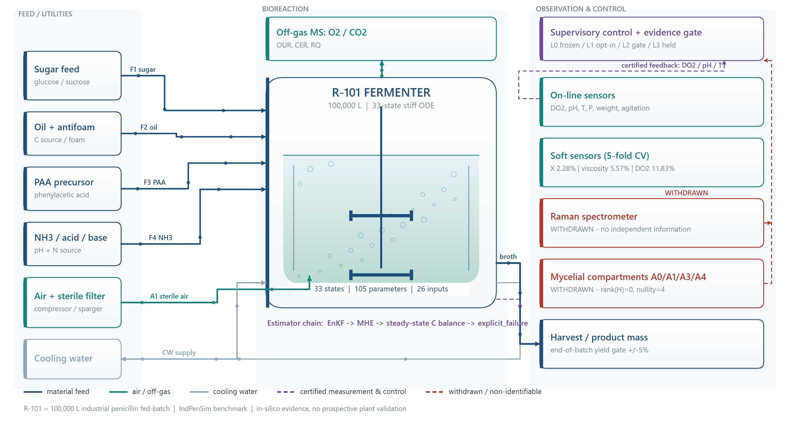

**Fig. 1 | Process flow diagram of the 100,000 L penicillin fed-batch.** Six feed and utility trains (sugar, oil and antifoam, phenylacetic acid precursor, ammonia/acid/base, sterile air and cooling water) enter the stirred aerated reactor R-101, which is simulated by a 33-state stiff ODE with 0.2 h on-line sampling and 12 h off-line assays with 98.2% missingness. Off-gas mass spectrometry supplies OUR, CER and RQ; on-line sensors feed the dissolved-oxygen, pH and temperature loops. Dashed purple traces are certified measurement and control paths, including the explicit-degradation estimator chain (ensemble Kalman filter, moving-horizon estimator, steady-state carbon balance, explicit failure). Red boxes and traces mark withdrawn channels: the simulated Raman spectrometer (incremental R-squared 0.0199 to 0.0092) and the four mycelial compartments (observation-operator rank 0, nullity 4). The supervisory layer implements the four-level evidence architecture of Section 2.8.

### 2.2 Mechanistic model and numerical solution

The port implements the 33-state stiff ODE system of the IndPenSim model family (Bajpai and Reuss, 1980; Birol et al., 2002; Goldrick et al., 2015). The state vector comprises substrate S, dissolved oxygen DO2, oxygen O2, product P, volume V, weight Wt, pH, temperature, heat Q, viscosity, A_t1, four mycelial compartments A0/A1/A3/A4, hyphal counts n0-n9 and nm, phi0, CO2, dissolved CO2, PAA, NH3 and the kinetic parameters mup and mux. Twelve of these states (n0-n9, nm, phi0) are algebraic quasi-steady states with zero time derivative. The parameter vector has 105 entries and the input vector 26. Nominal values include mux = 0.41, mup = 0.041, alpha_kLa = 85 and m_s = 0.029; batch-level random effects are mu_x = 0.41 +/- 0.025, mu_p = 0.041 +/- 0.0025 and alpha_kLa = 85 +/- 10.

Integration uses an implicit multistep (BDF) solver with relative tolerance 1e-3, absolute tolerance 1e-6 and a maximum step of 0.01 h; output is sampled at 0.2 h. Non-negativity guards clamp states 0-30 to 0.001 and dissolved oxygen to 1, and an adaptive guard activates for the substrate-limited regime beyond 65 h. Two dormant components exist in the code base (a fixed-step Runge-Kutta integrator and a draft simulator plug-in contract) but are not imported by any active path; we report them explicitly because their existence would otherwise be mistaken for deployed capability.

Fig. 2 shows the model, observation layers and estimator fallback. The B/C/D-tier estimator chain degrades explicitly rather than silently, and is described in Section 2.5.

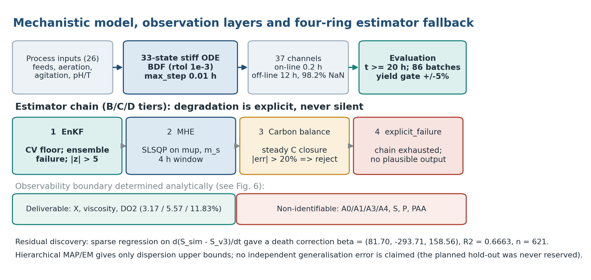

**Fig. 2 | Model, observation layers and estimator fallback.** Twenty-six process inputs drive a 33-state stiff ODE solved by BDF (rtol 1e-3, atol 1e-6, maximum step 0.01 h); 37 channels are emitted with on-line sampling at 0.2 h and off-line assays at 12 h with 98.2% missingness. Evaluation is restricted to t >= 20 h over 86 batches with a +/-5% yield gate. The estimator chain degrades from ensemble Kalman filter to moving-horizon estimator to steady-state carbon balance to an explicit failure state, never emitting a plausible-looking number after exhaustion. Channels classified as deliverable and as structurally non-identifiable are listed separately.

### 2.3 Frozen baseline and regression anchor

The default simulation path is frozen at the byte level. The four engine source files are pinned by SHA-256 hashes, and any candidate modification is evaluated outside this path. The regression anchor is a frozen, machine-readable record containing per-batch simulated and recorded total product mass and the relative yield error

\[
e_b = 100\,(Y_{\mathrm{sim},b} - Y_{\mathrm{rec},b})\,/\,Y_{\mathrm{rec},b}.
\]

Zero regression is defined as a maximum absolute deviation of exactly zero across all 86 batches at tolerance 0.0. Aggregate acceptance requires a batch-level RMSE no greater than 3.5% and all 86 batches within +/-5%. These criteria were fixed before candidate evaluation and were never relaxed.

### 2.4 Residual discovery, hierarchical estimation and their withdrawn claims

Residual structure was discovered by sparse regression on the derivative of the substrate residual, d(S_sim - S_ref)/dt, using a nine-term candidate library, exhaustive subset selection with a Bayesian information criterion, at most three active terms and cross-batch voting (Brunton et al., 2016). The dominant discovered structure was a biomass death correction

\[
X_{\mathrm{corr}} = \max\!\left(X - (k_{d1}X + k_{d2}X A_{t1} + k_{d3}X A_{t1}^2)/100,\ 0\right),
\]

with coefficients beta = (81.70, -293.71, 158.56), R-squared = 0.6663 over n = 621 observations. Two independent implementations agree exactly, and the correction improved 10 of 10 probe batches with a median improvement of 15.3 percentage points in the target error. A documentation discrepancy in the candidate-library header (eleven terms described, nine defined) was registered as a defect and resolved in favour of the code.

A hierarchical maximum-a-posteriori estimator with expectation-maximisation was also fitted to obtain population dispersion for mux, mup and m_s by grid search, minimising on-line RMSE plus a crash penalty. Two empirical-Bayes estimators of the population dispersion were falsified: an effective-sample-size argument gave an effective sample size of 46.8 out of 48 and hence zero dispersion, and a combined estimator inflated the dispersion by factors of 8.3 (mux) and 4.0 (mup) relative to known generating values. Only dispersion upper bounds are retained (sigma(mux) <= 0.0328, sigma(mup) <= 0.0056, sigma(m_s) <= 0.0019). Critically, the planned train/validation/test split was never honoured by the deployed estimator, which concatenates the training and validation sets before fitting. No independent validation set was therefore ever held out, and no generalisation claim is made for any hierarchical estimate.

### 2.5 State estimation, channel-level soft sensing and conservation closures

The estimator chain degrades explicitly through four rings: (i) an ensemble Kalman filter (Evensen, 2003) with gain computed from the innovation covariance, inflation 1.0005, degrading on low coefficient of variation, ensemble integration failure, absolute normalised innovations above 5 on whitelisted channels, or ill-conditioning; (ii) a moving-horizon estimator (Rao et al., 2003) solving a bound-constrained least-squares problem over (mup, m_s) on a 4 h window, degrading on solver failure, insufficient relative improvement, or boundary degeneracy, with an optimum sitting on a bound treated as non-identifiability rather than as a solution; (iii) a steady-state carbon balance whose residual above 20% rejects the estimate; and (iv) an explicit failure state that returns a named failure instead of a plausible-looking number.

Channel-level soft sensors were evaluated by five-fold cross-validation over the 86 batches for six channels (biomass X, product P, PAA, viscosity, substrate S and dissolved oxygen DO2), with two proxy feature sets and median normalised RMSE as the statistic. Because this protocol holds out folds, it is the only part of the accuracy evidence that supports a generalisation statement.

Element balances were computed for carbon and nitrogen. An earlier implementation omitted the volume factor on the volumetric CER term, producing a spurious -60% to -67% carbon imbalance; after correction the median carbon imbalance is -1.5% against a budget of +/-20%. Nitrogen balances give +9.9% under the model convention and -58.1% under the true metering convention against a budget of +/-35%; respiratory quotient reproduction from recorded inputs is exact, while simulated OUR and CER are approximately 12% high because of overestimated CO2 outgassing. Full elemental closure is therefore not claimed on this benchmark.

### 2.6 Health classification

The legacy crash classifier begins with a branch that returns normal whenever the maximum dissolved CO2 does not exceed 7.57 g/L; across all 86 batches the maximum is 7.194 g/L, so the branch is always taken. It was replaced by a five-channel classifier evaluated per batch: (A) dissolved CO2 above 7.57 g/L, benign if alone; (B) pH guard clamping events; (C) pH excursion beyond 7.0 or non-finite pH; (D) product collapse, defined as simulated-to-measured product change below 0.6; and (E) yield breach beyond +/-5%. Categories D or E imply catastrophic, B or C degraded, A alone benign, and otherwise normal. This classifier is information-bearing by construction only if at least one channel can fire; Section 3.4 verifies that it does.

### 2.7 Counterfactual audit protocol for acceptance instruments

Every acceptance instrument was subjected to a fixed audit battery, applied without post-hoc adjustment:

1. **Zero-information control.** Replace the predictor with a constant and recompute the metric. A valid metric must change.
2. **Constant-detector test.** Evaluate the classifier over all available batches; an output distribution with zero variance indicates a constant, not a test.
3. **Trigger-rate audit.** For threshold-based detectors, compute the fraction of real batches flagged. A near-unit trigger rate on unperturbed data indicates a detector that cannot discriminate anomalies.
4. **Rank test.** For state reconstructability claims, compute the singular values of the observation operator H; rank and nullity determine identifiability, and adding rows of the same observation type cannot change the column space.
5. **Two-sided A/B gate.** Candidate evaluation requires zero-information controls, injection controls, data-driven thresholds derived on a grid with explicit margin, leave-one-out consistency, a confusion table, and both improvement and harm directions.
6. **Seed transfer.** Any tuned stochastic parameter must be re-evaluated on at least two seeds not used for tuning.
7. **Runtime loading.** A deployed capability is counted only if its module imports and its entry symbol is callable; file existence is not evidence.

Thresholds (upper bounds of 20 and 30 percentage points for the variance-injection candidate, the +/-5% yield band, R-squared >= 0.5 with n >= 400, and the C/N budgets) were frozen before the corresponding experiments. Failing checks are retained in the archive; first-pass failures are kept alongside final results.

### 2.8 Falsifiability certificates, claim typing and the four-layer architecture

Let M be an acceptance instrument, p a fitted predictor and p0 a zero-information control. We attach to M a certificate

$$FC(M) = \langle \Delta,\ \hat{H},\ J,\ \mathrm{verdict},\ \mathrm{evidence} \rangle$$

where Delta = min(1, |M(p) - M(p0)|) for scalar statistics, Delta = 1 - |2q - 1| for a binary detector with trigger rate q, and Delta is the fraction of deliberately injected defects detected for a loading test; the entropy axis is the normalised Shannon entropy of the output distribution over K categories (Shannon, 1948), which is zero for a constant output; and J = TPR - FPR wherever a confusion table exists (Youden, 1950). The verdict is one of CERTIFIED, TAUTOLOGICAL, CONSTANT and SATURATED. An instrument is quarantined if any applicable axis is zero, and a named replacement must be recorded. The three axes are deliberately reported separately rather than collapsed into a single score, because a composite index would introduce exactly the arbitrary degree of freedom that this work argues against.

We further model every scientific claim as a typed record of subject, quantity, evidence, scope and authority. The four layers of the architecture become a compilation pipeline in the sense of protection systems (Saltzer and Schroeder, 1975): L0 is a frozen symbol table, pinned by four SHA-256 values and never rewritten; L1 compiles candidate code into isolated, fully bypassable namespaces without linking it into the default path; L2 is a type check, admitting a candidate only with zero-information and injection controls, two-sided criteria, frozen thresholds, leave-one-out consistency, a confusion table and at least two unseen stochastic seeds; and L3 is a human-signed linking action that was not executed in this study. An explicit revocation list of five parameter names (the variance-injection amplitude and seed, the channel-wise innovation criteria, and two golden-parameter override keys) is rejected whenever a candidate attempts to use it. WITHDRAWN is a valid claim type carrying its own evidence, so a negative result is a first-class output of the system rather than an omitted section of a report. Table 2 summarises the layers and their invariants, and Fig. 3 shows the architecture.

**Table 2.** The four-layer evidence-gated architecture: definitions, invariants and machine-checkable artefacts.

| Layer | Definition | Invariant | Machine-checkable artefact |
|---|---|---|---|
| L0 | Frozen baseline; default path byte-identical | no change to calibrated parameters, integrator, data or regression anchor | four pinned SHA-256 values; maximum regression deviation exactly zero |
| L1 | Opt-in candidates, disabled by default | fully bypassable; never touches L0 | explicit bypass flags and revocation list |
| L2 | Adversarial evidence gate | thresholds frozen; a NO_GO verdict cannot be rewritten as PASS; failures archived | two-sided gate record with retained first-pass failure |
| L3 | Human-gated promotion to the default path | requires explicit confirmation; not executed in this study | promotion state flag |

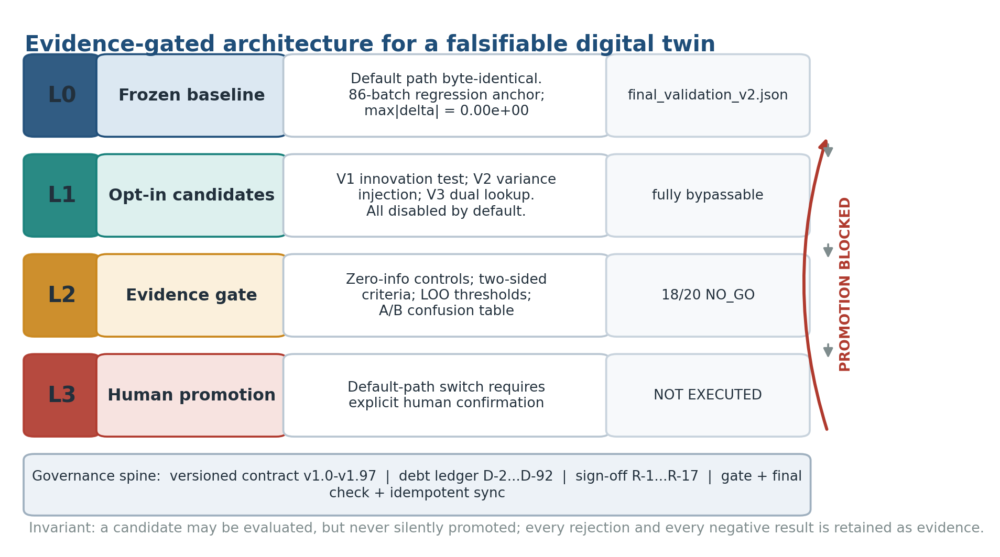

**Fig. 3 | The evidence-gated architecture.** L0 is a byte-identical frozen baseline with a machine-checked regression anchor. L1 holds opt-in candidates that are disabled by default and fully bypassable. L2 is an adversarial evidence gate with frozen thresholds, zero-information controls and archived failures. L3 is the human-gated promotion decision, which was not executed in this study (red arrow). The governance spine records every claim, rebuttal and negative result as a versioned artefact.

### 2.9 Baseline ladder, agreement and distributional diagnostics

Five reference estimators were evaluated against the same 86 recorded yields, and their information sets are reported explicitly, because they are not like-for-like methods: the naive predictors see only recorded yields, whereas the frozen twin additionally sees batch inputs, per-batch calibrated parameters and the mechanistic model. The estimators are the frozen L0 reconstruction, a leave-one-out batch-mean predictor, an in-sample global-mean predictor, a persistence (previous-batch) predictor and a zero predictor. Because the recorded product mass spans 0.54 to 4.56 x 10^6 g, relative error is unstable for the two lowest-yield batches; a scale-robust error, normalised by the median recorded yield, is therefore also reported:

$$\mathrm{RMSE}_{\mathrm{med}} = 100\,\sqrt{\overline{(\hat{y} - y)^2}}\,/\,\mathrm{median}(y).$$

Agreement was assessed by a parity plot and a Bland-Altman difference plot (Bland and Altman, 1986), the empirical cumulative distribution, a normal quantile-quantile plot with the Shapiro-Wilk statistic (Shapiro and Wilk, 1965), lag-1 to lag-10 autocorrelation with a Wald-Wolfowitz runs test (Wald and Wolfowitz, 1940), an exact sign test, a Wilson 95% interval (Wilson, 1927) for the within-band proportion, and a Mann-Whitney comparison (Mann and Whitney, 1947) of normal versus fault batches (84 versus 2, severely underpowered). Bootstrap intervals (Efron and Tibshirani, 1993) are not used because the residual distribution is not independent across time. A seven-stage historical calibration ladder from a 12-batch protocol is presented alongside the 86-batch anchor, but is kept visually and numerically separate because the protocols differ. A 12 x 12 response surface of end-of-batch yield error over the oxygen transfer coefficient (12 batches x 12 values from 30 to 140) was also reconstructed.

### 2.10 Realisation-path invariance test

For a stochastic augmentation c with disturbance realisation xi_s indexed by seed s, we define

$$T(c) = \max_{s \in S_{\mathrm{unseen}}} \max_{b \in B} |\Delta(c, s, b)|.$$

A candidate passes only if the zero-information control is byte-identical to L0, if T(c) stays below the frozen caps for every unseen seed, and if leave-one-out consistency holds on the tuning seed. This separates amplitude dependence (a property of the noise scale) from path dependence (a property of the particular disturbance realisation crossing a basin boundary in a bistable batch; Strogatz, 1994). Tuning the scale until a single-seed collapse disappears is a seed-specific fit, not a physical calibration.

### 2.11 Implementation and runtime verification procedure

The framework was deployed as a local research platform. Fourteen capabilities in four tiers are exposed by in-process reuse of the function bodies of the corresponding service definitions, avoiding a second implementation that could diverge numerically. Twelve custom operators are verified at runtime by import and callable checks. Three additive read-only or explicitly gated endpoints accompany the frozen simulation endpoint, whose handler body is unchanged. Capability invocation is protected by four independent admission gates: a whitelist of the fourteen capabilities, the five-name revocation list of Section 2.8, an explicit opt-in flag for bypass parameters, and an explicit confirmation flag for expensive re-invocations; numerical caps additionally bound concurrency, iteration and ensemble sizes. All rejections return an explicit reason rather than a silent fallback.

Runtime verification proceeded from a real browser, not from unit tests alone: six front-end views were rendered in headless Chrome with document-object-model assertions, console and page-error capture, and monitoring of failed resource requests, and a capability call was issued end-to-end from the browser through the service layer to the solver. An integration gate of 25 checks and an independent consistency audit of 20 checks were executed against the frozen artefacts.

### 2.12 Statistical conventions

RMSE is computed over batch-level relative yield errors. Normalised RMSE is normalised by the observed channel range and reported as a median over batches and folds; no single aggregate is used to hide channel-level failure. Wilson 95% intervals are reported where coverage is discussed. Symlog scaling in figures is used solely for display; all test statistics are computed on untransformed values. Failed checks are reported with the same prominence as passing ones, and no post-hoc threshold relaxation or subgroup searching was performed after seeing results.

---

## 3. Results and discussion

### 3.1 Reconstruction consistency and its statistical characterisation

The frozen baseline reproduces the recorded end-of-batch product mass with an RMSE of 2.3448% over 86 batches, with all 86 batches inside the pre-registered +/-5% band (range -4.814% to +4.829%; Fig. 4a), and byte-identical regression against the frozen anchor gives a maximum absolute deviation of exactly zero. Supporting checks comprise 33 unit and integration tests, a nine-point service smoke test, and a 54-point consistency audit of the preceding analysis round. For context, the uncalibrated nominal parameterisation gave a 70.95% RMSE with 9 of 12 batches crashing, early calibration strategies gave 32.57-37.72%, and the historical 12-batch baseline reached 4.48% (9 of 12 within +/-5%); extending the evaluation to 86 calibrated batches reduced the error to 2.3448% (Fig. 5a). Because the batch count and calibration scope changed between the 12-batch and 86-batch protocols, the two are presented as distinct protocol generations rather than as a single learning curve.

These are reconstruction numbers: each batch uses its own calibrated parameter vector. The 2.3448% figure therefore quantifies the mutual consistency and stability of the model port, the integrator, the parameter assembly and the metric implementation, which is a necessary precondition for the falsifiability audit but not a validation of transfer to uncalibrated batches.

The extended validation places the anchor in context (Fig. 5b, c; Table 4). Relative to the leave-one-out batch mean, the persistence predictor and the zero predictor, the frozen twin reduces RMSE by 96.82%, 97.46% and 97.66% respectively, and by 88.8% on the scale-robust median-normalised error (2.22% versus 26.31%). These differences are large but must not be over-interpreted: the naive predictors forecast a yield series, whereas the twin reconstructs each batch from its own inputs and calibrated parameters. Their role is to establish that the target series is far from trivially predictable and that the anchor is not an artefact of a low-variance target. The scale-robust column removes the amplification caused by the two lowest-yield batches (0.54 and 0.74 x 10^6 g against a median of 3.24 x 10^6 g).

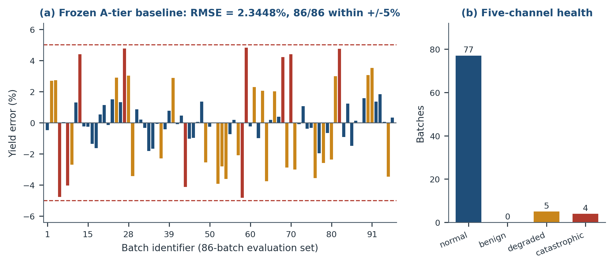

**Fig. 4 | Frozen-baseline accuracy and the corrected health verdict.** (a) Per-batch relative yield error for the 86-batch evaluation set; dashed lines mark the pre-registered +/-5% acceptance band (RMSE 2.3448%; 86/86 within band; byte-identical regression). (b) Distribution of the five-channel health verdict (77 normal, 0 benign, 5 degraded, 4 catastrophic). The legacy crash classifier returned normal for all 86 batches and is shown for contrast in Fig. 9b.

**Table 3.** Acceptance evidence for the frozen baseline.

| Quantity | Value |
|---|---|
| Batch-level yield RMSE | 2.3448% |
| Batches within +/-5% | 86/86 |
| Zero-regression maximum deviation | 0.00e+00 (tolerance 0.0) |
| Unit and integration tests | 33 passed |
| Service smoke test | 9/9 passed |
| Round-level consistency audit | 54/54 passed |
| Engine source SHA-256 | unchanged across all candidate rounds |

**Table 4.** Baseline ladder with explicit information sets.

| Estimator | Information set | n | RMSE (%) | RMSE / median yield (%) | within +/-5% |
|---|---|---|---|---|---|
| Frozen mechanistic reconstruction | batch inputs + per-batch calibrated parameters + 33-state ODE | 86 | 2.3448 | 2.2205 | 86/86 |
| Leave-one-out batch-mean predictor | other 85 recorded yields; held-out batch excluded | 86 | 73.6679 | 26.3103 | 11/86 |
| In-sample global-mean predictor | all 86 recorded yields (optimistic constant) | 86 | 72.8113 | 26.0044 | 11/86 |
| Persistence (previous batch) | recorded yield of the immediately preceding batch | 85 | 92.3806 | 38.2620 | 14/85 |
| Zero predictor | none | 86 | 100.0000 | 96.1811 | 0/86 |

The error distribution is statistically well behaved (Fig. 6; Table 5). The mean error is -0.0662% against a median of -0.0744%, with no material directional bias (exact sign test, 40 positive versus 46 negative, p = 0.590). Normality is not rejected (Shapiro-Wilk W = 0.9793, p = 0.1824; quantile-quantile correlation 0.9925), the distribution is slightly platykurtic (excess kurtosis -0.477), and there is no serial dependence in batch order (lag-1 autocorrelation 0.058; runs test, 42 observed versus 43.79 expected runs, p = 0.696). The Wilson 95% interval for the 86/86 within-band proportion is [0.9572, 1.0000], an honest finite-sample bound on the pass rate. By class, the 84 normal batches and the 2 fault batches show statistically indistinguishable RMSE (2.34% versus 2.67%; Mann-Whitney p = 0.107), although with only two fault batches this comparison is underpowered and is reported for completeness. Agreement analysis (Fig. 5c, d) gives a Pearson correlation of 0.9964 and R-squared of 0.9927 on the parity plot, a Bland-Altman bias of -0.0662% with limits of agreement -4.687% to +4.555%, and no magnitude-dependent trend.

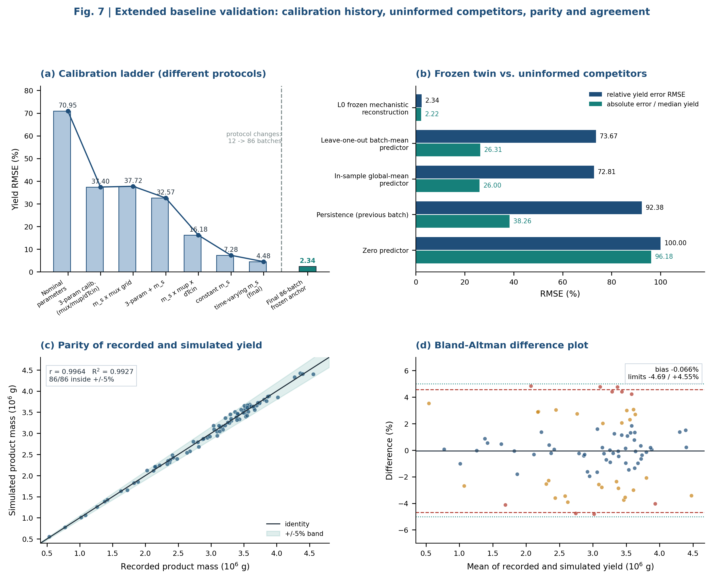

**Fig. 5 | Extended baseline validation.** (a) Seven historical calibration stages from the 12-batch protocol (70.95% to 4.48% RMSE), shown separately from the 86-batch frozen anchor (2.3448%) because the protocols differ. (b) Five reference predictors under two error normalisations; information sets differ and are listed in Table 4. (c) Parity of recorded and simulated product mass (r = 0.996, R-squared = 0.993) with the +/-5% band. (d) Bland-Altman agreement: bias -0.0662%, limits of agreement -4.687% to +4.555%, with no magnitude-dependent trend.

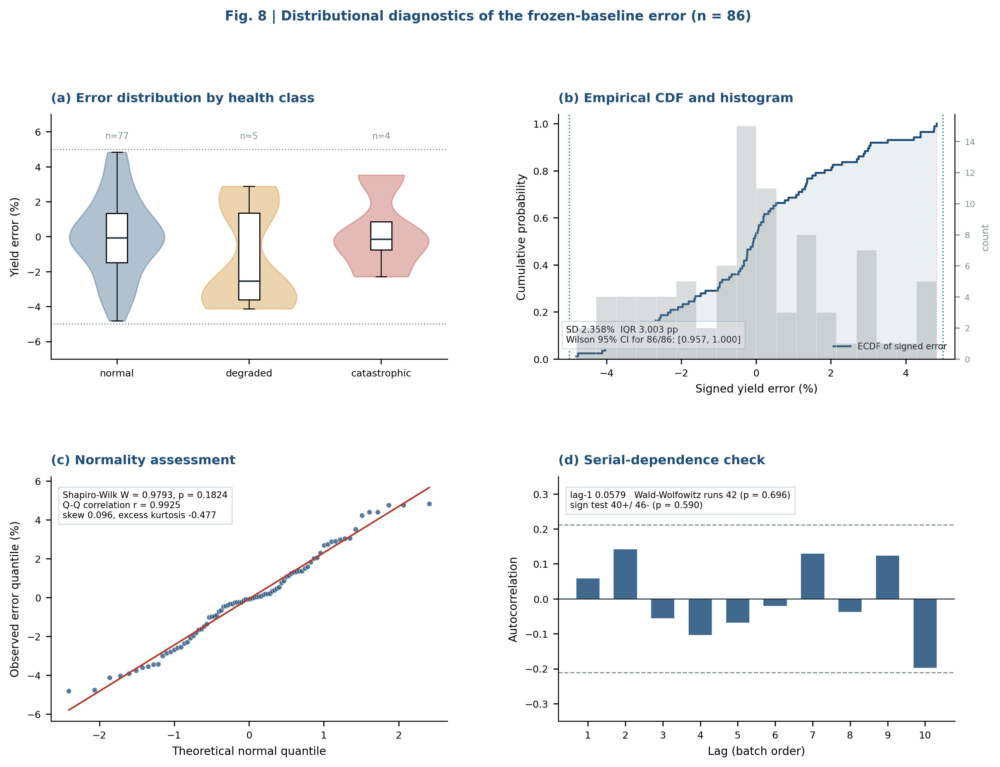

**Fig. 6 | Distributional diagnostics of the frozen-baseline error (n = 86).** (a) Violin and box plots by health class; (b) empirical CDF and histogram with the +/-5% band; (c) normal quantile-quantile plot with Shapiro-Wilk W = 0.9793 (p = 0.1824); (d) lag-1 to lag-10 autocorrelation with 95% white-noise bounds. All statistics are computed on untransformed errors.

**Table 5.** Distributional diagnostics of the 86 signed yield errors.

| Statistic | Value | Interpretation |
|---|---|---|
| Mean / median | -0.0662% / -0.0744% | no material systematic bias |
| SD / MAD / IQR | 2.3576% / 1.4967% / 3.0034 pp | tight, symmetric spread |
| Range | -4.8144% to +4.8290% | entirely inside the pre-registered band |
| Skew / excess kurtosis | 0.0960 / -0.4767 | near-Gaussian, slightly platykurtic |
| Shapiro-Wilk W (p) | 0.9793 (0.1824) | normality not rejected |
| Q-Q correlation | 0.9925 | consistent with normality |
| Sign test | 40+ / 46-, p = 0.5900 | no directional bias |
| Lag-1 autocorrelation | 0.0579 | no serial dependence in batch order |
| Runs test | 42 observed vs 43.79 expected, p = 0.6962 | no ordering artefact |
| Wilson 95% CI for 86/86 | [0.9572, 1.0000] | honest finite-sample bound on the pass rate |
| Normal (84) vs fault (2) RMSE | 2.3365% vs 2.6696%; Mann-Whitney p = 0.1073 | underpowered |

The parameter-response surface completes the characterisation (Fig. 7). A 12 x 12 sweep of the oxygen transfer coefficient over 12 batches shows contiguous collapsed and feasible regions rather than a smooth gradient, with an interior optimum at k* = 78.15 +/- 8.94, close to the nominal 85 +/- 10 and populated in only 13 of 144 grid cells. The fragmented surface is a further manifestation of the bistable batch dynamics that reappear in Sections 3.5 and 3.7.

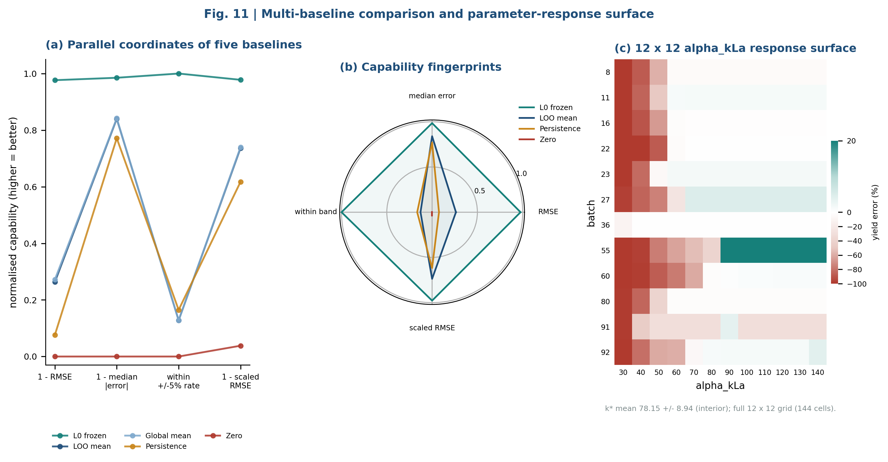

**Fig. 7 | Multi-baseline fingerprints and a parameter-response surface.** (a) Parallel coordinates of the five reference predictors on four normalised capability axes; (b) radar comparison of the same predictors; (c) 12 x 12 response surface of end-of-batch yield error over the oxygen transfer coefficient, showing contiguous collapsed and feasible regions rather than a smooth gradient. The interior optimum is k* = 78.15 +/- 8.94, close to the nominal 85 +/- 10.

### 3.2 Channel-level fidelity and what the twin cannot know

Five-fold cross-validation separates channels that a soft sensor can deliver from channels that are structurally unavailable (Fig. S1; Fig. S7). Biomass improves from 24.58% to 2.28% median normalised RMSE (a 22.31 percentage-point gain; the delivery protocol reports 3.17% with all 86 batches below 15%), viscosity from 19.69% to 5.57% (+14.12 pp), and dissolved oxygen from 19.53% to 11.83% (+7.69 pp). In contrast, the product channel degrades from 14.19% to 17.70% (-3.51 pp), PAA from 28.20% to 28.72% (-0.52 pp), and substrate remains at 214.59% because its "measurement" is a model reference rather than an assay, a circular comparison that is explicitly labelled as marginal rather than as a result. The product channel additionally retains a 60-120 h deficit (mean -0.0625, median -0.0923) that four independent repair attempts did not close; it is registered as a known boundary.

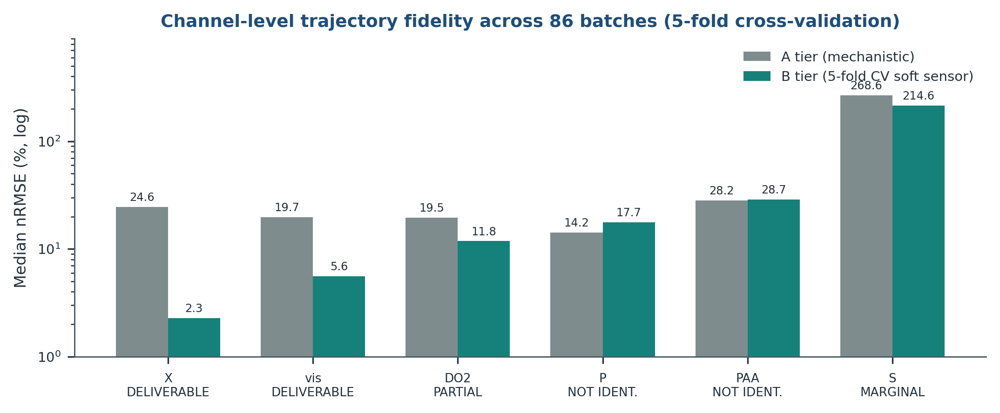

**Fig. S1 | Channel-level trajectory fidelity (supplementary).** Median normalised RMSE (log scale) for six channels, comparing the mechanistic output with a five-fold cross-validated soft sensor over 86 batches. Channels whose "measurement" is a model reference (substrate) or whose states are structurally unobservable (product, PAA) are flagged; a large numerical gain on a circular comparison is not treated as evidence.

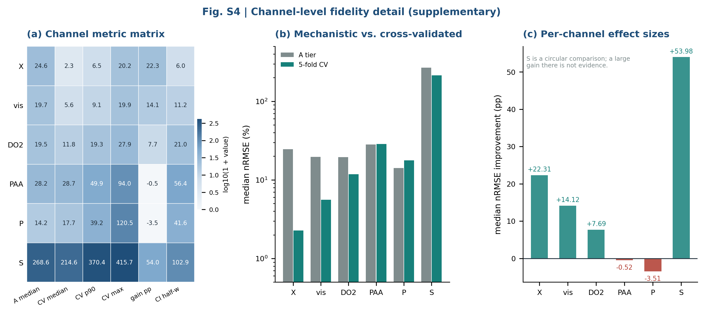

**Fig. S7 | Channel-level fidelity detail (supplementary).** (a) Six-channel metric matrix; (b) mechanistic versus cross-validated median normalised RMSE on a log scale; (c) per-channel effect sizes, with substrate labelled as a circular comparison.

Structural analysis explains these failures (Fig. 8a). For the four mycelial compartment states A0/A1/A3/A4, the assimilation observation operator has singular values [0, 0, 0, 0], i.e. rank 0 and nullity 4; the reporting operator has [2, 0, 0, 0], rank 1 and nullity 3; the condition number is infinite in both cases. The audit passed all 11 of its checks over 4 batches and 5 time points with a zero-information control. The reason is not insufficient data volume: the compartment states never enter the active observation vector, so additional batches or time points merely repeat the same column space (Raue et al., 2009; Wieland et al., 2021). Of the 37 released data columns, none contains a compartment assay, and the simulated Raman channel was shown to carry no independent information about PAA (incremental R-squared 0.0199 to 0.0092; t-statistic 0.104 to 0.036; PLS output 0-2.11 mg/L against assay values of 430-2023 mg/L, an approximately 1000-fold scale mismatch). The delivery claim for mycelial composition was therefore withdrawn and the quantity reclassified as an internal soft-sensing variable. This is a structural conclusion conditional on the observation operator H: new compartment-resolved measurements could change it, whereas more rows of the existing data cannot.

### 3.3 Acceptance instruments that could not be falsified

The audit battery of Section 2.7 identified three instruments whose outputs were independent of model quality, plus a fourth loading test with the same defect class (Fig. 9; Table 6).

First, residual-quantile interval coverage is tautological. Prediction intervals were formed from the 5th and 95th percentiles of the residual distribution itself. Replacing the fitted predictor with a zero-information constant produced coverage of 0.899548532731377 for biomass, product, PAA and viscosity, bit-identical to the fitted predictor, with zero control separation in all four channels; the verdict was TAUTOLOGICAL. The instrument therefore certified both a good model and no model at all, and is a particularly clean instance of metric-level leakage in the sense of Kapoor and Narayanan (2023). Replacing the interval construction with mu +/- 1.96 sigma, where sigma is predicted rather than derived from the realised residuals, restored discrimination: coverage fell to 0.0000 for the zero-information predictor versus 0.1072 (biomass) and 0.3160 (product) for the fitted one. The resulting intervals are informative in width rather than in coverage: the biomass interval has a 90% band of [-6.82%, +9.45%] (half-width 8.14%) and viscosity a half-width of 10.6%; a coverage of approximately 0.90 can also be bought trivially by widening an interval to a 97.9% half-width. Interval half-width and normalised-RMSE improvement, never coverage, are therefore reported as calibration evidence.

Second, the legacy crash classifier is a constant. It returns normal whenever the maximum dissolved CO2 does not exceed 7.57 g/L; the maximum over all 86 batches is 7.194 g/L, so the first branch always fires (86/86 normal). Batch 91 ends at pH 3.001 with 129 pH-guard clamping events and is still reported normal. A detector with zero output variance is not a detector, and the dashboard reading of "zero catastrophic batches" was consequently an artefact, not a finding.

Third, the global innovation criterion is near-constant. Evaluated on 32 unperturbed real batches, the global standardised-innovation threshold flagged 27 (84.38%) as degraded, so wiring it into the service would misclassify roughly three quarters of normal batches. The obvious global correction is not a correction either: raising the threshold from 5.0 to 10.0 leaves zero of 20 injected cases detected (the CO2 outgassing statistic reaches a maximum absolute z-score of 7.60 with a 90th percentile of 5.56; the O2 statistic never exceeds 0.17), and beyond a threshold of 15 the detector becomes constantly false. A single global threshold cannot separate the channels; the working alternative is channel-wise, data-driven and leave-one-out calibrated (Section 3.7).

Fourth, the deployment loading test declared a capability loaded on the basis of file existence, an instance of the silent capability-versus-availability gap that plagues production machine-learning systems (Sculley et al., 2015). Replacing it with a runtime import-and-callable test exposed two naming defects (a hierarchical estimator whose callable entry point differs from its module name, and an element-balance function registered under its module name) that were invisible to the existence test; the corrected runtime test verifies 12 of 12 operators and all 14 capabilities.

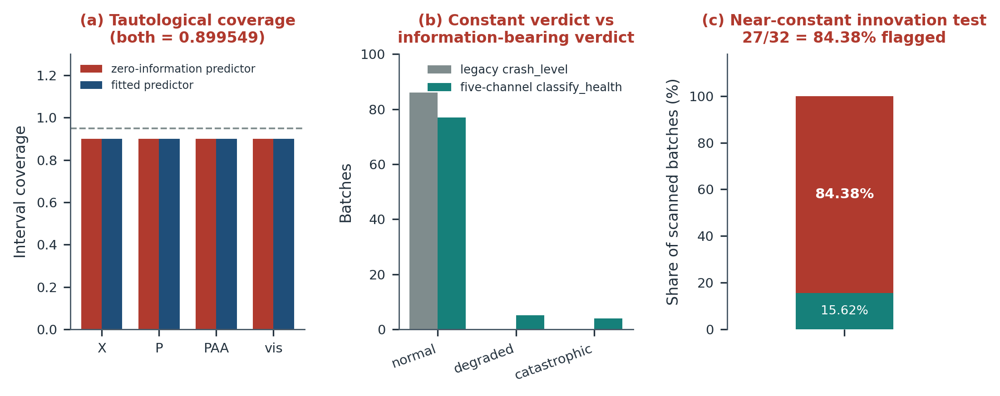

**Fig. 9 | Three unfalsifiable acceptance instruments.** (a) Residual-quantile interval coverage is identical (0.899549) for a zero-information constant predictor and the fitted predictor across four channels; the dashed line marks the nominal 0.95. (b) The legacy crash classifier returns 86 normal, 0 degraded and 0 catastrophic, whereas the five-channel classifier resolves 77/5/4. (c) The global innovation criterion flags 27 of 32 = 84.38% of unperturbed batches as degraded.

**Table 6.** Unfalsifiable instruments, adversarial controls and replacements.

| Instrument | Failure mode | Adversarial control | Replacement and consequence |
|---|---|---|---|
| Residual-quantile coverage | tautological (0.899549 for any predictor) | zero-information constant predictor | mu +/- 1.96 sigma intervals; report half-width and normalised-RMSE gain; coverage withdrawn as evidence |
| Legacy crash classifier | constant (86/86 normal) | output distribution has zero variance | five-channel health classifier; "zero catastrophic" claim withdrawn |
| Global innovation threshold | near-constant (84.38% flagged) | trigger-rate audit on unperturbed batches | channel-wise leave-one-out calibrated thresholds; kept opt-in |
| Empirical-Bayes dispersion estimate | degenerate (effective sample size 46.8/48 implies zero dispersion) | comparison with known generating dispersion | dispersion upper bounds only; no generalisation claim |
| File-existence loading test | tautological | runtime import and callable check | 12/12 runtime verification; two naming defects exposed |

### 3.4 Corrected health assessment and criterion dependence

The five-channel classifier resolves 77 normal, 0 benign, 5 degraded and 4 catastrophic batches (Fig. 4b). The catastrophic batches are 37, 50, 51 and 91 and the degraded batches 40, 43, 49, 54 and 92; flag tallies are 5 pH-clamp, 9 pH-excursion and 4 product-collapse events. Unlike the constant classifier, this instrument fires on real failure modes and separates them by severity.

A separate validity criterion, which asks whether a batch is admissible for baseline comparison rather than whether the model failed, declares 9 batches invalid (37, 40, 43, 49, 50, 51, 54, 91 and 92, of which 5 are true pH clamps). Table 9 cross-tabulates the two criteria. Although they answer different questions, they are perfectly collinear on this benchmark: collapsing to a 2 x 2 table gives phi = 1.0000, because both consume the same pH-guard clamping and pH-excursion signals. Two apparently independent checks are therefore one piece of evidence, and reporting both as corroboration would recreate the very category error this study argues against; they are counted once in the evidence inventory, and the collinearity is stated explicitly. The outward-facing summary statistic reads "4 catastrophic batches registered, 0 new", not "zero catastrophic batches".

**Table 9.** Health-versus-validity cross-tabulation.

| | valid | invalid | total |
|---|---|---|---|
| normal | 77 | 0 | 77 |
| degraded | 0 | 5 | 5 |
| catastrophic | 0 | 4 | 4 |
| total | 77 | 9 | 86 |

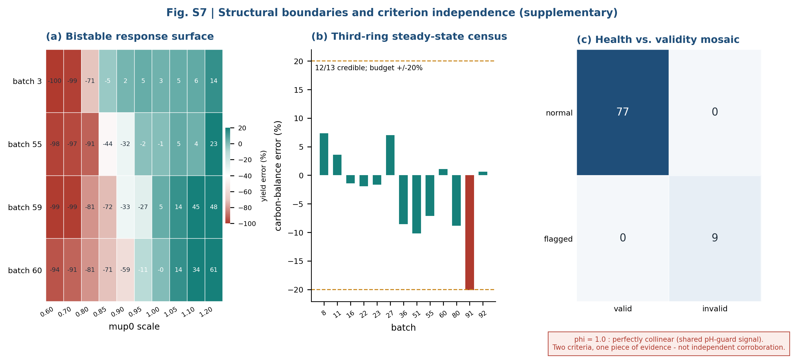

**Fig. S2 | Structural boundaries and criterion independence (supplementary).** (a) Four-batch by ten-scale bistable response surface; (b) carbon-balance error of the steady-state census (12 of 13 credible against a +/-20% budget); (c) health-versus-validity mosaic corresponding to Table 9.

### 3.5 Discontinuous control response closes the gradient path

The control-knob sweep shows that runtime continuous regulation is not merely difficult but structurally unavailable within this model (Fig. 8b). In the baseline state, the yield response to the three continuous control knobs is a hard jump spanning 99.83, 99.92 and 99.99 percentage points respectively, with no usable gradient on either side. Bisection on a collapsed batch located the substrate-setpoint transition within an interval of width 2.44 x 10^-7 and the product-setpoint transition within 2.44 x 10^-8; crossing it moves the yield error from -100.00% to between +0.51% and +1.33% with the batch becoming valid again. The collapsed state is therefore not an attractor, but both continuous knobs remain pinned at -100% and invalid throughout the collapsed regime. Open-loop setpoint re-tuning is feasible with a landing precision of 10^-4 to 10^-5, which is calibration-grade rather than control-grade. Runtime closed-loop control is accordingly registered as a known boundary of the model rather than as an unmet milestone, and no controller is reported.

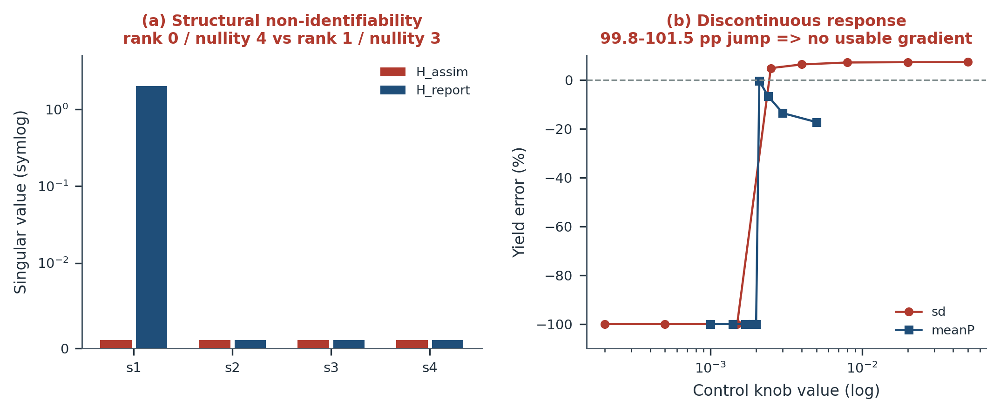

**Fig. 8 | Structural limits of the twin.** (a) Singular values of the observation operator for the mycelial compartment states: the assimilation operator has rank 0 / nullity 4 and the reporting operator rank 1 / nullity 3 (symlog display; zero values plotted at 10^-3 for visibility). Adding rows of the same observation type cannot alter the column space. (b) Yield error versus two continuous control knobs (logarithmic abscissa): the response is a near-vertical jump of 99.8-101.5 pp, leaving no usable gradient for closed-loop regulation.

### 3.6 Certifying the certification instruments

Applying the certificate definition of Section 2.8 to the eight acceptance instruments yields Table 7 and Fig. 10. Four instruments are invalidated: the residual-quantile coverage (TAUTOLOGICAL), the legacy crash classifier (CONSTANT), the global innovation threshold (SATURATED) and the file-existence loading test (TAUTOLOGICAL). Four are certified: the five-channel health classifier, the channel-wise leave-one-out calibrated innovation detector (opt-in), the corrected mean +/- 1.96 sigma interval (certified for width only, with coverage itself withdrawn as calibration evidence), and the runtime import-and-callable loading test, which detects both naming defects that the file-existence test reported as loaded.

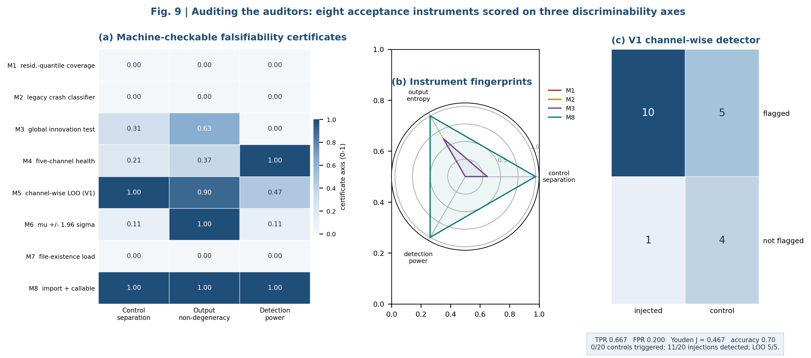

**Fig. 10 | Auditing the auditors.** (a) Eight acceptance instruments scored on three machine-checkable axes; (b) radar fingerprints of two degenerate, one saturated and one certified instrument; (c) confusion matrix of the channel-wise detector (10 true positives, 5 false negatives, 4 true negatives, 1 false positive; Youden J = 0.4667).

**Table 7.** Falsifiability certificates issued for eight acceptance instruments.

| ID | Instrument | Control separation | Output entropy | Detection power | Verdict |
|---|---|---|---|---|---|
| M1 | Residual-quantile interval coverage | 0.0000 | 0.0000 | 0.0000 | TAUTOLOGICAL |
| M2 | Legacy crash classifier | 0.0000 | 0.0000 | 0.0000 | CONSTANT |
| M3 | Global innovation threshold (z > 5) | 0.3125 | 0.6253 | 0.0000 | SATURATED |
| M4 | Five-channel health classifier | 0.2093 | 0.3705 | 1.0000 | CERTIFIED |
| M5 | Channel-wise leave-one-out calibrated innovation | 1.0000 | 0.9000 | 0.4667 | CERTIFIED (opt-in) |
| M6 | Mean +/- 1.96 sigma interval coverage | 0.1072 | 1.0000 | 0.1072 | CERTIFIED (width only) |
| M7 | File-existence loading test | 0.0000 | 0.0000 | 0.0000 | TAUTOLOGICAL |
| M8 | Runtime import-and-callable loading test | 1.0000 | 1.0000 | 1.0000 | CERTIFIED |

Two observations on Table 7 deserve emphasis. First, instrument M3 has non-zero entropy and non-zero control separation yet zero detection power: a detector that fires on 84.38% of normal data is informative about nothing, which a single entropy number alone would miss. This is precisely why the certificate reports three axes rather than one aggregate score. Second, the certificate battery is itself subject to the discipline it imposes: the certificate thresholds were fixed before the instruments were scored, and no axis weighting was chosen after seeing the results.

### 3.7 Pre-registered candidate evaluation and the realisation-path invariance test

Three opt-in candidates were evaluated against the two-sided, pre-registered gate (Table 8; Fig. 11).

The first candidate (V1), channel-wise innovation thresholds, comprised 25 cases: 5 zero-information controls and 20 injections. Control maxima were 4.59 (CO2 outgassing), 4.60 (dissolved oxygen), 0.06 (oxygen) and 4.80 (pH); injected maxima were 5.34, 7.60, 0.06 and 37.72. Data-driven thresholds with a 1.05 margin selected the CO2, dissolved-oxygen and pH channels and excluded oxygen. The candidate and the frozen baseline produced identical confusion tables (10 true positives, 5 false negatives, 4 true negatives, 1 false positive); injections were detected in 11 of 20 cases, controls fired in 0 of 20, and leave-one-out calibration succeeded in 5 of 5 folds. All 8 gate checks passed, but the candidate remained opt-in: passing a gate is not authorisation to change the default path.

The second candidate (V2), eight-path disturbance-variance injection with a time constant of approximately 40 h, was evaluated at full amplitude (scale 1.0). The maximum deviation from the frozen baseline was 96.06 percentage points with 3 of 6 catastrophic yield collapses (batch 16: -95.64 pp; batch 22: -44.46 pp; batch 27: -96.06 pp; batch 23: -16.96 pp), reproducible in 6 of 6 repetitions at fixed seed against a reference deviation of 3.09 pp. The frozen caps of 20 and 30 percentage points were left unchanged, and the first-pass gate result (16 of 18 checks failing) is archived alongside the final verdict. A multi-round amplitude optimisation over the scale grid {0.02, 0.05, 0.1, 0.2, 0.35, 0.6, 1.0} found five feasible scales on the tuning seed (7), with the scale closest to the reference deviation, 0.35 (root-mean-square deviation 2.13 pp), confirmed by six-fold leave-one-out consistency, giving 8 of 10 optimisation checks passed. The verdict remained NO_GO. On unseen seed 11 the same scale produced a maximum deviation of 99.85 percentage points with 2 collapses and was infeasible; on unseen seed 23 it produced 2.13 pp with no collapses. The collapse is thus not a monotone function of amplitude but a path-dependent response of bistable batches to the particular realisation of the disturbance (Strogatz, 1994; Henderson et al., 2018). A scale that happens not to collapse on one seed is a seed-specific fit, not a physical calibration, and promoting it would constitute exactly the kind of post-hoc relaxation that the audit protocol forbids. The candidate remains disabled by default. Under the realisation-path invariance test of Section 2.10, T(c) = 99.85 pp exceeds both frozen caps, so the candidate fails on path dependence even though it is feasible at low amplitude and on two of three seeds.

The third candidate (V3), a dual-constraint lookup for the oxygen transfer coefficient, was evaluated on 6 batches, excluding 6 known cliff batches. All 6 evaluated batches remained within +/-5%, with 3 improvements, 3 degradations and a maximum deviation of 0.0143 pp. Because 81 of 88 calibrated batches share the nominal coefficient value, writing the lookup back into the frozen parameter table would alter the L0 anchor; it was therefore retained as an evaluation-layer result only.

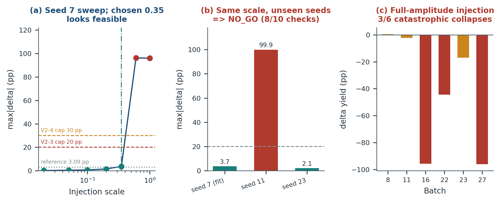

**Fig. 11 | The seed-transfer failure that fixed the NO_GO verdict.** (a) Maximum deviation from the frozen baseline across the amplitude grid on tuning seed 7; dashed lines are the frozen 20 and 30 pp caps and the dotted line the 3.09 pp reference; scale 0.35 appears feasible. (b) The same scale evaluated on two unseen seeds: seed 11 collapses (99.9 pp) while seed 23 does not (2.1 pp), demonstrating path dependence rather than amplitude dependence. (c) Per-batch yield deviation at full-amplitude injection: three of six batches collapse catastrophically.

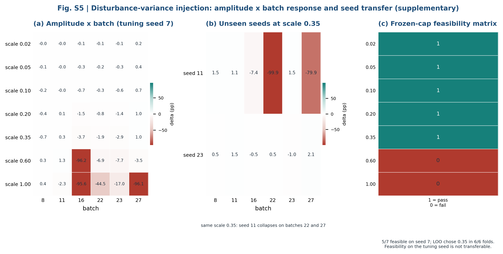

**Fig. S3 | Disturbance-variance injection detail (supplementary).** (a) Seven-scale by six-batch deviation heatmap on tuning seed 7; (b) the same scale 0.35 on two unseen seeds (seed 11 collapses on batches 22 and 27); (c) frozen-cap feasibility matrix (5 of 7 feasible on the tuning seed; leave-one-out selection chose 0.35 in 6 of 6 folds).

**Table 8.** Two-sided A/B evidence gate outcomes.

| Candidate | Gate result | Key evidence | Decision |
|---|---|---|---|
| Channel-wise innovation thresholds | 8/8 passed | 11/20 injections detected, 0/20 controls; leave-one-out 5/5; confusion table 10/5/4/1 | conditional approval, opt-in only |
| Eight-path variance injection | 18/20 NO_GO | full scale: 96.06 pp, 3/6 collapses; tuned scale 0.35 fails on unseen seed 11 (99.85 pp) | default off; promotion blocked |
| Dual-constraint oxygen-transfer lookup | 5/5 passed (evaluation layer) | 6 batches, 3 improved / 3 worsened, maximum deviation 0.0143 pp | no write-back to the frozen baseline |
| Frozen baseline | unchanged | four source hashes identical; batch 8 error -4.039% | retained as regression anchor |

The full gate matrix across the five families of checks, together with the per-channel effect sizes and the realisation-path test against the frozen caps, is shown in Fig. 12.

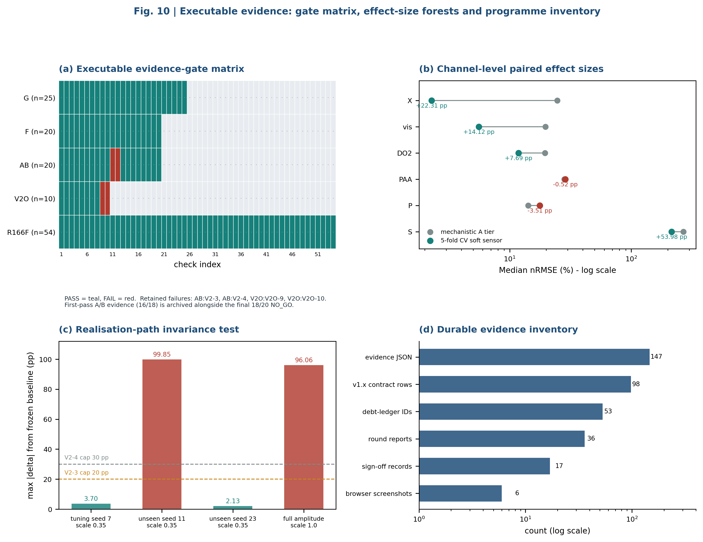

**Fig. 12 | Executable evidence.** (a) Five-family gate matrix (passed, failed, not applicable) with the two retained gate failures and two optimisation failures; (b) paired channel-level effect sizes with cross-validated and mechanistic endpoints; (c) realisation-path invariance test with the frozen 20 and 30 pp caps; (d) durable machine-readable evidence inventory on a logarithmic scale.

### 3.8 Runtime verification of the deployed framework

The integration gate passed all 25 checks and the independent consistency audit all 20 checks. Fourteen capabilities and 12 operators were verified as importable and callable, not merely present; as noted in Section 3.3, two naming defects were exposed only by this runtime verification. The six front-end views rendered their expected document elements (4 overview indicators, 1 process schematic, 86 batch cells, 15 channel rows, 12 operator cards and 14 capability controls) with zero page errors, zero console errors and no failed resource requests, and a browser-initiated capability call completed the full path from user interface through the service layer to the solver (Fig. S4; Table 10). All five revocation-list parameter names were each rejected with an explicit error, as were unlisted capabilities and unconfirmed expensive invocations. The engine's four source hashes were unchanged throughout, the frozen simulation endpoint still reproduces batch 8 at -4.039%, and a parameter override injected through the opt-in path was verified to take effect only inside the bypass namespace. Table 10 summarises the verification families.

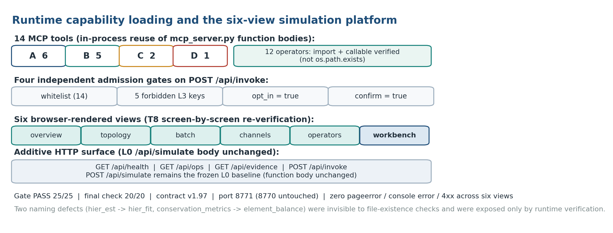

**Fig. S4 | Runtime capability loading and the six-view platform (supplementary).** Fourteen capabilities by tier, twelve operators verified by import and callable checks, four independent admission gates on capability invocation, six browser views, and the additive service surface. The frozen simulation endpoint retains its original handler body.

**Table 10.** Runtime verification families and outcomes.

| Verification family | Result |
|---|---|
| Engine immutability | 4/4 source hashes unchanged |
| Runtime loading | 14/14 capabilities, 12/12 operators |
| Revocation-list containment | 5/5 forbidden parameter names rejected with explicit errors |
| Frozen-path behaviour | batch 8 error -4.039%; opt-in override effective only in the bypass namespace |
| Browser verification | 6 views, 0 page errors, 0 console errors, 0 failed requests, end-to-end invocation succeeded |
| Integration gate and consistency audit | 25/25 and 20/20 passed |

### 3.9 Negative results as first-class outputs

The audit treats negative results as durable, typed outputs rather than as omissions. Fig. S5 traces ten candidate claims through the adversarial audits to their final statuses: claims survive as CERTIFIED, survive conditionally as PARTIAL, or become WITHDRAWN, and whenever the observation operator has a non-trivial null space the withdrawn status is forced regardless of fit quality. The withdrawn set includes the mycelial compartment composition (rank 0, nullity 4), the substrate, product and PAA delivery claims, the simulated Raman channel, hierarchical generalisation (no hold-out), and runtime continuous control (discontinuous response). Each withdrawn claim carries its own evidence and its own re-issue condition, such as the addition of compartment-resolved measurements.

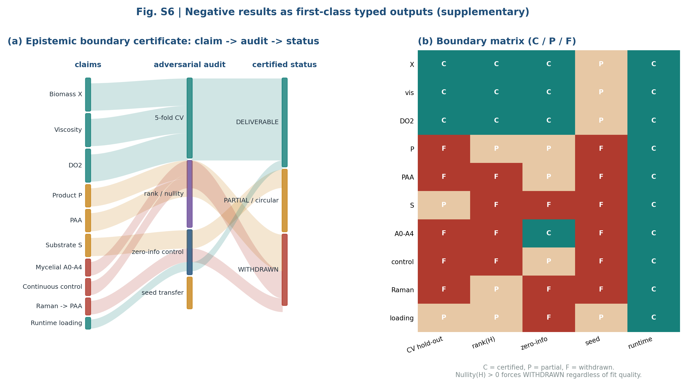

**Fig. S5 | Negative results as first-class typed outputs (supplementary).** (a) Alluvial diagram from ten candidate claims through four adversarial audits to three certified statuses; (b) boundary matrix (C = certified, P = partial or conditional, F = failed or withdrawn). Whenever the observation operator has a non-trivial null space, the withdrawn status is forced regardless of fit quality.

Fig. S6 summarises the evidence lifecycle of the underlying research programme. Every analysis round emitted a machine-readable evidence record and a report; first-pass failures (for example the initial 16-of-18 gate failure of the variance-injection candidate, and an earlier two-point calibration conclusion that was retracted after removing 29 degenerate batches) are preserved next to their final verdicts with their rebuttals, and no threshold was relaxed after seeing a result. This is a practical implementation of FAIR stewardship (Wilkinson et al., 2016) and of reproducibility checklists (Pineau et al., 2021; Peng, 2011; Sandve et al., 2013; Wilson et al., 2014), with the additional property that the artefacts are executable: the gates can be re-run against the deposited bundle rather than trusted from prose.

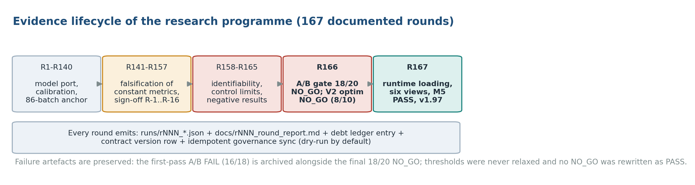

**Fig. S6 | Evidence lifecycle across the research programme (supplementary).** Model port and calibration, falsification of constant metrics and formal review, identifiability and control limits, the pre-registered NO_GO decision, and runtime loading with milestone closure. Every round emits a machine-readable evidence record and a report; first-pass failures are archived alongside final verdicts, and thresholds are never relaxed.

### 3.10 Discussion: what survives, what it means, and how to falsify this study

The recurring failure documented here was not numerical. The integrator was stable, the code was tested, the regression anchor was byte-identical, and the headline accuracy was excellent. What failed were the instruments of certification. The response is structural rather than rhetorical: every acceptance instrument must survive a zero-information control, a constant-detector test, a trigger-rate audit and, where relevant, a rank test; every claim about a deployed capability must survive a runtime import-and-callable check; every threshold is frozen before the experiment; and every failure is archived rather than deleted. This is close in spirit to V&V formalism (Oberkampf and Trucano, 2002; Roy and Oberkampf, 2011) and to identifiability analysis (Raue et al., 2009; Wieland et al., 2021), but it shifts the object of validation from the model to the entire claim-producing apparatus, including the dashboard.

The four-layer architecture matters because it separates three activities that are usually conflated: running a model (L0), evaluating a change (L1 and L2), and authorising a change (L3). Classical ensemble and moving-horizon estimators, sparse system identification and interval calibration are all legitimate L1 candidates; the gate does not forbid them, it forbids their unexamined promotion. In this study one candidate passed its gate and still remained opt-in, one failed and was retained as a documented negative result, and one was confined to the evaluation layer; the promotion layer was never executed. The distinction between measuring an improvement and changing what the plant relies on is the main practical deliverable for a process engineering organisation.

Accuracy is necessary but not sufficient. The 2.3448% yield RMSE is a strong statement about internal consistency, and a misleading one about prospective plant performance, because each batch is reconstructed with its own calibrated parameters; this qualification is stated in the Abstract, Methods, Results and Limitations. The only generalisation-bearing numbers in the study come from protocols with genuine hold-outs: the cross-validated channel soft sensors and the seed-transfer experiment that failed. This asymmetry is instructive. The most trustworthy evidence in the study is the negative result, because it was designed to be able to fail and did fail out of sample. A paper reporting only the accuracy curve would have produced a confident, unfalsifiable claim; reporting the seed-transfer collapse instead produces a defensible boundary. Seed sensitivity of this kind is well documented in reinforcement learning (Henderson et al., 2018) and is a natural consequence of bistable nonlinear dynamics (Strogatz, 1994); here the relevant mechanism is that a disturbance realisation can move a batch across a basin boundary, so amplitude is not the controlling variable, and tuning amplitude on one seed until the collapse disappears is a form of overfitting that looks like calibration.

For practitioners, the operational message is that a green dashboard is a hypothesis, not a certificate. The five-channel health classifier, interval half-widths, channel-wise thresholds and explicit-failure states are cheap to implement and immediately expose the failures that a single aggregate number hides. The L0/L1/L2 split also makes it possible to explore improvements without endangering the regression anchor, a common organisational failure mode when research and production code share a branch. Box 1 condenses the transferable core of the framework; it is not specific to penicillin fermentation, and each item has a concrete counterpart in the present study.

> **Box 1. Minimum falsifiability checklist for a scientific digital twin.**
> (1) Freeze the anchor: pin the default path and a regression statistic with tolerance zero, and never overwrite the frozen evidence. (2) Certify the metrics: for every acceptance statistic, run a zero-information control and discard the metric if it does not change; for every classifier, check that its output distribution is non-degenerate. (3) Audit trigger rates: a detector that fires on nearly all or nearly none of real data carries no information about anomalies. (4) Separate reconstruction from prediction: state explicitly whether evaluation batches use their own calibrated parameters, and reserve cross-validation or seed transfer for generalisation claims. (5) Compute the observation rank: report rank and nullity for every state or parameter claimed as deliverable, and withdraw claims for null-space directions. (6) Gate candidates adversarially: controls in both directions, frozen thresholds, leave-one-out consistency, confusion tables, and at least two unseen stochastic seeds. (7) Archive failures: keep first-pass failures, withdrawn conclusions and their rebuttals, and never relax a threshold after seeing the result. (8) Verify deployment at runtime: import and callable, not file existence, re-verified end to end from the interface down to the solver. (9) Keep promotion human: evaluation is automated; changing what a plant relies on is not.

A framework that demands falsifiability should specify how it can itself be refuted. Four experiments would do so. (i) Applying the certificate battery to a second, independent process with genuinely held-out batches; if zero instruments were invalidated there, the claim that tautological metrics are a systemic risk would be weakened. (ii) Adding compartment-resolved measurements, for example image-based morphology, so that the observation nullity falls; if the compartment states then became estimable, the withdrawn certificates were correctly conditional on the observation operator and would have to be reissued. (iii) Collecting prospectively measured plant data and testing whether the frozen anchor transfers without per-batch calibration; we predict that it will not, which is precisely why no predictive accuracy is claimed. (iv) Re-running the integration gate and the numerical cross-checks against the deposited bundle; if they fail, the executable-evidence claim is false. Of these, (iii) is the most important and the most likely to change the conclusions.

### 3.11 Limitations

All 86 evaluation batches are simulated. IndPenSim was validated against historical industrial records by its authors (Goldrick et al., 2015), but this study contains no prospective plant trial, no wet-laboratory measurement and no regulated-environment qualification; the results characterise a simulation benchmark and a software platform, not a deployed manufacturing twin. Bit-exact reproduction of the original MATLAB simulator is unattainable because the reference simulator seeds its random number generator from the wall clock without recording the seed; the zero-regression statement therefore means byte-identical reproduction of our own frozen Python baseline, which we explicitly do not extend to the original implementation.

Per-batch calibration limits the accuracy claim: each of the 86 batches is reconstructed with its own calibrated parameter vector, so the RMSE quantifies reconstruction consistency and implementation stability, and prospective prediction on an uncalibrated batch is not evaluated. The study also rests on a single process, a single strain and a single data asset; the framework is intended to be portable, the numerical conclusions are not. Identifiability conclusions are conditional on the observation operator: rank 0 with nullity 4 for the mycelial compartments is a property of the available measurements, not of the biology, and new compartment-resolved assays could change it. No independent hold-out exists for the hierarchical dispersion estimates, because the deployed estimator concatenates the training and validation sets; only dispersion upper bounds are reported. Dormant components in the code base (a fixed-step integrator and a draft plug-in contract) are not counted as deployed capability. The control conclusions are model-relative: the 99.8-101.5 pp discontinuity was measured on this model's response surface and does not prove that all industrial penicillin processes are discontinuous. The deployed platform is a local research prototype, not hardened, authenticated or validated for regulated use. No opt-in candidate was promoted to the default path, no frozen parameter table was rewritten and no dual-baseline regime was introduced; these are governance decisions requiring explicit authorisation, not technical omissions, and they bound the scope of every claim in this paper. The naive reference predictors of Table 4 have strictly less information than the twin and are reported to bound the difficulty of the target series, not to rank methods. Only two of 86 batches carry a fault label, so the fault-versus-normal comparison is underpowered. The health and validity criteria are perfectly collinear on this dataset and are counted once. The certificate schema is a minimal instrument that detects degeneracy, saturation and lack of contrast; it does not detect every possible form of metric leakage. Finally, Fig. 1 is a schematic evidence map of the benchmark, not a piping and instrumentation diagram.

---

## 4. Conclusions

This study asked which claims about a bioprocess digital twin survive once the unfalsifiable ones are removed, and answered it by auditing not only the model but the entire claim-producing apparatus. On an 86-batch industrial-scale penicillin simulation benchmark, a frozen baseline achieved a 2.3448% end-of-batch yield RMSE with all 86 batches within the pre-registered +/-5% band and byte-identical regression, a number that extended validation places in context (2.22% of median yield; unbiased, approximately normal and serially unstructured errors; Bland-Altman limits of agreement -4.69% to +4.55%) while making explicit that it measures reconstruction consistency, not prospective prediction.

Four of eight acceptance instruments were invalidated by counterfactual certificates, and a fifth finding showed that two apparently independent criteria are perfectly collinear because they share a pH-guard signal. Epistemic boundary certificates were issued for structurally unidentifiable states and for the discontinuous control response that closes the gradient path for continuous regulation, and a pre-registered NO_GO verdict was produced for disturbance-variance injection after a tuned scale failed a realisation-path invariance test on an unseen seed. The surviving evidence is smaller but defensible: cross-validated biomass and viscosity soft sensors, a five-channel health assessment resolving 77 normal, 5 degraded and 4 catastrophic batches, an explicit-failure estimator chain, a machine-readable evidence archive, and a runtime-verified platform with fourteen capabilities and twelve operators.

The general conclusion is that credibility in scientific digital twins is a property of the evidence apparatus, not of the headline error. Accuracy is necessary; falsifiability is what makes it meaningful; and authority to promote a change is a separate decision altogether. The four-layer architecture, machine-issued instrument certificates, typed epistemic boundaries, the nine-item checklist of Box 1 and the preservation of negative results as first-class artefacts are offered as a portable discipline. Future work should apply the certificate battery to a second independent process and, ultimately, to prospectively collected plant data with compartment-resolved measurements, the two additions that would genuinely change the observation operator and the scope of every claim made here.

---

## CRediT authorship contribution statement

[to be completed before submission.]

## Declaration of competing interest

The authors declare that they have no known competing financial interests or personal relationships that could have appeared to influence the work reported in this paper.

## Data availability

The IndPenSim dataset is publicly available from its original publication (Goldrick et al., 2015). The model port, calibrated parameter tables, machine-readable evidence artefacts, audit scripts and figure-generation code supporting the conclusions of this article will be deposited in a public repository (e.g. Zenodo) with a digital object identifier upon acceptance; the released IndPenSim data remain subject to the terms stated by their original authors.

## Acknowledgements

[to be completed before submission.]

---

## References

Bajpai RK, Reuss M. A mechanistic model for penicillin production. *Journal of Chemical Technology and Biotechnology*. 1980;30(1):332-344.

Baker M. 1,500 scientists lift the lid on reproducibility. *Nature*. 2016;533(7604):452-454.

Bellman R, Astrom KJ. On structural identifiability. *Mathematical Biosciences*. 1970;7(3-4):329-339.

Birol G, Undey C, Cinar A. A modular simulation package for fed-batch fermentation: penicillin production. *Computers & Chemical Engineering*. 2002;26(11):1553-1565. doi:10.1016/S0098-1354(02)00127-8.

Bland JM, Altman DG. Statistical methods for assessing agreement between two methods of clinical measurement. *The Lancet*. 1986;327(8476):307-310. doi:10.1016/S0140-6736(86)90837-8.

Brunton SL, Proctor JL, Kutz JN. Discovering governing equations from data by sparse identification of nonlinear dynamical systems. *Proceedings of the National Academy of Sciences*. 2016;113(15):3932-3937. doi:10.1073/pnas.1517384113.

D'Amour A, Heller K, Moldovan D, Adlam B, Alipanahi B, Beutel A, et al. Underspecification presents challenges for credibility in modern machine learning. *Journal of Machine Learning Research*. 2022;23(226):1-61.

Efron B, Tibshirani RJ. *An Introduction to the Bootstrap*. Chapman & Hall; 1993.

Evensen G. The Ensemble Kalman Filter: theoretical formulation and practical implementation. *Ocean Dynamics*. 2003;53(4):343-367.

Fanelli D. Negative results are disappearing from most disciplines and countries. *Scientometrics*. 2012;90(3):891-904.

Goldrick S, Stefan A, Lovett D, Montague G, Lennox B. The development of an industrial-scale fed-batch fermentation simulation. *Journal of Biotechnology*. 2015;193:70-82. doi:10.1016/j.jbiotec.2014.10.029.

Goldrick S, Duran-Villalobos CA, Jankauskas K, Lovett D, Farid SS, Lennox B. Modern day monitoring and control challenges outlined on an industrial-scale benchmark fermentation process. *Computers & Chemical Engineering*. 2019;130:106471. doi:10.1016/j.compchemeng.2019.05.037.

Harris CR, Millman KJ, van der Walt SJ, Gommers R, Virtanen P, Cournapeau D, et al. Array programming with NumPy. *Nature*. 2020;585(7825):357-362.

Henderson P, Islam R, Bachman P, Pineau J, Precup D, Meger D. Deep reinforcement learning that matters. *Proceedings of the AAAI Conference on Artificial Intelligence*. 2018;32(1). doi:10.1609/aaai.v32i1.11694.

Hunter JD. Matplotlib: a 2D graphics environment. *Computing in Science & Engineering*. 2007;9(3):90-95.

Ioannidis JPA. Why most published research findings are false. *PLoS Medicine*. 2005;2(8):e124.

Kapoor S, Narayanan A. Leakage and the reproducibility crisis in machine-learning-based science. *Patterns*. 2023;4(9):100804. doi:10.1016/j.patter.2023.100804.

Mann HB, Whitney DR. On a test of whether one of two random variables is stochastically larger than the other. *Annals of Mathematical Statistics*. 1947;18(1):50-60.

McKinney W. Data structures for statistical computing in Python. *Proceedings of the 9th Python in Science Conference*. 2010:51-56.

Miao H, Xia X, Perelson AS, Wu H. On identifiability of nonlinear ODE models and applications in viral dynamics. *SIAM Review*. 2011;53(1):3-39.

Oberkampf WL, Trucano TG. Verification and validation in computational fluid dynamics. *Progress in Aerospace Sciences*. 2002;38(3):209-272.

Open Science Collaboration. Estimating the reproducibility of psychological science. *Science*. 2015;349(6251):aac4716.

Peng RD. Reproducible research in computational science. *Science*. 2011;334(6060):1226-1227.

Pineau J, Vincent-Lamarre P, Sinha K, Lariviere V, Beygelzimer A, d'Alche-Buc F, Fox E, Larochelle H. Improving reproducibility in machine learning research (a report from the NeurIPS 2019 reproducibility program). *Journal of Machine Learning Research*. 2021;22(164):1-20.

Raue A, Kreutz C, Maiwald T, Bachmann J, Schilling M, Klingmuller U, Timmer J. Structural and practical identifiability analysis of partially observed dynamical models by exploiting the profile likelihood. *Bioinformatics*. 2009;25(15):1923-1929. doi:10.1093/bioinformatics/btp358.

Rao CV, Rawlings JB, Mayne DQ. Constrained state estimation for nonlinear discrete-time systems: stability and moving horizon approximations. *IEEE Transactions on Automatic Control*. 2003;48(1):97-108.

Roy CJ, Oberkampf WL. A comprehensive framework for verification, validation, and uncertainty quantification in scientific computing. *Computer Methods in Applied Mechanics and Engineering*. 2011;200(25-28):2131-2144.

Saltzer JH, Schroeder MD. The protection of information in computer systems. *Proceedings of the IEEE*. 1975;63(9):1278-1308.

Sandve GK, Nekrutenko A, Taylor J, Hovig E. Ten simple rules for reproducible computational research. *PLoS Computational Biology*. 2013;9(10):e1003285.

Sculley D, Holt G, Golovin D, Davydov E, Phillips T, Ebner D, et al. Hidden technical debt in machine learning systems. *Advances in Neural Information Processing Systems*. 2015;28:2503-2511.

Shannon CE. A mathematical theory of communication. *Bell System Technical Journal*. 1948;27(3):379-423; 27(4):623-656.

Shapiro SS, Wilk MB. An analysis of variance test for normality (complete samples). *Biometrika*. 1965;52(3-4):591-611. doi:10.1093/biomet/52.3-4.591.

Strogatz SH. *Nonlinear Dynamics and Chaos: With Applications to Physics, Biology, Chemistry, and Engineering*. Westview Press; 1994.

Virtanen P, Gommers R, Oliphant TE, Haberland M, Reddy T, Cournapeau D, et al. SciPy 1.0: fundamental algorithms for scientific computing in Python. *Nature Methods*. 2020;17(3):261-272.

Wald A, Wolfowitz J. On a test whether two samples are from the same population. *Annals of Mathematical Statistics*. 1940;11(2):147-162.

Wieland FG, Hauber AL, Rosenblatt M, Tonsing C, Timmer J. On structural and practical identifiability. *Current Opinion in Systems Biology*. 2021;25:60-69.

Wilkinson MD, Dumontier M, Aalbersberg IJ, Appleton G, Axton M, Baak A, et al. The FAIR Guiding Principles for scientific data management and stewardship. *Scientific Data*. 2016;3:160018. doi:10.1038/sdata.2016.18.

Wilson EB. Probable inference, the law of succession, and statistical inference. *Journal of the American Statistical Association*. 1927;22(158):209-212.

Wilson G, Aruliah DA, Brown CT, Chue Hong NP, Davis M, Guy RT, et al. Best practices for scientific computing. *PLoS Biology*. 2014;12(1):e1001745.

Youden WJ. Index for rating diagnostic tests. *Cancer*. 1950;3(1):32-35. doi:10.1002/1097-0142(1950)3:1<32::AID-CNCR2820030106>3.0.CO;2-3.
