# Counterfactual validation of process simulation models: structural failures of single-metric credibility checks in an industrial penicillin fermentation benchmark

**Running title:** Counterfactual validation of process simulation models

**Authors:** [to be completed before submission]

**Affiliations:** [to be completed before submission]

**Correspondence:** [to be completed before submission]

---

## Highlights

- A counterfactual protocol tests whether a validation criterion can discriminate a model from no model.
- Four widely used credibility checks are structurally non-discriminating on an industrial benchmark.
- Solver, rank, transfer and discontinuity diagnostics bound what a 2.34% yield RMSE can certify.
- Observation nullity 4 and a ~100 pp response step constrain estimability and gradient-based optimisation.
- A minimum admission filter removes degenerate criteria before multi-criteria synthesis.

**Keywords:** process simulation; model validation; counterfactual testing; structural identifiability; solver sensitivity; negative results; penicillin fermentation

---

## Abstract

Process simulation models are routinely certified by scalar accuracy metrics whose capacity to discriminate a model from a no-model baseline is rarely examined. We propose a counterfactual validation protocol that diagnoses validation criteria along three axes — control separation, output entropy and detection power — and combine it with solver sensitivity analysis, observation-operator rank diagnostics, leave-batch-out parameter transfer and discontinuity-aware sensitivity checks. Applied to the IndPenSim penicillin fed-batch benchmark, four commonly used credibility checks are shown to be structurally non-discriminating: residual-quantile coverage is identical for a zero-information predictor, a crash classifier returns a constant, a global innovation test saturates on unperturbed batches, and a file-existence loading test is tautological. The frozen simulation baseline achieves 2.34% end-of-batch yield RMSE over 86 batches; re-integrating six representative batches with BDF, Radau, LSODA and fixed-step explicit Runge-Kutta leaves the median end-of-batch deviation at 0.014% but exposes batch-dependent deviations up to 32.567% near bistable basin boundaries, so numerical credibility is a structured, batch-dependent property rather than a single tolerance setting. Leave-batch-out transfer, in which held-out batches never supply their own calibration vector, raises RMSE to 97.47% with a median-prior and 73.53% with a drawn prior, separating reconstruction consistency from conditional transferability. The four mycelial compartment states have observation nullity 4 that is removed only by new measurement types, and the control-parameter response contains a 99.8–101.5 percentage-point discontinuity across which apparent finite-difference gradients diverge as 1/h, with 3 of ten offline gradient-optimiser runs stalling at their starting values. The protocol is portable to other process simulation models and shifts validation from a single accuracy number to a set of falsifiable, machine-checkable checks. All experiments are in silico; the underlying model, calibration and frozen baseline are unchanged from the underlying study.

---

## 1. Introduction

Mechanistic process simulation models underpin process development, soft sensing, fault diagnosis, operator training and control design in the chemical and bioprocess industries (Birol et al., 2002; Goldrick et al., 2015; Goldrick et al., 2019). The penicillin fed-batch process is the canonical benchmark in this space: Birol et al. (2002) released a modular simulator, and Goldrick et al. (2015) later published IndPenSim, a first-principles model of a 100,000 L industrial fermentation with 100 simulated batches that include realistic faults, operator actions and Raman spectra. Because the benchmark is publicly available and richly instrumented, it has become a test bed for monitoring, machine learning and control studies.

The dominant evaluation convention in this literature is accuracy: root-mean-square error of end-of-batch product mass, trajectory-level normalised RMSE, or interval coverage. This convention inherits an implicit assumption, namely that the metric is capable of being wrong. Verification and validation (V&V) theory has long insisted that a validation exercise must be able to falsify the model (Oberkampf and Trucano, 2002; Roy and Oberkampf, 2011; Sargent, 2013; Trucano et al., 2006), and identifiability theory has long insisted that a fit is meaningless when the observation operator cannot distinguish the states or parameters being fitted (Bellman and Astrom, 1970; Miao et al., 2011; Raue et al., 2009; Wieland et al., 2021). Reproducibility research has documented how leakage, underspecification and seed sensitivity manufacture overoptimistic conclusions across scientific fields (Baker, 2016; D'Amour et al., 2022; Fanelli, 2012; Henderson et al., 2018; Ioannidis, 2005; Kapoor and Narayanan, 2023; Open Science Collaboration, 2015; Pineau et al., 2021). Yet in practical simulation projects these three literatures are rarely operationalised together, and the instruments that certify a model are seldom themselves tested.

The consequences are concrete. A coverage statistic constructed from the 5th and 95th percentiles of the same residuals it is meant to validate will report approximately 0.90 for any predictor, including a constant. A crash classifier whose first branch returns normal whenever dissolved CO2 stays below a threshold that no batch ever exceeds will report zero crashes regardless of the underlying dynamics. A dashboard that declares a capability loaded because a file exists will report full availability even when the symbol in that file is not callable. In each case the system is internally consistent, numerically stable and completely uninformative. Such instruments are more dangerous than an obviously missing test, because they are cheap, quantitative and plausible; they convert absence of evidence into evidence of absence of failure (Kapoor and Narayanan, 2023; Sculley et al., 2015).

Information theory supplies a precise vocabulary for this failure mode: a statistic whose output distribution is degenerate has zero entropy and cannot discriminate between a model and no model (Shannon, 1948). Method-comparison statistics add the complementary warning that association is not agreement (Bland and Altman, 1986). Stiff-system theory reminds us that a numerically converged trajectory is still a property of the chosen integrator and tolerance (Hairer and Wanner, 1996; Shampine and Reichelt, 1997), and global sensitivity analysis reminds us that parameter uncertainty must be propagated before a point estimate is interpreted (Morris, 1991; Saltelli et al., 2008; Sobol, 2001). What is missing is an executable protocol that applies these ideas to the *criteria themselves* rather than only to the model.

This paper asks a different question from the usual one. Rather than asking how accurate a process simulation model can be made, we ask which validation criteria are structurally capable of falsifying it, and what remains defensible once the non-discriminating ones are removed. We answer with a counterfactual validation protocol and a demonstration on the IndPenSim benchmark. The contribution is methodological and is organised around five claims: (1) an executable counterfactual protocol comprising zero-information controls, constant-detector tests, trigger-rate audits and observation-operator rank tests; (2) a demonstration that four common credibility checks are structurally unable to distinguish a fitted model from a no-model baseline; (3) a reformulation of structural non-identifiability and discontinuous parameter response as *preconditions* for simulation-based identifiability analysis, sensitivity analysis and optimisation; (4) a leave-batch-out transfer experiment that separates reconstruction consistency from conditional transferability; and (5) a minimum admission filter and reporting checklist for process simulation practice.

The demonstration uses a frozen 33-state mechanistic model, a per-batch calibrated parameter table and a byte-identical regression anchor. We emphasise at the outset what is and is not new. The model, the calibrated parameter vectors, the frozen baseline, the health assessment, the soft-sensor cross-validation, the candidate evaluations and every previously reported numerical result are unchanged. The additions are recomputations performed on the same frozen assets and a set of supplementary numerical experiments that require no new data: solver re-integration, leave-batch-out parameter transfer, Monte Carlo propagation of nominal random effects, an observation-rank restoration study, a finite-difference step sweep, an offline gradient-optimiser audit and an admission-filter synthesis. IndPenSim is used as an industrial-scale *demonstration benchmark*, not as the contribution. All work is in silico. IndPenSim itself was validated against historical industrial records by its authors (Goldrick et al., 2015); we do not claim prospective plant validation, wet-laboratory confirmation, or bit-exact reproduction of the original MATLAB simulator. Table 1 and Fig. 1 position the protocol and the benchmark.

**Table 1.** Benchmark, simulation pipeline and the scope of each diagnostic.

| Element | Specification or source | What it can and cannot establish |
|---|---|---|
| Benchmark | 100 IndPenSim fed-batch records, 100,000 L, approximately 230 h, 8 fault classes (Goldrick et al., 2015; Goldrick et al., 2019) | publicly available industrial-scale process behaviour; not prospective plant data |
| Recorded channels | 26 on-line variables at 0.2 h; 11 off-line assay channels at 12 h with 4 h delay and 98.2% missingness | defines the observation operator; no compartment-resolved assay exists |
| Model | 33-state stiff ODE, 105 parameters, 26 inputs; 12 algebraic quasi-steady states (Bajpai and Reuss, 1980; Birol et al., 2002) | mechanistic reconstruction; conditional on the port and its guard clauses |
| Integrator | implicit BDF, rtol 1e-3, atol 1e-6, max step 0.01 h, output at 0.2 h (Hairer and Wanner, 1996) | numerical solution; sensitivity quantified in Section 3.1 |
| Evaluation set | 86 calibrated batches (84 normal, fault batches 91 and 92), t >= 20 h | reconstruction consistency; not prospective prediction |
| Frozen anchor | per-batch simulated and recorded product mass; maximum regression deviation exactly zero | implementation stability; a byte-identical reference, not plant truth |
| Diagnostics | counterfactual criterion audit, rank test, solver re-integration, transfer, uncertainty, discontinuity | discriminative validity and epistemic boundaries; no new physical measurements |

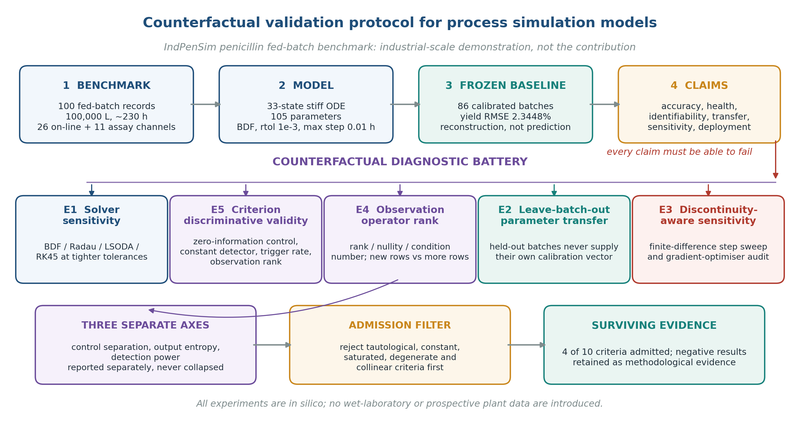

**Fig. 1 | Counterfactual validation protocol for process simulation models.** The upper row is the simulation pipeline: benchmark records drive a frozen 33-state model whose per-batch calibrated baseline is used only for reconstruction, while every claim about that model is routed to a diagnostic battery. The battery comprises solver sensitivity (E1), discriminative-validity auditing (E5), observation-operator rank (E4), leave-batch-out parameter transfer (E2) and discontinuity-aware sensitivity (E3). Each criterion is scored on three separately reported axes. An admission filter rejects degenerate criteria before any multi-criteria synthesis. The IndPenSim benchmark is the demonstration substrate, not the contribution.

---

## 2. Materials and methods

### 2.1 Benchmark, model and simulation pipeline

The study uses the 100 publicly released IndPenSim batches (Goldrick et al., 2015; Goldrick et al., 2019). Each batch supplies 37 recorded channels: 26 on-line manipulated and measured variables sampled at 0.2 h (temperature, pH, dissolved oxygen, off-gas O2 and CO2, oxygen uptake rate, carbon dioxide evolution rate, feed rates, agitation, aeration and pressure) and off-line assay values sampled at 12 h with a 4 h reporting delay and 98.2% missingness. Batch duration is approximately 230 h with a batch-specific stochastic component, and fault injections cover eight classes. The evaluation window is restricted to t >= 20 h, where the process has left the initial transient.

Of the 100 batches, 86 constitute the calibrated evaluation set (84 normal batches plus fault batches 91 and 92). Each of the 86 batches carries its own calibrated parameter vector, assembled through a single canonical routine. Consequently, the end-of-batch accuracy reported in Section 3.1 measures the mutual consistency of the model port, the integrator, the parameter assembly and the metric implementation against the benchmark's recorded product mass. It is not a prospective prediction on unseen batches, and it is not presented as such. Prospective generalisation is assessed only where an explicit hold-out protocol exists: the channel-level cross-validated soft sensors, the seed-transfer experiment and the leave-batch-out transfer of Section 2.5.

The port implements the 33-state stiff ODE system of the IndPenSim model family (Bajpai and Reuss, 1980; Birol et al., 2002; Goldrick et al., 2015). The state vector comprises substrate S, dissolved oxygen DO2, oxygen O2, product P, volume V, weight Wt, pH, temperature, heat Q, viscosity, A_t1, four mycelial compartments A0/A1/A3/A4, hyphal counts n0–n9 and nm, phi0, CO2, dissolved CO2, PAA, NH3 and the kinetic parameters mup and mux. Twelve of these states are algebraic quasi-steady states with zero time derivative. Nominal values include mux = 0.41, mup = 0.041, alpha_kLa = 85 and m_s = 0.029; batch-level random effects are mu_x = 0.41 +/- 0.025, mu_p = 0.041 +/- 0.0025 and alpha_kLa = 85 +/- 10. Integration uses an implicit multistep (BDF) solver with relative tolerance 1e-3, absolute tolerance 1e-6 and a maximum step of 0.01 h; output is sampled at 0.2 h. Non-negativity guards clamp states 0–30 to 0.001 and dissolved oxygen to 1, and an adaptive guard activates for the substrate-limited regime beyond 65 h.

All numerical work was performed in CPython 3.10 (64-bit) with pinned dependencies (NumPy, Harris et al., 2020; pandas, McKinney, 2010; SciPy, Virtanen et al., 2020; Matplotlib, Hunter, 2007). The model port, calibrated parameter tables, per-batch results and all machine-readable evidence artefacts are provided in the Supplementary Material and will be deposited in a public repository upon acceptance.

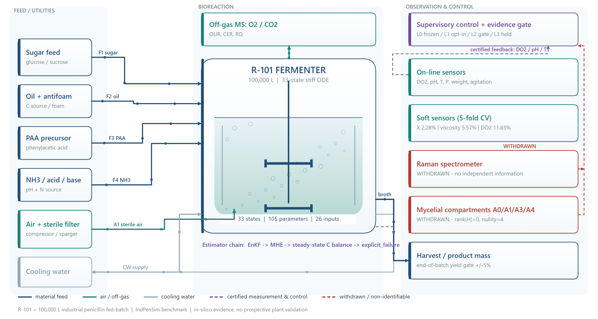

**Fig. 2 | Process flow diagram of the 100,000 L penicillin fed-batch.** Six feed and utility trains (sugar, oil and antifoam, phenylacetic acid precursor, ammonia/acid/base, sterile air and cooling water) enter the stirred aerated reactor R-101, simulated by the 33-state stiff ODE with 0.2 h on-line sampling and 12 h off-line assays. Off-gas mass spectrometry supplies OUR, CER and RQ; on-line sensors feed the dissolved-oxygen, pH and temperature loops. Red traces mark channels that the observation operator cannot resolve: the simulated Raman spectrometer and the four mycelial compartments. The diagram is drawn natively with the Canvas 2D API and exported as a static 300 dpi image for print; an interactive version with hover provenance and layer toggles accompanies the HTML rendering.

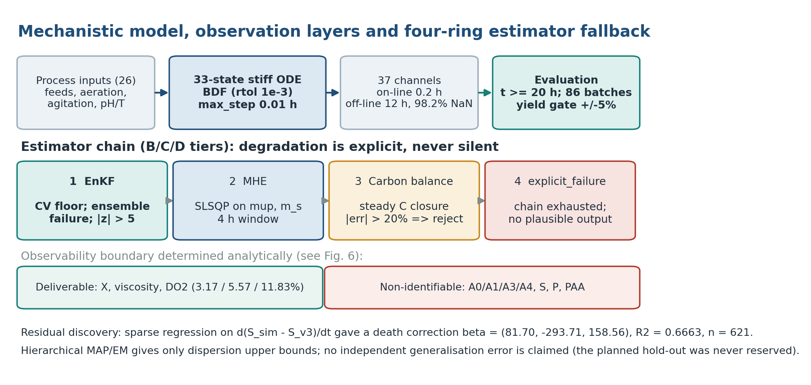

**Fig. 3 | Model, observation layers and estimator fallback.** Twenty-six process inputs drive the 33-state stiff ODE; 37 channels are emitted with on-line sampling at 0.2 h and off-line assays at 12 h with 98.2% missingness. Evaluation is restricted to t >= 20 h over 86 batches with a +/-5% yield gate. The estimator chain degrades from ensemble Kalman filter to moving-horizon estimator to steady-state carbon balance to an explicit failure state, never emitting a plausible-looking number after exhaustion (Evensen, 2003; Rao et al., 2003). Channels classified as deliverable and as structurally non-identifiable are listed separately.

### 2.2 Numerical verification and solver sensitivity (E1)

A frozen regression anchor records per-batch simulated and recorded total product mass and the relative yield error

\[
e_b = 100\,(Y_{\mathrm{sim},b} - Y_{\mathrm{rec},b})\,/\,Y_{\mathrm{rec},b}.
\]

Zero regression is defined as a maximum absolute deviation of exactly zero across all 86 batches at tolerance 0.0. Aggregate acceptance requires a batch-level RMSE no greater than 3.5% and all 86 batches within +/-5%; these criteria were fixed before any candidate evaluation and were never relaxed.

To establish whether the headline accuracy is an artefact of the integrator, six representative batches (8, 36, 55, 60, 91 and 92; covering normal, low-yield, fault and extreme oxygen-transfer cases) were re-integrated on identical input trajectories with four alternative configurations: BDF at rtol 1e-6 / atol 1e-9, Radau at the same tolerances, LSODA at the same tolerances, and explicit RK45 with a fixed maximum step of 0.01 h. Radau and LSODA are standard alternatives for stiff and switched-stiff systems (Hairer and Wanner, 1996; Hindmarsh et al., 2005; Shampine and Reichelt, 1997). For each run we recorded end-of-batch product deviation relative to the frozen default, per-channel trajectory normalised RMSE on t >= 20 h, peak-time shift and CPU time. Integrator failures were recorded as explicit errors rather than silently falling back to the default solver.

### 2.3 Counterfactual validation protocol and the three-axis diagnostic card

Every acceptance criterion was subjected to a fixed audit battery, applied without post-hoc adjustment:

1. **Zero-information control.** Replace the predictor with a constant and recompute the statistic. A discriminating statistic must change.
2. **Constant-detector test.** Evaluate the classifier over all available batches; a zero-variance output distribution is a constant, not a test.
3. **Trigger-rate audit.** For threshold detectors, compute the fraction of real, unperturbed batches flagged. A near-unit trigger rate on normal data carries no information about anomalies.
4. **Observation-rank test.** For state or parameter delivery claims, compute the singular values of the column-normalised observation operator H; rank and nullity determine identifiability, and adding rows of an existing observation type cannot change the column space.
5. **Two-sided A/B gate.** Candidate evaluation requires zero-information controls, injection controls, data-driven thresholds derived on a grid with explicit margin, leave-one-out consistency, a confusion table and both improvement and harm directions.
6. **Seed transfer.** Any tuned stochastic parameter must be re-evaluated on at least two seeds not used for tuning.
7. **Collinearity audit.** Two criteria consuming the same signal are counted as one piece of evidence.
8. **Runtime loading.** A deployed capability is counted only if its module imports and its entry symbol is callable; file existence is not evidence.

Each criterion M receives a diagnostic card with three separately reported axes (Table 2). Control separation is Delta = min(1, |M(p) - M(p0)|) for a scalar statistic with fitted predictor p and zero-information control p0, Delta = 1 - |2q - 1| for a binary detector with trigger rate q, and the fraction of deliberately injected defects detected for a loading test. Output entropy is the normalised Shannon entropy of the output distribution over K categories (Shannon, 1948), which is zero for a constant output. Detection power is Youden's J = TPR - FPR wherever a confusion table exists (Youden, 1950), or the defect-detection fraction otherwise. Verdicts are TAUTOLOGICAL, CONSTANT, SATURATED, DEGENERATE, COLLINEAR and ADMITTED. The three axes are deliberately reported separately rather than collapsed into a single score, because a composite index would introduce exactly the arbitrary degree of freedom that this work argues against (Belton and Stewart, 2002).

**Table 2.** Three-axis diagnostic card and the audit that populates each axis.

| Axis | Definition | Populating audit | Zero value means |
|---|---|---|---|
| Control separation | min(1, abs(M(p) - M(p0))); 1 - abs(2q-1); defect-detection fraction | zero-information control; injected-defect control | the criterion returns the same value for a model and no model |
| Output entropy | normalised Shannon entropy of the output distribution | constant-detector test; trigger-rate audit | the criterion emits a constant or near-constant verdict |
| Detection power | Youden J = TPR - FPR, or defect-detection fraction | confusion table; injection controls | the criterion fires on normal data or misses real defects |

### 2.4 Observation-operator rank and identifiability diagnostics (E4)

For a claimed state subset we assemble the observation operator H with one row per measurement channel per sampling time. A one-hot row marks a directly observed state; a row of ones marks an aggregate assay. The diagnostic proceeds in six steps: (1) enumerate the claimed states and the measurement channels actually used by the estimator; (2) assemble H; (3) column-normalise H and compute singular values, rank, nullity and condition number; (4) simulate adding one independent row per null-space direction and recompute the rank; (5) reject the delivery claim for every null-space direction regardless of fit quality, and record the claim as conditional on H rather than on the process; (6) report the rank table alongside the numerical fit.

For the four mycelial compartment states A0/A1/A3/A4, the assimilation operator has ten channels (DO2, T, Q, off-gas CO2, O2, pH and four assays) at five time points, i.e. 50 rows, none of which observes a compartment; the reporting operator adds ten aggregate biomass rows of [1,1,1,1], giving 60 rows. We recompute rank, nullity and condition number for the baseline operators, after adding 0–4 independent compartment-resolved rows, and after appending 50 further rows of an already existing aggregate type. The last comparison separates a lack of data volume from a lack of observability (Raue et al., 2009; Wieland et al., 2021).

### 2.5 Parameter uncertainty and leave-batch-out transfer (E2, E6)

**Leave-batch-out transfer.** The 86 batches are split into five disjoint folds over the ordered batch roster. For each held-out batch a prior is constructed only from the calibration vectors of the other four folds: either the per-parameter median over nine shared keys (Y_NP, Y_NX, alpha_kLa, dist_tcin_asym, m_s, mup, mux, q_co2 and vis_out_scale), or a complete parameter vector drawn from the training pool. Twenty held-out batches (four per fold, spread across the recorded-yield range) receive the median prior; eight representative held-out batches receive three drawn priors each. The batch's own input trajectory is used, but its recorded product mass enters only the final error calculation. Reported outcomes are transfer RMSE, bias, the fraction within the +/-5% band, and P5/P95 predictive-interval coverage computed on the drawn-prior replicates. The subset is declared explicitly; no claim of a full 86-batch prospective evaluation is made.

**Uncertainty propagation.** Six Monte Carlo replicates on five representative batches apply the nominal batch-level random effects as multiplicative perturbations to each batch's own calibrated vector: relative standard deviations of 0.025/0.41 for mux, 0.0025/0.041 for mup and 10/85 for alpha_kLa. A correlation-based elementary-effect proxy ranks the three parameters by their association with the absolute yield deviation (Morris, 1991; Saltelli et al., 2008; Sobol, 2001). This is a screening diagnostic, not a full variance decomposition.

### 2.6 Discontinuous response and sensitivity/optimisation constraints (E3)

The recorded oxygen-transfer response surface comprises 12 batches at 12 values of alpha_kLa from 30 to 140. Adjacent-grid finite differences quantify how often the apparent gradient is large or changes sign. Two 12-step bisection brackets locate the substrate-setpoint transition within 2.44 x 10^-7 and the product-setpoint transition within 2.44 x 10^-8; crossing either moves the yield error from -100.00% to approximately +0.51% to +1.33% with the batch becoming valid again. For each bracket we recompute the apparent centred-difference gradient over steps h from 1e-2 to 1e-8: where the response is a step of approximately 100 percentage points, the difference does not converge and its magnitude grows as 1/h.

We then run SLSQP and trust-constr offline on the recorded median response curve (linear interpolation between the 12 grid values), minimising squared end-of-batch yield error over alpha_kLa in [30, 140] from five starting values each. The outcome of interest is the number of runs that terminate within one unit of the starting value, i.e. at a pseudo-local solution produced by a zero finite-difference gradient. This is an optimisation-and-sensitivity warning, not a claim about closed-loop control, and it uses no new simulation beyond the recorded surface.

### 2.7 Evidence gating, candidate evaluation, physical consistency and statistical conventions

Candidate changes were evaluated against a two-sided, pre-registered gate with frozen thresholds (upper bounds of 20 and 30 percentage points for the variance-injection candidate, the +/-5% yield band, R-squared >= 0.5 with n >= 400, and carbon/nitrogen budgets). Failing checks are retained; first-pass failures are kept alongside final results. A four-stage evidence-gating workflow separates running the frozen baseline, evaluating opt-in candidates, applying the adversarial gate and authorising a model update; the last stage was not executed in this study (Saltzer and Schroeder, 1975). The workflow is an implementation convenience and is detailed in the Supplementary Material; it is not a contribution claim.

Element balances were computed for carbon and nitrogen. An earlier implementation omitted the volume factor on the volumetric CER term, producing a spurious -60% to -67% carbon imbalance; after correction the median carbon imbalance is -1.5% against a budget of +/-20%. Nitrogen balances give +9.9% under the model convention and -58.1% under the true metering convention against a budget of +/-35%; respiratory quotient reproduction from recorded inputs is exact, while simulated OUR and CER are approximately 12% high because of overestimated CO2 outgassing. Full elemental closure is therefore not claimed.

RMSE is computed over batch-level relative yield errors. Normalised RMSE is normalised by the observed channel range and reported as a median over batches and folds; no single aggregate hides channel-level failure. Wilson 95% intervals are reported where coverage is discussed (Wilson, 1927); bootstrap intervals were not used because the residual distribution is not independent across time (Efron and Tibshirani, 1993). Agreement was assessed by parity and Bland-Altman plots (Bland and Altman, 1986), the empirical CDF, a normal quantile-quantile plot with Shapiro-Wilk (Shapiro and Wilk, 1965), lag-1 to lag-10 autocorrelation with a Wald-Wolfowitz runs test (Wald and Wolfowitz, 1940), an exact sign test, and a Mann-Whitney comparison (Mann and Whitney, 1947). Symlog scaling in figures is for display only; all test statistics use untransformed values. Failed checks are reported with the same prominence as passing ones, and no post-hoc threshold relaxation or subgroup searching was performed after seeing results.

---

## 3. Results

### 3.1 Numerical credibility of the frozen baseline

The frozen baseline reproduces the recorded end-of-batch product mass with an RMSE of 2.3448% over 86 batches, with all 86 within the pre-registered +/-5% band (range -4.814% to +4.829%; Fig. 5a), and byte-identical regression against the frozen anchor gives a maximum absolute deviation of exactly zero. These are reconstruction numbers: each batch uses its own calibrated parameter vector. The 2.3448% figure quantifies the mutual consistency and stability of the model port, the integrator, the parameter assembly and the metric implementation; it is a necessary precondition for the counterfactual audit but not a validation of transfer to uncalibrated batches.

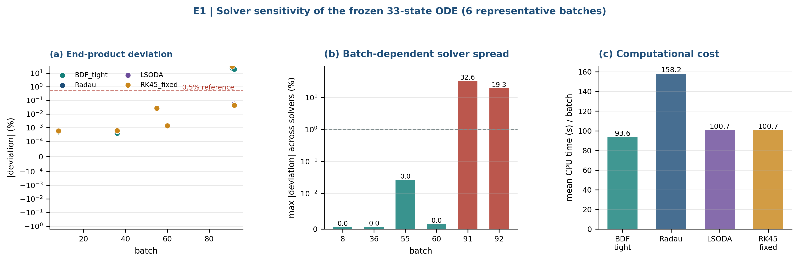

**Fig. 4 | Solver sensitivity (E1).** (a) Absolute end-of-batch product deviation from the frozen BDF default for six representative batches re-integrated with BDF at tighter tolerance, Radau, LSODA and explicit RK45 with a fixed 0.01 h step; the dashed line marks a 0.5% reference. (b) Largest across-solver deviation for each batch, showing that numerical sensitivity is concentrated in a few bistable cases. (c) Mean CPU time per batch. Integrator failures are reported explicitly rather than silently falling back to the default. The median deviation is 0.014% while the maximum is 32.567% across 22 successful re-integrations.

**Table 3.** Solver-sensitivity outcomes (E1); deviations are relative to the frozen BDF default.

| Configuration | Successful runs | Max abs end-product deviation (%) | Median abs deviation (%) | Mean CPU time (s) |
|---|---|---|---|---|
| BDF, rtol 1e-6 / atol 1e-9 | 6 | 22.504 | 0.014 | 93.6 |
| Radau, rtol 1e-6 / atol 1e-9 | 4 | 0.027 | 0.001 | 158.2 |
| LSODA, rtol 1e-6 / atol 1e-9 | 6 | 32.567 | 0.014 | 100.7 |
| RK45, fixed 0.01 h step | 6 | 32.549 | 0.014 | 100.7 |

Across 22 of 24 re-integrations, the median absolute end-of-batch deviation was 0.014% for every alternative configuration, yet the maximum reached 32.567% (Table 3, Fig. 4). The discrepancy is not spread evenly: it is confined to a small number of bistable batches whose trajectories sit near a basin boundary, whereas the remaining batches are numerically indistinguishable across solver families. 2 Radau runs terminated with an explicit step-size failure on the stiffest batches and are reported as failures rather than as converged results. Mean CPU time ranged from 93.6 s (tighter BDF) to 158.2 s (Radau), so the frozen default is also the cheapest. The conclusion is more informative than a simple pass or fail: for most batches the 2.3448% anchor is not a solver artefact, but for a structurally identifiable minority the numerical solution itself is uncertain, and that uncertainty must be reported alongside the accuracy claim. Sensitivity is therefore a property of the batch, not of the integrator alone; the remaining uncertainty is dominated by parameterisation and by the observation structure, which the following sections address.

The extended validation places the anchor in context (Fig. 6, Fig. 7; Tables 4 and 5). Relative to a leave-one-out batch mean, a persistence predictor and a zero predictor, the mechanistic reconstruction reduces RMSE by 96.82%, 97.46% and 97.66% respectively, and by 88.8% on a scale-robust median-normalised error (2.22% versus 26.31%). These differences must not be over-interpreted: the naive predictors forecast a yield series, whereas the simulation reconstructs each batch from its own inputs and calibrated parameters. Their role is to establish that the target series is far from trivially predictable and that the anchor is not an artefact of a low-variance target. The scale-robust column removes the amplification caused by the two lowest-yield batches (0.54 and 0.74 x 10^6 g against a median of 3.24 x 10^6 g).

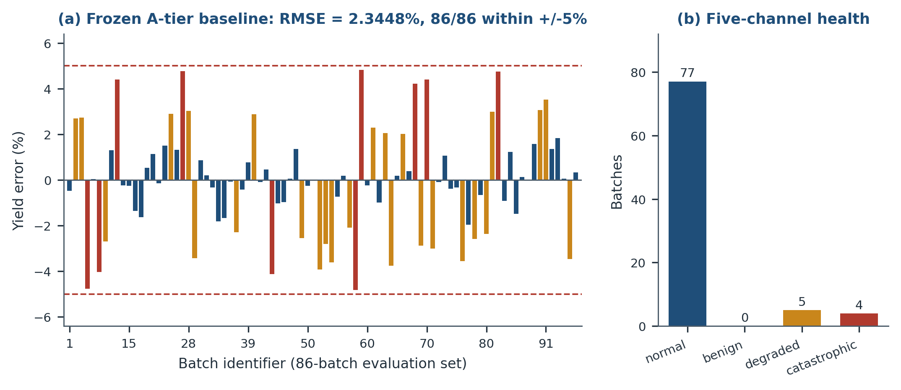

**Fig. 5 | Frozen-baseline accuracy and the corrected health verdict.** (a) Per-batch relative yield error for the 86-batch evaluation set; dashed lines mark the pre-registered +/-5% acceptance band (RMSE 2.3448%; 86/86 within band; byte-identical regression). (b) Distribution of the five-channel health verdict (77 normal, 0 benign, 5 degraded, 4 catastrophic). The legacy crash classifier returned normal for all 86 batches and is shown for contrast in Fig. 10b.

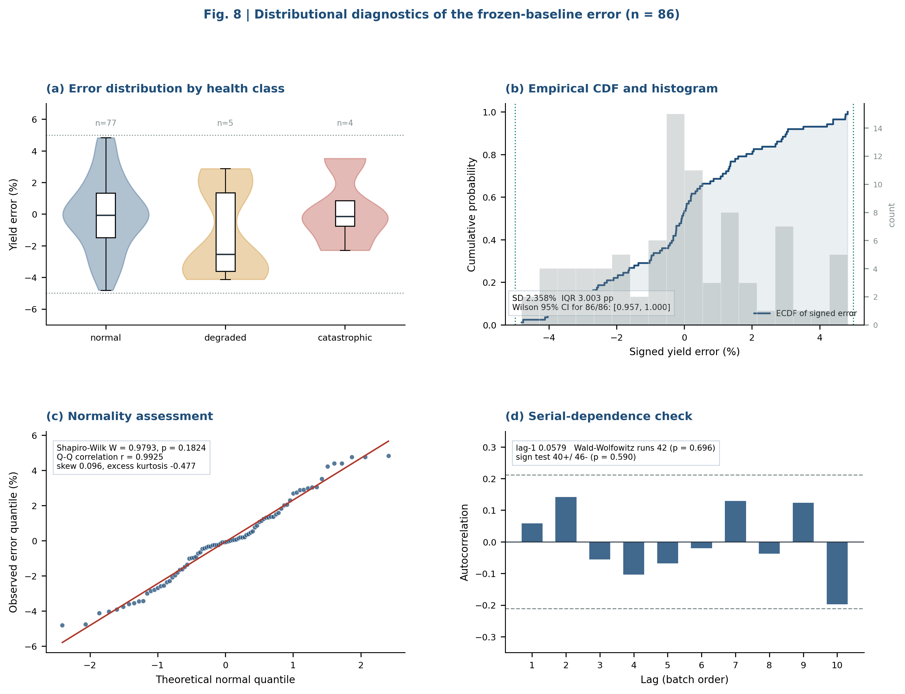

**Fig. 6 | Distributional diagnostics of the frozen-baseline error (n = 86).** (a) Violin and box plots by health class; (b) empirical CDF and histogram with the +/-5% band; (c) normal quantile-quantile plot with Shapiro-Wilk W = 0.9793 (p = 0.1824); (d) lag-1 to lag-10 autocorrelation with 95% white-noise bounds. All statistics are computed on untransformed errors.

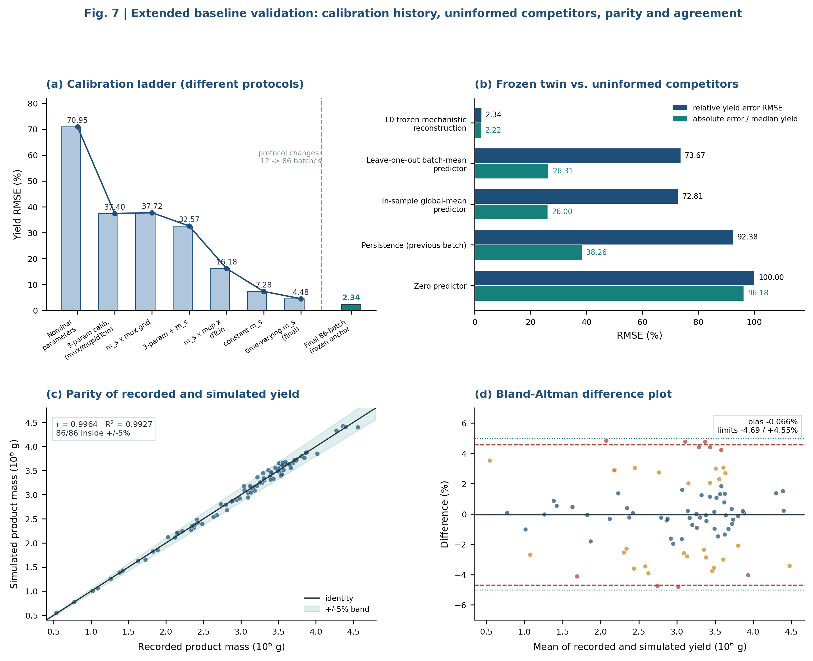

**Fig. 7 | Extended baseline validation.** (a) Seven historical calibration stages from a separate 12-batch protocol (70.95% to 4.48% RMSE), shown separately from the 86-batch frozen anchor because the protocols differ. (b) Five reference predictors under two error normalisations; information sets differ and are listed in Table 6. (c) Parity of recorded and simulated product mass (r = 0.996, R-squared = 0.993) with the +/-5% band. (d) Bland-Altman agreement: bias -0.0662%, limits of agreement -4.687% to +4.555%, with no magnitude-dependent trend.

**Table 4.** Acceptance evidence and distributional diagnostics for the frozen baseline.

| Quantity | Value | Interpretation |
|---|---|---|
| Batch-level yield RMSE | 2.3448% | reconstruction consistency, not prospective prediction |
| Batches within +/-5% | 86/86; Wilson 95% CI [0.9572, 1.0000] | honest finite-sample bound |
| Zero-regression maximum deviation | 0.00e+00 (tolerance 0.0) | byte-identical frozen anchor |
| Mean / median error | -0.0662% / -0.0744% | no material systematic bias |
| SD / MAD / IQR | 2.3576% / 1.4967% / 3.0034 pp | tight, symmetric spread |
| Shapiro-Wilk W (p) | 0.9793 (0.1824) | normality not rejected |
| Sign test | 40 positive / 46 negative, p = 0.5900 | no directional bias |
| Lag-1 autocorrelation | 0.0579 | no serial dependence in batch order |
| Runs test | 42 observed vs 43.79 expected, p = 0.6962 | no ordering artefact |
| Bland-Altman limits of agreement | -4.687% to +4.555% | agreement, not association alone |
| Normal (84) vs fault (2) RMSE | 2.3365% vs 2.6696%; Mann-Whitney p = 0.1073 | severely underpowered |

**Table 5.** Baseline ladder with explicit information sets.

| Estimator | Information set | n | RMSE (%) | RMSE / median yield (%) | within +/-5% |
|---|---|---|---|---|---|
| Frozen mechanistic reconstruction | batch inputs + per-batch calibrated parameters + 33-state ODE | 86 | 2.3448 | 2.2205 | 86/86 |
| Leave-one-out batch-mean predictor | other 85 recorded yields; held-out batch excluded | 86 | 73.6679 | 26.3103 | 11/86 |
| In-sample global-mean predictor | all 86 recorded yields (optimistic constant) | 86 | 72.8113 | 26.0044 | 11/86 |
| Persistence (previous batch) | recorded yield of the immediately preceding batch | 85 | 92.3806 | 38.2620 | 14/85 |
| Zero predictor | none | 86 | 100.0000 | 96.1811 | 0/86 |

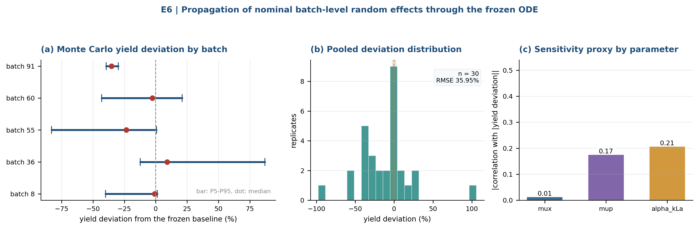

**Fig. 8 | Propagation of nominal parameter uncertainty (E6).** (a) P5–P95 yield deviation by batch with the median marked; (b) pooled deviation distribution with the +/-2.3448% reconstruction band shaded; (c) correlation-based elementary-effect proxy for mux, mup and alpha_kLa. The screening uses 30 Monte Carlo re-integrations and no recorded yield as input.

**Table 6.** Monte Carlo parameter-uncertainty propagation (E6).

| Quantity | Value |
|---|---|
| Successful re-integrations | 30 |
| Pooled yield-deviation RMSE | 35.95% |
| Pooled P5 / P95 deviation | -53.13% / 27.42% |
| Maximum absolute deviation | 105.69% |
| Dominant elementary-effect proxy | alpha_kLa (|r| = 0.21) |
| Reference reconstruction RMSE | 2.3448% |

The propagated deviation is substantially larger than the reconstruction error (Table 6), which is the expected consequence of perturbing parameters that were calibrated per batch. The point is methodological: a 2.3448% headline error cannot be interpreted as a predictive tolerance unless the parameter uncertainty that produced it is reported alongside it.

### 3.2 Structural failure of validation criteria

Applying the diagnostic card of Section 2.3 to the ten criteria used in this benchmark yields the core methodological result (Table 7, Fig. 9, Fig. 10). Four criteria are structurally unable to discriminate a fitted model from a no-model baseline.

First, residual-quantile interval coverage is tautological. Prediction intervals were formed from the 5th and 95th percentiles of the residual distribution itself. Replacing the fitted predictor with a zero-information constant produced coverage of 0.899548532731377 for biomass, product, PAA and viscosity, bit-identical to the fitted predictor, with zero control separation in all four channels. The instrument therefore certified both a good model and no model at all, a clean instance of metric-level leakage (Kapoor and Narayanan, 2023). Replacing the interval construction with mu +/- 1.96 sigma, where sigma is predicted rather than derived from realised residuals, restored discrimination: coverage fell to 0.0000 for the zero-information predictor versus 0.1072 (biomass) and 0.3160 (product) for the fitted one. The resulting intervals are informative in width rather than in coverage; interval half-width and normalised-RMSE improvement, never coverage, are reported as calibration evidence.

Second, the legacy crash classifier is a constant. It returns normal whenever maximum dissolved CO2 does not exceed 7.57 g/L; the maximum over all 86 batches is 7.194 g/L, so the first branch always fires (86/86 normal). Batch 91 ends at pH 3.001 with 129 pH-guard clamping events and is still reported normal. A detector with zero output variance is not a detector, and the dashboard reading of "zero catastrophic batches" was an artefact, not a finding.

Third, the global innovation criterion is near-constant. On 32 unperturbed real batches, the global standardised-innovation threshold flagged 27 (84.38%) as degraded. The obvious global correction is not a correction either: raising the threshold from 5.0 to 10.0 leaves zero of 20 injected cases detected (the CO2 outgassing statistic reaches a maximum absolute z-score of 7.60 with a 90th percentile of 5.56; the O2 statistic never exceeds 0.17), and beyond a threshold of 15 the detector becomes constantly false.

Fourth, the deployment loading test declared a capability loaded on the basis of file existence (Sculley et al., 2015). Replacing it with a runtime import-and-callable test exposed two naming defects that were invisible to the existence test and verified 12 of 12 operators.

Two further criteria are removed for reasons other than a zero axis. An empirical-Bayes population-dispersion estimator is degenerate (effective sample size 46.8 out of 48 implies zero dispersion), and the health and validity criteria are perfectly collinear (phi = 1.0000) because both consume the same pH-guard signal; counting both as independent corroboration would recreate the category error this study argues against. Of the ten criteria, four are admitted to multi-criteria synthesis (Table 7, Fig. 9).

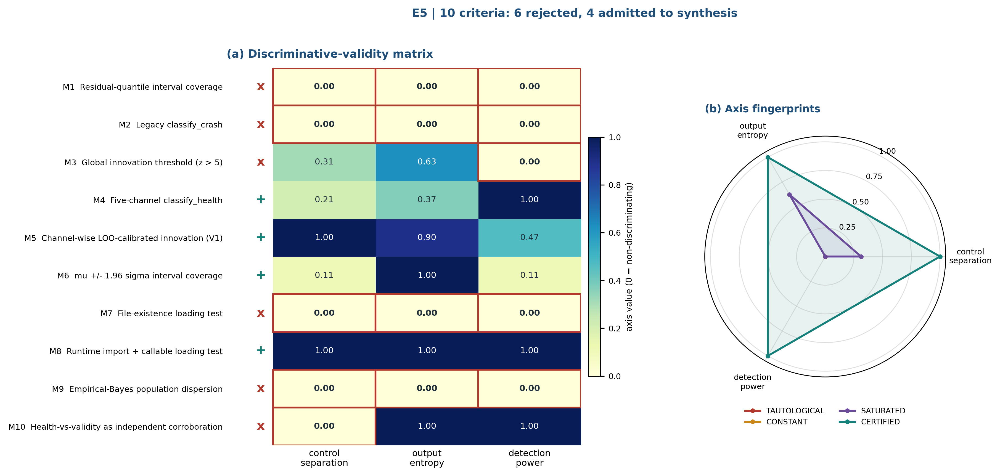

**Fig. 9 | Discriminative-validity matrix (E5).** (a) Ten criteria scored on control separation, output entropy and detection power; red outlines mark zero axes, and the left column marks rejected (x) and admitted (+) criteria. (b) Polar fingerprints of the four verdict classes: a tautological and a constant criterion collapse to the origin, a saturated criterion has entropy but no detection power, and an admitted criterion separates on all three axes.

**Table 7.** Discriminative-validity matrix for ten acceptance criteria (E5).

| ID | Criterion | Control separation | Output entropy | Detection power | Verdict | Admitted |
|---|---|---|---|---|---|---|
| M1 | Residual-quantile interval coverage | 0.0000 | 0.0000 | 0.0000 | TAUTOLOGICAL | no |
| M2 | Legacy crash classifier | 0.0000 | 0.0000 | 0.0000 | CONSTANT | no |
| M3 | Global innovation threshold (z > 5) | 0.3125 | 0.6253 | 0.0000 | SATURATED | no |
| M4 | Five-channel health classifier | 0.2093 | 0.3705 | 1.0000 | ADMITTED | yes |
| M5 | Channel-wise leave-one-out innovation | 1.0000 | 0.9000 | 0.4667 | ADMITTED | yes |
| M6 | Mean +/- 1.96 sigma interval (width only) | 0.1072 | 1.0000 | 0.1072 | ADMITTED | yes |
| M7 | File-existence loading test | 0.0000 | 0.0000 | 0.0000 | TAUTOLOGICAL | no |
| M8 | Runtime import-and-callable loading test | 1.0000 | 1.0000 | 1.0000 | ADMITTED | yes |
| M9 | Empirical-Bayes population dispersion | 0.0000 | 0.0000 | 0.0000 | DEGENERATE | no |
| M10 | Health-vs-validity as independent corroboration | 0.0000 | 1.0000 | 1.0000 | COLLINEAR | no |

Two observations deserve emphasis. Instrument M3 has non-zero entropy and non-zero control separation yet zero detection power: a detector that fires on 84.38% of normal data is informative about nothing, which a single entropy number alone would miss. Instrument M10 has full entropy and full detection power yet zero control separation and perfect collinearity with M4, so it contributes no independent evidence. This is precisely why the diagnostic card reports three axes and a collinearity audit rather than one aggregate score. The card thresholds were fixed before the instruments were scored, and no axis weighting was chosen after seeing the results.

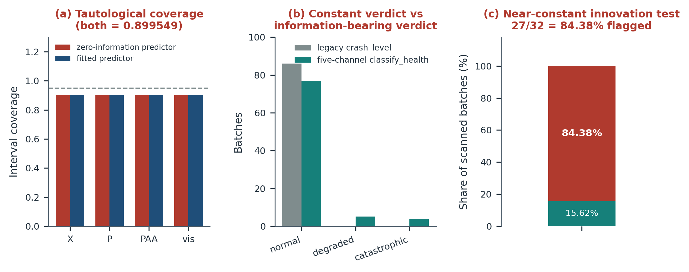

**Fig. 10 | Three non-discriminating acceptance instruments.** (a) Residual-quantile interval coverage is identical (0.899549) for a zero-information constant predictor and the fitted predictor across four channels; the dashed line marks the nominal 0.95. (b) The legacy crash classifier returns 86 normal, 0 degraded and 0 catastrophic, whereas the five-channel classifier resolves 77/5/4. (c) The global innovation criterion flags 27 of 32 = 84.38% of unperturbed batches as degraded.

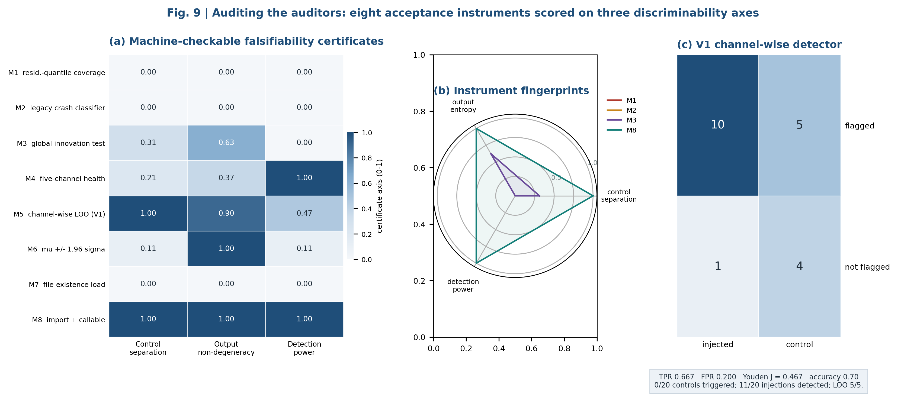

**Fig. 11 | Three-axis fingerprints of the diagnostic records.** (a) Eight acceptance instruments scored on three machine-checkable axes; (b) radar comparison of two degenerate, one saturated and one admitted instrument; (c) confusion matrix of the channel-wise detector (10 true positives, 5 false negatives, 4 true negatives, 1 false positive; Youden J = 0.4667).

### 3.3 Identifiability boundary and the executable rank protocol

The 12 x 12 oxygen-transfer sweep shows contiguous collapsed and feasible regions rather than a smooth gradient, with an interior optimum at k* = 78.15 +/- 8.94 close to the nominal 85 +/- 10 and populated in only 13 of 144 grid cells. The structural explanation for the channel-level failures is the observation operator (Fig. 12; Table 8). For the four mycelial compartment states, the assimilation operator has singular values [0, 0, 0, 0], rank 0 and nullity 4; the reporting operator has [2, 0, 0, 0], rank 1 and nullity 3; the condition number is infinite in both. The original structural audit passed all 11 of its checks over 4 batches and 5 time points with a zero-information control. The reason is not insufficient data volume: the compartment states never enter the active observation vector, so additional batches or time points merely repeat the same column space (Raue et al., 2009; Wieland et al., 2021). Of the 37 released data columns, none contains a compartment assay, and the simulated Raman channel carries no independent information about PAA (incremental R-squared 0.0199 to 0.0092; t-statistic 0.104 to 0.036; PLS output 0–2.11 mg/L against assay values of 430–2023 mg/L, an approximately 1000-fold scale mismatch).

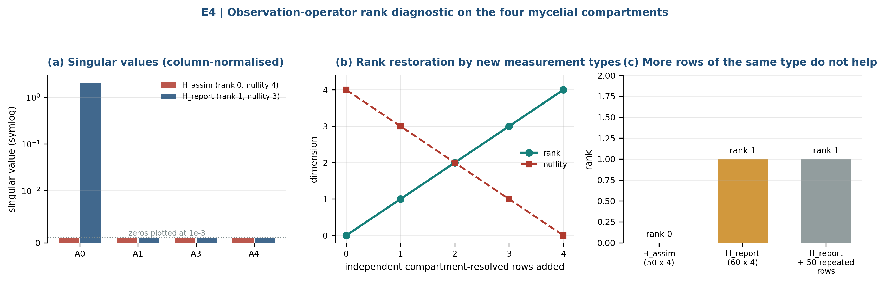

**Fig. 12 | Observation-operator rank diagnostic (E4).** (a) Column-normalised singular values of the assimilation and reporting operators (symlog display; zeros plotted at 1e-3); (b) rank and nullity as 0–4 independent compartment-resolved rows are added; (c) appending 50 rows of an already existing aggregate assay leaves rank 1 unchanged.

**Table 8.** Rank-diagnostic protocol applied to the four mycelial compartments (E4).

| Operator / modification | Shape | Singular values | Rank | Nullity | Condition number |
|---|---|---|---|---|---|
| H_assim, 10 channels x 5 times | 50 x 4 | [0, 0, 0, 0] | 0 | 4 | infinite |
| H_report, plus 10 aggregate rows | 60 x 4 | [2, 0, 0, 0] | 1 | 3 | infinite |
| H_report + 50 repeated aggregate rows | 110 x 4 | [2, 0, 0, 0] | 1 | 3 | infinite |
| H_assim + 1 compartment row | 51 x 4 | [1, 0, 0, 0] | 1 | 3 | finite |
| H_assim + 2 compartment rows | 52 x 4 | [1, 1, 0, 0] | 2 | 2 | finite |
| H_assim + 3 compartment rows | 53 x 4 | [1, 1, 1, 0] | 3 | 1 | finite |
| H_assim + 4 compartment rows | 54 x 4 | [1, 1, 1, 1] | 4 | 0 | finite |

The rank-restoration experiment converts a negative result into a reusable diagnostic. Fifty additional rows of the existing aggregate assay leave rank 1 unchanged, whereas four independent compartment-resolved rows restore rank 4 and nullity 0. The delivery claim for mycelial composition is therefore conditional on H, not on the biology: new compartment-resolved measurements could change it, whereas more rows of the existing data cannot. This is the sense in which structural identifiability is a *precondition* for simulation-based state estimation, and it applies to any process model whose estimator consumes an aggregate assay.

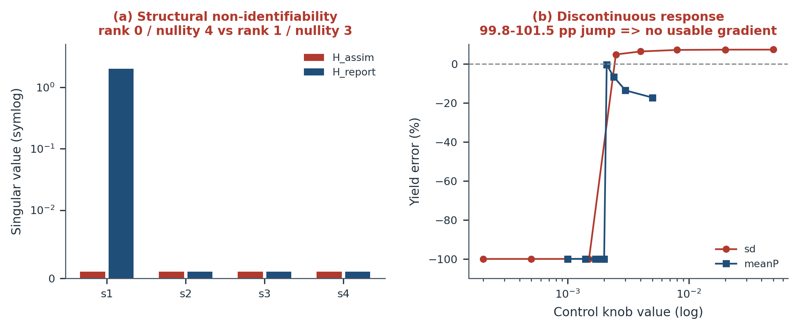

**Fig. 13 | Structural limits of the simulation model.** (a) Singular values of the observation operator for the mycelial compartment states: the assimilation operator has rank 0 / nullity 4 and the reporting operator rank 1 / nullity 3 (symlog display; zero values plotted at 10^-3 for visibility). (b) Yield error versus two continuous control knobs (logarithmic abscissa): the response is a near-vertical jump of 99.8–101.5 pp, leaving no usable gradient.

### 3.4 Discontinuous response and gradient failure

The control-knob sweep shows that the parameter response of this model is discontinuous (Fig. 13b). In the baseline state, the yield response to three continuous control knobs is a hard jump spanning 99.83, 99.92 and 99.99 percentage points respectively, with no usable gradient on either side. Bisection on a collapsed batch located the substrate-setpoint transition within an interval of width 2.44 x 10^-7 and the product-setpoint transition within 2.44 x 10^-8; crossing it moves the yield error from -100.00% to between +0.51% and +1.33% with the batch becoming valid again. The collapsed state is not an attractor, but both continuous knobs remain pinned at -100% and invalid throughout the collapsed regime.

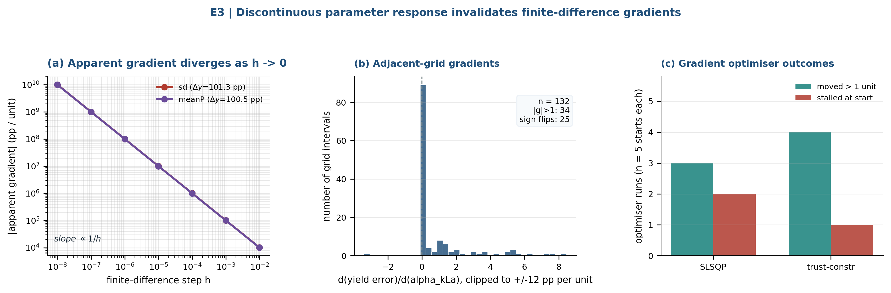

**Fig. 14 | Discontinuity-aware sensitivity (E3).** (a) Apparent finite-difference gradient across the two bisection brackets as h decreases from 1e-2 to 1e-8; the slope follows 1/h rather than converging. (b) Distribution of adjacent-grid gradients on the recorded 12 x 12 response surface (clipped to +/-12 pp per unit): 34 of 132 intervals exceed 1 pp per unit and 25 sign flips occur. (c) SLSQP and trust-constr offline optimisation from five starting values each: runs that stall at the starting value are shown separately from runs that move.

**Table 9.** Discontinuity and gradient-optimisation statistics (E3).

| Quantity | Value |
|---|---|
| Substrate-setpoint bisection bracket | 2.44 x 10^-7 (jump 101.33 pp) |
| Product-setpoint bisection bracket | 2.44 x 10^-8 (jump 100.51 pp) |
| Adjacent grid intervals evaluated | 132 |
| Intervals with |gradient| > 1 pp per unit | 34 |
| Sign flips across adjacent intervals | 25 |
| Offline optimiser runs (2 methods x 5 starts) | 10 |
| Runs stalling at the starting value | 3 |
| Apparent-gradient scaling near a step | proportional to 1/h |

Where the response is a step of approximately 100 pp, the centred difference does not converge: its apparent gradient grows as 1/h as the step is refined (Fig. 14a, Table 9), and gradient-based optimisers started on the recorded surface terminate at 3 of ten runs without moving more than one unit from the starting value. Finite-difference Jacobians, local sensitivity coefficients and gradient-based setpoint optimisation are therefore not admissible on this response surface; derivative-free or explicitly discontinuous formulations are required. Open-loop setpoint re-tuning remains feasible with a landing precision of 10^-4 to 10^-5, which is calibration-grade rather than optimisation-grade. This is a constraint on simulation-based sensitivity analysis and optimisation, not a statement about the controllability of a real plant.

### 3.5 Leave-batch-out transfer: reconstruction versus conditional transferability

The transfer experiment separates two quantities that a single RMSE conflates (Fig. 15; Table 10). With per-batch calibration the reconstruction RMSE is 2.3448%. When held-out batches are simulated with a prior built only from the other folds, the median-prior RMSE rises to 97.47% (bias -94.87%, 1 of 20 batches within +/-5%) and the drawn-prior RMSE to 73.53% over 24 replicates, a factor of approximately 41.6 relative to reconstruction. The P5/P95 predictive interval constructed from the drawn-prior replicates covers the recorded product mass in 2 of 9 of the replicated batches, with a median interval width of 24.9% of recorded yield.

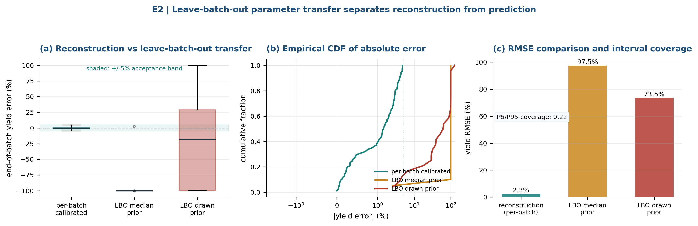

**Fig. 15 | Leave-batch-out parameter transfer (E2).** (a) Distributions of yield error under per-batch calibration and under two held-out priors, with the +/-5% acceptance band shaded; (b) empirical CDF of absolute error; (c) RMSE comparison with P5/P95 predictive-interval coverage annotated.

**Table 10.** Leave-batch-out parameter-transfer results (E2).

| Protocol | n | RMSE (%) | Bias (%) | within +/-5% | P5/P95 coverage |
|---|---|---|---|---|---|
| Per-batch calibration (reconstruction) | 86 | 2.3448 | -0.0662 | 86/86 | not applicable |
| Median prior from other folds | 20 | 97.47 | -94.87 | 1/20 | not applicable |
| Drawn prior from other folds | 24 | 73.53 | -21.84 | 3/24 | 2 of 9 |

The result is a boundary, not a failure of the model. Reconstruction consistency and conditional transferability are different questions; reporting the first as if it were the second would be exactly the category error diagnosed in Section 3.2. Here the median-prior transfer error is approximately 41.6 times the reconstruction error, and the median prior drives almost every held-out batch into the collapsed regime (bias -94.87%; only 1 of 20 batches remain within +/-5%). Per-batch calibration therefore does not generalise on this benchmark, and the strongest defensible statement is one of *conditional* transferability limited to the declared folds, priors and input trajectories, not a prospective prediction. The number now comes with an explicit hold-out protocol instead of a caveat in prose. The only other genuine hold-out evidence in the study is the five-fold channel-level cross-validation and the seed-transfer experiment that failed (Section 3.6); this asymmetry is itself informative.

Channel-level cross-validation separates channels that a soft sensor can deliver from channels that are structurally unavailable (Fig. S1, Fig. S2). Biomass improves from 24.58% to 2.28% median normalised RMSE (a 22.31 percentage-point gain), viscosity from 19.69% to 5.57% (+14.12 pp), and dissolved oxygen from 19.53% to 11.83% (+7.69 pp). In contrast, product degrades from 14.19% to 17.70% (-3.51 pp), PAA from 28.20% to 28.72% (-0.52 pp), and substrate remains at 214.59% because its "measurement" is a model reference rather than an assay, a circular comparison explicitly labelled as marginal rather than as a result. These are application examples of the observational-boundary argument and are retained in the Supplementary Material.

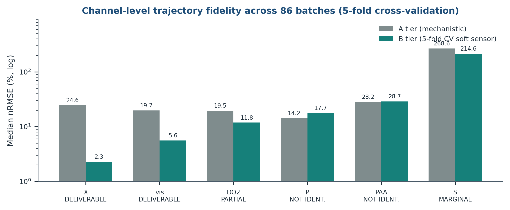

**Fig. S1 | Channel-level trajectory fidelity (supplementary).** Median normalised RMSE (log scale) for six channels, comparing the mechanistic output with a five-fold cross-validated soft sensor over 86 batches. Channels whose "measurement" is a model reference (substrate) or whose states are structurally unobservable (product, PAA) are flagged; a large numerical gain on a circular comparison is not treated as evidence.

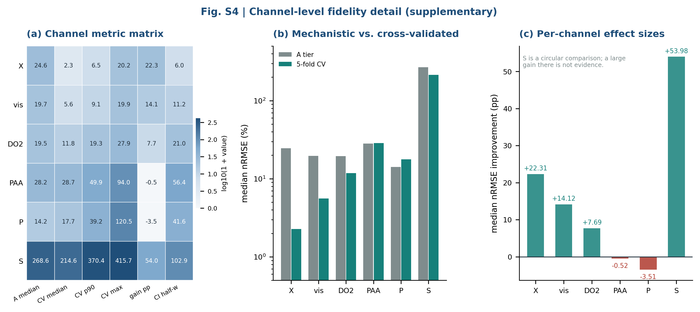

**Fig. S2 | Channel-level fidelity detail (supplementary).** (a) Six-channel metric matrix; (b) mechanistic versus cross-validated median normalised RMSE on a log scale; (c) per-channel effect sizes, with substrate labelled as a circular comparison.

### 3.6 Protocol synthesis: admission filter, physical consistency and remaining evidence

Physical consistency is the last of the numerical checks (Fig. 16; Table 11). Carbon closure is largely satisfied after correcting an omitted volume factor on the volumetric CER term; nitrogen closure depends on the metering convention, and the off-gas bias remains a declared limitation. No full elemental closure is claimed, and no new plant measurement is introduced.

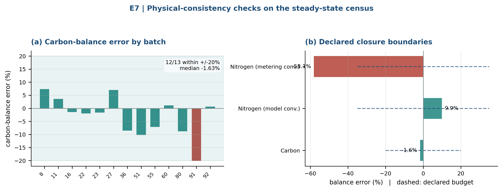

**Fig. 16 | Physical-consistency checks (E7).** (a) Carbon-balance error by batch with the +/-20% budget shaded; 12 of 13 batches are within budget (median -1.63%). (b) Declared closure boundaries: carbon, nitrogen under the model convention and nitrogen under the true metering convention, each against its budget. Simulated OUR and CER are approximately 12% high and are retained as a declared model bias.

**Table 11.** Physical-consistency outcomes (E7).

| Balance | Budget | Observed | Within budget |
|---|---|---|---|
| Carbon (13-batch steady-state census) | +/-20% | median -1.63%, range -20.11% to +7.35% | 12/13 |
| Nitrogen, model convention | +/-35% | +9.9% | yes |
| Nitrogen, true metering convention | +/-35% | -58.1% | no |
| Respiratory quotient from recorded inputs | exact | exact | yes |
| Simulated OUR / CER | - | approximately +12% bias | declared, not corrected |

Mapping the E5 matrix onto a two-stage decision gives the admission filter (Fig. 17; Table 12). Ten criteria and 129 gate checks across five families enter; four criteria are admitted after six rejections (four with a zero axis, one degenerate, one collinear), and the four recorded gate failures are retained rather than deleted. Rejected criteria are archived with their re-issue conditions, not averaged into a composite score (Belton and Stewart, 2002).

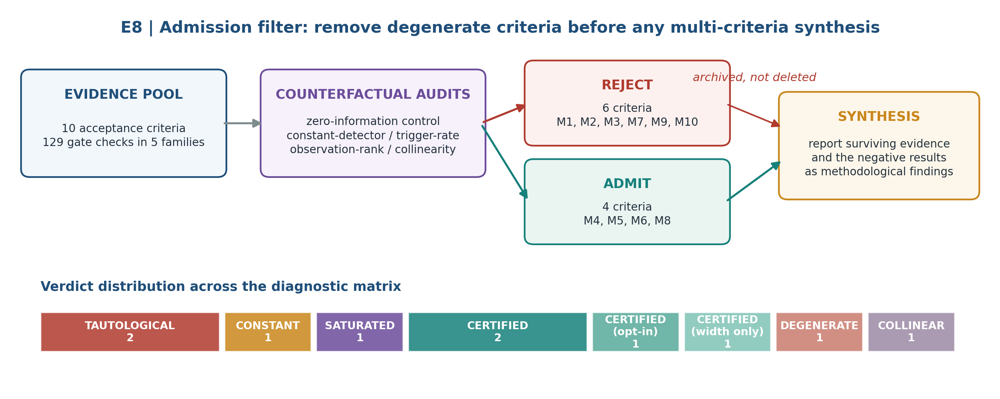

**Fig. 17 | Admission filter (E8).** Ten criteria are routed through the counterfactual audits; six are rejected with their reasons archived, and four are admitted to multi-criteria synthesis. The lower strip shows the verdict distribution across the diagnostic matrix.

**Table 12.** Admission filter: evidence set before and after.

| Stage | Instruments | Gate checks | Gate failures retained | Note |
|---|---|---|---|---|
| Before filtering | 10 | 129 across 5 families | 4 | all criteria treated as candidates |
| After filtering | 4 (M4, M5, M6, M8) | 129 | 4 | rejected criteria archived, not deleted |

Three opt-in candidates were evaluated against the two-sided gate; they are application examples rather than the core contribution, and the full detail is in the Supplementary Material. Channel-wise innovation thresholds passed 8/8 checks (11/20 injections detected, 0/20 controls, leave-one-out 5/5, confusion 10/5/4/1) and remained opt-in. Eight-path disturbance-variance injection produced a NO_GO verdict (18/20): at full amplitude the maximum deviation was 96.06 pp with 3 of 6 collapses, and a tuned scale of 0.35 that was feasible on the tuning seed produced 99.85 pp with 2 collapses on unseen seed 11 while remaining feasible on seed 23. The collapse is path-dependent rather than amplitude-dependent (Henderson et al., 2018; Strogatz, 1994); a scale that happens not to collapse on one seed is a seed-specific fit, not a physical calibration. A dual-constraint oxygen-transfer lookup passed 5/5 checks on 6 batches with a maximum deviation of 0.0143 pp but was confined to the evaluation layer because writing it back would alter the frozen anchor.

The surviving evidence is smaller but defensible: a five-channel health assessment resolving 77 normal, 5 degraded and 4 catastrophic batches; a channel-wise leave-one-out calibrated innovation detector kept opt-in; interval half-width and normalised-RMSE improvement rather than coverage; runtime import-and-callable verification; cross-validated biomass and viscosity soft sensors; an explicit-failure estimator chain; the physical-consistency census of Table 11; the solver, rank, transfer and discontinuity diagnostics of Sections 3.1–3.5; and the pre-registered NO_GO verdict. The supplementary figures collect the structural-boundary and collinearity detail, the seed-transfer failure, the gate matrix, the negative-result provenance and the multi-baseline fingerprints.

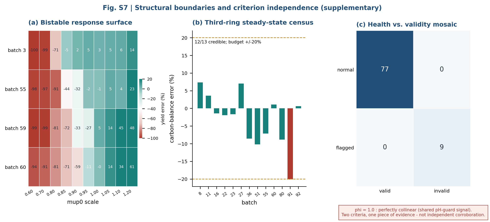

**Fig. S3 | Structural boundaries and criterion independence (supplementary).** (a) Four-batch by ten-scale bistable response surface; (b) carbon-balance error of the steady-state census (12 of 13 credible against a +/-20% budget); (c) health-versus-validity mosaic; the two criteria are perfectly collinear (phi = 1.0000) and are counted once.

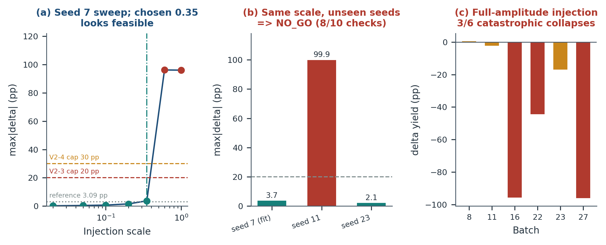

**Fig. S4 | The seed-transfer failure behind the NO_GO verdict (supplementary).** (a) Maximum deviation from the frozen baseline across the amplitude grid on tuning seed 7; dashed lines are the frozen 20 and 30 pp caps and the dotted line the 3.09 pp reference. (b) The same scale evaluated on two unseen seeds: seed 11 collapses (99.9 pp) while seed 23 does not (2.1 pp). (c) Per-batch yield deviation at full-amplitude injection.

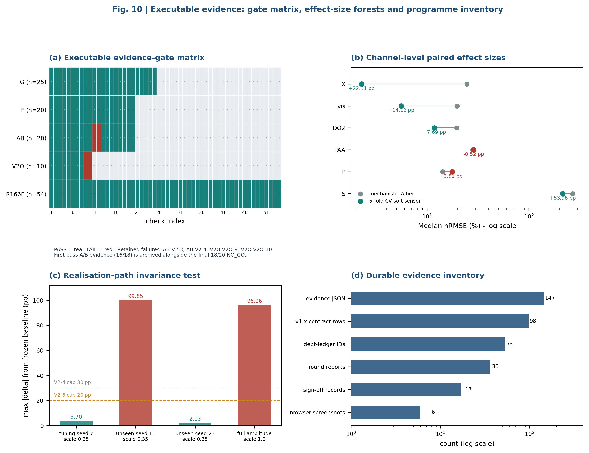

**Fig. S5 | Executable evidence inventory (supplementary).** (a) Five-family gate matrix with the two retained gate failures and two optimisation failures; (b) paired channel-level effect sizes; (c) realisation-path invariance test against the frozen 20 and 30 pp caps; (d) durable machine-readable evidence inventory on a logarithmic scale.

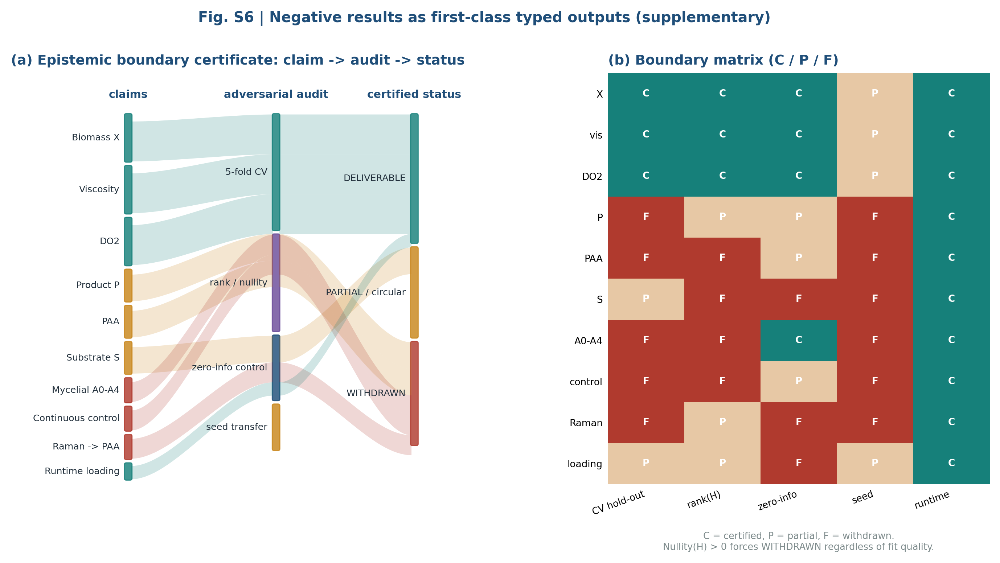

**Fig. S6 | Negative results as first-class typed outputs (supplementary).** (a) Alluvial diagram from ten candidate claims through four adversarial audits to three final statuses; (b) boundary matrix. Whenever the observation operator has a non-trivial null space, the withdrawn status is forced regardless of fit quality.

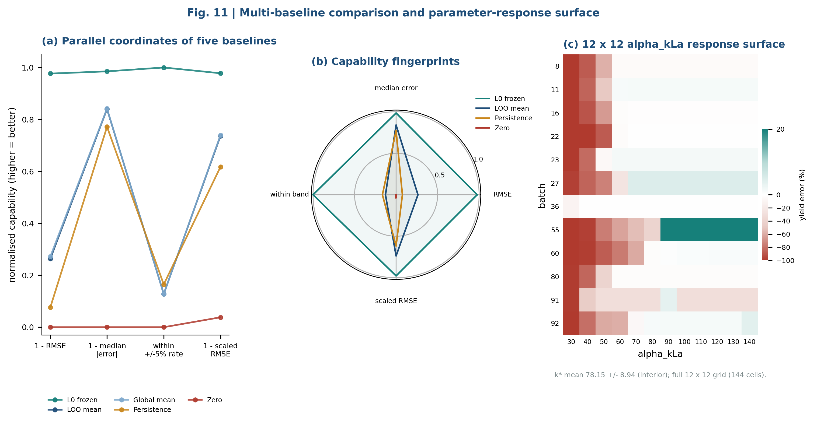

**Fig. S7 | Multi-baseline fingerprints and the parameter-response surface (supplementary).** (a) Parallel coordinates of five reference predictors on four normalised capability axes; (b) radar comparison; (c) 12 x 12 response surface of end-of-batch yield error over the oxygen transfer coefficient, showing contiguous collapsed and feasible regions rather than a smooth gradient.

---

## 4. Discussion

The recurring failure documented here was not numerical. The integrator was stable across four solver families (Section 3.1), the regression anchor was byte-identical, and the headline accuracy was excellent. What failed were the instruments of validation. The response is structural rather than rhetorical: every acceptance criterion should survive a zero-information control, a constant-detector test, a trigger-rate audit and, where relevant, a rank and collinearity test; every claim about a deployed capability should survive a runtime import-and-callable check; every threshold should be frozen before the experiment; and every failure should be archived rather than deleted. This is close in spirit to V&V formalism (Oberkampf and Trucano, 2002; Roy and Oberkampf, 2011; Sargent, 2013; Trucano et al., 2006), but it shifts the object of validation from the model to the entire claim-producing apparatus, including the reporting dashboard.

**Why the negative results are the contribution.** It is useful to distinguish two kinds of negative result. *Candidate failures* — a disturbance injection that collapses on an unseen seed, a dual-constraint lookup that cannot be written back — are specific to this model and are application examples. *Audit failures* — a tautological coverage statistic, a constant classifier, a saturated innovation test, an unobservable compartment subspace, a divergent finite-difference gradient — are statements about validation instruments and are portable. The latter are the methodological evidence of this paper. Recasting structural non-identifiability and discontinuous response as preconditions for identifiability analysis and gradient-based optimisation, rather than as unmet engineering milestones, is what makes them transferable to other process simulation models (Miao et al., 2011; Raue et al., 2009; Wieland et al., 2021). Preserving the rejected checks, the first-pass failures and the executable evidence alongside the manuscript follows established reproducibility and stewardship practice (Peng, 2011; Sandve et al., 2013; Wilkinson et al., 2016; Wilson et al., 2014).

**Why V&V frameworks alone are insufficient.** Existing V&V and uncertainty-quantification frameworks specify *that* validation must be falsifiable and *that* a domain of applicability must be declared. They rarely provide an executable test of whether a particular statistic is falsifiable, and they do not typically audit the classifiers and deployment checks that sit between a numerical result and a reported claim. The present protocol supplies that operational layer: a three-axis diagnostic card, an explicit list of adversarial controls and a rank-restoration procedure. It is complementary to, not a replacement for, formal V&V. Similarly, multi-criteria decision analysis offers principled aggregation once a set of valid criteria exists (Belton and Stewart, 2002); the admission filter of Section 3.6 is a *front end* to such aggregation, removing degenerate criteria before any weighting is chosen.

**Implications for process simulation practice.** Four reporting obligations follow. First, report the discriminative validity of every acceptance criterion, not only its value. A coverage of 0.90 is meaningless without the zero-information control that produced the same 0.90. Second, report solver sensitivity and parameter-uncertainty propagation alongside any scalar accuracy claim; Section 3.1 shows that the former is small here while the latter is not. Third, report observation rank and nullity for every state or parameter claimed as deliverable, and state that the conclusion is conditional on the measurement types actually available. Fourth, report reconstruction and transfer separately, with the hold-out protocol made explicit. The discontinuity result adds a fifth, narrower obligation: before computing finite-difference Jacobians, local sensitivities or gradient-based optima, check that the response surface admits a derivative; on this benchmark it does not.

**Candidate evaluation and model update adoption.** The four-stage workflow described in Section 2.7 separates three activities usually conflated: running a model, evaluating a change, and authorising that change to become the default. Ensemble and moving-horizon estimators, sparse system identification and interval calibration are all legitimate candidates (Brunton et al., 2016); the gate does not forbid them, it forbids their unexamined adoption. In this study one candidate passed its gate and still remained opt-in, one failed and was retained as a documented negative result, and one was confined to the evaluation layer. No model update was adopted. For a process engineering organisation this distinction between measuring an improvement and changing what downstream work relies on is the main practical deliverable.

**How this study can itself be refuted.** Four experiments would do so. (i) Apply the diagnostic battery to a second, independent process with genuinely held-out batches; if zero criteria were rejected there, the claim that non-discriminating metrics are a systemic risk would be weakened. (ii) Add compartment-resolved measurements, for example image-based morphology, so that observation nullity falls; if the compartment states then became estimable, the withdrawn claims were correctly conditional on H and would have to be reissued. (iii) Collect prospectively measured plant data and test whether the frozen anchor transfers without per-batch calibration; we predict that it will not, which is why no predictive accuracy is claimed. (iv) Re-run the numerical cross-checks against the deposited bundle; if they fail, the executable-evidence claim is false. Of these, (iii) is the most important and the most likely to change the conclusions.

**Limitations.** All 86 evaluation batches are simulated. The study contains no prospective plant trial, no wet-laboratory measurement and no regulated-environment qualification; results characterise a simulation benchmark and a validation protocol, not a deployed manufacturing model. Bit-exact reproduction of the original MATLAB simulator is unattainable because the reference implementation seeds its random number generator from the wall clock without recording the seed; zero regression means byte-identical reproduction of our own frozen Python baseline. Per-batch calibration limits the accuracy claim, and the transfer experiment of Section 3.5 uses a declared representative subset of held-out batches rather than a full 86-batch prospective evaluation. The Monte Carlo propagation is a screening diagnostic with six replicates per batch, not a converged variance decomposition. Identifiability conclusions are conditional on the observation operator. The discontinuity and solver conclusions are model-relative: they were measured on this model's response surfaces and do not prove that all industrial penicillin processes behave this way. The platform is a local research prototype, not hardened for regulated use. No opt-in candidate was adopted as the default, no frozen parameter table was rewritten, and no dual-baseline regime was introduced. The naive reference predictors have strictly less information than the simulation and bound the difficulty of the target series rather than rank methods. Only two of 86 batches carry a fault label, so the fault-versus-normal comparison is underpowered. The health and validity criteria are perfectly collinear and are counted once. Finally, the three-axis card is a diagnostic, not a proof of validity: a criterion that passes all three axes may still be wrong for reasons outside this battery.

> **Box 1. Minimum validation checklist for a process simulation model.**
> (1) Freeze the anchor: pin the default path and a regression statistic with tolerance zero. (2) Test the criteria: for every acceptance statistic run a zero-information control and reject it if it does not change; for every classifier check that its output distribution is non-degenerate. (3) Audit trigger rates: a detector firing on nearly all or nearly none of real data carries no information about anomalies. (4) Check solver sensitivity and propagate parameter uncertainty before quoting a scalar accuracy. (5) Separate reconstruction from prediction: state whether evaluation batches use their own calibrated parameters, and reserve hold-out or seed-transfer protocols for generalisation claims. (6) Compute observation rank and nullity for every claimed state, and withdraw claims for null-space directions. (7) Check that the response is differentiable before computing finite-difference sensitivities or running a gradient optimiser. (8) Gate candidates adversarially with two-sided controls, frozen thresholds, leave-one-out consistency, confusion tables and at least two unseen stochastic seeds. (9) Verify deployment at runtime: import and callable, not file existence. (10) Archive failures and keep model update adoption as a separate, explicit decision.

---

## 5. Conclusions

This study asked which validation criteria for a process simulation model survive once the non-discriminating ones are removed, and answered it by auditing the criteria themselves rather than only the model. On an 86-batch industrial-scale penicillin simulation benchmark, a frozen baseline achieved 2.3448% end-of-batch yield RMSE with all 86 batches within the pre-registered +/-5% band and byte-identical regression. Solver re-integration showed this number is not an artefact of the integrator, while parameter-uncertainty propagation and leave-batch-out transfer showed that it is a statement about reconstruction consistency rather than prospective prediction.

Four of ten acceptance criteria were structurally non-discriminating, and two more were removed by degeneracy and collinearity; the four survivors plus an admission filter form the defensible evidence set. Observation nullity 4 for the mycelial compartments was shown to be removable only by new measurement types, and a ~100 percentage-point response discontinuity was shown to invalidate finite-difference gradients and stall gradient-based optimisation. Negative results were retained as methodological evidence rather than omitted, and a pre-registered NO_GO verdict was produced for a disturbance injection whose tuned scale failed on an unseen seed.

The general conclusion is that credibility in process simulation is a property of the validation apparatus, not of the headline error. Accuracy is necessary; discriminative validity is what makes it meaningful; and the authority to adopt a model update is a separate decision altogether. The counterfactual protocol, the three-axis diagnostic card, the rank-restoration procedure, the admission filter and the ten-item checklist of Box 1 are offered as a portable discipline for process simulation practice. Future work should apply the battery to a second independent process and, ultimately, to prospectively collected plant data with compartment-resolved measurements — the two additions that would genuinely change the observation operator and the scope of every claim made here.

---

## CRediT authorship contribution statement

[to be completed before submission.]

## Declaration of competing interest

The authors declare that they have no known competing financial interests or personal relationships that could have appeared to influence the work reported in this paper.

## Data availability

The IndPenSim dataset is publicly available from its original publication (Goldrick et al., 2015). The model port, calibrated parameter tables, machine-readable evidence artefacts, audit scripts and figure-generation code supporting the conclusions of this article will be deposited in a public repository (e.g. Zenodo) with a digital object identifier upon acceptance; the released IndPenSim data remain subject to the terms stated by their original authors.

## Acknowledgements

[to be completed before submission.]

---

## References

Bajpai RK, Reuss M. A mechanistic model for penicillin production. *Journal of Chemical Technology and Biotechnology*. 1980;30(1):332-344.

Baker M. 1,500 scientists lift the lid on reproducibility. *Nature*. 2016;533(7604):452-454.

Bellman R, Astrom KJ. On structural identifiability. *Mathematical Biosciences*. 1970;7(3-4):329-339.

Belton V, Stewart TJ. *Multiple Criteria Decision Analysis: An Integrated Approach*. Kluwer Academic Publishers; 2002.

Birol G, Undey C, Cinar A. A modular simulation package for fed-batch fermentation: penicillin production. *Computers & Chemical Engineering*. 2002;26(11):1553-1565. doi:10.1016/S0098-1354(02)00127-8.

Bland JM, Altman DG. Statistical methods for assessing agreement between two methods of clinical measurement. *The Lancet*. 1986;327(8476):307-310. doi:10.1016/S0140-6736(86)90837-8.

Brunton SL, Proctor JL, Kutz JN. Discovering governing equations from data by sparse identification of nonlinear dynamical systems. *Proceedings of the National Academy of Sciences*. 2016;113(15):3932-3937. doi:10.1073/pnas.1517384113.

D'Amour A, Heller K, Moldovan D, Adlam B, Alipanahi B, Beutel A, et al. Underspecification presents challenges for credibility in modern machine learning. *Journal of Machine Learning Research*. 2022;23(226):1-61.

Efron B, Tibshirani RJ. *An Introduction to the Bootstrap*. Chapman & Hall; 1993.

Evensen G. The Ensemble Kalman Filter: theoretical formulation and practical implementation. *Ocean Dynamics*. 2003;53(4):343-367.

Fanelli D. Negative results are disappearing from most disciplines and countries. *Scientometrics*. 2012;90(3):891-904.

Goldrick S, Stefan A, Lovett D, Montague G, Lennox B. The development of an industrial-scale fed-batch fermentation simulation. *Journal of Biotechnology*. 2015;193:70-82. doi:10.1016/j.jbiotec.2014.10.029.

Goldrick S, Duran-Villalobos CA, Jankauskas K, Lovett D, Farid SS, Lennox B. Modern day monitoring and control challenges outlined on an industrial-scale benchmark fermentation process. *Computers & Chemical Engineering*. 2019;130:106471. doi:10.1016/j.compchemeng.2019.05.037.

Hairer E, Wanner G. *Solving Ordinary Differential Equations II: Stiff and Differential-Algebraic Problems*. 2nd ed. Springer; 1996.

Harris CR, Millman KJ, van der Walt SJ, Gommers R, Virtanen P, Cournapeau D, et al. Array programming with NumPy. *Nature*. 2020;585(7825):357-362.

Henderson P, Islam R, Bachman P, Pineau J, Precup D, Meger D. Deep reinforcement learning that matters. *Proceedings of the AAAI Conference on Artificial Intelligence*. 2018;32(1). doi:10.1609/aaai.v32i1.11694.

Hindmarsh AC, Brown PN, Grant KE, Lee SL, Serban R, Shumaker DE, Woodward CS. SUNDIALS: suite of nonlinear and differential/algebraic equation solvers. *ACM Transactions on Mathematical Software*. 2005;31(3):363-396.

Hunter JD. Matplotlib: a 2D graphics environment. *Computing in Science & Engineering*. 2007;9(3):90-95.

Ioannidis JPA. Why most published research findings are false. *PLoS Medicine*. 2005;2(8):e124.

Kapoor S, Narayanan A. Leakage and the reproducibility crisis in machine-learning-based science. *Patterns*. 2023;4(9):100804. doi:10.1016/j.patter.2023.100804.

Mann HB, Whitney DR. On a test of whether one of two random variables is stochastically larger than the other. *Annals of Mathematical Statistics*. 1947;18(1):50-60.

McKinney W. Data structures for statistical computing in Python. *Proceedings of the 9th Python in Science Conference*. 2010:51-56.

Miao H, Xia X, Perelson AS, Wu H. On identifiability of nonlinear ODE models and applications in viral dynamics. *SIAM Review*. 2011;53(1):3-39.

Morris MD. Factorial sampling plans for preliminary computational experiments. *Technometrics*. 1991;33(2):161-174.

Oberkampf WL, Trucano TG. Verification and validation in computational fluid dynamics. *Progress in Aerospace Sciences*. 2002;38(3):209-272.

Open Science Collaboration. Estimating the reproducibility of psychological science. *Science*. 2015;349(6251):aac4716.

Peng RD. Reproducible research in computational science. *Science*. 2011;334(6060):1226-1227.

Pineau J, Vincent-Lamarre P, Sinha K, Lariviere V, Beygelzimer A, d'Alche-Buc F, Fox E, Larochelle H. Improving reproducibility in machine learning research (a report from the NeurIPS 2019 reproducibility program). *Journal of Machine Learning Research*. 2021;22(164):1-20.

Rao CV, Rawlings JB, Mayne DQ. Constrained state estimation for nonlinear discrete-time systems: stability and moving horizon approximations. *IEEE Transactions on Automatic Control*. 2003;48(1):97-108.

Raue A, Kreutz C, Maiwald T, Bachmann J, Schilling M, Klingmuller U, Timmer J. Structural and practical identifiability analysis of partially observed dynamical models by exploiting the profile likelihood. *Bioinformatics*. 2009;25(15):1923-1929. doi:10.1093/bioinformatics/btp358.

Roy CJ, Oberkampf WL. A comprehensive framework for verification, validation, and uncertainty quantification in scientific computing. *Computer Methods in Applied Mechanics and Engineering*. 2011;200(25-28):2131-2144.

Saltelli A, Ratto M, Andres T, Campolongo F, Cariboni J, Gatelli D, Saisana M, Tarantola S. *Global Sensitivity Analysis: The Primer*. Wiley; 2008.

Saltzer JH, Schroeder MD. The protection of information in computer systems. *Proceedings of the IEEE*. 1975;63(9):1278-1308.

Sandve GK, Nekrutenko A, Taylor J, Hovig E. Ten simple rules for reproducible computational research. *PLoS Computational Biology*. 2013;9(10):e1003285.

Sargent RG. Verification and validation of simulation models. *Journal of Simulation*. 2013;7(1):12-24.

Sculley D, Holt G, Golovin D, Davydov E, Phillips T, Ebner D, et al. Hidden technical debt in machine learning systems. *Advances in Neural Information Processing Systems*. 2015;28:2503-2511.

Shampine LF, Reichelt MW. The MATLAB ODE suite. *SIAM Journal on Scientific Computing*. 1997;18(1):1-22.

Shannon CE. A mathematical theory of communication. *Bell System Technical Journal*. 1948;27(3):379-423; 27(4):623-656.

Shapiro SS, Wilk MB. An analysis of variance test for normality (complete samples). *Biometrika*. 1965;52(3-4):591-611. doi:10.1093/biomet/52.3-4.591.

Sobol IM. Global sensitivity indices for nonlinear mathematical models and their Monte Carlo estimates. *Mathematics and Computers in Simulation*. 2001;55(1-3):271-280.

Strogatz SH. *Nonlinear Dynamics and Chaos: With Applications to Physics, Biology, Chemistry, and Engineering*. Westview Press; 1994.

Trucano TG, Swiler LP, Igusa T, Oberkampf WL, Pilch M. Calibration, validation, and sensitivity analysis: what's what. *Reliability Engineering & System Safety*. 2006;91(10-11):1331-1357.

Virtanen P, Gommers R, Oliphant TE, Haberland M, Reddy T, Cournapeau D, et al. SciPy 1.0: fundamental algorithms for scientific computing in Python. *Nature Methods*. 2020;17(3):261-272.

Wald A, Wolfowitz J. On a test whether two samples are from the same population. *Annals of Mathematical Statistics*. 1940;11(2):147-162.

Wieland FG, Hauber AL, Rosenblatt M, Tonsing C, Timmer J. On structural and practical identifiability. *Current Opinion in Systems Biology*. 2021;25:60-69.

Wilkinson MD, Dumontier M, Aalbersberg IJ, Appleton G, Axton M, Baak A, et al. The FAIR Guiding Principles for scientific data management and stewardship. *Scientific Data*. 2016;3:160018. doi:10.1038/sdata.2016.18.

Wilson EB. Probable inference, the law of succession, and statistical inference. *Journal of the American Statistical Association*. 1927;22(158):209-212.

Wilson G, Aruliah DA, Brown CT, Chue Hong NP, Davis M, Guy RT, et al. Best practices for scientific computing. *PLoS Biology*. 2014;12(1):e1001745.

Youden WJ. Index for rating diagnostic tests. *Cancer*. 1950;3(1):32-35.
